# UniFi Management CLI - Architecture Overview

**Document version**: 1.2
**Last updated**: 2026-06-03
**Codebase root**: `src/unifi_mapper/`

> **See also**: [C4 Architecture](c4-architecture.md) | [Codebase Map](codemap.md) | [Use Cases](../guides/use-cases-and-howto.md) | [Troubleshooting](../operations/troubleshooting-and-runbook.md)

---

## Table of Contents

1. [System Overview](#1-system-overview)
2. [Layered Architecture](#2-layered-architecture)
3. [Layer 1: User Interface](#3-layer-1-user-interface)
4. [Layer 2: Intelligence](#4-layer-2-intelligence)
5. [Layer 3: API Integration](#5-layer-3-api-integration)
6. [Layer 4: Analysis Toolkit](#6-layer-4-analysis-toolkit)
7. [Layer 5: Network Control Plane](#7-layer-5-network-control-plane)
8. [Layer 6: Protect Integration](#8-layer-6-protect-integration)
9. [Layer 7: Core Domain](#9-layer-7-core-domain)
10. [Layer 8: SSH Integration](#10-layer-8-ssh-integration)
11. [Layer 9: Scheduling and Automation](#11-layer-9-scheduling-and-automation)
12. [Design Patterns](#12-design-patterns)
13. [Key Workflows (Sequence Diagrams)](#13-key-workflows-sequence-diagrams)
14. [Module Dependency Graph](#14-module-dependency-graph)
15. [External Interfaces](#15-external-interfaces)
16. [Configuration and Credential Management](#16-configuration-and-credential-management)

---

## 1. System Overview

The UniFi Management CLI is an enterprise-grade Python automation platform for managing UniFi networks. It solves three distinct operational problems:

- **Topology discovery and port naming**: LLDP/client-driven desired-state port labelling. Connected ports reflect discovered devices; disconnected ports are reset to `Port x`.
- **Network diagnostics**: 40+ analysis and diagnostic tools covering IP conflicts, STP, VLANs, QoS, performance, security, DHCP pools, PoE budgets, client density, uplink redundancy, latency, radio configuration, roaming, and configuration drift.
- **AI-assisted troubleshooting**: An MCP server exposing the full tool surface to Claude and other AI agents for natural-language network operations.

The platform is delivered as three CLI entry points plus an MCP server, all installed from a single Python package:

| Entry point | Module | Framework |
| --- | --- | --- |
| `unifi-mapper` | `typer_cli.py` | Typer + Rich |
| `unifi-network-toolkit` | `network_cli.py` | argparse |
| `unifi-inventory` | `inventory_cli.py` | Typer (the `inventory` subapp run on its own) |
| `unifi-mcp` | `mcp/server.py` | FastMCP |

---

## 2. Layered Architecture

The system is organised into nine layers. Dependencies flow strictly downward; the only upward flow is return values and events.

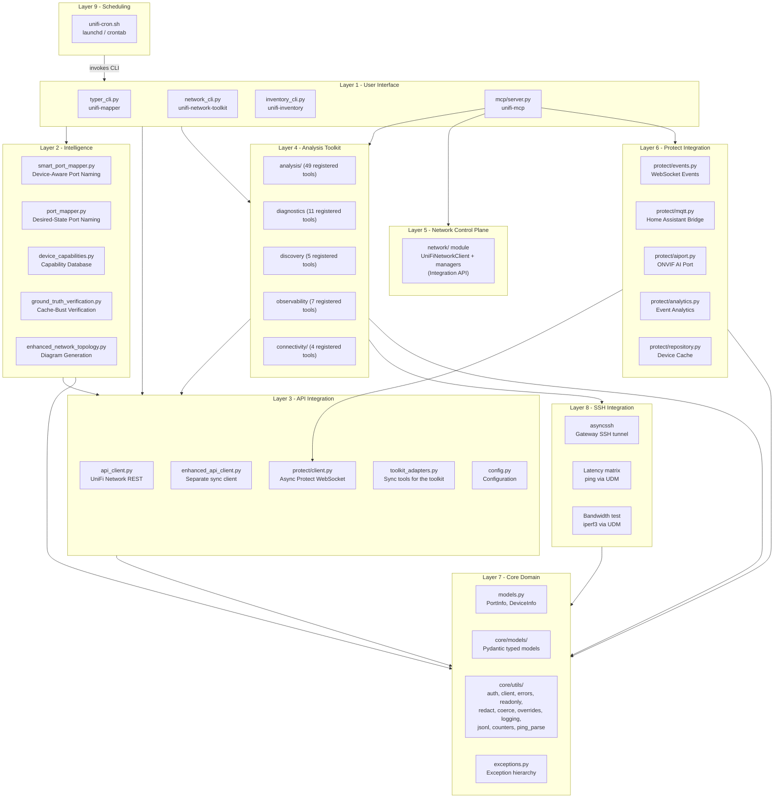

---

## 3. Layer 1: User Interface

### Component diagram

```mermaid
graph LR
    subgraph typer_cli["typer_cli.py - unifi-mapper"]
        APP["app: Typer\n(root)"]
        CMD_DISCOVER["discover\nLLDP topology + port naming"]
        CMD_FIND["find\nDevice / IP / MAC / client"]
        CMD_ANALYZE["analyze\nLink quality / VLANs / STP / QoS\nlink-errors / roaming / config-drift / neighbours"]
        CMD_DIAGNOSE["diagnose\nHealth / perf / connectivity\nall / latency-matrix / bandwidth\ndevice-stats / ap-retries\nwan / wan-history"]
        CMD_PORTS["ports\nPort labels and read-only\nport diagnostics"]
        CMD_CTRL["controller\nconfig / config-changes / events"]
        CMD_BACKUP["backup\nverify (offline)"]
        CMD_GATEWAY["gateway\nping / traceroute / dns\nhttp / flows (SSH)"]
        CMD_VLAN["vlan-traffic\nsample (SSH) / rollup\nreport / coverage"]
        CMD_STP["stp\nSTP topology and optimization"]
        CMD_RADIO["radio\nsnapshot / optimize / restore\nauto-channel / report"]
        CMD_INV["inventory\nDevice management"]
        CMD_VFY["verify\nPort update verification"]
        CMD_DIAG["diagram\nGraphviz png / svg / html"]
        CMD_CAP["capabilities\nDevice capability report"]
    end

    subgraph network_cli["network_cli.py - unifi-network-toolkit"]
        NC_MAIN["main() argparse"]
        NC_DISC["discover"]
        NC_AN["analyze"]
        NC_FIND["find"]
        NC_DIAG["diagnose"]
    end

    subgraph mcp_server["mcp/server.py - unifi-mcp"]
        MCP_SEARCH["search_tools()"]
        MCP_LIST["list_categories()"]
        MCP_INFO["get_tool_info()"]
        MCP_EXEC["execute_tool()"]
        RUNNER["ToolRunner\nvalidate, gate, mask"]
        REGISTRY["ToolRegistry\nYAML manifests"]
    end

    subgraph cli_shared["cli.py - shared entry point"]
        XDG["get_default_config_path()\nXDG Base Dir"]
        LOAD["load_env_from_config()"]
    end

    APP --> CMD_DISCOVER
    APP --> CMD_FIND
    APP --> CMD_ANALYZE
    APP --> CMD_DIAGNOSE
    APP --> CMD_PORTS
    APP --> CMD_CTRL
    APP --> CMD_BACKUP
    APP --> CMD_GATEWAY
    APP --> CMD_VLAN
    APP --> CMD_STP
    APP --> CMD_RADIO
    APP --> CMD_INV
    APP --> CMD_VFY
    APP --> CMD_DIAG
    APP --> CMD_CAP

    cli_shared --> typer_cli
    cli_shared --> network_cli

    MCP_SEARCH --> REGISTRY
    MCP_LIST --> REGISTRY
    MCP_INFO --> REGISTRY
    MCP_EXEC --> RUNNER
    RUNNER --> REGISTRY
```

### typer_cli.py

The primary CLI, `unifi-mapper`, is built with [Typer](https://typer.tiangolo.com/) and uses Rich for terminal output. All subcommands share a `State` singleton for the config path and debug flag:

```python
class State:
    """Global CLI state."""
    config_path: Optional[Path] = None
    debug: bool = False

state = State()

app = typer.Typer(
    name="unifi-mapper",
    rich_markup_mode="rich",
    invoke_without_command=True,
)
```

The root callback intercepts `--connected-devices`, `--dry-run`, and `--verify-updates` flags so users can invoke the discover workflow without explicitly naming the subcommand.

### cli.py (shared entry point)

`cli.py` is the shared foundation consumed by `typer_cli.py` and `inventory_cli.py` (and, for `load_env_from_config`, `network_cli.py`). It provides:

- **XDG Base Directory resolution** for config files — `get_default_config_path()` tries `prod.env`, then `default.env`, in `$XDG_CONFIG_HOME/unifi_management_cli/` (or `~/.config/unifi_management_cli/` when `XDG_CONFIG_HOME` is unset), then falls back to `.env` in the current directory. `--config` or `UNIFI_CONFIG` comes first ([section 16](#16-configuration-and-credential-management)).
- **`load_env_from_config(path)`** — reads a `.env` file and injects each key-value pair into `os.environ`.

### MCP Server (mcp/server.py)

The `unifi-mcp` server is built on the FastMCP bundled with the official MCP Python SDK (`mcp>=1.30,<1.31`). It exposes four public meta-tools that implement the Code Mode pattern (see [Section 12](#12-design-patterns)):

| Tool | Purpose |
| --- | --- |
| `search_tools` | Discover tools by query, category, or tag |
| `list_categories` | Enumerate all category groups |
| `get_tool_info` | Fetch the parameters, JSON input/output schemas and annotations for a named tool |
| `execute_tool` | Run a read-only catalog tool by name; mutating tools are refused with `MUTATION_REFUSED` |

With `--surface direct` (or `UNIFI_MCP_TOOL_SURFACE=direct`) the server also lists the 73 non-mutating, non-pipeline catalog tools directly. The server holds no domain logic. Its modules:

| Module | Responsibility |
| --- | --- |
| `mcp/server.py` | `main()` (`--version`, `--help`, `--surface`, `--config`, `--check`), the meta-tools, the lifespan, `create_server(surface)`, the `unifi://catalog` and `unifi://config/status` resources and two prompts |
| `mcp/config.py` | CWD-independent config discovery (`--config`, `UNIFI_CONFIG`, XDG, `~/.config`, legacy), per-family loading (`controller`, `network_api`, `protect`), the bounded Keychain/1Password pre-check and the `UNIFI_MCP_*` settings |
| `mcp/registry.py` | `ToolRegistry`: validates and loads the YAML manifests (a bad file or entry is skipped and logged), search and metadata |
| `mcp/catalog.py` | `ToolCatalog`: builds SDK tools (input/output schemas, titles, annotations) lazily; never builds mutating tools |
| `mcp/runner.py` | `ToolRunner`: the one call path for `execute_tool` and direct tools: mutation gate, signature validation, credential gate, concurrency cap and optional deadline, error codes, secret masking (`core/utils/redact.py`), `isError: true` on failure, then one call-log line |
| `mcp/call_audit.py` | The default-on call log (`UNIFI_MCP_CALL_AUDIT`): one JSON line per catalog call in `$XDG_STATE_HOME/unifi_mapper/mcp-audit.jsonl` with the tool, its parameter names only, the duration and the outcome, never a value; the guards' request lines join it with `UNIFI_MCP_REQUEST_AUDIT=on`; capped at 16 MiB |

The lifespan resolves config once, installs one `SharedControllerClient` (from `core/utils/client.py`) behind a read-only HTTP transport, so a server process logs in to the controller once and every async tool borrows that session, and points `sys.stdout` at stderr so stray prints can't corrupt JSON-RPC. See the [MCP server guide](../mcp-server/MCP_SERVER_GUIDE.md) for launch modes and client configuration.

### New CLI command groups (v1.1)

**`radio` subcommand group** — manages Wi-Fi radio configuration with reversible operations:

| Command | Module | Purpose |
| --- | --- | --- |
| `radio snapshot` | `analysis/radio_config.py` | Backup current AP radio settings to JSON |
| `radio optimize` | `analysis/radio_config.py` | Preview optimised radio settings; `--apply` writes them (auto-snapshots first) |
| `radio restore` | `analysis/radio_config.py` | Preview restoring a radio snapshot; `--apply` writes it |
| `radio auto-channel` | `analysis/channel_optimiser.py` | Utilization-weighted channel assignment (previews unless `--apply`) |
| `radio report` | `analysis/channel_optimiser.py` | Generate markdown radio optimisation report |

**New `diagnose` commands** — comprehensive diagnostics runner and gateway-level tools:

| Command | Module | Purpose |
| --- | --- | --- |
| `diagnose all` | 15 checks across the analysis modules ([13.5](#135-comprehensive-diagnostics-runner-flow)) | Run all checks with pass/warn/fail summary table |
| `diagnose latency-matrix` | `analysis/latency_matrix.py` | SSH to UDM, ping all device/client IPs |
| `diagnose bandwidth` | `analysis/bandwidth_test.py` | iperf3 throughput test via SSH to gateway |
| `diagnose wan` | `diagnostics/wan_health.py`, `diagnostics/wan_history.py` | WAN health and the last scheduled speedtest; `--record` appends it to the history |
| `diagnose wan-history` | `diagnostics/wan_history.py` | The recorded speedtest results (reads a local file only) |
| `diagnose device-stats` | `diagnostics/observability.py` | One device's CPU, memory, load, uptime, radios and per-VAP counters |
| `diagnose ap-retries` | `diagnostics/observability.py` | Every AP's per-VAP TX retry rate over an interval (two reads) |
| `diagnose ap-health` | `analysis/ap_health.py` | One AP's 2.4 GHz counters sampled 1-60 times, 30-600 s apart, beside a reference AP; a markdown or JSON report (CLI only; `--ping-clients` pings up to 4 of each AP's wireless clients over SSH, those on 2.4 GHz and those with no radio reported; a failed read or ping is recorded, never fatal; Ctrl-C ends with a partial report, exit 130, a failure that ends the run with one, exit 1) |
| `diagnose client-connectivity` | `diagnostics/client_connectivity.py` | One client: lookup, AP counters, then gateway ping, DNS, HTTP from its VLAN and flows over SSH; each layer bounded, 120 s in all (CLI only) |

**`controller` subcommand group** — the controller's raw config objects and site-wide event
history, read-only: `config` and `config-changes` through the same guarded client as the MCP
observability tools, `events` through the sync client behind `ReadOnlySession`:

| Command | Module | Purpose |
| --- | --- | --- |
| `controller config` | `diagnostics/observability.py` | The config objects of one kind, every secret key removed |
| `controller config-changes` | `diagnostics/observability.py` | Objects created in a window, newest first, from each object's ID |
| `controller events` | `port_history.py` (`collect_recent_events`) | Site-wide events, alarms and system-log entries in the last N hours |

**`backup` subcommand group** — `backup verify` (`backup/verify.py`) checks a downloaded `.unf`
backup offline: decrypt, extract and decompress (each capped at 1 GiB, the database at 64 gzip
members) and per-collection document counts, never document contents; it contacts nothing.

**New `stp audit-priorities` command** (`analysis/stp_audit.py`) — a one-shot,
read-only priority audit: each switch's current against its recommended priority, a warning
when non-core switches tie at the lowest priority, and the gateway under "Skipped". It always
tiers the whole fleet (`--device` narrows the rows and the verdict, and keeps the fleet's as
`fleet_compliant` and `fleet_summary`) and writes no plan; `stp optimize
--plan` does.

**New `gateway` command group** (`connectivity/gateway_probe.py`) — live probes run on the
gateway over SSH, CLI only (no MCP tool, decision D1 in issue 060): `gateway ping`,
`traceroute`, `dns`, `http` and `flows`. Each opens one session and runs one argv with its own
bound through `analysis/gateway_ssh.py`; a device or client name resolves to its address
through the read-only controller client (exact names, hostnames, MACs and IPs across devices and
clients first, then a unique partial name; the rule `diagnose client-connectivity` shares), and
`http --vlan` to the interface whose address is in that VLAN's subnet
(`analysis/vlan_interfaces.py`).

**New `vlan-traffic` command group** (`analysis/vlan_traffic.py`, `analysis/vlan_traffic_store.py`)
— per-VLAN throughput history. `sample` (SSH, CLI only) reads the controller's network list and
runs one fixed script on the gateway, then stores a row per VLAN in a SQLite store under the XDG
state directory (`vlan-traffic.sqlite3`, never the working directory; `--db` names another);
a script that fails on the gateway, or a run that stores nothing, exits 1;
`rollup`, `report PERIOD` and `coverage` work on the store alone (`now`, `1d` and `1w` read raw
samples, `1m` and `1y` the hourly and daily rows `rollup` writes for every complete hour and
day; issue 069 records why July's tiers were replaced). The MCP tools
`get_vlan_traffic_report` and `list_vlan_traffic_periods` read the default store read-only in a
worker thread, with no credentials; nothing over MCP starts a sample (decision D1 in issue 060),
and no schedule is published until issue 038 is decided.

**New `analyze` commands** — time-series analysis with snapshot/compare pattern:

| Command | Module | Purpose |
| --- | --- | --- |
| `analyze link-errors` | `analysis/link_error_tracking.py`, `analysis/counter_history.py` | Baseline snapshot, counter history + delta comparison |
| `analyze roaming` | `analysis/roaming_analysis.py` | Client-to-AP association tracking |
| `analyze config-drift` | `analysis/config_drift.py` | Device config snapshot + diff |
| `analyze neighbours` | `analysis/neighbour_scan.py` | RF spectrum scan for external networks |

---

## 4. Layer 2: Intelligence

This layer contains the domain-specific reasoning that goes beyond raw API calls: understanding device limitations, verifying API responses, building topology graphs.

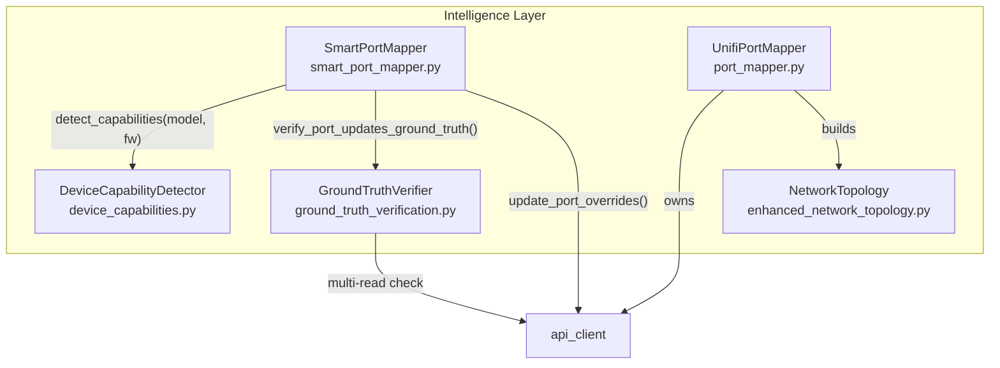

### Port naming components

Port naming is split across `run_methods.py`, `port_mapper.py`, and `api_client.py`:

- `run_methods._choose_port_name()` selects a desired name for every physical router/switch port: useful LLDP name, client name, useful active current name, or `Port x` for disconnected/default ports.
- `UnifiPortMapper.batch_update_port_names()` batches per-device changes and triggers force-provisioning after a successful write.
- `UnifiApiClient.update_port_names()` persists changes by merging names into `port_overrides`, the writable UniFi configuration field.

`SmartPortMapper` remains the device-aware orchestration class for capability-sensitive LLDP-driven naming. It:

1. Calls `DeviceCapabilityDetector` to determine whether a device supports port naming at all.
2. Constructs port name proposals from LLDP data.
3. Applies updates via the API client using the correct write field (`port_overrides`, not `port_table`).
4. Optionally calls `GroundTruthVerifier` to confirm persistence.

```python
class SmartPortMapper:
    def __init__(self, api_client):
        self.api_client = api_client
        self.capability_detector = DeviceCapabilityDetector()

    def smart_update_ports(
        self,
        devices_data: List[Dict],
        lldp_data: Dict[str, Dict],
        verify_updates: bool = True,
        dry_run: bool = False,
    ) -> Dict[str, Any]:
        ...
```

### device_capabilities.py

Encodes community-researched knowledge about UniFi device firmware quirks into a structured capability database:

```python
class PortNamingSupport(Enum):
    FULL_SUPPORT = "full"
    UI_ONLY = "ui_only"
    LIMITED = "limited"
    RESETS_AUTOMATICALLY = "resets"
    NOT_SUPPORTED = "none"

@dataclass
class DeviceCapability:
    model: str
    firmware_version: str
    port_naming_support: PortNamingSupport
    known_issues: List[str]
    workarounds: List[str]
    api_endpoint_restrictions: List[str]
    max_port_name_length: Optional[int] = 32
    supports_port_profiles: bool = True
```

Known device issues are keyed by `(model_code, firmware_version)` tuples. A wildcard `"*"` firmware matches all versions. This allows the system to skip unsafe operations (e.g., firmware 7.2.123 on US-8-60W automatically resets port profiles and cycles PoE ports).

### ground_truth_verification.py

The UniFi API caches device state aggressively. After a port-override write, the API may return the old value for several seconds or indefinitely. `GroundTruthVerifier` addresses this with two strategies:

**Strategy 1: Multi-read consistency check**
Reads the same port name N times with configurable delays, adding cache-busting HTTP headers on each request. Consistency across reads (all N reads agree on the new value) is used as the verification signal.

**Strategy 2: Browser verification (optional)**
Uses browser automation against the UniFi controller UI, which reads directly from the controller's internal state rather than the cached API layer. This requires credentials and is opt-in.

```python
def _multi_read_consistency_check(
    self, device_id, port_idx, expected_name,
    num_reads=5, delay_between_reads=2.0
) -> Dict[str, Any]:
    # Cache-busting headers added per read:
    self.api_client.session.headers.update({
        "Cache-Control": "no-cache, no-store, must-revalidate",
        "X-Cache-Bust": str(int(time.time() * 1000)),
    })
```

### enhanced_network_topology.py

Wraps `DeviceInfo` and `PortInfo` objects into a graph. PNG and SVG render through Graphviz from the DOT source `_generate_dot_source()` builds, and HTML is an interactive diagram. `generate_dot_diagram` and `generate_mermaid_diagram` write a one-line placeholder, not a diagram ([issue 044](../issues/044-discover-mermaid-and-dot-write-a-placeholder.md)). `network_topology.py` is a thin re-export shim so existing code imports continue to work without modification.

---

## 5. Layer 3: API Integration

### API layer components

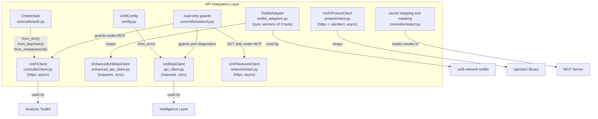

### UnifiApiClient (api_client.py)

The primary synchronous client for the UniFi Network REST API.

**Dual endpoint detection**: The client probes both the UniFi OS path (`/proxy/network/api/...`) and the legacy path (`/api/...`) during login, storing the working endpoint for subsequent requests.

**Authentication strategies**:

| Strategy | HTTP mechanism | Preferred for |
| --- | --- | --- |
| API token | `X-API-KEY` header | UniFi OS (UDM, UDR, UDM SE) |
| Username + password | Session cookie (POST `/api/login`) | Legacy controllers |

**Retry with exponential backoff**: The `_retry_request()` method wraps every outbound call. It respects the retryable vs permanent distinction in the exception hierarchy — authentication failures (401/403) and other 4xx errors are not retried; server errors (5xx), 408 and 429 responses, timeouts, and connection failures are retried up to `max_retries` with `delay * 2^attempt` spacing. Callers keep the defaults (3 attempts, 1.0 s); `UnifiConfig`'s retry settings never reach the client ([issue 042](../issues/042-settings-with-no-effect.md)).

```python
def _retry_request(self, func, *args, **kwargs):
    for attempt in range(self.max_retries):
        try:
            return func(*args, **kwargs)
        except Timeout as e:
            delay = self.retry_delay * (2 ** attempt)
            time.sleep(delay)
        except HTTPError as e:
            if e.response.status_code in [401, 403]:
                raise UniFiAuthenticationError(...)  # No retry
            ...
```

**Input checks and logging**: The constructor checks the base URL and clamps the timeout and retry arguments. `_hash_for_verification()` keeps a short SHA-256 hash of each credential next to the raw value, and `_sanitize_for_logging()` shortens the controller URL in the start-up log line. Masking secret values in MCP results and CLI error text is `core/utils/redact.py`'s job.

### EnhancedUnifiApiClient (enhanced_api_client.py)

A separate synchronous `requests` client (it does not subclass `UnifiApiClient`) with port-override updates followed by `force-provision`, per-port verification, and `meta.rc` checks on `200` responses. `unifi-network-toolkit` uses it, through `ToolkitAdapter`.

### UniFiProtectClient (protect/client.py)

A fully async wrapper around the `uiprotect` library's `ProtectApiClient`. Manages:

- A `ConnectionState` finite state machine: `DISCONNECTED → CONNECTING → CONNECTED ⇄ RECONNECTING → ERROR`.
- Context manager lifecycle (`__aenter__` / `__aexit__`) for clean resource management.
- WebSocket subscription plumbing for real-time event delivery.
- Typed property accessors for all Protect device types: cameras, AI ports, sensors, lights, chimes, door locks.

```python
async with UniFiProtectClient(config) as client:
    cameras = client.cameras        # dict[str, Camera]
    ai_ports = client.ai_ports      # dict[str, AiPort]
    bootstrap = client.bootstrap    # full Bootstrap snapshot
```

### UniFiClient (core/utils/client.py)

A second async client built with `httpx` for use by the analysis toolkit. Consumes credentials from the `get_credentials()` fallback chain (see Section 16). This client follows the async context manager pattern and is the standard client for all toolkit tools. Under the MCP server every async controller tool borrows one shared client whose transport is `core/utils/readonly.py`'s `ReadOnlyAsyncTransport`, so a write raises `ReadOnlyViolation` before any I/O; `core/utils/redact.py` then masks secret values in every result and error. The CLI's analysis and SSH commands (those run through `typer_cli._run_analysis` and `_run_gateway_ssh`) borrow one too, installed for the one command by `typer_cli._guarded`; the CLI's other direct async reads don't yet ([issue 064](../issues/064-cli-reads-outside-the-read-only-transport.md)).

### ToolkitAdapter (toolkit_adapters.py)

The adapter gives `unifi-network-toolkit` synchronous versions of three tools (`find_device_sync`, `analyze_link_quality_sync`, `network_health_check_sync`) that read directly from its `EnhancedUnifiApiClient` without an async event loop. The MCP server doesn't use it.

---

## 6. Layer 4: Analysis Toolkit

The toolkit is 87 registered tools in seven categories, implemented in the `analysis/`, `diagnostics/`, `discovery/` and `connectivity/` packages, the read-only port diagnostics (`port_inspect.py`, `port_diagnostics.py`, `port_history.py`, behind `core/utils/readonly.py`'s guard, with secrets stripped by `core/utils/redact.py` and each port's effective profile resolved by `analysis/link_settings.py`) and the `mcp/tools/` wrappers for the Integration API and Protect. All of them are registered via YAML manifests and exposed through the MCP server. Several analysis modules are CLI-only and not registered: the SSH tools (latency matrix, bandwidth test, the `gateway` probes) and the snapshot-and-compare commands (`analyze link-errors`, `roaming`, `config-drift`, `neighbours`).

### Tool inventory

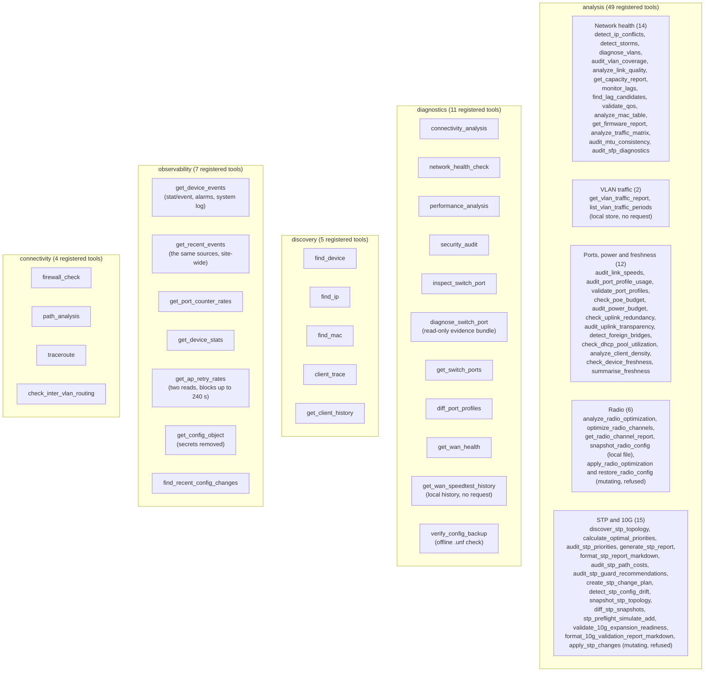

### New analysis module categories

Twelve of the later analysis modules fall into four functional groups. Only the infrastructure-health and radio modules are registered MCP tools; the SSH and time-series modules are CLI-only:

**Infrastructure health** — single-shot checks that return a Pydantic report:

| Module | Function | Returns |
| --- | --- | --- |
| `dhcp_pool.py` | `check_dhcp_pool_utilization()` | `DHCPPoolReport` — per-network pool size, active clients, exhaustion warnings |
| `poe_budget.py` | `check_poe_budget()` | `PoEBudgetReport` — per-switch PoE consumption vs capacity |
| `client_density.py` | `analyze_client_density()` | `ClientDensityReport` — per-AP client count, avg signal, overload flags |
| `uplink_redundancy.py` | `check_uplink_redundancy()` | `UplinkRedundancyReport` — single-uplink SPOF detection |

**Radio management** — snapshot/apply/restore lifecycle:

| Module | Functions | Purpose |
| --- | --- | --- |
| `radio_config.py` | `snapshot_radio_config`, `apply_radio_config`, `restore_radio_config` | Reversible AP radio changes |
| `channel_optimiser.py` | `analyze_channels`, `optimize_5ghz`, `optimize_24ghz`, `optimize_radio_channels_mcp` | Utilization-weighted channel assignment with DFS penalty scoring |

**SSH-based tools** (CLI only: `diagnose latency-matrix`, `diagnose bandwidth`, the `gateway` probes, `diagnose client-connectivity`, `diagnose ap-health --ping-clients` and `vlan-traffic sample`) — require `asyncssh` and gateway SSH credentials (`UNIFI_SSH_PASSWORD`, see [section 10](#10-layer-8-ssh-integration)):

| Module | Function | Purpose |
| --- | --- | --- |
| `latency_matrix.py` | `run_latency_matrix()` | SSH to UDM, ping all device/client IPs, build RTT/loss matrix |
| `bandwidth_test.py` | `run_bandwidth_test()` | SSH to UDM, run iperf3 to target, report throughput |
| `connectivity/gateway_probe.py` | `gateway_ping()`, `gateway_traceroute()`, `gateway_dns_check()`, `gateway_http_check()` and the conntrack flow reader | One probe per SSH session: ping, traceroute, nslookup, curl (`--globoff`) or conntrack, each an argv with its own bound |
| `diagnostics/client_connectivity.py` | `diagnose_client_connectivity()`, `build_verdict()` | One client: lookup and AP counters, then the gateway probes in order (ping, DNS, HTTP from the client's VLAN, flows), each a bounded layer within a 120 s budget; a failed layer is a finding, and a layer that can't test the client's own path is not run |
| `analysis/vlan_traffic.py` | `sample_vlan_traffic()` | One fixed `sh -c` script per sample (each `br*` interface's byte counters and addresses, 30 s bound), each VLAN matched to its interface by subnet, rows stored in `analysis/vlan_traffic_store.py` (no MCP tool samples) |
| `analysis/ap_health.py` | `run_ap_health_capture()`, `build_report()`, `render_markdown()` | An AP's 2.4 GHz counters sampled over time (no SSH); with `--ping-clients`, one SSH session pings up to 4 wireless clients per AP each sample (on 2.4 GHz, or with no radio reported) |

**Time-series analysis** (CLI only: the `analyze link-errors`, `roaming`, `config-drift` and `neighbours` commands) — snapshot/compare pattern with JSON baselines:

| Module | Functions | Purpose |
| --- | --- | --- |
| `link_error_tracking.py` | `snapshot_link_errors`, `compare_link_errors` | Port error counter deltas to distinguish active degradation from historical |
| `roaming_analysis.py` | `snapshot_client_associations`, `analyze_roaming` | Track client-to-AP associations over time, identify sticky clients |
| `config_drift.py` | `snapshot_config`, `detect_drift` | Full device config snapshot + diff against baseline |
| `neighbour_scan.py` | `scan_neighbours` | RF spectrum scan for external networks per channel |

### YAML manifest pattern

Each category has a manifest file under `mcp/manifests/`. The manifest declares the tool's module path, handler function, title, description, priority and tags, plus its credential family and the `mutates`, `pipeline`, `writes_local`, `idempotent` and `open_world` flags (the [MCP server guide](../mcp-server/MCP_SERVER_GUIDE.md#adding-a-tool) lists every key). This decouples tool metadata from implementation and allows the MCP server to serve discovery without importing any tool code at startup.

```yaml
# mcp/manifests/analysis.yaml
category: analysis
tools:
  detect_ip_conflicts:
    module: unifi_mapper.analysis.ip_conflicts
    handler: detect_ip_conflicts
    description: Find IP address conflicts between devices on the network
    priority: P1
    tags: [ip, conflict, layer3, diagnostic]
```

Priority levels (`P1` through `P3`) help AI agents decide which tools to invoke first when investigating a reported symptom.

### Tool implementation pattern

Every analysis tool follows the same four-phase pattern:

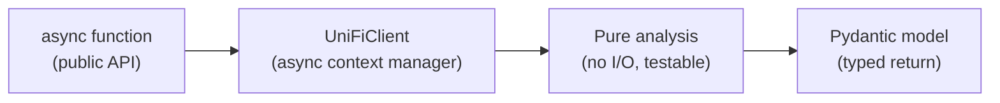

1. **Async entry point**: The public function is always `async def`. CLI commands wrap it with `asyncio.run()`.
2. **Data fetch via `UniFiClient`**: All API calls happen inside an `async with UniFiClient() as client:` block. The client handles auth, retries, and session cleanup.
3. **Pure analysis**: A private `_analyze_*()` function receives raw API dicts and returns structured results. This function has no I/O — it is pure computation and fully unit-testable.
4. **Pydantic model return**: The result is always a typed Pydantic v2 model from `core/models/`, ensuring consistent serialisation for CLI, MCP, and test consumers.

```python
# Canonical pattern (all 12 new modules follow this exactly)
async def check_dhcp_pool_utilization() -> DHCPPoolReport:
    async with UniFiClient() as client:
        networks = await client.get_networks()
        clients = await client.get_clients()

    pools, warnings, recs = _analyze_dhcp_pools(networks, clients)
    return DHCPPoolReport(pools=pools, warnings=warnings, ...)
```

**SSH-based tools** extend this pattern by adding an SSH phase, through `gateway_ssh.gateway_session()` and `run_gateway_command()`, between data fetch and analysis:

```python
async def run_latency_matrix(...) -> LatencyMatrixReport:
    creds = Credentials.from_env()
    async with UniFiClient() as client:
        devices = await client.get_devices()       # Phase 2: API fetch
    targets = _build_target_list(devices, ...)      # Phase 3: pure analysis
    results = await _ping_targets_via_ssh(creds.host, targets, ...)  # SSH phase
    return LatencyMatrixReport(results=results, ...)  # Phase 4: Pydantic model
```

**Time-series tools** use a snapshot/compare variant where the first call writes a JSON baseline and the second call diffs against it:

```python
# Snapshot phase (writes baseline)
async def snapshot_link_errors(output_path: str) -> dict:
    async with UniFiClient() as client:
        devices = await client.get_devices()
    snapshot = _build_snapshot(devices)
    Path(output_path).write_text(json.dumps(snapshot))
    return snapshot

# Compare phase (reads baseline, fetches current, diffs)
async def compare_link_errors(baseline_path: str, threshold: int) -> dict:
    async with UniFiClient() as client:
        devices = await client.get_devices()
    baseline = json.loads(Path(baseline_path).read_text())
    return _compute_deltas(baseline, _build_snapshot(devices), threshold)
```

---

## 7. Layer 5: Network Control Plane

The `network/` sub-package is the Integration API path. `client.py` holds `UniFiNetworkClient`, an async `httpx` client for `/proxy/network/integrations/v1`, configured by `config.py`'s `NetworkConfig` (`UNIFI_NETWORK_*`); the other modules are managers over it. Its only caller is the MCP `network` category (`mcp/tools/network.py`), which opens one client per call behind the GET-only `ReadOnlyAsyncTransport`; no CLI command uses it.

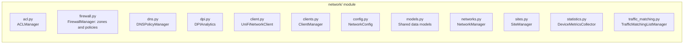

Each manager maps to one Integration API resource under `/sites/{siteId}` (`firewall/zones`, `firewall/policies`, `acl-rules`, `dns/policies`, `clients`, `networks`, `traffic-matching-lists`, `devices`) or `/dpi`. The six MCP tools read zones, policies, ACL rules, DNS policies, clients and networks. The client also has write methods (device and port actions, guest authorisation, and creating, updating or deleting networks, firewall policies, ACL rules, DNS policies and traffic-matching lists); no MCP tool calls them, and the guard would refuse them. Its device-statistics and port-action paths aren't served by Network 10.6 ([issue 035](../issues/035-device-statistics-and-port-action-paths.md)).

---

## 8. Layer 6: Protect Integration

The Protect integration is a self-contained subsystem for real-time camera and sensor management.

### Protect subsystem components

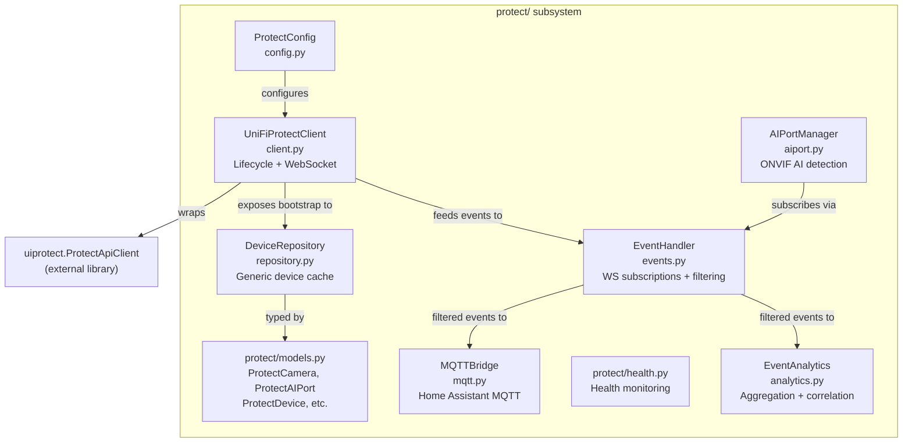

### Connection state FSM

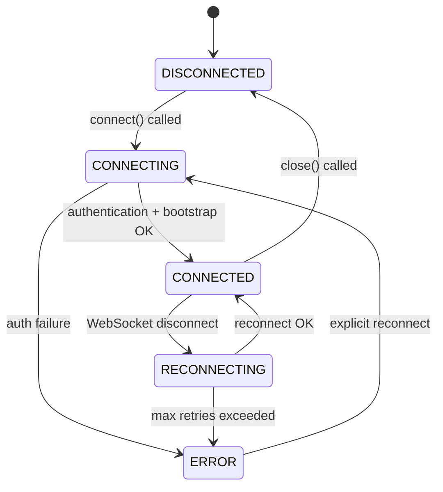

### Event pipeline

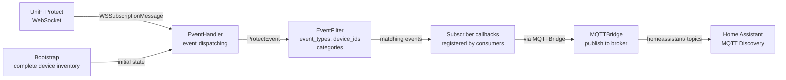

### DeviceRepository pattern

`DeviceRepository[T]` is a generic, typed cache for any Protect device type. Each concrete device type gets its own typed repository instance, providing O(1) lookup by device ID and type-safe iteration:

```python
T = TypeVar('T', bound=ProtectDevice)

class DeviceRepository(Generic[T]):
    def add(self, device: T) -> None: ...
    def get(self, device_id: str) -> T | None: ...
    def all(self) -> list[T]: ...
    def filter(self, predicate: Callable[[T], bool]) -> list[T]: ...
```

### AI Port management

`AIPortManager` in `aiport.py` wraps the Protect AI Port devices, which are hardware modules that add UniFi smart detection (person, vehicle, animal, face, licence plate, smoke) to third-party ONVIF cameras. It tracks paired cameras, manages capability configuration, and subscribes to the event stream for real-time detection events.

---

## 9. Layer 7: Core Domain

### models.py (legacy domain objects)

The original domain objects used by the intelligence layer. Plain Python classes (not Pydantic) because they predate the Pydantic migration:

| Class | Role |
| --- | --- |
| `PortInfo` | Single switch port: index, name, media, speed, LLDP data, proposed name |
| `DeviceInfo` | Network device with list of `PortInfo`, LLDP neighbours |
| `PortHealthMetrics` | Error counters and utilisation stats for a port |
| `DeviceHealthMetrics` | Aggregated health for a device |
| `NetworkHealthStatus` | Network-wide health roll-up |
| `NetworkTopologyChange` | A detected change to the topology |
| `NetworkConfiguration` | Immutable snapshot of a site configuration |
| `NetworkAnalysisResult` | Output type for analysis runs |

### core/models/ (Pydantic typed models)

Newer Pydantic v2 models used by the analysis toolkit and MCP tools. These models are the standard for all new code:

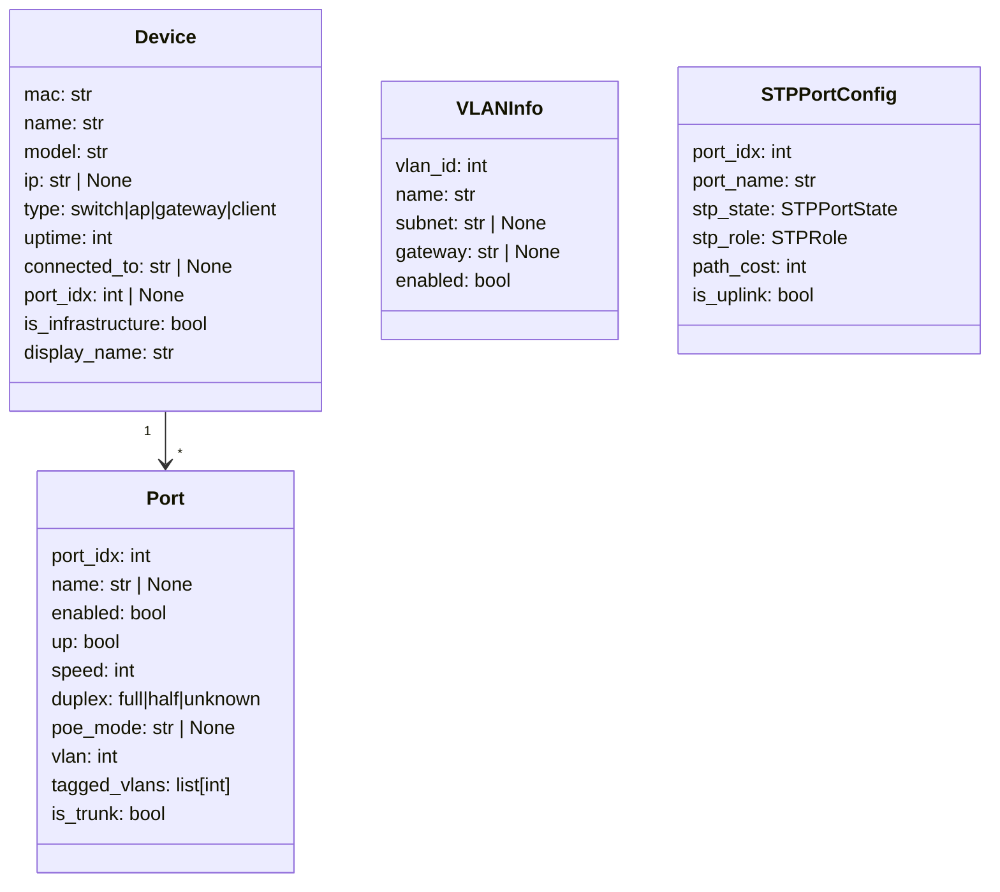

`Device`, `Port` and the STP models live in `core/models/device.py`, `port.py` and `stp.py`. `VLANInfo` is in `core/models/analysis.py`, next to the other analysis report models; `vlan.py` holds the `VLAN` model. The STP suite passes an `STPTopology` (switches, connections, root bridge) from tool to tool; under MCP, a tool that takes such a model as a required parameter is a pipeline tool, reachable only through `execute_tool`.

**Why there is no port mirroring.** `core/models/mirror.py` still defines mirror-session models, but no tool or command uses them: port mirroring was built once and removed. UniFi switches mirror only locally (a source port to a destination port on the same switch, set in the controller's port settings). Remote SPAN across switches is not in the controller at all: it is configured over SSH on each switch, needs a dedicated VLAN and often an extra cable, and the controller overwrites it on reboot, re-adoption or a firmware update. Ubiquiti's EdgeSwitch line supports RSPAN; the UniFi line does not. A tool here could therefore only automate local SPAN, which is a controller write (class C: CLI only, plan, review, apply), so it was not rebuilt. For packet capture across switches, mirror locally on the switch nearest the traffic, or capture on the gateway.

### core/utils/

| Module | Purpose |
| --- | --- |
| `auth.py` | `Credentials` Pydantic model + `get_credentials()` fallback chain |
| `client.py` | `UniFiClient` async httpx client used by the toolkit, and `SharedControllerClient`, the one guarded client an MCP server process shares (and that each CLI analysis or SSH command borrows for its run) |
| `coerce.py` | `int_or_none` and `float_or_none` for controller fields whose JSON type varies by model and firmware |
| `counters.py` | Reset-aware per-VAP counter deltas (`retry_delta`): a counter regression or a missing VAP is a reset, never a negative delta |
| `errors.py` | `ToolError` structured exception + `ErrorCodes` constants |
| `jsonl.py` | `append_capped_jsonl()`: the shared capped JSON Lines writer (lock, torn-line repair, optional dedup, size and age compaction through a temp file); the port counter history writes through it |
| `logging.py` | Loguru helpers: `replace_default_loguru_handler()`, which both CLIs call first so loguru never annotates a traceback with frame values (`diagnose=False`, [issue 058](../issues/058-tracebacks-print-frame-values.md)); nothing calls `configure_logging` ([issue 045](../issues/045-configure-logging-is-never-called.md)) |
| `overrides.py` | `load_stp_overrides()`: the STP overrides YAML (`UNIFI_STP_OVERRIDES`) |
| `ping_parse.py` | `parse_ping_output()`: GNU and BusyBox ping statistics (the latency matrix reads ping output through it) |
| `readonly.py` | The read-only guards (`ReadOnlySession`, `ReadOnlyAsyncTransport`) and the opt-in request audit (a file, or a sink such as the MCP call log's buffer) |
| `redact.py` | Strips secret fields from diagnostic output and masks secret values in MCP results and CLI error text |

### exceptions.py

The exception hierarchy classifies all API errors into retryable and permanent categories, enabling the retry logic in `UnifiApiClient` to make correct decisions without inspecting HTTP status codes in every call site:

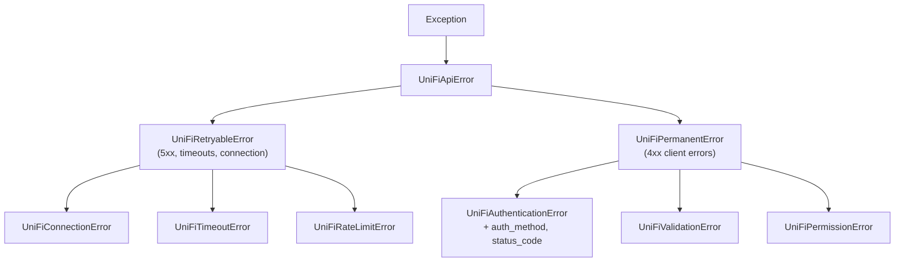

---

## 10. Layer 8: SSH Integration

The latency matrix, the bandwidth test, the gateway probes, the two composites built on them (`diagnose client-connectivity`, `diagnose ap-health --ping-clients`) and the VLAN traffic sampler (`vlan-traffic sample`) require direct SSH access to the UDM gateway to execute commands that cannot be performed via the REST API. All of them go through `analysis/gateway_ssh.py`, the only module that opens an SSH session (`asyncssh`, non-blocking).

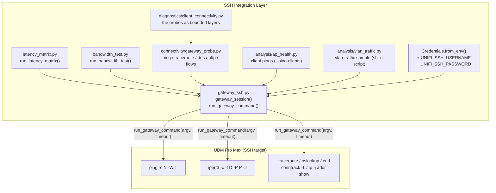

**Why SSH?** The UniFi REST API provides no endpoint for active probing (ping, traceroute, iperf3). SSH to the gateway is the only way to measure real latency and throughput from the network's vantage point — analogous to running `show ip route` or `ping` from a router's CLI in traditional networking.

**Connection pattern**: Every SSH tool opens one session per run (each `gateway` probe its own) with `gateway_ssh.gateway_session()`, the only caller of `asyncssh.connect()` in `src/` (a test scans for any other). It connects with `known_hosts=None` (the `GATEWAY_KNOWN_HOSTS` constant), which turns off SSH host-key verification (see [issue 038](../issues/038-ssh-host-key-verification-disabled.md); TLS certificates are a separate setting), and `preferred_auth='keyboard-interactive,password'`. The login comes from `gateway_ssh.ssh_login()`: the username from `UNIFI_SSH_USERNAME` (default `root`) and the password only from `UNIFI_SSH_PASSWORD`. Without it each tool stops with `CONFIG_MISSING` before any request (a `gateway` probe checks it before it looks a name up); `UNIFI_PASSWORD`, the UniFi OS login, is never sent over SSH, because it isn't the console's SSH password and a wrong password leaves failed root logins on the gateway. A failed connect is `CONTROLLER_UNREACHABLE`, "SSH connection to {host} failed: …", with the exception text redacted; the connect, handshake and login together are bounded at 30 s (`SSH_CONNECT_TIMEOUT`), so a stalled gateway ends as "SSH connection to {host} timed out after 30s".

**Command lines**: every value is checked before it goes on a command line run on the gateway, normally as root (`analysis/gateway_ssh.py`). Each address must parse with `ipaddress` and carry no IPv6 zone id (`ipaddress` accepts any text after `%`); `--count` must be 1–100, `--timeout` 1–60 s, `--duration` 1–86400 s and `--parallel` 1–128 (iperf3's own limits). Each command is an argv list that `run_gateway_command()` joins with `shlex.join`, under a timeout the caller must state (`count × timeout + 5` s per ping, `duration + 15` s for iperf3); a timeout is `TIMEOUT`, naming the program and the bound only. The `gateway` probes bound their own values the same way (ping count 1–100 and interval 0.2–5.0 s, traceroute 1–30 hops, curl `--max-time` 1–60 s, at most 5000 flows; a hostname, URL with no user name or password (its query string is passed as given, so the help says to put no secret in it), or interface name each has its own check) and their timeouts follow their arguments (`count × interval + 12` s for ping, `hops × 6 + 15` s for traceroute, 20 s for nslookup, `--max-time + 10` s for curl, 60 s for conntrack).

**Latency matrix** SSHs once, then runs `ping -c {count} -W {timeout} {ip}` for each target IP, ten at a time, parsing RTT stats from stdout. A target whose IP fails the check is not pinged and is listed in `skipped_targets`. Returns a `LatencyMatrixReport` with per-target `LatencyResult` entries.

**Bandwidth test** SSHs once, runs `iperf3 -c {target} -t {duration} -P {parallel} -J` (JSON output mode), and parses the structured result. Supports `--reverse` for download testing and `--bidir` for bidirectional. An invalid TARGET exits 1 before the config is read or anything connects, and every failure prints as text on stderr, never as a traceback. Every Typer app also sets `pretty_exceptions_show_locals=False`, so even an uncaught traceback shows no frame's local variables, such as the SSH password ([issue 058](../issues/058-tracebacks-print-frame-values.md)).

---

## 11. Layer 9: Scheduling and Automation

`scripts/unifi-cron.sh` provides cross-platform scheduled execution of audit tasks. It is a standalone shell script with no Python dependencies — it invokes `uv run unifi-mapper` subcommands.

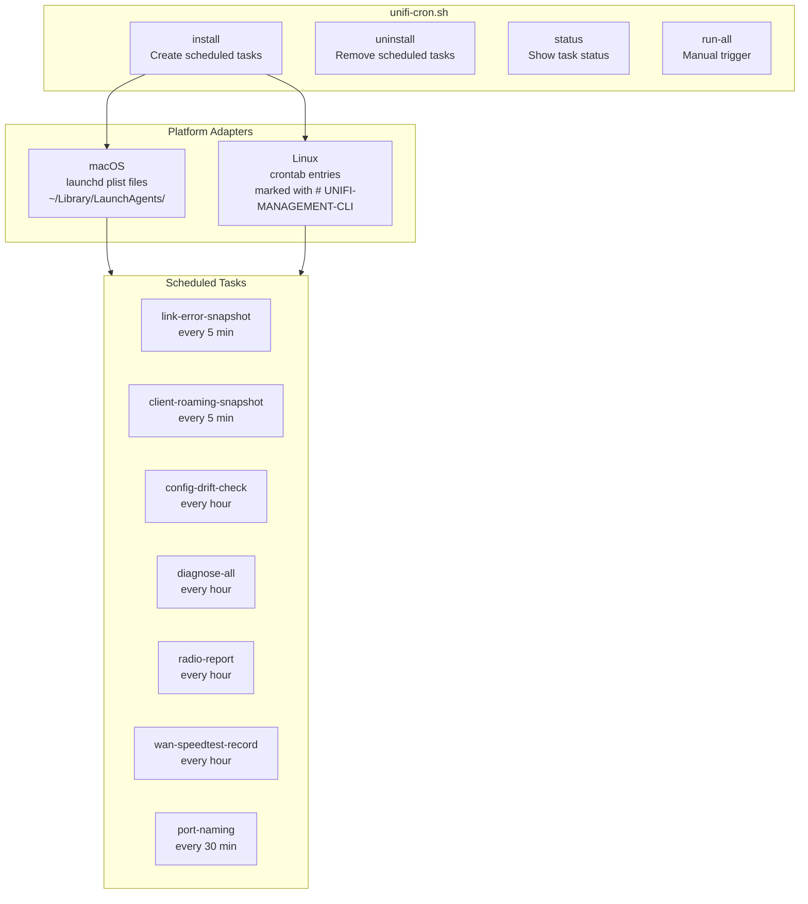

**Schedule summary**:

| Task | Interval | CLI command |
| --- | --- | --- |
| Link error snapshot (records history) | 5 min | `analyze link-errors --record` |
| Client roaming snapshot | 5 min | `analyze roaming --snapshot` |
| Config drift check | 1 hour | `analyze config-drift` |
| Full diagnostics | 1 hour | `diagnose all` |
| Radio report | 1 hour | `radio report -o reports/channel-report.md` |
| WAN speedtest record (reads the last scheduled result; never starts one) | 1 hour | `diagnose wan --record` |
| Port naming | 30 min | `--verify-updates --connected-devices --apply` |

`install` and `update` install every row, so installing or updating the schedule for the
hourly WAN record also installs the port-naming write (`--apply`), whose place in the default
schedule is [issue 025](../issues/025-launchd-plists-are-invalid-xml.md)'s open decision.

The scheduler writes logs to `$PROJECT_DIR/logs/` with one log file per task. On macOS, each task is a launchd plist under `~/Library/LaunchAgents/com.unifi-management.{name}.plist`. On Linux, entries are appended to the user's crontab with a `# UNIFI-MANAGEMENT-CLI` marker for clean uninstall.

---

## 12. Design Patterns

### Adapter Pattern (toolkit_adapters.py)

The analysis toolkit is async-first. The legacy CLI path (older `cli.py` and `network_cli.py`) is synchronous. `ToolkitAdapter` wraps each async toolkit function in a synchronous variant, extracting data from the synchronous `UnifiApiClient` and building the same output structures:

```python
class ToolkitAdapter:
    def __init__(self, api_client):
        self.api_client = api_client

    def find_device_sync(self, query: str) -> List[Dict[str, Any]]:
        """Synchronous device search (adapts async discovery to sync client)."""
        devices_response = self.api_client.get_devices(self.api_client.site)
        ...
```

This allows the synchronous CLI to use the same tool logic as the async MCP server without requiring an event loop.

### Strategy Pattern

**Authentication strategy**: `UnifiApiClient` selects the authentication method at construction time based on which credentials are present. The `auth_method` attribute records the active strategy (`"token"` or `"username_password"`). The same attribute propagates into `UniFiAuthenticationError` for diagnostic context.

**Port update strategy**: `SmartPortMapper` consults `DeviceCapabilityDetector` before each device to select the appropriate update path (skip entirely, use minimal overrides, use full override). This replaces a brittle if-else chain with a data-driven capability database.

**Credential resolution strategy**: `get_credentials()` in `core/utils/auth.py` implements a priority-ordered fallback chain — environment variables, then macOS Keychain via `keyring`, then 1Password CLI:

```python
async def get_credentials() -> Credentials:
    # 1. Environment variables (UNIFI_URL, UNIFI_CONSOLE_API_TOKEN, etc.)
    try:
        return Credentials.from_env()
    except ToolError:
        pass

    # 2. macOS Keychain via keyring
    keychain_data = keyring.get_password('unifi-mcp', 'controller')
    if keychain_data:
        return Credentials.from_keychain(keychain_data)

    # 3. 1Password CLI
    process = await asyncio.create_subprocess_exec('op', 'item', 'get', ...)
    ...
```

### Repository Pattern (protect/repository.py)

`DeviceRepository[T]` provides a type-safe, in-memory store for Protect device objects. The generic type parameter enforces that cameras cannot be stored in a sensor repository and vice versa:

```python
class DeviceRepository(Generic[T]):
    def __init__(self, device_type: DeviceType) -> None:
        self._device_type = device_type
        self._devices: dict[str, T] = {}

    def get(self, device_id: str) -> T | None:
        return self._devices.get(device_id)

    def filter(self, predicate: Callable[[T], bool]) -> list[T]:
        return [d for d in self._devices.values() if predicate(d)]
```

### Lazy Loading / Proxy Pattern (mcp/registry.py)

`ToolProxy` defers importing a tool's implementation module until the first `execute()` call, and `ToolCatalog` (`mcp/catalog.py`) likewise builds a tool's SDK definition (schemas, annotations) only when it is first looked up or listed. This keeps MCP server startup fast even though 87 tools are registered -- only the YAML manifests are parsed at startup on the default discovery surface:

```python
class ToolProxy:
    def __init__(self, metadata: ToolMetadata) -> None:
        self._implementation: Callable[..., Any] | None = None
        self._lock = Lock()

    def _load_implementation(self) -> None:
        if self._implementation is not None:
            return
        with self._lock:
            if self._implementation is not None:
                return
            module = importlib.import_module(self.metadata.module)
            self._implementation = getattr(module, self.metadata.handler)
```

The double-checked locking (`if ... return` before and inside the lock) ensures thread safety while avoiding lock contention on the hot path once the module is loaded.

### Context Manager Pattern (protect/client.py, core/utils/client.py)

Both async API clients implement `__aenter__` / `__aexit__` for use in `async with` blocks. This guarantees that WebSocket connections and HTTP sessions are properly closed even when exceptions propagate:

```python
async with UniFiProtectClient(config) as client:
    cameras = client.cameras
    # WebSocket and HTTP session are open here
# Both are closed here, even if an exception occurred
```

### Code Mode Pattern (mcp/server.py + mcp/registry.py)

The MCP server implements a progressive-disclosure pattern designed for AI agents. On the default discovery surface, rather than exposing 87 individual tool definitions to the AI's context window, it exposes four public meta-tools, and the agent runs the tool it chose through `execute_tool`:

```text
1. search_tools(category="analysis") -> list of matching tools
2. get_tool_info("detect_ip_conflicts") -> parameters, input_schema and description
3. execute_tool("detect_ip_conflicts", {}) -> {"ok": true, "result": ...}
```

This keeps the AI's tool list short (4 tools, about 6.4k characters of `tools/list`) and avoids overwhelming the model with schema for all 87 tools at once. The agent requests detail only for tools it intends to use. Hosts that defer tool schemas themselves can use the direct surface instead (77 tools listed).

---

## 13. Key Workflows (Sequence Diagrams)

### 13.1 Port Discovery and Naming Flow

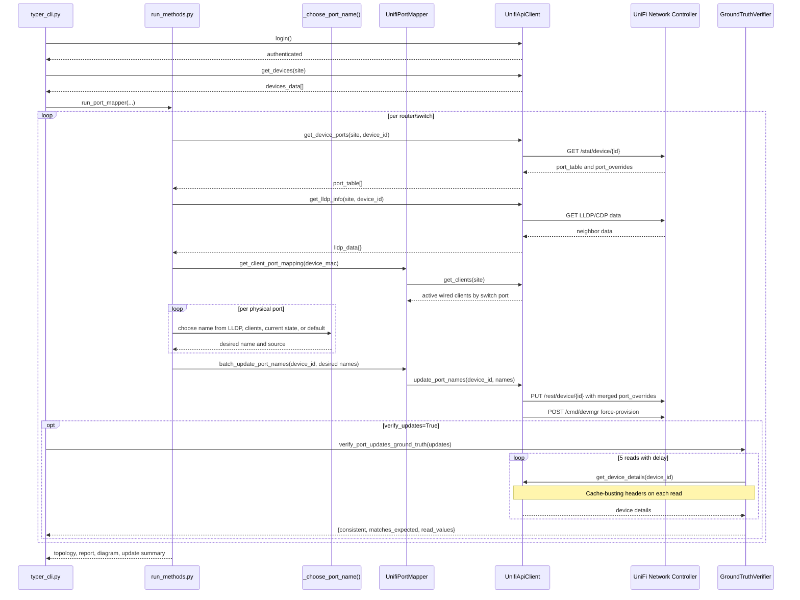

### 13.2 API Authentication Flow

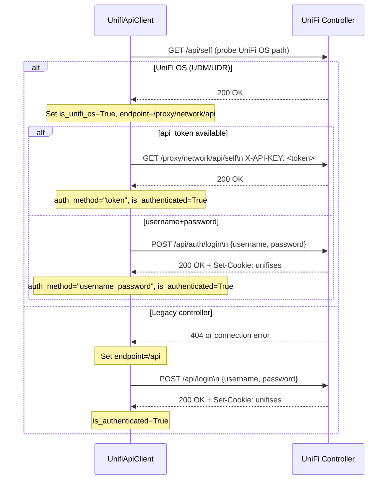

### 13.3 MCP Tool Discovery and Execution Flow

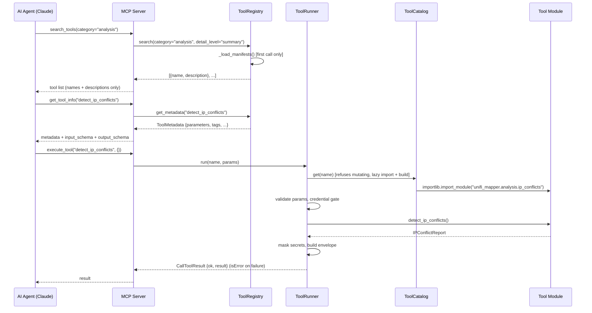

### 13.4 Protect Event Processing Flow

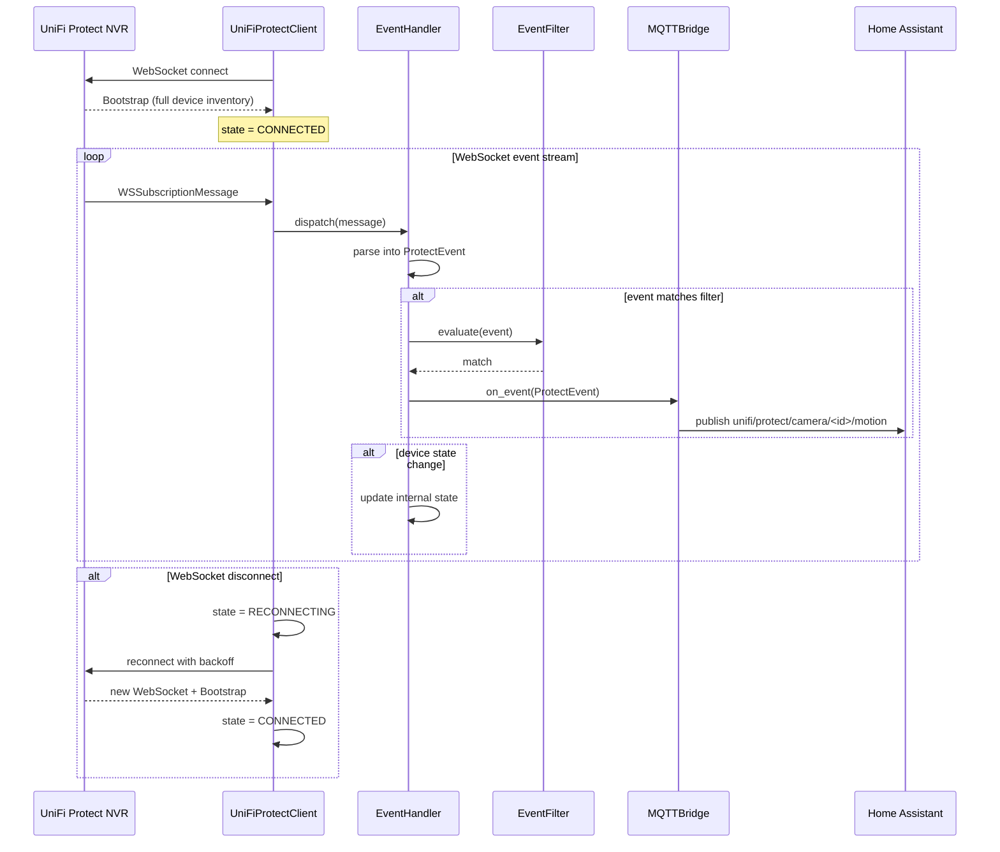

### 13.5 Comprehensive Diagnostics Runner Flow

The `diagnose all` command runs 15 independent checks sequentially (`typer_cli.diagnose_all`), each following the canonical async pattern, and aggregates results into a pass/warn/fail summary: link quality, capacity planning, port profiles, MTU consistency, SFP diagnostics, radio optimization, firmware skew, DHCP pools, PoE budget, client density, uplink redundancy, uplink VLAN transparency, device power budget, foreign bridges and telemetry freshness.

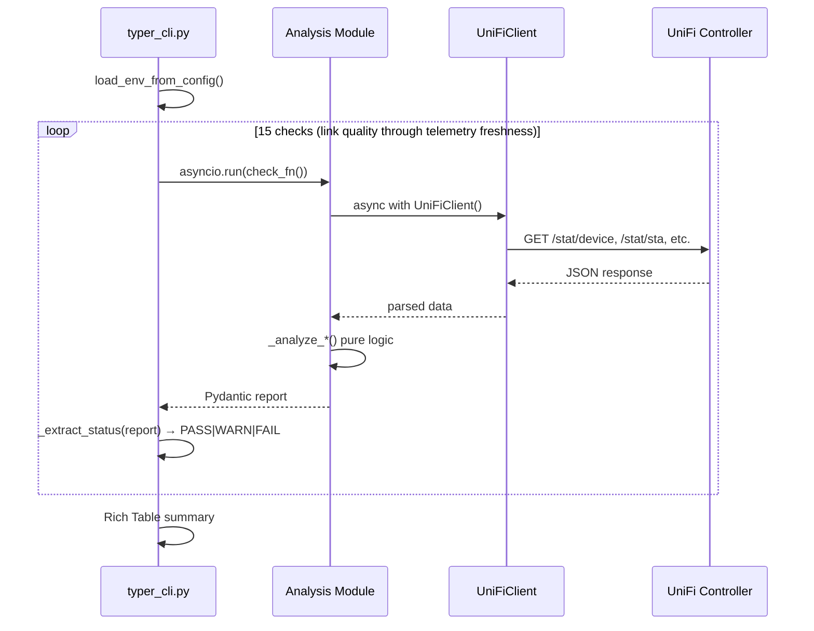

---

## 14. Module Dependency Graph

The following graph shows the primary import relationships between modules. Arrows point from importer to imported. A dotted arrow is a call through an object the caller is given, not an import, and `mcp/registry` and `mcp/catalog` import tool modules lazily, by name, from the manifests.

```mermaid
graph TD
    subgraph entry_points["Entry Points"]
        TCLI["typer_cli"]
        NCLI["network_cli"]
        ICLI["inventory_cli"]
        MCPS["mcp/server"]
    end

    subgraph scheduling["Scheduling"]
        CRON["unifi-cron.sh"]
    end

    subgraph cli_shared["Shared CLI"]
        CLI["cli"]
        RM["run_methods"]
    end

    subgraph intelligence["Intelligence"]
        SPM["smart_port_mapper"]
        PM["port_mapper"]
        DC["device_capabilities"]
        GTV["ground_truth_verification"]
        ENT["enhanced_network_topology"]
    end

    subgraph api["API Integration"]
        AC["api_client"]
        EAC["enhanced_api_client"]
        TA["toolkit_adapters"]
        PC["protect/client"]
        UC["core/utils/client"]
        CFG["config"]
        AUTH["core/utils/auth"]
        RO["core/utils/readonly"]
        RED["core/utils/redact"]
    end

    subgraph tools["Analysis Toolkit"]
        AN["analysis/*"]
        DG["diagnostics/*"]
        DS["discovery/*"]
        CN["connectivity/*"]
        MT["mcp/tools/*"]
    end

    subgraph ssh_layer["SSH Integration"]
        ASYNCSSH["asyncssh"]
        GS["analysis/gateway_ssh"]
        LM["analysis/latency_matrix"]
        BW["analysis/bandwidth_test"]
        GP["connectivity/gateway_probe"]
        CCX["diagnostics/client_connectivity"]
        AH["analysis/ap_health"]
        VTS["analysis/vlan_traffic"]
    end

    subgraph network_cp["Network Control Plane"]
        NW["network/*"]
    end

    subgraph protect_sub["Protect Subsystem"]
        PE["protect/events"]
        PQ["protect/mqtt"]
        PAI["protect/aiport"]
        PAN["protect/analytics"]
        PRE["protect/repository"]
    end

    subgraph domain["Core Domain"]
        MD["models"]
        CM["core/models/*"]
        EX["exceptions"]
        ERR["core/utils/errors"]
    end

    CRON -->|"uv run"| TCLI
    TCLI --> CLI
    TCLI --> SPM
    TCLI --> PM
    TCLI --> RED
    NCLI --> CLI
    NCLI --> RM
    NCLI --> EAC
    NCLI --> TA
    ICLI --> CLI
    ICLI --> AC
    CLI --> CFG
    CLI --> RM
    MCPS --> REGISTRY["mcp/registry"]
    MCPS --> UC
    MCPS --> RO
    REGISTRY -.->|"lazy import"| AN
    REGISTRY -.->|"lazy import"| DG
    REGISTRY -.->|"lazy import"| DS
    REGISTRY -.->|"lazy import"| CN
    REGISTRY -.->|"lazy import"| MT

    SPM --> DC
    SPM --> GTV
    SPM --> PM
    PM --> AC
    PM --> ENT
    PM --> RM
    RM --> AC
    RM --> MD
    GTV -.->|"reads through"| AC

    AC --> EX
    EAC --> EX
    TA -.->|"wraps"| EAC
    PC --> RO
    UC --> AUTH
    UC --> RO
    AUTH --> ERR

    AN --> UC
    AN --> CM
    DG --> UC
    DG --> AC
    DG --> RO
    DG --> RED
    DS --> UC
    DS --> CM
    CN --> UC
    CN --> CM
    MT --> NW
    MT --> PC
    MT --> RO

    LM --> UC
    LM --> GS
    LM --> AUTH
    BW --> GS
    BW --> AUTH
    GP --> UC
    GP --> GS
    CCX --> GP
    CCX --> UC
    AH --> UC
    AH --> GS
    VTS --> UC
    VTS --> GS
    GS --> ASYNCSSH
    GS --> AUTH

    PE --> PC
    PQ --> PE
    PAI --> PE
    PAN --> PE
    PRE --> PC

    ENT --> MD
```

---

## 15. External Interfaces

### 15.1 UniFi Network REST API

| Interface | Protocol | Auth | Notes |
| --- | --- | --- | --- |
| UniFi OS path | HTTPS REST | `X-API-KEY` token header | UDM, UDR, UDM SE — preferred |
| Legacy controller path | HTTPS REST | Session cookie (POST `/api/login`) | Self-hosted controller software |

Key endpoints consumed:

| Endpoint | Method | Purpose |
| --- | --- | --- |
| `/proxy/network/api/s/{site}/stat/device` | GET | Device inventory with port tables |
| `/proxy/network/api/s/{site}/rest/device/{id}` | PUT | Port override writes |
| `/proxy/network/api/s/{site}/stat/sta` | GET | Wireless client list |
| `/proxy/network/api/s/{site}/rest/networkconf` | GET | Network/VLAN configuration |
| `/proxy/network/api/s/{site}/rest/firewallrule` | GET | Firewall rules |
| `/proxy/network/api/s/{site}/stat/health` | GET | Site health summary |

**Critical API behaviour note**: The UniFi API caches device state. Reads of `port_table` after a write to `port_overrides` may return stale data for an indeterminate period. The `GroundTruthVerifier` exists specifically to work around this behaviour.

**Write field distinction**: `port_table` is read-only (populated by the controller firmware). The writable field is `port_overrides` — a sparse array containing ports with configuration overrides. Port naming writes must merge desired names into `port_overrides` while preserving existing per-port settings such as PoE mode and valid speed overrides.

### 15.2 UniFi Protect WebSocket API

| Interface | Protocol | Library |
| --- | --- | --- |
| Protect events | WSS WebSocket | `uiprotect` library |
| Bootstrap data | HTTPS REST | `uiprotect` library |
| Camera streams | RTSP | Not managed by this platform |

Event types consumed: motion, smart detect zones, doorbell, sensor state, device online/offline, NVR system events.

### 15.3 ONVIF (IP Camera Protocol)

Used by `protect/aiport.py` to communicate with third-party cameras paired to UniFi AI Ports. Handled via the `onvif-zeep-async` library.

### 15.3a SSH (Gateway Management Plane)

Used by `analysis/latency_matrix.py`, `analysis/bandwidth_test.py`, `connectivity/gateway_probe.py`, `diagnostics/client_connectivity.py` (through the probes), `analysis/ap_health.py` (with `--ping-clients`) and `analysis/vlan_traffic.py` (`vlan-traffic sample`) to execute commands on the UDM gateway. Every session and command goes through `analysis/gateway_ssh.py` (`gateway_session()`, `run_gateway_command()`), on `asyncssh`.

| Interface | Protocol | Auth | Notes |
| --- | --- | --- | --- |
| UDM SSH | SSH (port 22) | Password (`UNIFI_SSH_USERNAME` / `UNIFI_SSH_PASSWORD`) | `known_hosts=None`: the host key isn't verified ([issue 038](../issues/038-ssh-host-key-verification-disabled.md)) |

Commands executed: `ping` (latency matrix, `gateway ping`, `diagnose client-connectivity`, `diagnose ap-health --ping-clients`), `iperf3` (bandwidth test), `traceroute`, `nslookup`, `curl`, `conntrack -L` and `ip -j addr show` (the `gateway` probes, and `client-connectivity`'s DNS, HTTP and flow layers), and one fixed `sh -c` script reading `/sys/class/net/br*/statistics` and `ip -4 -j addr show` (`vlan-traffic sample`).

### 15.4 MQTT (Home Assistant Integration)

`protect/mqtt.py` publishes events to an MQTT broker using the Home Assistant MQTT Discovery convention. The bridge auto-generates discovery payloads so Home Assistant registers Protect devices without manual configuration.

| Topic pattern | Content |
| --- | --- |
| `homeassistant/<type>/<device_id>/config` | Discovery payload (auto-registers device in HA) |
| `unifi/protect/<device_id>/state` | Device state updates |
| `unifi/protect/<device_id>/event` | Event payloads (motion, detection, etc.) |

### 15.5 MCP Protocol

The MCP server implements the Model Context Protocol with the FastMCP bundled in the official MCP Python SDK (`mcp>=1.30,<1.31`). AI clients connect over stdio; no network transport is served. The server exports:

- 4 public meta-tools (`search_tools`, `list_categories`, `get_tool_info`, `execute_tool`); with `--surface direct`, also the 73 non-mutating, non-pipeline catalog tools
- 87 registered tools in YAML manifests, of which 84 run through `execute_tool` (the 3 mutating tools are refused)
- 2 resources (`unifi://catalog`, `unifi://config/status`) and 2 prompts (`troubleshoot_port_link`, `plan_stp_change`)
- Server `instructions`, per-tool annotations, and `serverInfo.version` set to the package version

---

## 16. Configuration and Credential Management

### Configuration resolution order

The CLI entry points (`cli.get_default_config_path`, used by `unifi-mapper` and `unifi-inventory`) read one env file:

```mermaid
flowchart TD
    EnvCli["--config CLI flag, or UNIFI_CONFIG (unifi-mapper)"]
    HasXdg{"XDG_CONFIG_HOME set?"}
    XdgDir["$XDG_CONFIG_HOME/unifi_management_cli/"]
    HomeDir["~/.config/unifi_management_cli/"]
    Prod["prod.env in that directory"]
    Def["default.env in that directory"]
    DotEnv[".env (current directory)"]
    Missing["exit 1: Configuration file not found"]
    Load["load into os.environ"]

    EnvCli -->|"given (exit 1 if missing)"| Load
    EnvCli -->|"not given"| HasXdg
    HasXdg -->|"yes"| XdgDir
    HasXdg -->|"no"| HomeDir
    XdgDir --> Prod
    HomeDir --> Prod
    Prod -->|"exists"| Load
    Prod -->|"not found"| Def
    Def -->|"exists"| Load
    Def -->|"not found"| DotEnv
    DotEnv -->|"exists"| Load
    DotEnv -->|"not found"| Missing
```

A set `XDG_CONFIG_HOME` replaces `~/.config` here rather than going before it, unlike the MCP server's search ([issue 048](../issues/048-cli-and-mcp-config-searches-differ.md)). Of the CLI programs, only the root `--config` option of `unifi-mapper` (`typer_cli.main`) reads `UNIFI_CONFIG`; the MCP server reads it too (below). The standalone `unifi-inventory` program ignores that variable: without its own `--config` it goes straight to the `XDG_CONFIG_HOME` step. The `inventory` commands take their own `--config` and ignore the root one ([issue 043](../issues/043-inventory-ignores-the-root-config.md)); `unifi-network-toolkit` defaults its `--config` to `~/.config/unifi_management_cli/prod.env`.

### Credential fallback chain (MCP / toolkit)

For the async toolkit and MCP server, credentials are resolved at runtime via `get_credentials()`:

1. **Environment variables**: `UNIFI_URL` (or `UNIFI_HOST`), `UNIFI_CONSOLE_API_TOKEN` (or `UNIFI_API_TOKEN`), `UNIFI_USERNAME`, `UNIFI_PASSWORD`, `UNIFI_SITE`, `UNIFI_VERIFY_SSL`.
2. **macOS Keychain**: Stored as JSON under service name `unifi-mcp`, account `controller`, via the `keyring` library.
3. **1Password CLI**: Reads an item named `UniFi Controller` from the default 1Password vault using the `op` CLI.

If all three sources fail, a `ToolError` with `error_code=AUTHENTICATION_FAILED` is raised with a structured suggestion. Under the MCP server the chain runs off the event loop, bounded by `UNIFI_MCP_CREDENTIAL_TIMEOUT` (default 15 s), and an exhausted or slow chain is reported as `CONFIG_MISSING`.

The MCP server does **not** use the resolution order above: it never reads a `.env` in the working directory, and loads its file per credential family (`--config`, `UNIFI_CONFIG`, then the XDG/`~/.config` files, then the legacy `~/.config/unifi_network_mapper/prod.env`). See [Configuration](../mcp-server/MCP_SERVER_GUIDE.md#configuration) in the MCP server guide.

### UnifiConfig dataclass

`config.py` provides `UnifiConfig`, a `@dataclass` with `__post_init__` validation:

- URL must start with `http://` or `https://`.
- Either `api_token` or both `username` and `password` must be present.
- Numeric values are clamped to safe ranges: timeout 1-300s, retries 1-10, retry delay 0.1-10s.
- `from_env()` is the standard factory, loading from an env file then `os.environ`.

---

*End of architecture overview.*
