# C4 Architecture: UniFi Management CLI

> **See also**: [Architecture Overview](architecture-overview.md) | [Codebase Map](codemap.md) | [Use Cases](../guides/use-cases-and-howto.md) | [Troubleshooting](../operations/troubleshooting-and-runbook.md)

## Table of Contents

1. [Overview](#overview)
2. [Level 1: System Context](#level-1-system-context)
3. [Level 2: Container Diagram](#level-2-container-diagram)
4. [Level 3: Component Diagrams](#level-3-component-diagrams)
   - [CLI Layer Components](#31-cli-layer-components)
   - [API Integration Components](#32-api-integration-components)
   - [Analysis and Diagnostic Components](#33-analysis-and-diagnostic-components)
   - [UniFi Protect Components](#34-unifi-protect-components)
   - [MCP Server Components](#35-mcp-server-components)
5. [Level 4: Code Diagrams](#level-4-code-diagrams)
   - [API Client Class Structure](#41-api-client-class-structure)
   - [Protect Client Class Structure](#42-protect-client-class-structure)
   - [Data Model Hierarchy](#43-data-model-hierarchy)
   - [Exception Hierarchy](#44-exception-hierarchy)
6. [Provider and Platform Architecture](#provider-and-platform-architecture)
7. [Dynamic Runtime Flows](#dynamic-runtime-flows)
8. [Key Design Decisions](#key-design-decisions)

---

## Overview

The UniFi Management CLI is an enterprise-grade Python automation platform for Ubiquiti UniFi networks. It provides four distinct installed entry points--three CLI tools and one MCP server--all built on a shared library of API clients, domain models, and analysis engines. The platform spans two separate UniFi product lines (Network and Protect) and integrates with Home Assistant via MQTT and with AI assistants via the Model Context Protocol.

Provider/platform-specific detail lives in:

- [UniFi Network Provider Architecture](providers/unifi-network.md)
- [UniFi Protect and MQTT Provider Architecture](providers/unifi-protect-mqtt.md)
- [AXIS Provisioning Provider Architecture](providers/axis-provisioning.md)
- [MCP and Automation Interface Architecture](providers/mcp-automation.md)

This document follows the C4 model (Simon Brown) with all four levels of abstraction: System Context, Container, Component, and Code.

---

## Level 1: System Context

The system context shows the UniFi Management CLI in relation to the humans and external systems it interacts with. At this level, internal structure is irrelevant — the focus is on boundaries and relationships.

### Mermaid Diagram

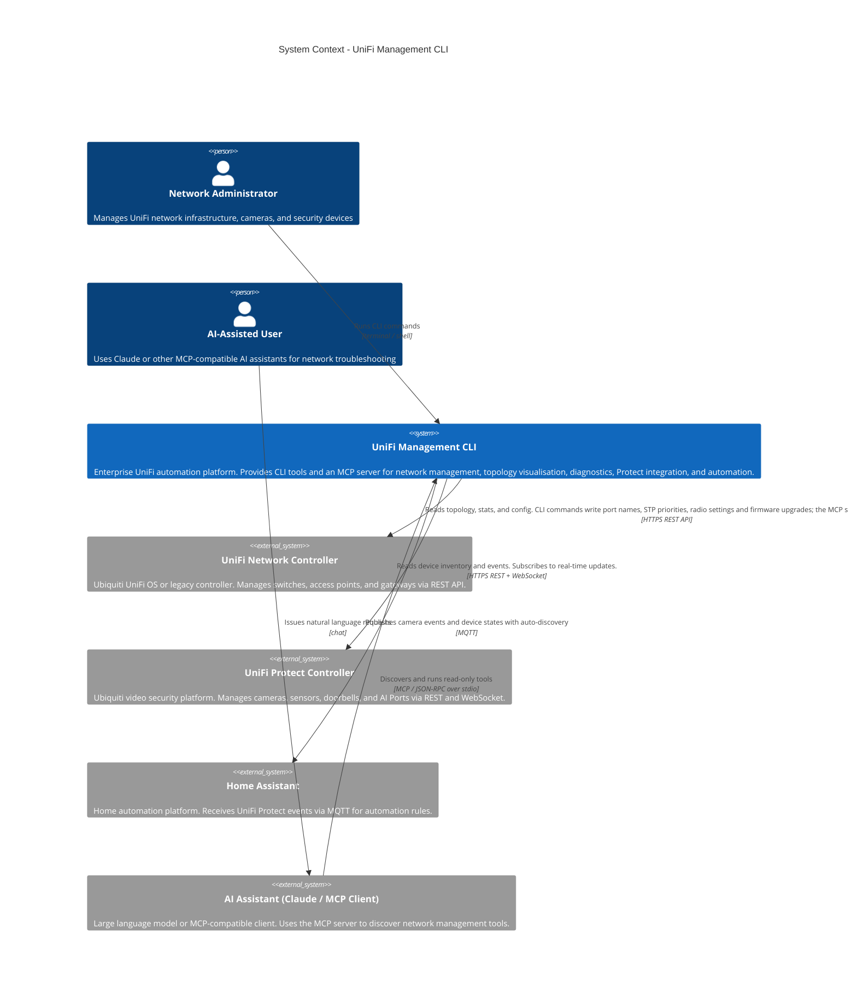

### PlantUML Equivalent

```plantuml
@startuml C4_Context
!include https://raw.githubusercontent.com/plantuml-stdlib/C4-PlantUML/master/C4_Context.puml

Person(admin, "Network Administrator", "Manages UniFi network infrastructure, cameras, and security devices")
Person(ai_user, "AI-Assisted User", "Uses Claude or MCP-compatible AI assistants for network troubleshooting")

System(unifi_mgmt, "UniFi Management CLI", "Enterprise UniFi automation platform providing CLI tools and MCP server for network management, topology visualisation, diagnostics, Protect integration, and automation.")

System_Ext(unifi_network, "UniFi Network Controller", "Ubiquiti UniFi OS or legacy controller. Manages switches, APs, and gateways via REST API.")
System_Ext(unifi_protect, "UniFi Protect Controller", "Ubiquiti video security platform. Manages cameras, sensors, doorbells, and AI Ports.")
System_Ext(home_assistant, "Home Assistant", "Home automation platform receiving Protect events via MQTT.")
System_Ext(ai_assistant, "AI Assistant (Claude / MCP Client)", "LLM or MCP-compatible client invoking network management tools.")

Rel(admin, unifi_mgmt, "Runs CLI commands", "terminal / shell")
Rel(ai_user, ai_assistant, "Issues natural language requests", "chat")
Rel(ai_assistant, unifi_mgmt, "Discovers and runs read-only tools", "MCP / JSON-RPC over stdio")
Rel(unifi_mgmt, unifi_network, "Reads; CLI commands write, the MCP server never does", "HTTPS REST")
Rel(unifi_mgmt, unifi_protect, "Reads devices and events, subscribes to updates", "HTTPS REST + WebSocket")
Rel(unifi_mgmt, home_assistant, "Publishes events with MQTT auto-discovery", "MQTT")
@enduml
```

### Context Notes

The platform serves two distinct user personas with different interaction models:

- The **Network Administrator** invokes CLI tools directly. They choose the appropriate tool (`unifi-mapper`, `unifi-network-toolkit`, or `unifi-inventory`) depending on whether they need interactive output, scripting compatibility, or inventory reports.

- The **AI-Assisted User** interacts indirectly through an MCP-compatible client such as Claude Desktop. The AI assistant uses `unifi-mcp` for progressive tool discovery: the default discovery surface lists four meta-tools (`search_tools`, `list_categories`, `get_tool_info`, `execute_tool`), and the direct surface also lists each read-only tool by name. Every call runs through `ToolRunner`; the three tools that would change the controller are refused, and those changes go through the CLI.

The dual-controller architecture (Network + Protect) reflects Ubiquiti's product split: network infrastructure and video security run on separate controllers with different APIs, authentication models, and communication protocols.

---

## Level 2: Container Diagram

At the container level, the UniFi Management CLI resolves into five containers: four Python entry-point commands and the shared library they all import. Each container has a distinct technology profile and responsibility boundary.

### Mermaid Diagram

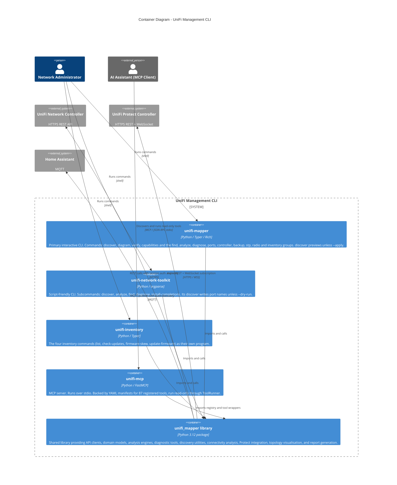

### PlantUML Equivalent

```plantuml
@startuml C4_Container
!include https://raw.githubusercontent.com/plantuml-stdlib/C4-PlantUML/master/C4_Container.puml

Person(admin, "Network Administrator")
Person_Ext(ai_assistant, "AI Assistant (MCP Client)")

System_Ext(unifi_network, "UniFi Network Controller", "HTTPS REST API")
System_Ext(unifi_protect, "UniFi Protect Controller", "HTTPS REST + WebSocket")
System_Ext(home_assistant, "Home Assistant", "MQTT")

System_Boundary(platform, "UniFi Management CLI") {
    Container(unifi_mapper_cli, "unifi-mapper", "Python / Typer / Rich", "Primary interactive CLI with Rich terminal UI")
    Container(network_toolkit_cli, "unifi-network-toolkit", "Python / argparse", "Script-friendly CLI for automation")
    Container(inventory_cli, "unifi-inventory", "Python / Typer", "The four inventory commands as their own program")
    Container(mcp_server, "unifi-mcp", "Python / FastMCP", "MCP server backed by 87 YAML-registered tools, run read-only")
    Container(shared_lib, "unifi_mapper library", "Python 3.12 package", "Shared library: API clients, models, analysis, diagnostics, Protect, topology")
}

Rel(admin, unifi_mapper_cli, "Runs commands", "shell")
Rel(admin, network_toolkit_cli, "Runs commands", "shell")
Rel(admin, inventory_cli, "Runs commands", "shell")
Rel(ai_assistant, mcp_server, "Discovers and runs read-only tools", "MCP / JSON-RPC stdio")
Rel(unifi_mapper_cli, shared_lib, "Imports and calls")
Rel(network_toolkit_cli, shared_lib, "Imports and calls")
Rel(inventory_cli, shared_lib, "Imports and calls")
Rel(mcp_server, shared_lib, "Imports and calls")
Rel(shared_lib, unifi_network, "REST calls with retry logic", "HTTPS")
Rel(shared_lib, unifi_protect, "Async REST + WebSocket", "HTTPS / WSS")
Rel(shared_lib, home_assistant, "MQTT publish with auto-discovery", "MQTT")
@enduml
```

### Container Notes

The **four entry points (three CLIs and the MCP server) are shells** over the shared library. They handle argument parsing, output formatting, and process lifecycle, and the domain logic lives in the library. The `pyproject.toml` entry-point declarations map each command straight to a module's `main` or `app`.

The **shared library** is the architectural centre of gravity. All domain logic, API interactions, and integration code live here. This makes the platform easy to extend: a new CLI tool, automation wrapper, or future web API can be added without touching existing containers.

The `unifi-mapper` and `unifi-network-toolkit` CLIs offer overlapping functionality with different UX targets. `unifi-mapper` uses Typer + Rich for an interactive terminal experience; `unifi-network-toolkit` uses argparse for scripting compatibility. This is a deliberate duplication to serve both audiences without compromise.

---

## Level 3: Component Diagrams

### 3.1 CLI Layer Components

The CLI containers delegate to specific modules within the shared library. This diagram shows the internal components of the CLI layer and their dependencies on the library core.

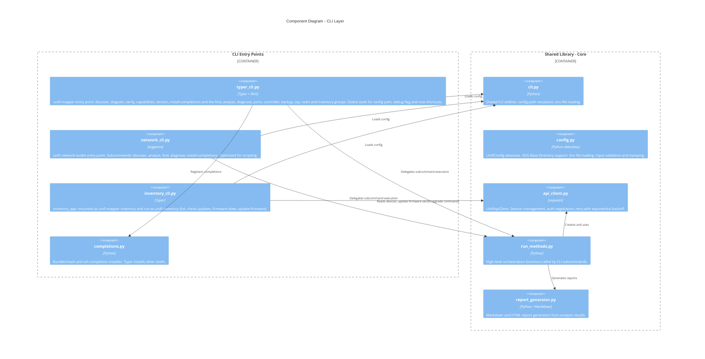

### PlantUML Equivalent

```plantuml
@startuml C4_Component_CLI
!include https://raw.githubusercontent.com/plantuml-stdlib/C4-PlantUML/master/C4_Component.puml

Container_Boundary(cli_layer, "CLI Entry Points") {
    Component(typer_cli, "typer_cli.py", "Typer + Rich", "unifi-mapper: discover, diagram, verify, find, analyze, diagnose, ports, controller, backup, stp, radio, inventory")
    Component(network_cli, "network_cli.py", "argparse", "unifi-network-toolkit: discover, analyze, find, diagnose")
    Component(inventory_cli_comp, "inventory_cli.py", "Typer", "inventory_app: unifi-inventory, also mounted as the inventory group of unifi-mapper")
    Component(completions, "completions.py", "Python", "bash and zsh completion installer")
}

Container_Boundary(core_lib, "Shared Library - Core") {
    Component(cli_helpers, "cli.py", "Python", "Shared CLI utilities and config path resolution")
    Component(config_comp, "config.py", "Python dataclass", "UnifiConfig: validation, XDG, env loading")
    Component(api_client_comp, "api_client.py", "requests", "UnifiApiClient: session, auth, retry")
    Component(run_methods, "run_methods.py", "Python", "High-level orchestration for CLI subcommands")
    Component(report_gen, "report_generator.py", "Python / Markdown", "Markdown and HTML report generation")
}

Rel(typer_cli, cli_helpers, "Loads config")
Rel(typer_cli, run_methods, "Delegates")
Rel(network_cli, cli_helpers, "Loads config")
Rel(network_cli, run_methods, "Delegates")
Rel(inventory_cli_comp, cli_helpers, "Loads config")
Rel(inventory_cli_comp, api_client_comp, "Reads devices")
Rel(run_methods, api_client_comp, "Creates and uses")
Rel(run_methods, report_gen, "Generates reports")
@enduml
```

---

### 3.2 API Integration Components

The API integration layer abstracts the two separate UniFi controller APIs behind clean client interfaces.

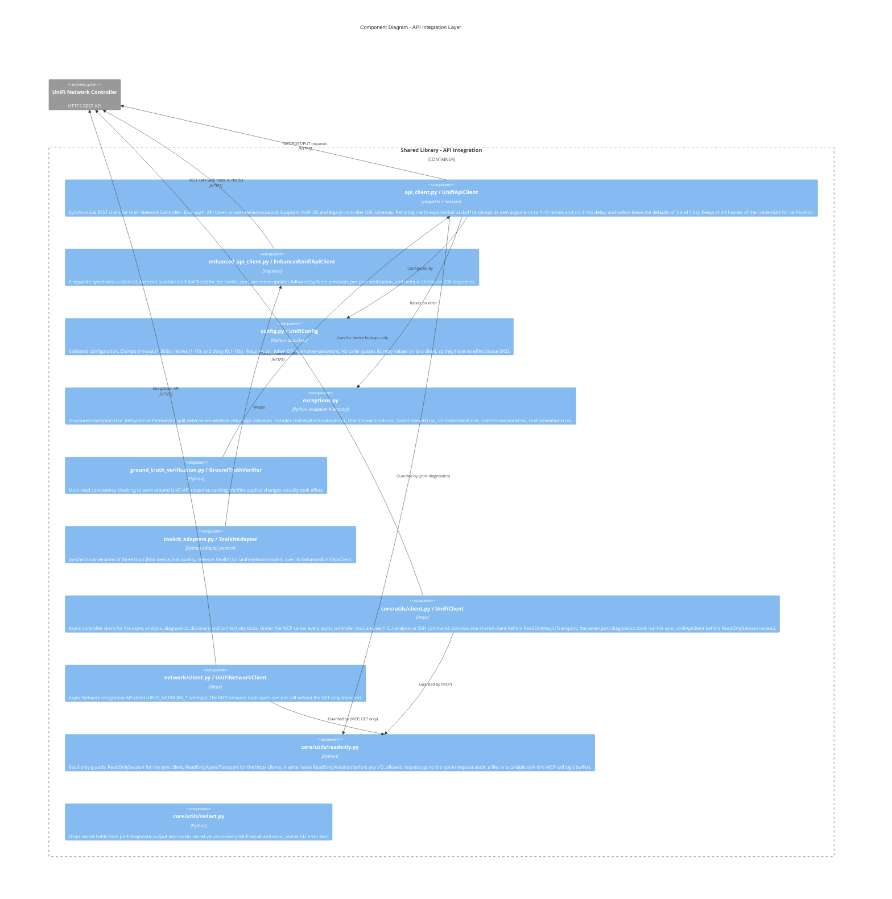

### PlantUML Equivalent

```plantuml
@startuml C4_Component_API
!include https://raw.githubusercontent.com/plantuml-stdlib/C4-PlantUML/master/C4_Component.puml

Container_Boundary(api_layer, "Shared Library - API Integration") {
    Component(api_client_c, "UnifiApiClient", "requests", "Synchronous REST client with dual auth, retry, and credential sanitisation")
    Component(enhanced_api, "EnhancedUnifiApiClient", "requests", "Separate sync client: overrides + force-provision, meta.rc checks")
    Component(config_c, "UnifiConfig", "dataclass", "Validated configuration with input clamping")
    Component(exceptions_c, "Exception hierarchy", "Python", "Retryable vs Permanent error split")
    Component(ground_truth, "GroundTruthVerifier", "Python", "Multi-read consistency checking for API cache workaround")
    Component(toolkit_adapters_c, "ToolkitAdapter", "Python adapter", "Sync versions of three tools for the toolkit")
    Component(async_client_c, "UniFiClient", "httpx", "Async controller client; shared and read-only under MCP")
    Component(network_client_c, "UniFiNetworkClient", "httpx", "Async Integration API client")
    Component(readonly_c, "core/utils/readonly.py", "Python", "Read-only guards and request audit")
    Component(redact_c, "core/utils/redact.py", "Python", "Secret stripping and masking")
}

System_Ext(unifi_network_c, "UniFi Network Controller", "HTTPS REST")

Rel(api_client_c, unifi_network_c, "REST calls", "HTTPS")
Rel(enhanced_api, unifi_network_c, "REST calls", "HTTPS")
Rel(api_client_c, exceptions_c, "Raises on error")
Rel(ground_truth, api_client_c, "Uses for lookups")
Rel(toolkit_adapters_c, enhanced_api, "Wraps")
Rel(async_client_c, unifi_network_c, "Classic API", "HTTPS")
Rel(network_client_c, unifi_network_c, "Integration API", "HTTPS")
Rel(async_client_c, readonly_c, "Guarded by")
Rel(network_client_c, readonly_c, "Guarded by")
@enduml
```

---

### 3.3 Analysis and Diagnostic Components

The intelligence layer contains the toolkit functions exposed to CLI workflows and the 87 YAML-registered MCP tools. Tools receive a client/config object, query the UniFi controller surface they belong to, and return structured results.

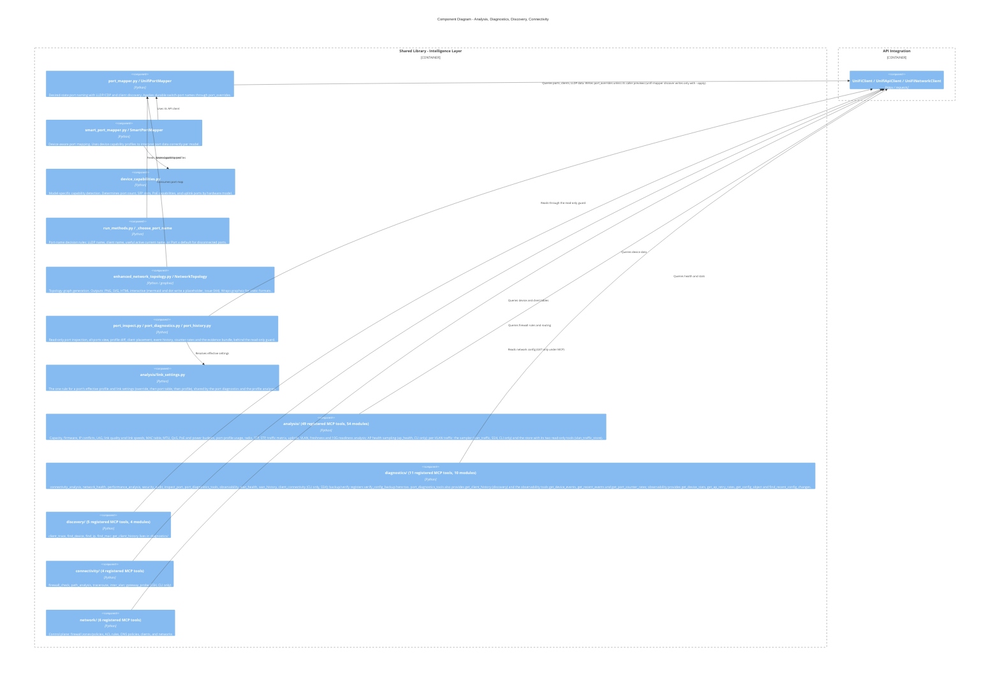

### PlantUML Equivalent

```plantuml
@startuml C4_Component_Intelligence
!include https://raw.githubusercontent.com/plantuml-stdlib/C4-PlantUML/master/C4_Component.puml

Container_Boundary(intelligence, "Shared Library - Intelligence Layer") {
    Component(port_mapper_c, "UnifiPortMapper", "Python", "Desired-state port naming through port_overrides")
    Component(smart_port_mapper_c, "SmartPortMapper", "Python", "Device-aware port mapping")
    Component(device_caps, "DeviceCapabilities", "Python", "Model-specific capability profiles")
    Component(naming_rules, "run_methods.py / _choose_port_name", "Python", "LLDP, client, current, or Port x naming rules")
    Component(topology_c, "NetworkTopology", "Python / graphviz", "Topology graph: PNG, SVG, HTML")
    Component(port_diag_c, "Port diagnostics", "Python", "Read-only port inspection and evidence bundles")
    Component(link_settings_c, "analysis/link_settings.py", "Python", "Effective profile and link settings rule")
    Component(analysis_pkg, "analysis/ (49 registered MCP tools)", "Python", "Capacity, firmware, IP conflicts, LAG, link quality and speeds, MAC, MTU, QoS, PoE, radio, SFP, STP, traffic, uplinks, VLAN, 10G readiness")
    Component(diagnostics_pkg, "diagnostics/ (11 registered MCP tools)", "Python", "Health, performance, security, connectivity, port inspection and evidence, WAN health and speedtest history, offline backup verification; also client history and the observability tools")
    Component(discovery_pkg, "discovery/ (5 registered MCP tools)", "Python", "Find device, find IP, find MAC, client trace; client history comes from diagnostics/")
    Component(connectivity_pkg, "connectivity/ (4 registered MCP tools)", "Python", "Firewall check, path analysis, inter-VLAN routing, traceroute")
    Component(network_pkg, "network/ (6 registered MCP tools)", "Python", "Firewall zones/policies, ACL rules, DNS policies, clients, networks")
}

Container_Boundary(api_int, "API Integration") {
    Component(api_ref, "UniFiClient / UnifiApiClient / UniFiNetworkClient", "httpx / requests", "")
}

Rel(analysis_pkg, api_ref, "Queries")
Rel(diagnostics_pkg, api_ref, "Queries")
Rel(discovery_pkg, api_ref, "Queries")
Rel(connectivity_pkg, api_ref, "Queries")
Rel(network_pkg, api_ref, "Reads")
Rel(port_mapper_c, api_ref, "Writes port_overrides unless previewing")
Rel(port_diag_c, api_ref, "Reads (guarded)")
Rel(port_diag_c, link_settings_c, "Uses")
Rel(naming_rules, port_mapper_c, "Feeds desired names")
Rel(smart_port_mapper_c, device_caps, "Uses")
Rel(topology_c, port_mapper_c, "Consumes")
@enduml
```

---

### 3.4 UniFi Protect Components

The Protect subsystem is architecturally isolated from the Network subsystem. It uses an async client, a separate configuration model, and a WebSocket event pipeline.

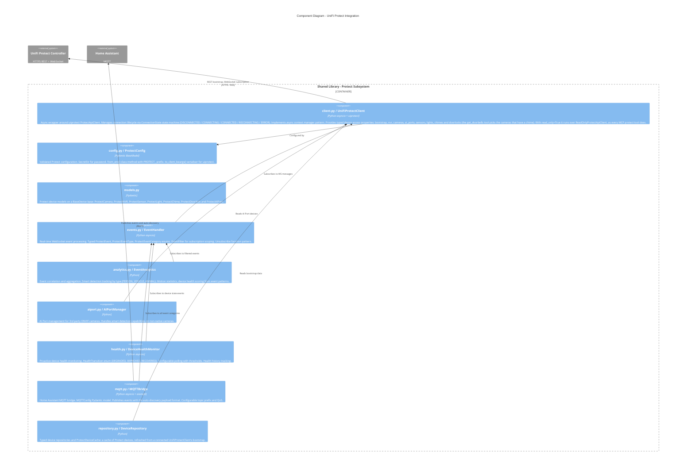

### PlantUML Equivalent

```plantuml
@startuml C4_Component_Protect
!include https://raw.githubusercontent.com/plantuml-stdlib/C4-PlantUML/master/C4_Component.puml

Container_Boundary(protect_sub, "Shared Library - Protect Subsystem") {
    Component(protect_client_c, "UniFiProtectClient", "asyncio + uiprotect", "Async wrapper with ConnectionState machine and typed device properties")
    Component(protect_config_c, "ProtectConfig", "Pydantic", "Validated config with SecretStr and from_env()")
    Component(protect_models_c, "Protect Models", "Pydantic", "Camera, NVR, sensor, light, chime, doorlock and AI Port models")
    Component(events_c, "EventHandler", "asyncio", "WebSocket event processing with typed enums and subscription filtering")
    Component(analytics_c, "EventAnalytics", "Python", "Event correlation, smart detection stats, motion aggregation")
    Component(aiport_c, "AIPortManager", "Python", "AI Port management for 3rd party ONVIF cameras")
    Component(health_c, "DeviceHealthMonitor", "asyncio", "Proactive health monitoring with transition detection")
    Component(mqtt_c, "MQTTBridge", "asyncio + aiomqtt", "HA MQTT bridge with auto-discovery")
    Component(repository_c, "DeviceRepository", "Python", "Device cache refreshed from the client's bootstrap")
}

System_Ext(protect_ctrl, "UniFi Protect Controller")
System_Ext(ha, "Home Assistant")

Rel(protect_client_c, protect_ctrl, "REST + WebSocket")
Rel(events_c, protect_client_c, "Subscribes")
Rel(analytics_c, events_c, "Subscribes")
Rel(health_c, events_c, "Subscribes")
Rel(mqtt_c, events_c, "Subscribes")
Rel(mqtt_c, ha, "Publishes", "MQTT")
@enduml
```

---

### 3.5 MCP Server Components

The MCP server separates tool discovery from tool loading: an AI assistant explores the catalogue through the registry's metadata, and a handler is imported only when its tool is first described or run. Every call, on either surface, goes through one runner.

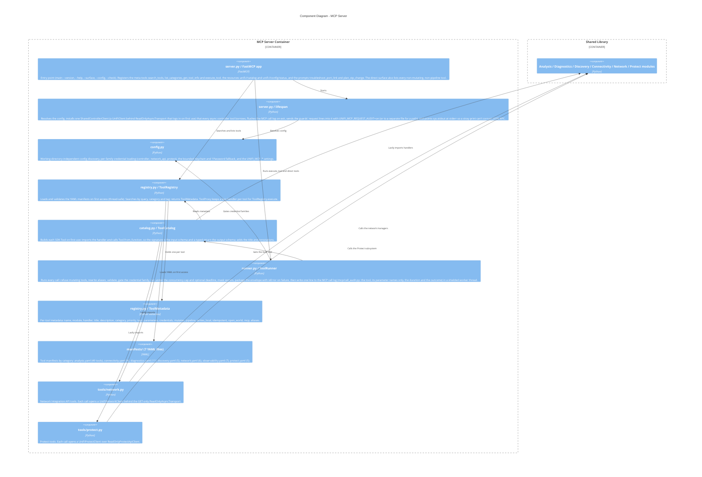

### PlantUML Equivalent

```plantuml
@startuml C4_Component_MCP
!include https://raw.githubusercontent.com/plantuml-stdlib/C4-PlantUML/master/C4_Component.puml

Container_Boundary(mcp_sub, "MCP Server") {
    Component(mcp_server_c, "FastMCP app", "FastMCP", "Meta-tools, resources, prompts; direct surface")
    Component(lifespan_c, "lifespan", "Python", "Shared read-only controller client")
    Component(config_c, "config.py", "Python", "Config discovery, credential families, settings")
    Component(registry_c, "ToolRegistry", "Python", "YAML manifest loading and validation, search")
    Component(catalog_c, "ToolCatalog", "Python", "Builds SDK tools from handlers on first use")
    Component(runner_c, "ToolRunner", "Python", "Validate, gate, run, mask, package every call")
    Component(tool_metadata_c, "ToolMetadata", "Python dataclass", "Per-tool manifest fields")
    Component(manifests_c, "manifests/ (7 YAML files)", "YAML", "Tool definitions for 87 analysis, connectivity, diagnostics, discovery, network, observability and protect tools")
    Component(network_tools_c, "tools/network.py", "Python", "Integration API tools, GET-only client per call")
    Component(protect_tools_c, "tools/protect.py", "Python", "Protect tools over ReadOnlyProtectApiClient")
}

Container_Boundary(shared_c, "Shared Library") {
    Component(shared_ref, "All domain modules", "Python", "")
}

Rel(mcp_server_c, registry_c, "Searches")
Rel(mcp_server_c, runner_c, "Runs tools")
Rel(mcp_server_c, lifespan_c, "Starts")
Rel(lifespan_c, config_c, "Resolves config")
Rel(registry_c, manifests_c, "Loads YAML")
Rel(registry_c, tool_metadata_c, "Holds")
Rel(runner_c, catalog_c, "Gets tools")
Rel(runner_c, config_c, "Gates credentials")
Rel(catalog_c, network_tools_c, "Lazily imports")
Rel(catalog_c, protect_tools_c, "Lazily imports")
Rel(catalog_c, shared_ref, "Lazily imports")
Rel(network_tools_c, shared_ref, "Delegates")
Rel(protect_tools_c, shared_ref, "Delegates")
@enduml
```

---

## Level 4: Code Diagrams

### 4.1 API Client Class Structure

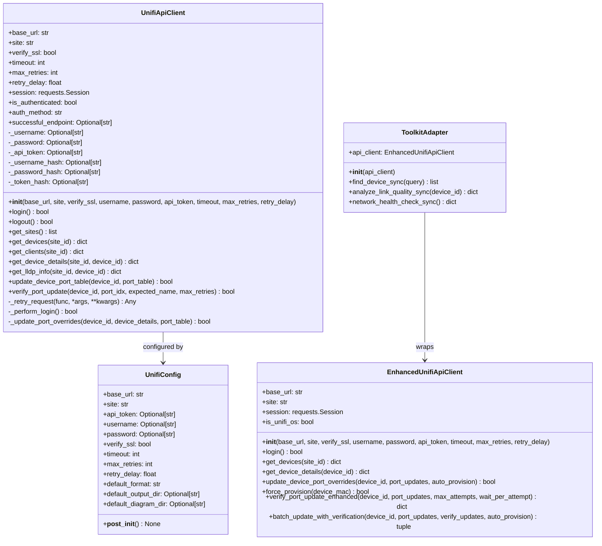

### PlantUML Equivalent

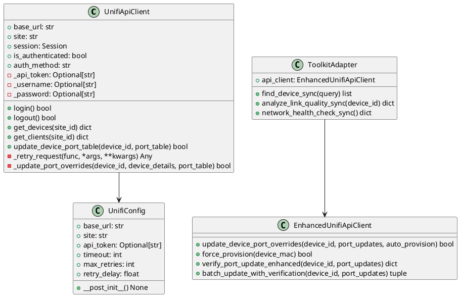

---

### 4.2 Protect Client Class Structure

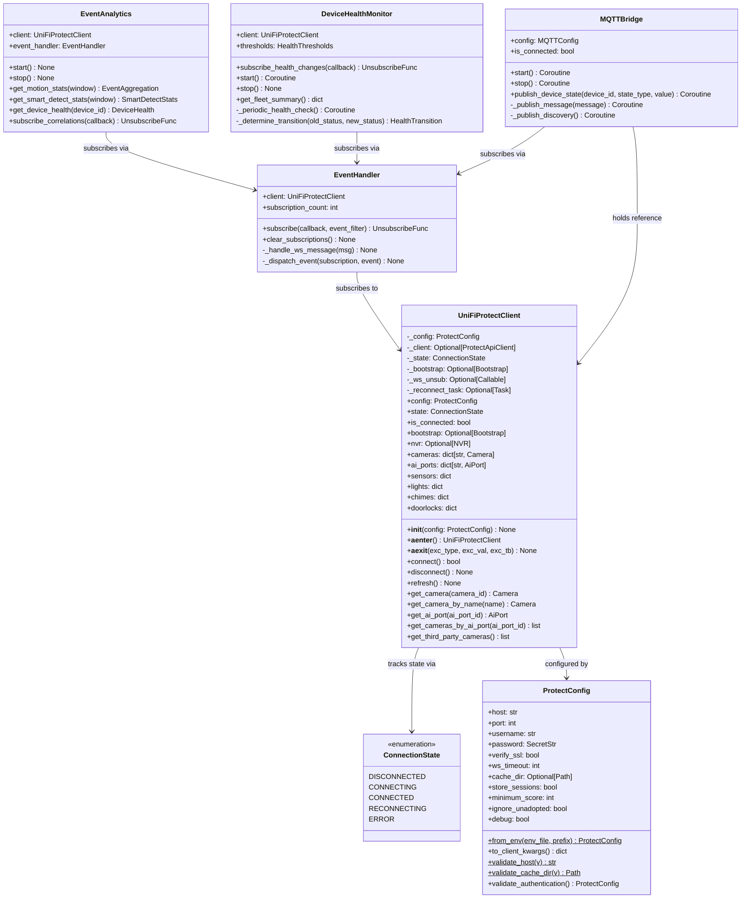

### PlantUML Equivalent

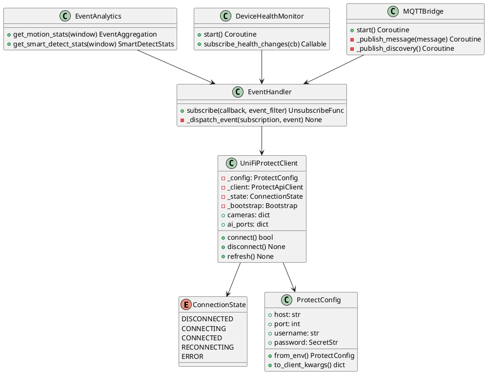

---

### 4.3 Data Model Hierarchy

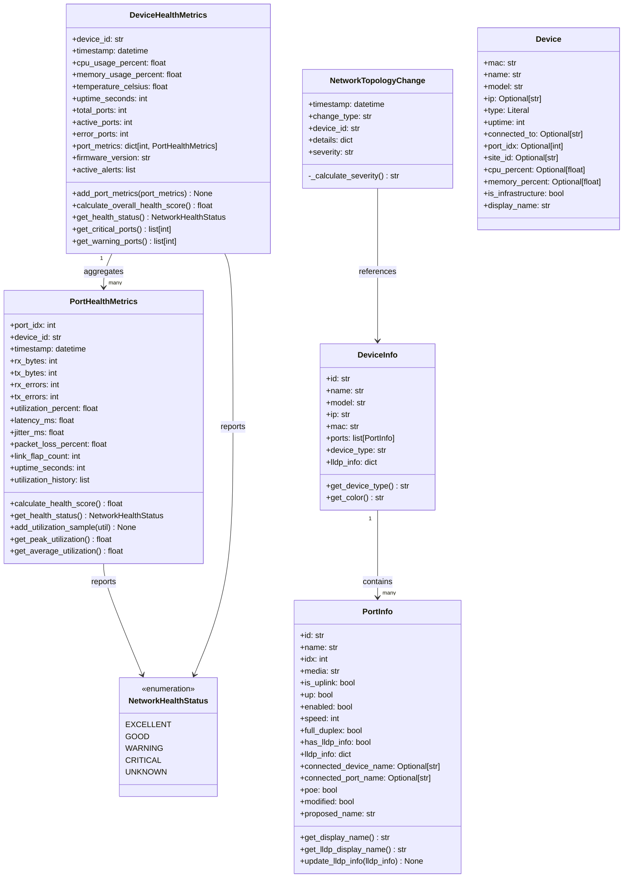

### PlantUML Equivalent

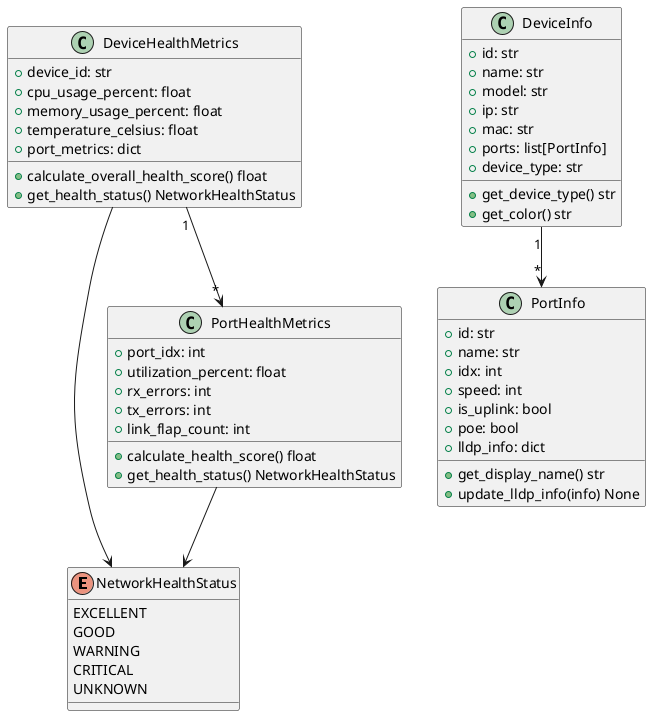

---

### 4.4 Exception Hierarchy

```mermaid
classDiagram
    class Exception {
        <<Python built-in>>
    }

    class UniFiApiError {
        <<base>>
        Base exception for all UniFi API errors.
        Catch this to handle any UniFi error.
    }

    class UniFiRetryableError {
        <<abstract>>
        Errors where retry logic should activate.
        5xx responses, timeouts, connection failures.
    }

    class UniFiPermanentError {
        <<abstract>>
        Errors that must not be retried.
        4xx client errors — retrying won't help.
    }

    class UniFiConnectionError {
        Network connectivity failures.
        Connection refused, DNS resolution failure.
    }

    class UniFiTimeoutError {
        Request timed out.
        Controller unreachable within configured timeout.
    }

    class UniFiRateLimitError {
        HTTP 429 Too Many Requests.
        Back off and retry after delay.
    }

    class UniFiAuthenticationError {
        +auth_method: str
        +status_code: int
        HTTP 401 or 403.
        Token invalid or credentials rejected.
    }

    class UniFiPermissionError {
        Insufficient API privileges for operation.
        User account lacks required role.
    }

    class UniFiValidationError {
        Invalid input parameters.
        Bad site_id, device_id format, etc.
    }

    Exception <|-- UniFiApiError
    UniFiApiError <|-- UniFiRetryableError
    UniFiApiError <|-- UniFiPermanentError
    UniFiRetryableError <|-- UniFiConnectionError
    UniFiRetryableError <|-- UniFiTimeoutError
    UniFiRetryableError <|-- UniFiRateLimitError
    UniFiPermanentError <|-- UniFiAuthenticationError
    UniFiPermanentError <|-- UniFiPermissionError
    UniFiPermanentError <|-- UniFiValidationError
```

### PlantUML Equivalent

```plantuml
@startuml Code_Exceptions
class Exception <<Python built-in>>

class UniFiApiError <<base>>
class UniFiRetryableError <<abstract>>
class UniFiPermanentError <<abstract>>

class UniFiConnectionError
class UniFiTimeoutError
class UniFiRateLimitError

class UniFiAuthenticationError {
    +auth_method: str
    +status_code: int
}
class UniFiPermissionError
class UniFiValidationError

Exception <|-- UniFiApiError
UniFiApiError <|-- UniFiRetryableError
UniFiApiError <|-- UniFiPermanentError
UniFiRetryableError <|-- UniFiConnectionError
UniFiRetryableError <|-- UniFiTimeoutError
UniFiRetryableError <|-- UniFiRateLimitError
UniFiPermanentError <|-- UniFiAuthenticationError
UniFiPermanentError <|-- UniFiPermissionError
UniFiPermanentError <|-- UniFiValidationError
@enduml
```

---

## Provider and Platform Architecture

The C4 diagrams above show the system as a whole. Provider-specific behavior is documented separately so the main C4 view stays readable while preserving the details that matter during implementation and operations.

| Provider/interface | Architecture document | Implementation scope |
| --- | --- | --- |
| UniFi Network | [providers/unifi-network.md](providers/unifi-network.md) | Synchronous legacy REST client, async integrations API client, port mapping, analysis, discovery, connectivity, and network control wrappers. |
| UniFi Protect + MQTT | [providers/unifi-protect-mqtt.md](providers/unifi-protect-mqtt.md) | Async Protect client, WebSocket events, device repository, health/analytics, AI Port support, and Home Assistant MQTT discovery/state publishing. |
| AXIS provisioning | [providers/axis-provisioning.md](providers/axis-provisioning.md) | Scripted AXIS camera/device desired-state reconciliation through VAPIX, JSON API, ONVIF helpers, and MQTT target configuration. |
| MCP and automation | [providers/mcp-automation.md](providers/mcp-automation.md) | FastMCP stdio server, the discovery and direct surfaces, YAML manifests, lazy tool building (`ToolCatalog`), read-only execution (`ToolRunner` and the guards), and automation entry points. |

```mermaid
C4Container
    title Provider and Automation Boundaries - UniFi Management CLI

    Person(admin, "Network Administrator", "Runs CLI workflows")
    Person_Ext(agent, "AI Assistant", "Discovers automation tools")

    System_Ext(network_controller, "UniFi Network Controller", "Network REST APIs")
    System_Ext(protect_controller, "UniFi Protect Controller", "Protect REST + WebSocket")
    System_Ext(mqtt_broker, "MQTT Broker / Home Assistant", "MQTT discovery and state topics")

    System_Boundary(package, "unifi_mapper package") {
        Container(cli, "CLI entry points", "Typer / argparse", "Human-operated terminal workflows")
        Container(network_provider, "Network provider modules", "requests + httpx", "Topology, port naming, diagnostics, discovery, and Network control plane")
        Container(protect_provider, "Protect provider modules", "asyncio + uiprotect", "Protect inventory, events, AI Port, analytics, health, and MQTT bridge")
        Container(mcp_provider, "MCP automation interface", "FastMCP + YAML manifests", "Progressive tool discovery, lazy tool building and read-only execution through ToolRunner")
    }

    Rel(admin, cli, "Runs commands", "shell")
    Rel(agent, mcp_provider, "Discovers and runs read-only tools", "MCP stdio")
    Rel(cli, network_provider, "Calls workflows")
    Rel(cli, protect_provider, "Calls Protect workflows")
    Rel(mcp_provider, network_provider, "References registered tool wrappers")
    Rel(mcp_provider, protect_provider, "References Protect tool wrappers")
    Rel(network_provider, network_controller, "Reads; CLI commands write, the MCP server never does", "HTTPS REST")
    Rel(protect_provider, protect_controller, "Bootstraps and subscribes", "HTTPS / WSS")
    Rel(protect_provider, mqtt_broker, "Publishes discovery and state", "MQTT")
```

## Dynamic Runtime Flows

### Port discovery and desired-state port naming

The `discover` workflow now treats switch-port labels as desired state. For every router/switch port it chooses exactly one durable name:

1. LLDP/CDP device name when the controller provides a useful non-MAC neighbour name.
2. Active wired client name when LLDP only exposes a MAC address or no useful neighbour name.
3. Existing current name only when the port is active and the discovered client label is weak.
4. `Port x` when no device is connected, where `x` is the UniFi port index.

A plain `discover` previews: it chooses the names and writes the report and the diagram, but sends nothing to the controller. Only `discover --apply` writes. Writes are sent to `port_overrides`, not `port_table`. `port_table` is controller/device state; `port_overrides` is the writable configuration the UniFi UI persists.

```mermaid
C4Dynamic
    title Dynamic Diagram - Discover Desired-State Port Naming

    Person(admin, "Network administrator", "Runs discovery and expects switch-port labels to match connected devices")
    Container(cli, "unifi-mapper discover", "Typer CLI", "Loads config and starts the discovery workflow")
    Container_Boundary(shared_library, "unifi_mapper shared library") {
        Component(run_methods, "run_methods.py", "Python", "Builds desired names for every router and switch port")
        Component(naming, "_choose_port_name", "Python", "Chooses LLDP name, client name, active current name, or Port x")
        Component(mapper, "UnifiPortMapper", "Python", "With --apply only: batches per-device port name updates and provisions devices")
        Component(api, "UnifiApiClient", "requests", "Reads controller state and writes durable port_overrides")
    }
    System_Ext(controller, "UniFi Network Controller", "Stores device state and switch-port configuration")
    ContainerDb(report, "Reports and diagrams", "Markdown / Graphviz", "Generated topology artefacts (png, svg or html)")

    Rel(admin, cli, "1. Runs command", "shell")
    Rel(cli, run_methods, "2. Delegates discovery", "Python call")
    Rel(run_methods, api, "3. Reads devices, port_table, clients, LLDP", "HTTPS REST")
    Rel(api, controller, "4. GET /stat/device and /stat/sta", "HTTPS")
    Rel(run_methods, naming, "5. Selects desired name per port", "Python call")
    Rel(run_methods, mapper, "6. With --apply, sends per-device desired updates", "Python call")
    Rel(mapper, api, "7. With --apply, persists merged port_overrides", "PUT /rest/device by id")
    Rel(api, controller, "8. With --apply, writes port_overrides and force-provision", "HTTPS REST")
    Rel(run_methods, report, "9. Emits report and topology diagram", "file output")
```

### Protect event to Home Assistant MQTT

```mermaid
sequenceDiagram
    autonumber
    participant Protect as UniFi Protect Controller
    participant Client as UniFiProtectClient
    participant Events as EventHandler
    participant Bridge as MQTTBridge
    participant Broker as MQTT Broker
    participant HA as Home Assistant

    Client->>Protect: authenticate and load bootstrap
    Client->>Protect: subscribe to WebSocket updates
    Protect-->>Client: WSSubscriptionMessage
    Client->>Events: normalise event/action/model
    Events->>Bridge: dispatch matching ProtectEvent
    Bridge->>Broker: publish state topic
    Bridge->>Broker: publish discovery topic
    Broker-->>HA: device/entity state and metadata
```

### MCP discovery and lazy tool resolution

```mermaid
sequenceDiagram
    autonumber
    actor User as AI-assisted user
    participant Assistant as MCP client / assistant
    participant Server as unifi-mcp FastMCP server
    participant Registry as ToolRegistry
    participant Manifest as YAML manifests
    participant Runner as ToolRunner
    participant Catalog as ToolCatalog
    participant Tool as Tool implementation module

    User->>Assistant: "Find the STP tools"
    Assistant->>Server: search_tools(query="stp")
    Server->>Registry: search(query, category, tags)
    Registry->>Manifest: load manifests on first access
    Manifest-->>Registry: 87 tool metadata records
    Registry-->>Server: matching summaries
    Server-->>Assistant: tool names and descriptions
    Assistant->>Server: get_tool_info("discover_stp_topology")
    Server->>Catalog: find(tool_name)
    Catalog->>Tool: import the handler on first use
    Catalog-->>Server: input and output schemas, title, annotations
    Server-->>Assistant: full tool spec
    Assistant->>Server: execute_tool("discover_stp_topology", {})
    Server->>Runner: run(name, params)
    Note over Runner: refuse mutating tools, validate, gate the credential family
    Runner->>Tool: call the handler (read-only guarded client)
    Tool-->>Runner: STPTopology
    Runner-->>Server: masked envelope
    Server-->>Assistant: ok envelope with the result
```

## Key Design Decisions

### Synchronous Network API, Asynchronous Protect API

The original port-naming path (`UnifiApiClient`, `EnhancedUnifiApiClient`) and the read-only port diagnostics use `requests` (synchronous). The analysis, diagnostics, discovery and connectivity tools and the MCP server use the async `httpx` clients (`UniFiClient` for the classic controller API, `UniFiNetworkClient` for the Integration API), and the Protect client (`UniFiProtectClient`) uses `asyncio` and the `uiprotect` library, because Protect needs a persistent WebSocket subscription for real-time events. The sync port-diagnostics tools run under the MCP server too, each behind the sync read-only guard. The `ToolkitAdapter` class gives `unifi-network-toolkit` synchronous versions of three tools over its sync client; the MCP server doesn't use it.

### Retryable vs Permanent Exception Split

The exception hierarchy divides all errors into `UniFiRetryableError` and `UniFiPermanentError` before further specialisation. The retry loop in `UnifiApiClient._retry_request()` follows the same split: it retries timeouts, connection errors and 5xx, 408 and 429 responses with exponential backoff, while a 401 or 403 (`UniFiAuthenticationError`) or another 4xx (`UniFiPermissionError`) raises at once. When the attempts run out, a timeout raises `UniFiTimeoutError` and a connection failure `UniFiConnectionError`; an HTTP error that kept failing raises the base `UniFiApiError`. This prevents pointless retries on authentication failures (wrong password will always fail) while correctly retrying transient network issues.

### Credential Handling in the API Client

`UnifiApiClient` keeps a short SHA-256 hash of each credential next to the raw value (`_hash_for_verification()`), so a credential can be checked without exposing it, and logs the controller URL through `_sanitize_for_logging()`. Masking secrets in MCP results and errors, and in CLI error text, is the job of `core/utils/redact.py`.

### Code Mode Pattern in the MCP Server

The MCP server exposes `search_tools`, `list_categories`, `get_tool_info` and `execute_tool` as first-class tools rather than relying on the MCP tool listing protocol alone. This is the Code Mode pattern: AI assistants are expected to call `search_tools(query="stp")` and `get_tool_info("discover_stp_topology")` before `execute_tool("discover_stp_topology", {})`. This reduces hallucination of tool names and allows the assistant to inspect the full catalogue of 87 registered tools without receiving all tool definitions upfront. Hosts that defer tool schemas can use the direct surface (`UNIFI_MCP_TOOL_SURFACE=direct`) instead.

### YAML Manifests as the Tool Contract

Tool definitions live in YAML manifests rather than Python decorators. This separates the tool contract (what a tool is called, what it does, what parameters it accepts, which credential family it needs, whether it mutates) from the implementation (how it does it). The `ToolRegistry` loads and validates manifests lazily; `ToolCatalog` defers the actual `importlib.import_module()` call until a tool is first described or run (`ToolProxy` does the same for `ToolRegistry.execute`). The practical result is fast MCP server startup even with a large tool catalogue.

### Ground Truth Verification

`GroundTruthVerifier` exists because the UniFi API has known response caching behaviour where a `PUT` to update port names may return success, but a subsequent `GET` returns the old values for several seconds. Rather than relying on the API to confirm its own writes, the verifier performs multi-read consistency checks to detect when the controller has actually applied a change. This is documented as a workaround for API behaviour that is outside the project's control.

### Topology Wrapper Module

`network_topology.py` is a one-line re-export of `enhanced_network_topology.py`. This pattern preserves backward compatibility for any callers using the original import path (`from unifi_mapper.network_topology import NetworkTopology`) while consolidating the actual implementation in the enhanced module. New code imports from `enhanced_network_topology` directly.
