# UniFi Management CLI - Codebase Map

Generated: 2026-05-02; refreshed against the code on 2026-10-04

> **See also**: [Architecture Overview](architecture-overview.md) | [C4 Architecture](c4-architecture.md) | [Use Cases](../guides/use-cases-and-howto.md) | [Troubleshooting](../operations/troubleshooting-and-runbook.md)

---

## Table of Contents

1. [Project Overview](#1-project-overview)
2. [Top-Level Package Architecture](#2-top-level-package-architecture)
3. [Module Dependency Graph](#3-module-dependency-graph)
4. [Workflow-Oriented Component Map](#4-workflow-oriented-component-map)
5. [Core Entry Points and Configuration](#5-core-entry-points-and-configuration)
   - 5.1 [cli.py - Legacy argparse entry point](#51-clipy)
   - 5.2 [typer_cli.py - Modern Typer/Rich CLI](#52-typer_clipy)
   - 5.3 [network_cli.py and inventory_cli.py](#53-network_clipy-and-inventory_clipy)
   - 5.4 [config.py - UnifiConfig dataclass](#54-configpy)
6. [API Clients](#6-api-clients)
   - 6.1 [api_client.py - UnifiApiClient](#61-api_clientpy)
   - 6.2 [enhanced_api_client.py - EnhancedUnifiApiClient](#62-enhanced_api_clientpy)
7. [Port Mapping Subsystem](#7-port-mapping-subsystem)
   - 7.1 [port_mapper.py - UnifiPortMapper](#71-port_mapperpy)
   - 7.2 [smart_port_mapper.py - SmartPortMapper](#72-smart_port_mapperpy)
   - 7.3 [device_capabilities.py - DeviceCapabilityDetector](#73-device_capabilitiespy)
   - 7.4 [ground_truth_verification.py - GroundTruthVerifier](#74-ground_truth_verificationpy)
   - 7.5 [run_methods.py - Orchestration functions](#75-run_methodspy)
   - 7.6 [Port inspection and read-only port diagnostics](#76-port-inspection-and-read-only-port-diagnostics)
8. [Core Data Models](#8-core-data-models)
   - 8.1 [models.py - Legacy in-memory models](#81-modelspy)
   - 8.2 [core/models/ - Pydantic typed models](#82-coremodels)
9. [Network Topology and Reporting](#9-network-topology-and-reporting)
   - 9.1 [network_topology.py / enhanced_network_topology.py](#91-network_topologypy--enhanced_network_topologypy)
   - 9.2 [report_generator.py](#92-report_generatorpy)
10. [core/ Package](#10-core-package)
   - 10.1 [core/utils/auth.py - Credentials](#101-coreutilsauthpy)
   - 10.2 [core/utils/client.py - UniFiClient (async)](#102-coreutilsclientpy)
   - 10.3 [core/utils/errors.py - ToolError](#103-coreutilserrorspy)
   - 10.4 [core/utils/redact.py and core/utils/readonly.py](#104-coreutilsredactpy-and-coreutilsreadonlypy)
   - 10.5 [Other core/utils/ modules](#105-other-coreutils-modules)
11. [analysis/ Package](#11-analysis-package)
12. [diagnostics/ Package](#12-diagnostics-package)
13. [discovery/ Package](#13-discovery-package)
14. [connectivity/ Package](#14-connectivity-package)
15. [network/ Package](#15-network-package)
    - 15.1 [network/config.py - NetworkConfig](#151-networkconfigpy)
    - 15.2 [network/client.py - UniFiNetworkClient (async)](#152-networkclientpy)
    - 15.3 [network/firewall.py - FirewallManager](#153-networkfirewallpy)
    - 15.4 [Other network/ modules](#154-other-network-modules)
16. [protect/ Package](#16-protect-package)
    - 16.1 [protect/config.py - ProtectConfig](#161-protectconfigpy)
    - 16.2 [protect/client.py - UniFiProtectClient](#162-protectclientpy)
    - 16.3 [protect/events.py - Event handling](#163-protecteventspy)
    - 16.4 [protect/analytics.py - EventAnalytics](#164-protectanalyticspy)
    - 16.5 [protect/mqtt.py - MQTTBridge](#165-protectmqttpy)
    - 16.6 [protect/repository.py - DeviceRepository](#166-protectrepositorypy)
17. [mcp/ Package - MCP Server](#17-mcp-package)
    - 17.1 [mcp/server.py - FastMCP entry point](#171-mcpserverpy)
    - 17.2 [mcp/registry.py - ToolRegistry](#172-mcpregistrypy)
    - 17.3 [mcp/tools/ - Tool wrappers](#173-mcptools)
    - 17.4 [mcp/catalog.py, mcp/runner.py, mcp/config.py and mcp/call_audit.py](#174-mcpcatalogpy-mcprunnerpy-mcpconfigpy-and-mcpcall_auditpy)
18. [monitors/ and backup/ Packages](#18-monitors-and-backup-packages)
19. [utility/ Package](#19-utility-package)
20. [Key Workflows](#20-key-workflows)
    - 20.1 [Port Discovery and Naming Workflow](#201-port-discovery-and-naming-workflow)
    - 20.2 [STP Diagnostics and Remediation Workflow](#202-stp-diagnostics-and-remediation-workflow)
    - 20.3 [VLAN and Port Profile Validation Workflow](#203-vlan-and-port-profile-validation-workflow)
    - 20.4 [Port Counter Baseline Workflow](#204-port-counter-baseline-workflow)
    - 20.5 [Protect Event Pipeline](#205-protect-event-pipeline)
    - 20.6 [MCP Tool Discovery and Execution Workflow](#206-mcp-tool-discovery-and-execution-workflow)
21. [Exception Hierarchy](#21-exception-hierarchy)
22. [scripts/ Directory](#22-scripts-directory)

---

## 1. Project Overview

The UniFi Management CLI is a Python package (`unifi_mapper`) that provides three distinct interface layers over UniFi Controller APIs:

1. **CLI tools** - argparse and Typer-based command-line interfaces for network operators
2. **Analysis and diagnostics tools** - 54 analysis modules plus the diagnostics, discovery and connectivity packages
3. **MCP server** - A FastMCP server that exposes 87 registered tools to AI agents via the Model Context Protocol, all of them read-only against the controller

The codebase contains two generations of API client code. The legacy synchronous path (`api_client.py`, `port_mapper.py`, `run_methods.py`) handles the original port-mapping workflow. The modern async path (`core/utils/client.py`, `network/client.py`, `protect/client.py`) serves the analysis, network control, and Protect integration packages.

---

## 2. Top-Level Package Architecture

```mermaid
graph TB
    subgraph "CLI Entry Points"
        CLI["cli.py\n(argparse, legacy)"]
        TCLI["typer_cli.py\n(Typer + Rich)"]
        NCLI["network_cli.py\n(argparse)"]
        ICLI["inventory_cli.py\n(Typer)"]
    end

    subgraph "Port Mapping Core"
        PM["port_mapper.py\nUnifiPortMapper"]
        SPM["smart_port_mapper.py\nSmartPortMapper"]
        DC["device_capabilities.py\nDeviceCapabilityDetector"]
        GTV["ground_truth_verification.py\nGroundTruthVerifier"]
        RM["run_methods.py\norchestration"]
    end

    subgraph "API Clients"
        AC["api_client.py\nUnifiApiClient (sync)"]
        EAC["enhanced_api_client.py\nEnhancedUnifiApiClient (sync)"]
        UC["core/utils/client.py\nUniFiClient (async)"]
        NC["network/client.py\nUniFiNetworkClient (async)"]
        PC["protect/client.py\nUniFiProtectClient (async)"]
    end

    subgraph "Domain Packages"
        ANA["analysis/\n54 modules, 49 tools"]
        DIA["diagnostics/\n10 modules, 11 tools"]
        DIS["discovery/\n4 modules, 5 tools"]
        CON["connectivity/\n5 modules, 4 tools"]
        NET["network/\n12 modules"]
        PRO["protect/\n9 modules"]
    end

    subgraph "MCP Server"
        MCP["mcp/server.py\nFastMCP"]
        REG["mcp/registry.py\nToolRegistry"]
        TW["mcp/tools/\nwrappers"]
    end

    CLI --> PM
    TCLI --> PM
    TCLI --> ICLI
    RM --> PM
    PM --> AC
    SPM --> DC
    SPM --> GTV
    SPM --> AC
    EAC --> AC
    ANA --> UC
    DIA --> UC
    DIS --> UC
    CON --> UC
    NET --> NC
    PRO --> PC
    MCP --> REG
    REG --> TW
    TW --> NC
    TW --> PC
```

---

## 3. Module Dependency Graph

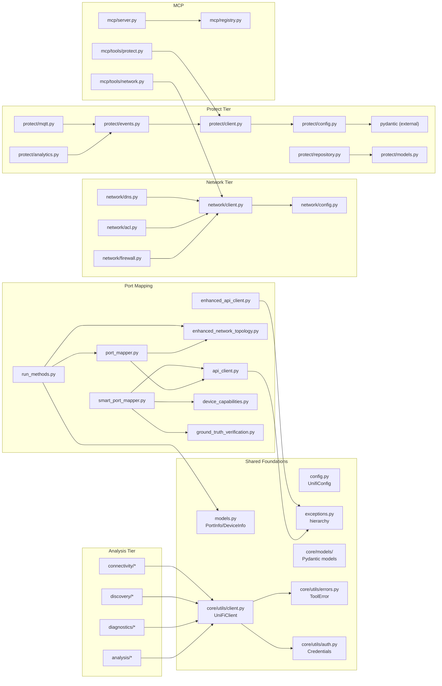

---

## 4. Workflow-Oriented Component Map

The codebase is best understood as five logical slices. The older synchronous port mapper owns discovery, naming, topology diagrams, and verification. The newer async tool stack owns analysis, diagnostics, network control, Protect, and MCP exposure.

```mermaid
graph TB
    subgraph "Operator Interfaces"
        Argparse["cli.py / verify_cli.py\nlegacy argparse CLIs"]
        Typer["typer_cli.py / inventory_cli.py\nTyper + Rich CLIs"]
        MCPServer["mcp/server.py\nFastMCP meta-tools, ToolRunner"]
    end

    subgraph "Sync Port-Naming Slice"
        Config["config.py\nUnifiConfig"]
        API["api_client.py\nUnifiApiClient"]
        PortMapper["port_mapper.py\nUnifiPortMapper"]
        SmartMapper["smart_port_mapper.py\nSmartPortMapper"]
        Capabilities["device_capabilities.py\ncapability guardrails"]
        GroundTruth["ground_truth_verification.py\nmulti-read verification"]
        RunMethods["run_methods.py\nworkflow orchestration"]
        Topology["enhanced_network_topology.py\nGraphviz/Mermaid topology"]
        Report["report_generator.py\nMarkdown reports"]
    end

    subgraph "Async Tool Foundation"
        Auth["core/utils/auth.py\nCredentials"]
        UniFiClient["core/utils/client.py\nUniFiClient"]
        ToolError["core/utils/errors.py\nToolError"]
        CoreModels["core/models/*\nPydantic domain models"]
    end

    subgraph "Analysis and Validation Tools"
        Discovery["discovery/*\nfind + trace"]
        STP["analysis/stp_*.py\nSTP topology, guard, drift, plans"]
        VLAN["analysis/vlan_*.py\nVLAN diagnostics + coverage"]
        Profiles["analysis/port_profile_validation.py\nport profile safety"]
        Counters["analysis/port_counter_baseline.py\ncounter snapshots"]
        OtherAnalysis["analysis/*\ncapacity, traffic, SFP, QoS, MTU"]
    end

    subgraph "Network and Protect Control"
        NetworkManagers["network/*\nfirewall, ACL, DNS, clients, sites"]
        Protect["protect/*\nclient, events, analytics, MQTT"]
        MCPTools["mcp/tools/*\nmanager lifecycle wrappers"]
        Registry["mcp/registry.py + catalog.py\nmanifest registry, lazy SDK tools"]
        Manifests["mcp/manifests/*.yaml\ntool metadata"]
    end

    Argparse --> Config --> API
    Argparse --> RunMethods
    Typer --> RunMethods
    RunMethods --> PortMapper --> API
    SmartMapper --> Capabilities
    SmartMapper --> GroundTruth
    RunMethods --> Topology
    RunMethods --> Report

    MCPServer --> Registry --> Manifests
    Registry --> MCPTools
    Registry --> STP
    Registry --> VLAN
    Registry --> Profiles
    Registry --> Discovery
    Registry --> OtherAnalysis
    MCPTools --> NetworkManagers
    MCPTools --> Protect

    Discovery --> UniFiClient
    STP --> UniFiClient
    VLAN --> UniFiClient
    Profiles --> UniFiClient
    OtherAnalysis --> UniFiClient
    UniFiClient --> Auth
    UniFiClient --> ToolError
    STP --> CoreModels
    VLAN --> CoreModels
    NetworkManagers --> CoreModels
    Protect --> CoreModels
```

**Primary module boundaries.**

| Slice | Modules | Interface Shape | Notes |
|---|---|---|---|
| Legacy port naming | `cli.py`, `config.py`, `api_client.py`, `port_mapper.py`, `smart_port_mapper.py`, `run_methods.py` | Synchronous classes and functions over `requests` | Handles read-modify-write of `port_overrides`; must preserve unrelated port settings. |
| Verification | `ground_truth_verification.py`, `verify_cli.py`, `browser_verification.py` | Multi-read verification helpers and CLI | Exists because UniFi API reads can be stale after writes. |
| Async analysis | `analysis/*`, `diagnostics/*`, `discovery/*`, `connectivity/*` | `async` functions returning Pydantic models | Consumed directly by tests and indirectly by MCP manifests. |
| Network control plane | `network/*`, `network_cli.py`, `mcp/tools/network.py` | Manager classes over `UniFiClient` or `UniFiNetworkClient` | Splits typed Network API resources from classic controller analysis tools. |
| MCP exposure | `mcp/server.py`, `mcp/registry.py`, `mcp/catalog.py`, `mcp/runner.py`, `mcp/config.py`, `mcp/manifests/*.yaml`, `mcp/tools/*` | FastMCP meta-tools and direct tools; `ToolCatalog` builds each SDK tool on first use and `ToolRunner` validates, gates, runs and masks every call | Agents search metadata before loading expensive domain modules. |
| Protect integration | `protect/*`, `monitors/protect_monitor.py`, `mcp/tools/protect.py` | Async `uiprotect` wrapper plus independent polling monitor | Protect is intentionally separate from Network API concerns. |

**PlantUML component view.**

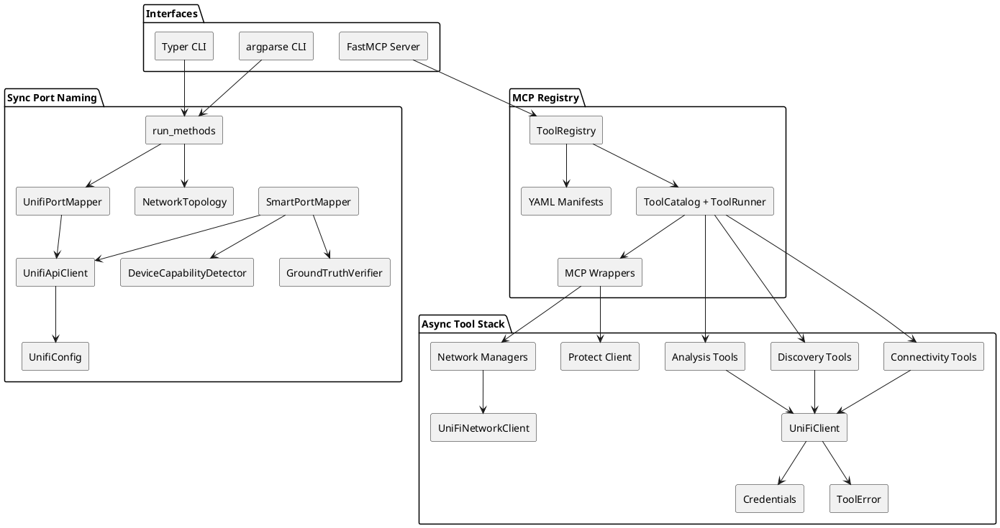

---

## 5. Core Entry Points and Configuration

### 5.1 `cli.py`

**Purpose.** The original argparse CLI, now run only as `python -m unifi_mapper.cli` (the `unifi-mapper` console script is `typer_cli:app`). It handles config discovery, loads a `.env` file into `os.environ`, then delegates to `run_port_mapper` or `SmartPortMapper`. Unlike `unifi-mapper discover`, it writes port names unless `--dry-run` is given ([issue 015](../issues/015-other-discover-entry-points-write-by-default.md)).

**Key functions.**

| Function | Description |
|---|---|
| `main()` | argparse-based entry, dispatches to port mapping or smart mapping |
| `load_env_from_config(config_path)` | Parses a key=value `.env` file into `os.environ`; exits 1 if the file is missing |
| `get_default_config_path()` | `prod.env`, then `default.env`, in `$XDG_CONFIG_HOME/unifi_management_cli/` (or `~/.config/unifi_management_cli/` when unset), else `./.env` |

**Dependencies.** `config.py`, `api_client.py`, `port_mapper.py`, `smart_port_mapper.py`, `run_methods.py`, `completions.py`

**Interface.** `typer_cli.py` and `inventory_cli.py` import its two config helpers; `network_cli.py` imports `load_env_from_config`. Deferred imports after env loading avoid import-time side effects. The MCP server has its own search (`mcp/config.py`), which also tries `~/.config` when `XDG_CONFIG_HOME` is set ([issue 048](../issues/048-cli-and-mcp-config-searches-differ.md)).

---

### 5.2 `typer_cli.py`

**Purpose.** The `unifi-mapper` console script: a Typer + Rich CLI over the port-mapping logic and the analysis packages. Registers the top-level commands (`discover`, `diagram`, `verify`, `capabilities`, `version`, `install-completions`) and the `find`, `analyze`, `diagnose`, `inventory`, `stp`, `radio`, `ports`, `controller` and `backup` groups, 68 commands in all.

**Key objects.**

| Object | Description |
|---|---|
| `app` | Typer application instance. Root options: `--config`/`-c` (also `UNIFI_CONFIG`), `--debug`, and the `discover` shortcuts `--dry-run`, `--apply`, `--connected-devices` and `--verify-updates`. On their own the shortcuts run `discover` (a preview unless `--apply`); before the `discover` subcommand the first three are passed on to it; before any other subcommand they exit 2, and a root `--apply` exits 2 before any subcommand |
| `state` (State) | Global singleton holding config path, debug flag and the root shortcuts passed on to `discover` |
| `main()` | Root callback: applies the shortcut rules above, and prints help on a bare `unifi-mapper` |

**Dependencies.** `cli.py` (for `get_default_config_path`, `load_env_from_config`), `inventory_cli.py`

---

### 5.3 `network_cli.py` and `inventory_cli.py`

**Purpose.** `network_cli.py` is the argparse entry point for the `unifi-network-toolkit` console script (`analyze`, `diagnose`, `find`, `discover`, `install-completions`); its `discover` writes port names unless `--dry-run` is given (issue 015). `inventory_cli.py` provides the Typer subapp `inventory_app` (`list`, `check-updates`, `firmware-skew`, `update-firmware`), mounted as `unifi-mapper inventory` and run on its own as `unifi-inventory`. Each inventory command takes its own `--config` and ignores the root one ([issue 043](../issues/043-inventory-ignores-the-root-config.md)).

`toolkit_adapters.py` (`ToolkitAdapter`) gives the toolkit synchronous versions of three tools (`find_device_sync`, `analyze_link_quality_sync`, `network_health_check_sync`) over its `EnhancedUnifiApiClient`.

**Dependencies.** `inventory_cli.py` imports `api_client.py` and `cli.py`. `network_cli.py` defers its imports: `cli.load_env_from_config`, `config.py`, `port_mapper.py`, `run_methods.py`, `enhanced_api_client.py` and `toolkit_adapters.py`.

---

### 5.4 `config.py`

**Purpose.** Centralises all configuration for the synchronous API path as a `dataclass` with validation and clamping of numeric parameters.

**Key class.** `UnifiConfig`

| Field | Type | Notes |
|---|---|---|
| `base_url` | `str` | Required, must start with `http://` or `https://` |
| `site` | `str` | Defaults to `"default"` |
| `api_token` | `Optional[str]` | Preferred auth method |
| `username` / `password` | `Optional[str]` | Fallback auth |
| `verify_ssl` | `bool` | Defaults to `False` for self-signed certs |
| `timeout` | `int` | Clamped to 1-300 seconds |
| `max_retries` / `retry_delay` | `int` / `float` | Clamped to 1-10 and 0.1-10.0, but no caller passes them on ([issue 042](../issues/042-settings-with-no-effect.md)) |
| `default_format`, `default_output_dir`, `default_diagram_dir` | `str` / `Optional[str]` | Read only by the legacy `python -m unifi_mapper.cli` (issue 042) |

**Key methods.**

- `from_env(env_file)` - Loads `UNIFI_URL`, `UNIFI_SITE`, `UNIFI_CONSOLE_API_TOKEN`, etc. from environment (and the file, when it exists)
- `to_dict()` - Returns every field as a dict. It includes the output preferences, which `UnifiApiClient` does not accept, so it can't be passed to that constructor as is

**Dependencies.** Standard library only (`os`, `dataclasses`, `pathlib`).

---

## 6. API Clients

### 6.1 `api_client.py`

**Purpose.** Synchronous REST client for the UniFi Controller API (both UniFi OS / UDM and legacy controllers). Handles authentication, endpoint detection, retry logic with exponential backoff, input validation, and credential scrubbing.

**Key class.** `UnifiApiClient`

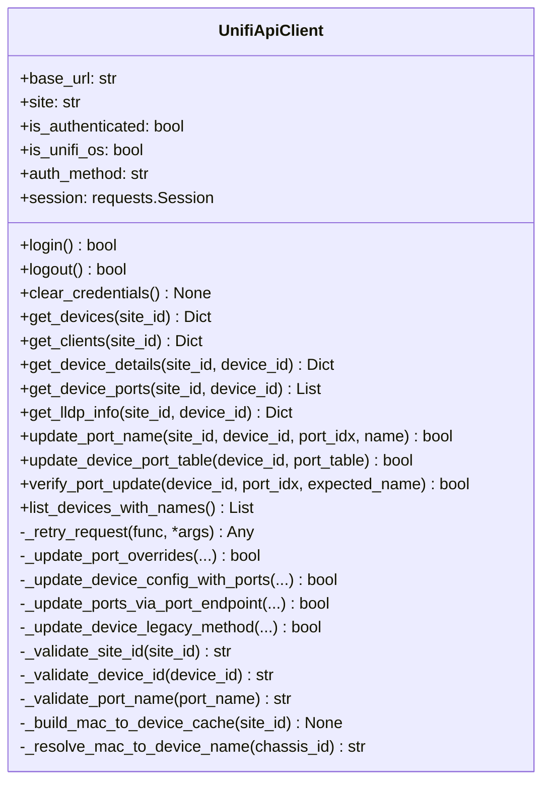

**Retry logic.** `_retry_request` applies exponential backoff (`retry_delay * 2^attempt`) for transient errors. It maps HTTP status codes to exception types: 401/403 raise `UniFiAuthenticationError` (no retry); 5xx and 408/429 retry up to `max_retries`.

**Port update strategy.** `update_device_port_table` tries four methods in order:

1. `_update_port_overrides` - writes to the writable `port_overrides` field (preferred)
2. `_update_device_config_with_ports` - sends full device config with updated `port_table`
3. `_update_ports_via_port_endpoint` - uses device manager `cmd/devmgr` command
4. `_update_device_legacy_method` - minimal payload fallback

**UniFi OS detection.** On first use, probes `/api/system`. Success means UniFi OS routes; failure falls back to legacy `/api/s/{site}/...` paths.

**Dependencies.** `exceptions.py`, `requests`

---

### 6.2 `enhanced_api_client.py`

**Purpose.** A second synchronous client (it does not subclass `UnifiApiClient`) that adds automatic device provisioning (`force-provision`) after port updates and enhanced per-port verification. `unifi-network-toolkit` uses it for its `analyze`, `diagnose` and `find` commands, through `ToolkitAdapter`.

**Key class.** `EnhancedUnifiApiClient`

| Method | Description |
|---|---|
| `update_device_port_overrides(device_id, port_updates, auto_provision)` | Updates named ports via `port_overrides`, then triggers `force-provision` |
| `force_provision(device_mac)` | Posts `cmd/devmgr` force-provision command |
| `verify_port_update_enhanced(device_id, port_updates, max_attempts)` | Per-port verification returning `Dict[int, bool]` |
| `batch_update_with_verification(device_id, port_updates, verify, auto_provision)` | Combined update + verify, returns `tuple[bool, Dict[int, bool]]` |

**Key difference from `api_client.py`.** This client checks `meta.rc` in the JSON response body (not just HTTP status) to detect silent API failures that return `200 OK` with an error payload.

**Dependencies.** `exceptions.py`, `requests`

---

## 7. Port Mapping Subsystem

### 7.1 `port_mapper.py`

**Purpose.** High-level facade over `UnifiApiClient`. Provides the primary object operators interact with: connects to the controller, fetches device and LLDP data, maps clients to ports, and dispatches batch port name updates.

**Key class.** `UnifiPortMapper`

| Method | Description |
|---|---|
| `get_devices()` | Fetch all devices for the configured site |
| `get_device_ports(device_id)` | Fetch port table for one device |
| `get_lldp_info(device_id)` | Fetch LLDP table for one device |
| `get_clients()` | Fetch all wired and wireless clients |
| `get_client_port_mapping(device_mac)` | Map switch ports to connected clients |
| `format_client_names(clients, max_names)` | Sanitise and format names for port labels |
| `batch_update_port_names(device_id, port_updates, verify_updates)` | Update multiple ports in one API call + optional verification |
| `_force_device_provision(device_id, device_mac)` | Post `force-provision` to device manager |
| `run(...)` | Delegates to `run_methods.run_port_mapper` |

**Internal state.** Holds a `NetworkTopology` instance that is populated during `run_methods.run_port_mapper`.

**Dependencies.** `api_client.py`, `network_topology.py`

---

### 7.2 `smart_port_mapper.py`

**Purpose.** Wraps the standard port mapper with device-capability awareness. Before updating any port it queries `DeviceCapabilityDetector` to determine whether the device is known to auto-reset port names, support only UI configuration, or have other firmware bugs. Integrates `GroundTruthVerifier` for post-update cross-checking.

**Key class.** `SmartPortMapper`

| Method | Description |
|---|---|
| `smart_update_ports(devices_data, lldp_data, verify_updates, dry_run)` | Main entry; iterates devices, checks capabilities, applies updates |
| `_apply_device_aware_updates(device_id, device_name, port_updates, capability)` | Applies updates using appropriate strategy per capability level |
| `_perform_ground_truth_verification(results)` | Calls `verify_with_ground_truth` and updates result dict |
| `generate_smart_mapping_report(results)` | Renders text summary with incompatible devices and recommendations |

**Dependencies.** `device_capabilities.py`, `ground_truth_verification.py`, `api_client.py`

---

### 7.3 `device_capabilities.py`

**Purpose.** Static knowledge base of device-specific port naming limitations keyed by `(model_code, firmware_version)`. Provides `should_attempt_port_naming` and `get_recommended_strategy` to prevent futile API calls against known-broken devices.

**Key objects.**

| Object | Description |
|---|---|
| `PortNamingSupport` (Enum) | `FULL_SUPPORT`, `UI_ONLY`, `LIMITED`, `RESETS_AUTOMATICALLY`, `NOT_SUPPORTED` |
| `DeviceCapability` (dataclass) | Per-device record: known issues, workarounds, max name length |
| `DeviceCapabilityDetector` | Lookup class with `detect_capabilities`, `should_attempt_port_naming`, `get_recommended_strategy` |

`analyze_network_capabilities.py` (`python -m unifi_mapper.analyze_network_capabilities`) runs the detector over the live device list and prints the compatibility report; `unifi-mapper capabilities` does the same through the Typer CLI.

**Dependencies.** Standard library only.

---

### 7.4 `ground_truth_verification.py`

**Purpose.** Multi-read consistency verifier that works around the UniFi API's tendency to return stale cached data. Uses enhanced API polling with forced cache invalidation rather than trusting a single read.

**Key class.** `GroundTruthVerifier`

| Method | Description |
|---|---|
| `verify_port_updates_ground_truth(device_updates, use_browser)` | Routes to browser or enhanced API verification |
| `_verify_with_enhanced_api_checks(device_updates)` | Multiple reads with jitter, cross-checks `port_table` and `port_overrides` |

**Module-level helper.** `verify_with_ground_truth(api_client, device_updates, browser_credentials)` - convenience wrapper used by `SmartPortMapper`.

**Dependencies.** `api_client.py`

---

### 7.5 `run_methods.py`

**Purpose.** Orchestration functions that drive a full port-mapper run: authenticate, fetch devices and clients, build LLDP port names, apply updates, infer topology connections, generate diagram and report. This is the main workflow coordinator.

**Key functions.**

| Function | Description |
|---|---|
| `run_port_mapper(port_mapper, site_id, ...)` | Full end-to-end run returning `(devices, connections)` |
| `get_devices_and_lldp_data(port_mapper, site_id)` | Helper for smart mapper: returns `(network_devices, lldp_data)` |
| `infer_device_connections(api_client, site_id, devices)` | Top-level connection inference dispatcher |
| `infer_connections_from_clients(api_client, site_id, devices)` | Connection inference from switch-port client data |
| `infer_connections_from_subnets(devices)` | Topology heuristic based on IP subnet membership |
| `infer_connections_from_device_types(devices)` | Topology heuristic based on device type hierarchy |

**Dependencies.** `models.py`, `network_topology.py`, `report_generator.py`

---

### 7.6 Port inspection and read-only port diagnostics

**Purpose.** Answer "what is on this port, how did it negotiate, and what has the controller seen?" for any switch and port, without any controller write. These modules use the synchronous `UnifiApiClient` and back both the `unifi-mapper ports` commands and the MCP tools in `diagnostics/`.

| Module | Key functions | Purpose |
|---|---|---|
| `port_inspect.py` | `resolve_switch_match`, `resolve_switch`, `inspect_port` | Resolve a switch (exact name, then MAC, IP, tokens, substring) and inspect one port: link, profile, network, connected device, addressing, LLDP |
| `port_diagnostics.py` | `collect_device_identity`, `collect_port_detail`, `collect_override`, `list_switch_ports`, `diff_port_profiles`, `get_client_history`, `collect_integration_snapshot`, `build_port_diagnostic_bundle` | Verbatim, sanitised evidence: raw port entry with raw `speed_caps`, full override, profile diff and usage, client placement checked from each record, Integration API port capability, and the evidence bundle with `request_audit` |
| `port_history.py` | `collect_events`, `collect_recent_events`, `sample_port_counters`, `read_counter_baselines` | Paged `stat/event`, `list/alarm` and v2 `system-log` history with observed retention per source, for one device (`collect_events`) or site-wide over the last N hours (`collect_recent_events`, `controller events`); counter rates with a trust verdict; read-only baseline comparison |
| `diagnostic_reads.py` | `Collection`, `fetch`, `resolve_device`, `find_port_entry` | Shared fetch helper that records failures instead of raising, the report model base (`schema_version`, final secret-stripping pass) and port lookups |
| `port_diagnostics_render.py` | `render_*` | Rich tables for the CLI; `--json` bypasses it |

**Safety.** Every entry point installs `core/utils/readonly.py`'s guard after login, so reused helpers cannot write either. Every output passes through `core/utils/redact.py`.

**Dependencies.** `api_client.py`, `core/utils/readonly.py`, `core/utils/redact.py`, `analysis/port_counter_baseline.py` (read only)

---

## 8. Core Data Models

### 8.1 `models.py`

**Purpose.** Classic Python classes (no Pydantic) used by the port-mapping and topology subsystem. These predate the Pydantic migration and remain in use by all synchronous code paths.

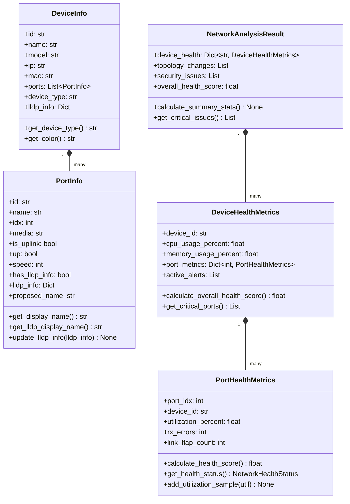

`NetworkHealthStatus` is an enum with values `EXCELLENT`, `GOOD`, `WARNING`, `CRITICAL`, `UNKNOWN`.

`NetworkConfiguration` is a snapshot model with a `compare_with(other)` method that returns a diff dict covering devices added/removed/modified and connections added/removed.

---

### 8.2 `core/models/`

**Purpose.** Pydantic `BaseModel` typed models used by the async analysis and network control tools. Each file is a focused domain model.

| Module | Key Classes | Notes |
|---|---|---|
| `device.py` | `Device` | `mac`, `name`, `model`, `type`, `connected_to`, `port_idx`, system metrics |
| `port.py` | `Port` (inferred) | Port state and configuration |
| `firewall.py` | `FirewallRule` | Action, source/dest with type annotations, protocol, `is_blocking` property |
| `vlan.py` | (VLAN models) | VLAN membership and configuration |
| `stp.py` | `STPTopology`, `SwitchSTPConfig`, `STPPortConfig`, `STPChange`, `STPOptimizationReport` | Rich STP analysis models with priority constants |
| `mirror.py` | `MirrorCapability`, `MirrorSession`, `DeviceMirrorCapabilities`, `MirrorSessionResult`, `MirrorReport` | SPAN/mirror session models, kept but used by no tool or command: port mirroring was removed (UniFi mirrors only locally; RSPAN needs per-switch SSH setup the controller overwrites). See "Why there is no port mirroring" in [architecture-overview.md](architecture-overview.md) |
| `analysis.py` | (analysis result models) | Structured results for analysis tools |
| `network_path.py` | `NetworkPath` | Used by `render_mermaid` for path visualisation |
| `capability.py` | `SwitchCapabilityClass`, `is_root_eligible`, `is_access_class` | Switch capability classes shared by the STP models and `analysis/model_capabilities.py` |

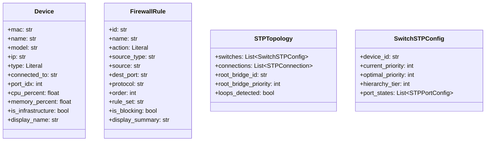

---

## 9. Network Topology and Reporting

### 9.1 `network_topology.py` / `enhanced_network_topology.py`

**Purpose.** `network_topology.py` is a thin re-export shim (`from .enhanced_network_topology import NetworkTopology`). The real implementation is in `enhanced_network_topology.py`.

**Key class.** `NetworkTopology`

| Method | Description |
|---|---|
| `add_device(device_id, name, model, mac, ip)` | Adds a `DeviceInfo` to the topology dict |
| `add_connection(source_id, target_id, source_port_idx, target_port_idx)` | Appends a connection record |
| `generate_png_diagram(path)` | Renders PNG via Graphviz |
| `generate_svg_diagram(path)` | Renders SVG via Graphviz |
| `generate_dot_diagram(path)` | Writes a one-line placeholder, not DOT source ([issue 044](../issues/044-discover-mermaid-and-dot-write-a-placeholder.md)) |
| `generate_mermaid_diagram(path)` | Writes a one-line placeholder, not Mermaid markup (issue 044) |
| `generate_html_diagram(path, show_connected_devices)` | Renders interactive HTML diagram |

**Dependencies.** `models.py`

---

### 9.2 `report_generator.py`

**Purpose.** Generates a Markdown port mapping report from a `devices` dict. Calculates summary statistics (total devices, ports with LLDP, ports to rename) and formats per-device port tables.

**Key function.** `generate_port_mapping_report(devices, output_path)`

**Dependencies.** `models.py`

---

## 10. `core/` Package

The `core/` package provides shared infrastructure consumed by the async analysis, network, and Protect tools. It is separate from the legacy synchronous infrastructure in the top-level package.

### 10.1 `core/utils/auth.py`

**Purpose.** Credential loading and validation via a Pydantic model. Implements a credential chain: first `UNIFI_URL`/`UNIFI_HOST` for controller address, then `UNIFI_CONSOLE_API_TOKEN`/`UNIFI_API_TOKEN` for token auth, falling back to `UNIFI_USERNAME`/`UNIFI_PASSWORD`.

**Key class.** `Credentials` (Pydantic `BaseModel`)

| Field | Description |
|---|---|
| `host` | Controller hostname or IP |
| `port` | Defaults to 443 |
| `api_token` | Preferred for UniFi OS |
| `username` / `password` | Fallback credentials |
| `site` | Defaults to `"default"` |
| `verify_ssl` | Defaults to `False` |

**Key function.** `get_credentials()` - async loader that calls `Credentials.from_env()`.

---

### 10.2 `core/utils/client.py`

**Purpose.** Async HTTP client (`httpx.AsyncClient`) for UniFi Controller API, used by all analysis/diagnostics/discovery/connectivity tools. Supports context manager lifecycle (`async with UniFiClient() as client`).

**Key class.** `UniFiClient`

| Method | Description |
|---|---|
| `connect()` | Opens httpx session, detects UniFi OS, authenticates; under the MCP server, and in the CLI's analysis and SSH commands, it borrows the installed shared client instead |
| `disconnect()` | Closes session and logs out |
| `get_devices()`, `get_device(device_id)`, `get_device_ports(device_id)` | Device and port reads |
| `get_lldp_table(device_id)` | Returns the LLDP table for a device |
| `get_clients()`, `get_rogue_aps()`, `get_networks()`, `get_network_topology()` | Client, neighbour-AP, network and topology reads |
| `get(path)`, `post(path)`, `put(path)` | Raw requests on the site API |
| `build_path(endpoint)`, `build_v2_path(endpoint)` | Full paths on the site API (`/proxy/network/api/s/{site}/…`) and the v2 API (`/proxy/network/v2/api/site/{site}/…`) |
| `update_device_port()`, `update_port_names()`, `force_provision()` | Write helpers; under the MCP server, and in the CLI's analysis and SSH commands, the read-only transport refuses them |

**Authentication.** Prefers token (`X-API-KEY` header). Falls back to username/password POST against `/api/auth/login` (UniFi OS) or `/api/login` (legacy).

**Read-only under MCP.** The shared client the MCP lifespan installs (connect timeout 10 s, request timeout 30 s) sends every request through `core/utils/readonly.py`'s `ReadOnlyAsyncTransport`, which refuses a write with `ReadOnlyViolation` before any I/O. After a 401 it logs in again once and retries the request once. The CLI installs the same holder for each command run through `_run_analysis` or `_run_gateway_ssh` (`typer_cli._guarded`), so those commands log in once and can't write; its other direct async reads are [issue 064](../issues/064-cli-reads-outside-the-read-only-transport.md).

**Dependencies.** `core/utils/auth.py`, `core/utils/errors.py`, `httpx`

---

### 10.3 `core/utils/errors.py`

**Purpose.** Structured exception class for MCP tool errors following the AWS Labs MCP pattern. Carries a machine-readable error code alongside human-readable message, recovery suggestion, and related tool hints.

**Key class.** `ToolError(Exception)`

**Key class.** `ErrorCodes` - namespace of string constants: `DEVICE_NOT_FOUND`, `CONTROLLER_UNREACHABLE`, `AUTHENTICATION_FAILED`, etc.

---

### 10.4 `core/utils/redact.py` and `core/utils/readonly.py`

**`redact.py`.** `strip_secrets(value, path)` removes (never masks) every key starting with `x_` or containing `password`, `secret`, `token`, `authkey`, `psk`, `preshared`, `passphrase`, `api_key` or `private_key`, or that is, or ends in `_` followed by, `community` (SNMP), `syslog_key` or `lcm_tracker_seed`, in any case (`snmp_community` goes; `community_id` and `syslog_key_id` stay), at any depth, and the `value` of a mapping whose `key` or `name` names a secret by those rules (`{key: 'api_token', value: …}`), and returns the dotted paths it removed. `redact_text()` masks secret values quoted in error or HTTP text and truncates it (the keywords, plus `syslog_key` and `lcm_tracker_seed` by the same suffix rule; not `community`, an ordinary word in free text); `redact_traceback()` formats an exception's traceback with every line through it. `is_secret_key()`, over `SECRET_KEY_RE` and the suffix rule (`SUFFIX_SECRET_KEYS`), is the single shared rule for stripping and masking.

**`readonly.py`.** `install_read_only_guard(client)` wraps an authenticated `UnifiApiClient` session in `ReadOnlySession`: `GET`/`HEAD` pass except `cmd`/`upd` paths, `POST` passes only to `stat/event`, `list/alarm`, the v2 `system-log/{device-alert,admin-activity,update-alert,client-alert}` queries and logout, and every other method raises `ReadOnlyViolation` (a `PermissionError`) before any I/O. Each sent request is audited as `{method, path}`. It must be installed after `login()`, which replaces the session. Installing it also wraps the client's `login`/`_perform_login` on the instance, so a later login (for example after `logout()`) leaves a fresh session that is wrapped again with the same audit list; login traffic itself is never audited. `assert_guarded()` is the backstop for a session assigned directly. `ReadOnlyAsyncTransport` is the httpx twin for the async clients: with `site=` it applies the controller policy (the shared MCP `UniFiClient`), and with `policy=get_only_request_allowed` the GET-only policy the `network_api` tools use. Every request it lets through goes to the opt-in `UNIFI_MCP_REQUEST_AUDIT` file.

`redact.py` is also what the CLI's gateway SSH commands use (`redact_text`) to report an unexpected failure without a traceback, since the traceback's locals would include the SSH password.

---

### 10.5 Other `core/utils/` modules

| Module | Key names | Purpose |
|---|---|---|
| `counters.py` | `VapCounters`, `vap_counters_from_dict`, `pick_vap`, `retry_delta` | Reset-aware deltas of the cumulative per-VAP TX counters: a counter regression or a VAP missing from the previous sample is a reset, never a negative delta |
| `coerce.py` | `int_or_none`, `float_or_none` | Numeric coercion for controller fields whose JSON type varies by model and firmware (system stats sent as strings) |
| `jsonl.py` | `append_capped_jsonl`, `compact_jsonl_lines`, `epoch_field`, `CappedWriteResult` | The shared capped JSON Lines writer: `flock` on `<file>.lock`, torn-line repair, optional dedup by key, compaction by size (to 80% of the cap) or age through a temp file and `os.replace` (only compaction is atomic: readers take no lock and skip a last line an append in progress has cut short), optional file and directory modes; the port counter history writes through it |
| `ping_parse.py` | `parse_ping_output`, `PingStats` | Parses GNU (`rtt min/avg/max/mdev`) and BusyBox (`round-trip min/avg/max`) ping statistics; `latency_matrix` builds its results from it |
| `overrides.py` | `load_stp_overrides`, `STPOverrides` | Loads the STP optimiser's root-eligible and forced-access MACs from `UNIFI_STP_OVERRIDES` (default `~/.config/unifi_management_cli/stp_overrides.yaml`) |
| `logging.py` | `configure_logging`, `get_logger`, `replace_default_loguru_handler` | A loguru JSON-file setup that nothing calls, so `UNIFI_MAPPER_DEBUG` has no effect ([issue 045](../issues/045-configure-logging-is-never-called.md)); the CLI uses `typer_cli.setup_logging` and the MCP server `server._configure_logging`. Both CLIs first replace loguru's default handler with a `diagnose=False` one, and every `logger.add` in `src/` sets `diagnose=False`, so a logged traceback never shows frame values; every CLI error line goes through `redact_text` (`unifi-mapper`, `unifi-inventory`, `unifi-network-toolkit`, the `verify_cli` and legacy `cli.main` paths), `--debug` tracebacks redact each exception message (`redact_traceback` in the argparse CLIs), and the env-file loaders report a line without `=` by file and line number only ([issue 058](../issues/058-tracebacks-print-frame-values.md)) |

---

## 11. `analysis/` Package

Analysis modules expose focused `async` functions or pure data helpers. Controller-backed tools use `UniFiClient` from `core/utils/client.py`, return Pydantic models or plain dictionaries, and are registered in `mcp/manifests/analysis.yaml`.

| Module | Primary Function(s) | Purpose |
|---|---|---|
| `capacity_planning.py` | `get_capacity_report` | Identifies bandwidth, port, and growth pressure |
| `firmware_advisor.py` | `get_firmware_report` | Cross-references running firmware against known issues |
| `ip_conflicts.py` | `detect_ip_conflicts` | Finds duplicate IP assignments across subnets |
| `lag_monitoring.py` | `monitor_lags`, `find_lag_candidates` | Monitors LAG health and identifies parallel links suitable for LACP |
| `link_quality.py` | `analyze_link_quality` | Analyses port error rates and link stability |
| `mac_analyzer.py` | `analyze_mac_table` | MAC address table analysis including aging and conflicts |
| `mtu_audit.py` | `audit_mtu_consistency` | Checks MTU and jumbo-frame consistency across inter-switch links |
| `port_counter_baseline.py` | `snapshots_from_switches`, `diff_since_last` | Persists and diffs per-port counter snapshots under the XDG state root; `analyze link-errors --snapshot` writes the store (§20.4) |
| `port_profile_validation.py` | `validate_port_profiles` | Validates STP Edge, BPDU Guard, uplink, and client access profile safety |
| `qos_validation.py` | `validate_qos` | Validates QoS policy consistency across devices |
| `radio_optimization.py` | `analyze_radio_optimization` | Reviews Wi-Fi channel reuse and transmit power |
| `sfp_diagnostics.py` | `audit_sfp_diagnostics` | Pulls transceiver identity and DOM diagnostics |
| `storm_detection.py` | `detect_storms` | Identifies broadcast/multicast storm conditions |
| `stp_optimizer.py` | `discover_stp_topology`, `calculate_optimal_priorities`, `is_gateway_switch`, `apply_stp_changes`, `validate_10g_expansion_readiness` | STP topology discovery, priority optimisation (the gateway is tiered from but never planned or named root), path-cost auditing, remediation, and 10G preflight |
| `stp_audit.py` | `audit_stp_priorities`, `build_stp_audit`, `scope_stp_audit` | One-shot priority audit: current vs recommended per switch, a tie warning and the gateway under `skipped`; tiers always come from the whole fleet |
| `stp_change_plan.py` | `create_stp_change_plan` | Creates ordered STP changes with rollback bundle and checks |
| `stp_drift.py` | `detect_stp_config_drift`, `load_stp_intent` | Compares live STP state with desired intent |
| `stp_guard.py` | `audit_stp_guard_recommendations` | Finds Root Guard candidates and high topology-change counters |
| `stp_preflight.py` | `stp_preflight_simulate_add` | Simulates planned switch additions and root expectations |
| `stp_snapshot.py` | `snapshot_stp_topology`, `diff_stp_snapshots` | Serialises and diffs STP topology snapshots |
| `traffic_matrix.py` | `analyze_traffic_matrix` | Summarises top talkers and placement hints |
| `vlan_coverage.py` | `audit_vlan_coverage` | Checks required VLAN propagation on trunk and planned uplink ports |
| `vlan_diagnostics.py` | `diagnose_vlans` | Validates VLAN definitions, gateways, trunks, and inter-VLAN assumptions |
| `bandwidth_test.py` | `run_bandwidth_test` | iperf3 bandwidth testing via SSH to gateway |
| `channel_optimiser.py` | `analyze_channels`, `optimize_5ghz`, `optimize_24ghz`, `generate_report` | Auto-channel optimiser with utilization-weighted channel assignment |
| `client_density.py` | `analyze_client_density` | Wireless client density analysis per AP |
| `config_drift.py` | `snapshot_config`, `detect_drift` | Configuration drift detection with baseline snapshot and diff |
| `dhcp_pool.py` | `check_dhcp_pool_utilization` | DHCP pool utilization and exhaustion analysis |
| `gateway_ssh.py` | `gateway_session`, `run_gateway_command`, `check_exit_status`, `require_ip`, `require_hostname`, `require_http_url`, `require_interface_name`, `require_bounded_int`, `require_bounded_float`, `ssh_login` | The only SSH door: opens every gateway session and runs every command as a shell-quoted argv under a timeout the caller states; checks every value before it goes on a command line, and reads the SSH login from `UNIFI_SSH_*` only (latency matrix, bandwidth test, gateway probes, client connectivity, AP-health pings, VLAN traffic sampler) |
| `latency_matrix.py` | `run_latency_matrix` | Gateway-centric ping matrix via SSH across all device and client IPs |
| `vlan_traffic.py` | `sample_vlan_traffic`, `parse_bridge_counters`, `split_sample_output` | `vlan-traffic sample` (CLI only, SSH): the network list through the borrowed read-only `UniFiClient()`, one fixed `sh -c` script on the gateway (30 s bound; a failure status, or output with no parseable address list, is `API_ERROR` and stores nothing), each VLAN matched to its interface by subnet (`vlan_interfaces.py`), one insert into the store; the CLI exits 1 when nothing was stored |
| `vlan_traffic_store.py` | `open_store`, `run_rollups`, `read_vlan_traffic_report`, `read_vlan_traffic_periods`, `get_vlan_traffic_report`, `list_vlan_traffic_periods` | The SQLite store at `state_dir() / 'vlan-traffic.sqlite3'` (`credentials: none`, no client import): reads open it `mode=ro` through `as_uri()` and never create it; errors mapped by name (missing `NO_DATA`, hot journal "needs recovery", busy, unreadable); July's cadence-safe rollups and report and coverage queries; the two MCP tools read the default store in a thread |
| `ap_health.py` | `run_ap_health_capture`, `build_report`, `render_markdown`, `summarize_samples` | `diagnose ap-health` (CLI only, no MCP tool): one AP's 2.4 GHz radio, VAP retry and load counters sampled 1-60 times 30-600 s apart beside a reference AP, each sample read bounded at 45 s (a timed-out or failed one is missing); retry rates over real intervals only; with `--ping-clients`, one SSH session pings up to 4 2.4 GHz clients per AP (a failed ping records its redacted error); fills an `ApHealthCapture` so Ctrl-C, or a failure that ends the run, gives a partial report; no power-cycle step |
| `vlan_interfaces.py` | `resolve_vlan_interfaces` | Pure: maps each VLAN network to the gateway interface whose address is in its subnet (never by name), the rest unresolved |
| `link_error_tracking.py` | `snapshot_link_errors`, `compare_link_errors` | Link error rate tracking with baseline deltas for active degradation detection |
| `neighbour_scan.py` | `scan_neighbours`, `get_our_ap_bssids`, `compute_channel_neighbour_score` | RF neighbour AP scanning for external network detection per channel |
| `poe_budget.py` | `check_poe_budget` | PoE budget validation: per-switch consumption vs capacity |
| `radio_config.py` | `snapshot_radio_config`, `apply_radio_config`, `restore_radio_config`, `build_optimisation_plan` | Radio config management: snapshot, apply, restore, and optimisation planning |
| `roaming_analysis.py` | `snapshot_client_associations`, `analyze_roaming` | Client roaming pattern analysis to identify sticky clients and frequent roamers |
| `uplink_redundancy.py` | `check_uplink_redundancy` | Uplink single-point-of-failure detection and failover validation |
| `counter_history.py` | `append_history`, `read_port_history`, `summarise_port_history` | Capped JSON Lines history of switch port counters under the XDG state root (`analyze link-errors --record`; §20.4) |
| `device_freshness.py` | `check_device_freshness`, `summarise_freshness` | Whether the controller serves live telemetry or a stale snapshot: a slow two-sample check, and a single-read summary for `diagnose all` |
| `foreign_bridges.py` | `detect_foreign_bridges` | Wired third-party bridges inside the UniFi layer-2 domain |
| `link_settings.py` | `port_override`, `effective_profile_id`, `effective_port_settings` | The one place that decides a port's effective profile and link settings (the override over the port table over the profile), shared by the port diagnostics and the profile analyses ([issue 026](../issues/026-profile-precedence-outside-port-diagnostics.md)) |
| `link_speed_audit.py` | `audit_link_speeds`, `collect_link_speed_audit` | Fleet-wide ports below their capability, forced-speed traps and half duplex (`analyze link-speeds`) |
| `model_capabilities.py` | `classify_model` | Capability classes for UniFi switch and gateway models, used by the STP optimiser |
| `neighbour_trend.py` | `snapshot_neighbours`, `detect_neighbour_trend` | Neighbour AP baseline snapshot and diff (`analyze neighbours --snapshot` / `--diff`) |
| `port_naming.py` | `resolve_peer`, `is_weak_label`, `name_quality`, `would_lose_information`, `is_cosmetic_change`, `strip_multi_suffix` | Port-label rules for `ports refresh`: the LLDP peer or wired client, with guards against weak labels, churn and `+N` flapping |
| `port_profile_usage.py` | `audit_port_profile_usage`, `collect_port_profile_usage` | Where each port profile is applied, and which profiles are traps (`analyze port-profile-usage`) |
| `power_budget.py` | `audit_power_budget` | Switch input power headroom against published vendor figures (`analyze power-budget`) |
| `rf_strategy.py` | `compute_coverage_score`, `classify_confidence` | RF strategy scorecard engine, used by the roaming analysis and the RF simulator |
| `rf_simulator.py` | `simulate_disable`, `simulate_width_change` | What-if simulation for RF strategy recommendations |
| `uplink_transparency.py` | `audit_uplink_transparency` | Elected uplinks that can't carry tagged VLANs (`analyze uplink-transparency`) |
| `wlan_config.py` | `update_wlan_settings`, `verify_wlan_patch`, `check_minrate_gate` | Guarded WLAN (SSID) setting writes with guard-field verification; no CLI command or MCP tool calls it yet |

`stp_optimizer.py` is the hub for STP analysis. It discovers switches from `stat/device`, extracts STP state from `port_table`, builds LLDP-derived `STPConnection` records, annotates root eligibility, then feeds specialised helpers such as drift detection, snapshots, Root Guard auditing, 10G path-cost validation, and change-plan generation.

---

## 12. `diagnostics/` Package

Diagnostic tools. The first four use `UniFiClient`; `inspect_port.py` and `port_diagnostics_tools.py` run the synchronous port code (section 7.6) in a worker thread behind the read-only guard.

| Module | Purpose |
|---|---|
| `connectivity_analysis.py` | End-to-end connectivity path analysis between two endpoints |
| `network_health.py` | Aggregate network health scoring across all devices |
| `performance_analysis.py` | Bandwidth utilisation, latency, and packet loss trending |
| `security_audit.py` | Security posture assessment: open ports, weak auth, unencrypted traffic |
| `inspect_port.py` | `inspect_switch_port`: deep single-port inspection |
| `port_diagnostics_tools.py` | `diagnose_switch_port`, `get_switch_ports`, `diff_port_profiles` (diagnostics category), `get_client_history` (discovery) and `get_device_events`, `get_recent_events`, `get_port_counter_rates` (observability) |
| `wan_health.py`, `wan_history.py` | `build_wan_health`, `get_wan_health`; `append_speedtest`, `read_speedtest_history`, `get_wan_speedtest_history` | WAN and internet status from `stat/health` with the controller's last scheduled speedtest (`diagnose wan`), and its history under the XDG state directory through the capped writer, deduplicated per run (`diagnose wan --record`, `diagnose wan-history`); `wan_history` imports no client, so its tool runs with `credentials: none`. No speedtest is ever started |
| `observability.py` | `get_device_stats`, `get_ap_retry_rates`, `get_config_object`, `find_recent_config_changes` (observability category; `diagnose device-stats`, `diagnose ap-retries`, `controller config`, `controller config-changes`): pure `*_from_data` cores over controller records, async handlers on the borrowed read-only `UniFiClient()`, secrets stripped at the source |
| `client_connectivity.py` | `diagnose client-connectivity` (CLI only, no MCP tool): `build_verdict` (pure, July's layers) and `diagnose_client_connectivity`, which looks the client up (45 s), reads its AP's VAP counters and runs the gateway probes in order (ping, DNS for the probe URL's host, HTTP from the client's VLAN, flows), each a bounded layer within a 120 s budget; a failed layer is a finding, a layer with no time left is `not_run: budget`, and `skipped_layers` marks a layer that can't test the client's own path `not_run` (no address; a probe URL host that is an address; an unknown client network, for HTTP) |

---

## 13. `discovery/` Package

Four modules for locating specific assets, all on `UniFiClient`. The `discovery` MCP category has five tools: the fifth, `get_client_history`, lives in `diagnostics/port_diagnostics_tools.py`.

| Module | Purpose |
|---|---|
| `client_trace.py` | Traces a client's path through the network from MAC/IP to upstream device |
| `find_device.py` | Locates a device by name, hostname, IP, or partial MAC |
| `find_ip.py` | Finds all devices and clients with a specific IP address |
| `find_mac.py` | Finds all devices and clients with a specific MAC address |

---

## 14. `connectivity/` Package

Four connectivity tools, all on `UniFiClient`, and the CLI-only gateway probes over SSH.

| Module | Purpose |
|---|---|
| `firewall_check.py` | Determines whether traffic between two endpoints would be permitted by firewall rules |
| `inter_vlan.py` | `check_inter_vlan_routing`: resolves two endpoints, their VLANs and gateway, and the firewall verdict between them (`diagnose inter-vlan`) |
| `path_analysis.py` | Calculates layer-2 and layer-3 path between two endpoints |
| `traceroute.py` | Logical traceroute through UniFi topology (does not send ICMP) |
| `gateway_probe.py` | `gateway ping`, `traceroute`, `dns`, `http` and `flows` (CLI only, no MCP tool): one SSH session per probe through `analysis/gateway_ssh.py`, an argv with its own bound, July's parsers; names resolve through the read-only `UniFiClient()` by `match_identities` (exact identities across devices and clients first, then a unique partial name; shared with `client_connectivity.find_client`) |

The package `__init__.py` exports `firewall_check`, `path_analysis`, `traceroute`, `check_inter_vlan_routing` and its models directly.

---

## 15. `network/` Package

The `network/` package provides the modern async interface to the UniFi Network API (v10.1.68+). It is the backend for the MCP network tools.

### 15.1 `network/config.py`

**Purpose.** Pydantic `NetworkConfig` for the Network API connection: `host`, `port`, `api_key` (SecretStr), `site_id`, `verify_ssl`, `timeout`.

Loaded via `NetworkConfig.from_env()` with the prefix `UNIFI_NETWORK_`: `UNIFI_NETWORK_HOST`, `UNIFI_NETWORK_API_KEY` and `UNIFI_NETWORK_SITE_ID` (all three required: the MCP `network_api` family), plus the optional `UNIFI_NETWORK_PORT`, `UNIFI_NETWORK_VERIFY_SSL`, `UNIFI_NETWORK_TIMEOUT` and `UNIFI_NETWORK_DEBUG`.

---

### 15.2 `network/client.py`

**Purpose.** Async `httpx.AsyncClient` wrapper specific to the Network API (separate from `core/utils/client.py` which uses the classic controller API). Supports context manager lifecycle.

**Key class.** `UniFiNetworkClient`

Exposes typed response methods for each resource type: `get_devices()`, `get_networks()`, `get_firewall_zones()`, `get_firewall_policies()`, `get_acl_rules()`, `get_dns_policies()`, `get_clients()`, etc.

**Exceptions.** `NetworkClientError`, `NetworkAuthenticationError` (both defined in this module).

---

### 15.3 `network/firewall.py`

**Purpose.** High-level firewall management with integrated syslog logging support.

**Key class.** `FirewallManager`

| Method | Description |
|---|---|
| `get_zones(refresh)` | Returns cached or fresh list of `FirewallZone` |
| `get_policies(refresh)` | Returns cached or fresh list of `FirewallPolicy` |
| `get_zone_traffic_stats()` | Aggregates policy counts per zone pair |

**Supporting dataclasses.** `PolicyHitStats`, `ZoneTrafficStats`

---

### 15.4 Other `network/` modules

| Module | Class/Function | Purpose |
|---|---|---|
| `acl.py` | `ACLManager` | ACL rule retrieval and management |
| `clients.py` | `ClientManager` | Connected client listing and search |
| `dns.py` | `DNSPolicyManager` | DNS policy retrieval |
| `dpi.py` | `DPIAnalytics` | Deep Packet Inspection application/category data |
| `models.py` | `FirewallZone`, `FirewallPolicy`, `ACLRule`, `DNSPolicy`, etc. | Network API typed response models (distinct from `core/models/firewall.py`) |
| `networks.py` | `NetworkManager` | Network/VLAN definition management |
| `sites.py` | `SiteManager` | Site enumeration |
| `statistics.py` | `DeviceMetricsCollector` | Port and device statistics collection |
| `traffic_matching.py` | `TrafficMatchingListManager` | Traffic matching rule management |

---

## 16. `protect/` Package

UniFi Protect camera and security system integration. Uses the third-party `uiprotect` library as the underlying client, wrapped with a higher-level async interface.

### 16.1 `protect/config.py`

**Purpose.** Pydantic `ProtectConfig` for Protect API connection. Stricter than `NetworkConfig`: validates that the host has no protocol prefix, validates cache directory existence, and enforces that both username and password are present.

| Field | Default | Description |
|---|---|---|
| `host` | required | IP or hostname, protocol prefix stripped on validation |
| `port` | 443 | HTTPS port |
| `ws_timeout` | 30 | WebSocket timeout seconds |
| `minimum_score` | 0 | Smart detection confidence threshold |
| `store_sessions` | True | Persist auth sessions to disk |

Loaded via `ProtectConfig.from_env(prefix='PROTECT_')` reading `PROTECT_HOST`, `PROTECT_USERNAME`, `PROTECT_PASSWORD`, etc.

---

### 16.2 `protect/client.py`

**Purpose.** Async wrapper around `uiprotect.ProtectApiClient`. Manages connection state machine (`ConnectionState` enum) and exposes typed access to Protect device types.

**Key class.** `UniFiProtectClient`

| Member | Description |
|---|---|
| `connect()` / `disconnect()` / `refresh()` | Lifecycle management; `refresh()` re-reads the bootstrap |
| `state`, `is_connected` | The `ConnectionState` and whether the client is usable |
| `bootstrap`, `nvr` (properties) | The `uiprotect` `Bootstrap` and the NVR |
| `cameras`, `ai_ports`, `sensors`, `lights`, `chimes`, `doorlocks` (properties) | Typed device dictionaries keyed by id |
| `get_camera(camera_id)`, `get_camera_by_name(name)` | One camera |
| `get_ai_port(ai_port_id)`, `get_cameras_by_ai_port(ai_port_id)`, `get_third_party_cameras()` | AI Ports and the third-party cameras paired with them |
| Context manager `__aenter__` / `__aexit__` | Use as `async with UniFiProtectClient(config) as client` |

The MCP Protect tools (`mcp/tools/protect.py`) connect through `ReadOnlyProtectApiClient`, a `ProtectApiClient` subclass in this module whose `request()` allows only GET and HEAD (no `cmd`/`upd` segment) and the session login.

**Exceptions.** `ProtectClientError`, `ConnectionError`, `AuthenticationError` (all defined in this module).

`protect/aiport.py` (`AIPortManager`, `AIPortInfo`, `PairedCamera`, `AIDetectionEvent`) models AI Ports, their capabilities and paired cameras, for the client, the event and health modules and the Protect monitor.

---

### 16.3 `protect/events.py`

**Purpose.** WebSocket event type definitions, filtering, and subscription management for real-time Protect updates.

**Key classes.**

| Class | Description |
|---|---|
| `ProtectEventCategory` (str Enum) | `MOTION`, `SMART_DETECT`, `DOORBELL`, `SENSOR`, `DOORLOCK`, `DEVICE_STATE`, etc. |
| `ProtectEventType` (str Enum) | Fine-grained event types: `MOTION`, `SMART_DETECT`, `FACE_GROUP_DETECTED`, etc. |
| `ProtectEvent` (dataclass) | Normalised event with `event_type`, `device_id`, `timestamp`, `data` |
| `EventFilter` (dataclass) | Filter by event types, device IDs, categories, score threshold |
| `EventHandler` | Subscription manager: `subscribe(callback, filter)` returns `UnsubscribeFunc` |

---

### 16.4 `protect/analytics.py`

**Purpose.** Event correlation and statistics built on top of the event subscription system. Aggregates smart detection events and monitors device health over rolling time windows.

**Key classes.**

| Class | Description |
|---|---|
| `SmartDetectType` (str Enum) | `PERSON`, `VEHICLE`, `ANIMAL`, `PACKAGE`, `FACE`, `LICENSE_PLATE`, `SMOKE`, `CMONX` |
| `DeviceHealthStatus` (str Enum) | Health states for monitored devices |
| `EventAnalytics` | Start/stop lifecycle; provides `get_motion_stats()`, event pattern correlation |

---

### 16.5 `protect/mqtt.py`

**Purpose.** MQTT bridge that publishes Protect events to an MQTT broker with Home Assistant Discovery autodiscovery messages. Enables integrating Protect events into Home Assistant automations.

**Key classes.**

| Class | Description |
|---|---|
| `MQTTConfig` (Pydantic) | Broker connection: `host`, `port`, `topic_prefix`, `discovery_prefix`, `qos` |
| `MQTTBridge` | Subscribes to `EventHandler`, serialises events, publishes to MQTT topics |

**Topics published.** `{topic_prefix}/camera/{device_id}/{event_type}` for events; `homeassistant/binary_sensor/...` for HA discovery.

---

### 16.6 `protect/repository.py`

**Purpose.** Repository pattern providing type-safe access to Protect device collections. Generic over device type via `DeviceRepository[T]`.

**Key classes.**

| Class | Description |
|---|---|
| `DeviceRepository[T]` | Generic typed cache: `add(device)`, `get(id)`, `all()`, `filter(predicate)` |
| `ProtectDeviceCache` | Composite cache holding a typed repository for each device type, filled by `refresh(client)` |

Populated from a connected `UniFiProtectClient`'s `Bootstrap` response.

---

## 17. `mcp/` Package

The MCP server exposes all analysis, diagnostic, discovery, connectivity, network, and Protect tools to AI agents via the Model Context Protocol.

### 17.1 `mcp/server.py`

**Purpose.** MCP server entry point, on the FastMCP bundled with the `mcp` SDK. Registers four meta-tools, two resources and two prompts; every catalog tool call goes through `ToolRunner` (`mcp/runner.py`). With `--surface direct` it also lists the non-mutating, non-pipeline catalog tools built by `ToolCatalog` (`mcp/catalog.py`). Config discovery and credential families live in `mcp/config.py`.

**Key tools registered directly.**

| Tool | Description |
|---|---|
| `search_tools(query, category, tags, detail_level)` | Progressive tool discovery; primary entry point for agents |
| `list_categories()` | Returns dict mapping category names to tool name lists |
| `get_tool_info(tool_name)` | Returns metadata, `input_schema`, `output_schema` and annotations for a tool |
| `execute_tool(tool_name, params)` | Runs a read-only catalog tool through `ToolRunner`; refuses mutating tools |

**Entry point.** `main()` (the `unifi-mcp` console script) parses `--version`, `--help`, `--surface`, `--config` and `--check`, then runs the stdio server; the lifespan resolves config and installs the shared read-only controller client. Launch it with `uvx --python 3.12 --from <repo path> unifi-mcp` (see the [MCP server guide](../mcp-server/MCP_SERVER_GUIDE.md)).

---

### 17.2 `mcp/registry.py`

**Purpose.** Lazy-loading tool registry. Reads YAML manifests on first access, validates each entry against `MANIFEST_KEYS` (`ToolRegistry(strict=True)` in the tests rejects an unknown key or a wrong type), builds `ToolMetadata` records, and wraps tool implementations in `ToolProxy` for deferred import.

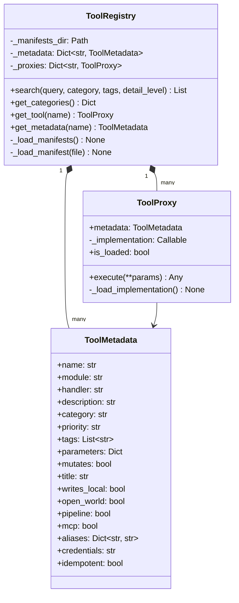

**Concurrency.** Double-checked locking (`threading.Lock`) ensures manifests are loaded only once even under concurrent access.

**Lazy loading.** `ToolProxy._load_implementation()` calls `importlib.import_module` and `getattr` on first `execute()` call, not at startup. `ToolRegistry.execute(name, params)` is the registry's own refuse-mutation choke point over the proxies; the MCP server runs tools through `ToolCatalog` and `ToolRunner` instead (§17.4), which import each handler the same lazy way.

**Manifest files.** Seven YAML files under `mcp/manifests/`: `analysis.yaml` (49 tools), `connectivity.yaml` (4), `diagnostics.yaml` (11), `discovery.yaml` (5), `network.yaml` (6), `observability.yaml` (7), `protect.yaml` (5). Each declares a `category` and a `tools` mapping of name to `{module, handler, title, description, priority, tags, parameters, credentials, mutates, pipeline, writes_local, idempotent, open_world, mcp, aliases}`; the [MCP server guide](../mcp-server/MCP_SERVER_GUIDE.md#adding-a-tool) lists each key's default.

---

### 17.3 `mcp/tools/`

**Purpose.** Async wrapper functions that handle the lifecycle of manager classes and provide a consistent interface for MCP tool execution.

| Module | Wraps | Example functions |
|---|---|---|
| `network.py` | `network/client.py` `UniFiNetworkClient` and the `network/` managers | `get_firewall_zones`, `get_firewall_policies`, `get_acl_rules`, `get_dns_policies`, `get_networks`, `get_clients` |
| `protect.py` | `protect/client.py` `UniFiProtectClient` over `ReadOnlyProtectApiClient` | `get_cameras`, `get_nvr_info`, `get_sensors`, `get_lights`, `get_doorbells` |

Each call opens its own guarded client: the network wrappers build `UniFiNetworkClient` on `ReadOnlyAsyncTransport` with the GET-only policy (`get_only_request_allowed`), and the Protect wrappers use `ReadOnlyProtectApiClient`. A refused write raises `ReadOnlyViolation`, which the runner reports as `READ_ONLY_VIOLATION`. Any other failure still comes back as model dicts with an `{"error": str(e)}` entry inside a successful result ([issue 011](../issues/011-network-protect-errors-as-success.md)).

---

### 17.4 `mcp/catalog.py`, `mcp/runner.py`, `mcp/config.py` and `mcp/call_audit.py`

| Module | Key names | Responsibility |
|---|---|---|
| `catalog.py` | `ToolCatalog`, `build_tool`, `is_direct` | Builds each SDK `Tool` with `Tool.from_function` on first use (the handler signature is the input schema; a typed return gives the output schema), with its title and annotations; `direct_tools()` lists the non-mutating, non-pipeline tools for the direct surface |
| `runner.py` | `ToolRunner`, `ERRORS_SET_IS_ERROR` | One path for every call on either surface: look up, refuse mutating tools, rewrite aliases, validate, gate the credential family, run under the concurrency cap and the optional `UNIFI_MCP_TOOL_TIMEOUT`, mask secrets and package the envelope; every failure sets `isError` |
| `call_audit.py` | `CallAuditLog`, `parse_call_audit`, `env_switch`, `CallAuditSetting` | The default-on MCP call log (issue 013 D5): one line per catalog call in `$XDG_STATE_HOME/unifi_mapper/mcp-audit.jsonl` (the registered tool or `<unregistered>`, the surface, its own parameter names with other keys counted, the duration, the outcome); never a value; request lines buffered from the guards' sink with `UNIFI_MCP_REQUEST_AUDIT=on`; written through `append_capped_jsonl` (16 MiB, `0o600`); a failed write warns once and turns it off |
| `config.py` | `resolve_config_path`, `resolve_mcp_config`, `load_server_settings`, `CREDENTIAL_KEYS`, `FAMILY_KEYS` | Working-directory-independent config discovery, per-family loading (`controller`, `network_api`, `protect`), the bounded Keychain/1Password fallback and the `UNIFI_MCP_*` settings |

---

## 18. `monitors/` and `backup/` Packages

### `protect_monitor.py`

**Purpose.** Long-running synchronous monitoring daemon for UniFi Protect devices. Polls the Protect API at configurable intervals and detects state changes in AI Ports, cameras, smart detection events, and stream health. Intended for standalone execution (`python -m unifi_mapper.monitors.protect_monitor`).

**Key class.** `ProtectMonitor`

Uses `requests` (synchronous) rather than `uiprotect`, making it independent of the async Protect client stack. Credentials come from `PROTECT_HOST`, `PROTECT_USERNAME` and `PROTECT_PASSWORD` unless given on the command line.

### `backup/poc_decrypt.py` and `backup/verify.py`

**Purpose.** `poc_decrypt.py` is a proof of concept that decrypts a UniFi controller backup (`.unf`) with the controller's fixed AES key and IV (module constants, not settings), extracts the database and parses its BSON collections (`decrypt_backup`, `extract_db_gz`, `decompress_db`, `iter_bson_documents`, `parse_bson_documents`). Run it as `python -m unifi_mapper.backup.poc_decrypt BACKUP.unf`. Its stages never print (a debug log line instead), `decompress_db` follows `gzip.decompress`' member rules with optional output and member caps, reading the stream through a `memoryview` in 64 KiB slices so its work is linear however many members the stream holds, and a missing dependency raises `ImportError` instead of printing and exiting.

`verify.py` (`verify_backup_bytes`, `check_backup_path`, `verify_config_backup`; `backup verify`, MCP `verify_config_backup`, `credentials: none`) runs those stages offline, the extracted member and the decompressed database each capped at 1 GiB (an oversized member is refused by its declared size before it is inflated) and the database at 64 gzip members, and counts each collection's documents without keeping any, so the result holds structure only. The walk is strict: it stops at the first document that fails to decode, and that, or bytes left after the last whole document, makes the backup invalid (`corrupt_document` or `truncated`). Only checked strings leave the backup: a collection name from `KNOWN_COLLECTIONS` (any other counted as `other`) and a version that is a version number (else `<unrecognised>`). The path is checked before the file is opened: the `.unf` suffix first, then absolute (MCP); then it is resolved (a symlink's target must end in `.unf` too) and must be a regular file of at most 512 MiB. `read_backup` opens it once, without following a link or blocking on a FIFO, checks the open descriptor again (`fstat`) and reads at most one byte more than the size it reports, so a file that changed after the check is refused.

---

## 19. `utility/` Package

Three helper modules for output generation.

| Module | Function | Purpose |
|---|---|---|
| `export_markdown.py` | `export_markdown(content, path)` | Writes analysis results to Markdown files |
| `format_table.py` | `format_table(data, headers)` | Formats tabular data for terminal or Markdown output |
| `render_mermaid.py` | `render_mermaid(diagram_type, data)` | Converts topology/path/firewall/STP data into Mermaid diagram strings |

`render_mermaid` supports four diagram types: `'path'`, `'topology'`, `'firewall_matrix'` and `'stp'`. It uses `core/models/network_path.py` (`NetworkPath`) for path diagrams. Its topology renderer is the candidate for `discover --format mermaid`, which still writes a placeholder ([issue 044](../issues/044-discover-mermaid-and-dot-write-a-placeholder.md)).

---

## 20. Key Workflows

### 20.1 Port Discovery and Naming Workflow

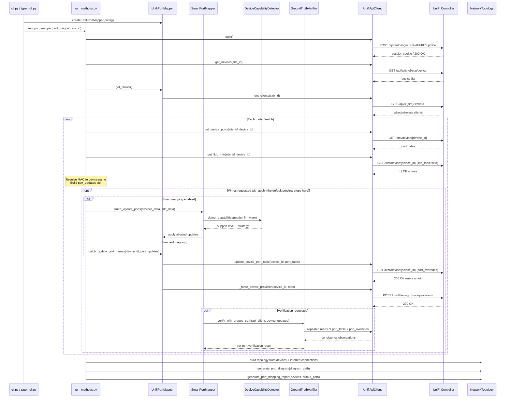

**LLDP name resolution.** The `get_lldp_info` method reads the `lldp_table` field from each device's detail response. It resolves `chassis_id` (a MAC address) to a device name by first checking LLDP `system_name` and `chassis_name` fields, then falling back to an in-memory MAC-to-name cache populated from the device list. MAC-like strings are filtered out to prevent port labels being set to raw MACs.

**Port override vs port table.** The controller's `port_table` is read-only (reflects current state). Writes go to `port_overrides` (persistent configuration). The client merges existing overrides with new name changes to avoid overwriting unrelated settings like `poe_mode`.

---

### 20.2 STP Diagnostics and Remediation Workflow

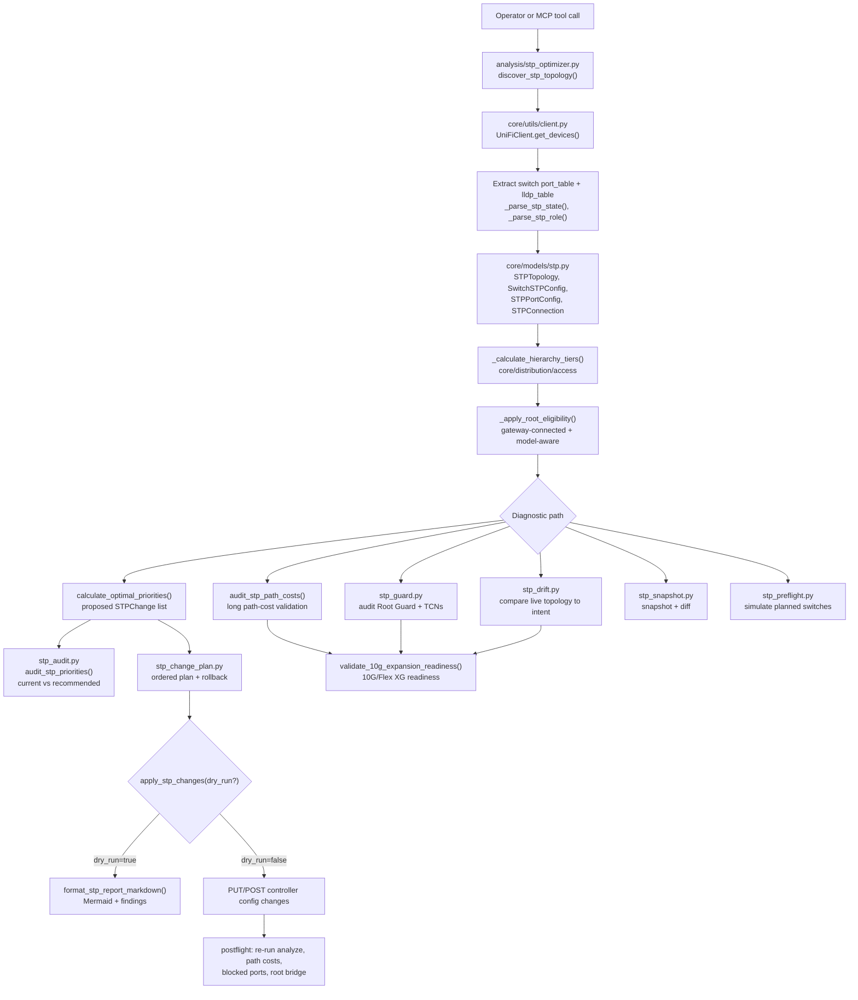

**Interfaces and data contracts.**

| Stage | Module | Input | Output |
|---|---|---|---|
| Discovery | `stp_optimizer.discover_stp_topology` | Optional `device_id` | `STPTopology` |
| Optimisation | `stp_optimizer.calculate_optimal_priorities` | `STPTopology` | `list[STPChange]` |
| Priority audit | `stp_audit.audit_stp_priorities` | Optional `device` (name, MAC or ID; narrows the rows and the verdict, the fleet's kept as `fleet_compliant`/`fleet_summary`) | Audit dict: `switches`, `skipped`, `remediation` (CLI commands) |
| Guard audit | `stp_guard.audit_stp_guard_recommendations` | `STPTopology` | `STPGuardAuditReport` |
| Drift detection | `stp_drift.detect_stp_config_drift` | `STPTopology`, intent mapping | `STPDriftReport` |
| Snapshots | `stp_snapshot.snapshot_stp_topology` / `diff_stp_snapshots` | `STPTopology` or two snapshots | `STPSnapshot`, `STPSnapshotDiff` |
| Change planning | `stp_change_plan.create_stp_change_plan` | `list[STPChange]` | `STPChangePlan` with rollback |
| Remediation | `stp_optimizer.apply_stp_changes` | `STPOptimizationReport`, `dry_run` | Applied controller changes or preview |

**Remediation guardrail.** `apply_stp_changes` is intentionally downstream of discovery, calculation, and report generation. The safe workflow is discover -> calculate -> plan -> dry-run -> apply -> rediscover, because STP priority changes can alter forwarding paths during convergence.

---

### 20.3 VLAN and Port Profile Validation Workflow

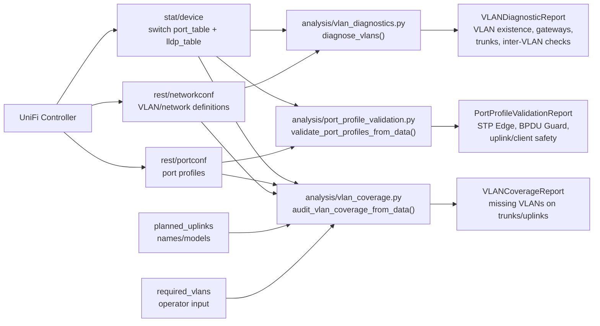

**How the validators split responsibility.**

| Concern | Module | What it checks | Main failure mode surfaced |
|---|---|---|---|
| Port profile safety | `port_profile_validation.py` | Edge/client ports, uplinks, BPDU Guard, detected BPDUs | Edge profile on infrastructure links or missing guardrails on client ports |
| Required VLAN propagation | `vlan_coverage.py` | Required VLANs on trunk and planned uplink ports | A future or current uplink missing a required VLAN |
| VLAN health | `vlan_diagnostics.py` | VLAN definitions, gateways, port profile consistency, trunk coverage, optional source/dest VLAN pair | VLAN exists but cannot route or propagate correctly |

**Interaction pattern.** The three validators share controller inputs but answer different questions. `vlan_diagnostics.py` is the broad health check, `vlan_coverage.py` is the targeted expansion/change-readiness check, and `port_profile_validation.py` is the layer-2 safety check that prevents STP and BPDU mistakes.

---

### 20.4 Port Counter Baseline Workflow

`port_counter_baseline.py` persists per-port counter snapshots (`PortCounterBaselineStore.save`) and diffs against them (`diff_since_last`). Its producer is `analyze link-errors --snapshot`: `link_error_tracking.snapshot_link_errors` writes the link-error baseline and `PortCounterBaselineStore().save(snapshots_from_devices(devices))` from one device read. `analyze link-errors --record` appends to a separate capped JSON Lines history (`analysis/counter_history.py`), so recording never moves a baseline. The readers only read:

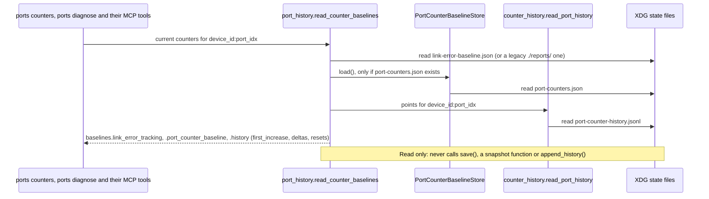

Writers, all behind explicit flags of `analyze link-errors`: `--snapshot` (both baselines) and `--record` (`append_history`, through the shared `core/utils/jsonl.append_capped_jsonl`: `fcntl.flock` on `port-counter-history.jsonl.lock`, append, then compaction through a temp file and `os.replace` only once the oldest line is a day past `--retention-days` (default 14) or the file passes the 64 MiB cap, trimming to 80% of the cap, so a full file is not rewritten on every run). Issues [002](../issues/002-port-counter-baseline-has-no-producer.md) and [004](../issues/004-no-counter-history.md) record the decision.

**State location.** `port_counter_baseline.state_dir()` is `$XDG_STATE_HOME/unifi_mapper` when set, otherwise `~/.local/state/unifi_mapper`. It holds `port-counters.json` (`default_baseline_path()`), `link-error-baseline.json` (`default_link_error_baseline_path()`) and `port-counter-history.jsonl` (`default_history_path()`).

**Counter semantics.** `diff_snapshots()` clamps negative deltas to zero. That prevents device reboot or counter reset noise from appearing as negative errors, but it also means reset detection must come from timestamps or surrounding device uptime rather than the delta value alone.

---

### 20.5 Protect Event Pipeline

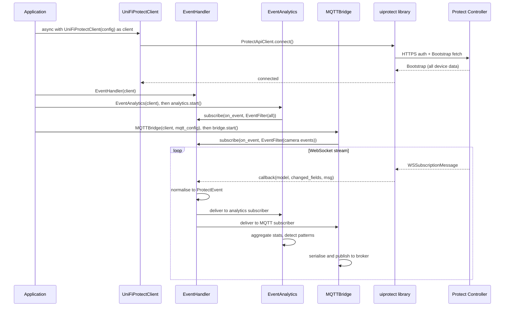

---

### 20.6 MCP Tool Discovery and Execution Workflow

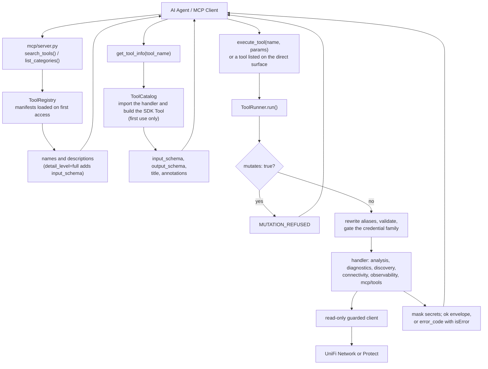

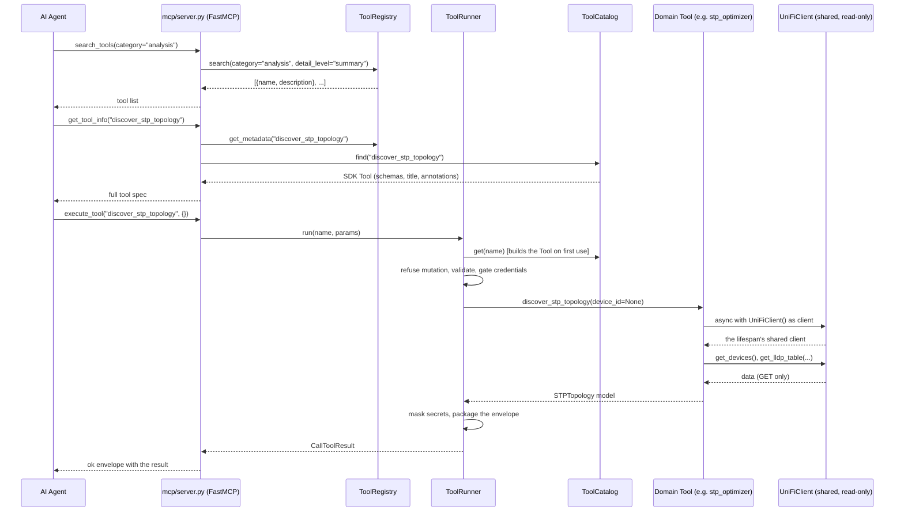

**MCP interface layers.**

| Layer | Module | Responsibility |
|---|---|---|
| Meta-tools and surfaces | `mcp/server.py` | Exposes `search_tools`, `list_categories`, `get_tool_info` and `execute_tool` through FastMCP; on the direct surface also lists each non-mutating, non-pipeline tool; two resources and two prompts |
| Registry | `mcp/registry.py` | Loads and validates the YAML manifests, indexes categories and tags |
| Catalog | `mcp/catalog.py` | Builds each SDK tool from its handler on first use: schemas, title, annotations |
| Runner | `mcp/runner.py` | Validates, gates, runs, masks and packages every call on either surface |
| Config | `mcp/config.py` | Config discovery, credential families, `UNIFI_MCP_*` settings |
| Manifests | `mcp/manifests/*.yaml` | Declarative tool name -> module/handler metadata |
| Wrappers | `mcp/tools/network.py`, `mcp/tools/protect.py` | Open one guarded Network API or Protect client per call |
| Domain tools | `analysis/*`, `diagnostics/*`, `discovery/*`, `connectivity/*`, `network/*`, `protect/*` | Implement operational behavior |

**Dependency rule.** MCP metadata points inward to existing domain functions; domain modules do not depend on MCP. That keeps tools usable from tests, CLIs, and future interfaces without carrying FastMCP concerns into business logic.

---

## 21. Exception Hierarchy

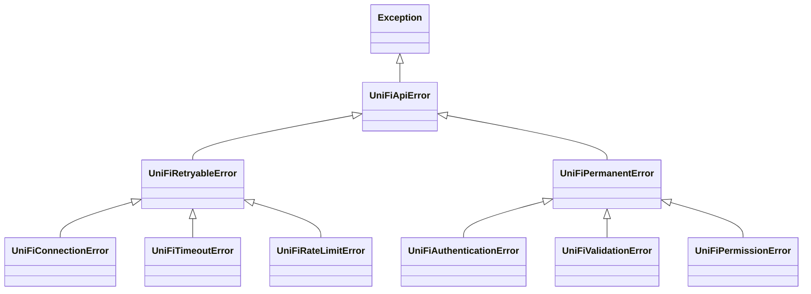

**Design intent.** `UniFiRetryableError` subclasses indicate transient failures suitable for exponential backoff retry. `UniFiPermanentError` subclasses indicate conditions where retrying would not help and the error should be surfaced immediately.

`UniFiAuthenticationError` carries `auth_method` and `status_code` attributes for diagnostic context.

The async `core/` and `protect/` stacks use separate exception classes (`ToolError`, `ProtectClientError`, `NetworkClientError`) rather than extending this hierarchy, reflecting the generational split in the codebase.

---

## 22. `scripts/` Directory

| Script | Purpose |
|---|---|
| `unifi-cron.sh` | Master cron/scheduler script supporting macOS (launchd) and Linux (crontab). Installs, updates, and removes scheduled audit jobs: the link-error history (`analyze link-errors --record`) and roaming snapshots every 5 min; config drift, `diagnose all`, the radio report and the WAN speedtest record (`diagnose wan --record`, which reads the controller's last scheduled result and never starts a speedtest) hourly; port naming every 30 min, which writes (`--apply`); installing or updating installs every task. Subcommands: `install`, `status`, `run-all`, `update`, `uninstall`, `help`. On macOS the generated plists are invalid XML ([issue 025](../issues/025-launchd-plists-are-invalid-xml.md)) |
| `unifi-mcp-launch.sh` | Legacy MCP launch wrapper: sources `$UNIFI_MCP_ENV`, exports every key, then runs `unifi-mcp` from the repo's environment |
| `audit_port_labels.py` | Read-only census explaining why `ports refresh` proposes few changes |
| `network-audit.sh` | One read-only audit run: `discover --dry-run`, `stp snapshot`, `stp analyze`, `stp optimize --dry-run --plan`, `stp guard` and `stp report` (plus `stp validate-10g` with `--planned-switches`) into `${XDG_STATE_HOME:-~/.local/state}/unifi_mapper/audits/<stamp>`, private (`umask 077`); no apply path, it prints the review-then-apply commands |
| `controller_dump.py` | The controller's config and state objects as JSON, one GET per endpoint of a fixed table through the read-only guard, every payload through `strip_secrets`, plus `manifest.json` (counts, removed paths, request audit); files `0o600`, each created new (`O_EXCL` and `O_NOFOLLOW`); `--output` refused inside the repository, and when it is an existing directory that is not empty, not the user's or writable by others (exit 2) |
| `verify_format_safety.py` | Checks that a formatting sweep changed no code semantics |
| `axis_provision.py` | AXIS camera and device provisioning from `~/.config/axiscam/config.yaml` (writes to the devices; see the [AXIS guide](../guides/axis-provisioning.md)) |
| `onvif_probe.py`, `onvif_stream.py` | ONVIF camera probes and stream tests. Neither keeps a camera address, name or credential in the source: both load them through `onvif_config.py` and stop before connecting if one is unset ([issue 041](../issues/041-onvif-scripts-hard-code-cameras.md)) |
| `onvif_config.py` | Reads the ONVIF account and camera list from `ONVIF_USERNAME`, `ONVIF_PASSWORD` and `ONVIF_CAMERAS` (`NAME=HOST[:PORT]`, comma-separated); imports nothing from the ONVIF library |
| `apply_ap_tx_power_auto.py` | Releases a manual 5 GHz transmit power back to the controller's auto mode (writes, through `apply_radio_config`) |
| `apply_ap_channel_plan.py`, `apply_stp_priorities_custom.py`, `remediate_stp_post_apply.py` | One-off controller changes for one site (channel plan, STP priorities, post-apply STP remediation). They write to the controller and target its devices and ports by name, but the repository holds none of those names: each script reads them from the site's targets file through `site_targets.py`, and stops with exit code 2, before it reads the controller config, when the file is missing or malformed ([issue 046](../issues/046-real-device-names-in-code-and-history.md)) |
| `site_targets.py`, `site-targets.example.json` | Reads the three one-off scripts' targets from `site-targets.json`: the path given with `--targets`, else `$XDG_CONFIG_HOME/unifi_management_cli/site-targets.json`, else `~/.config/unifi_management_cli/site-targets.json`. Each script has its own section; the example holds placeholders only, so copy it outside the repository and fill it in |

---

*This codemap was generated by reading every source file under `src/unifi_mapper/`.*
