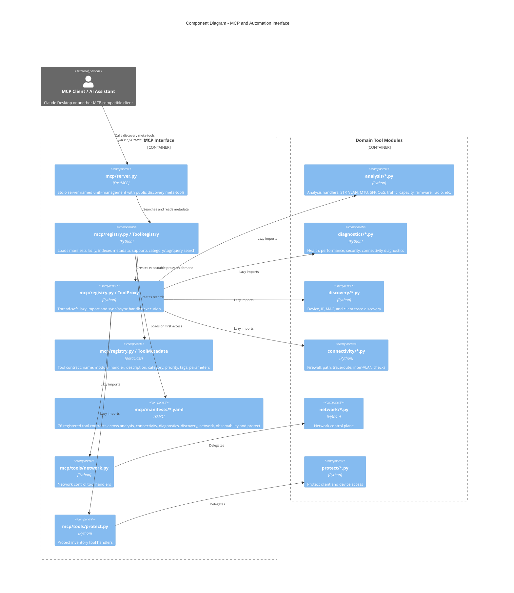
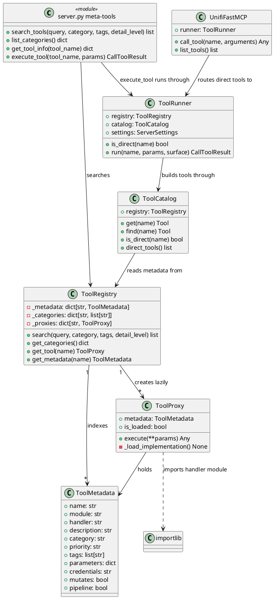
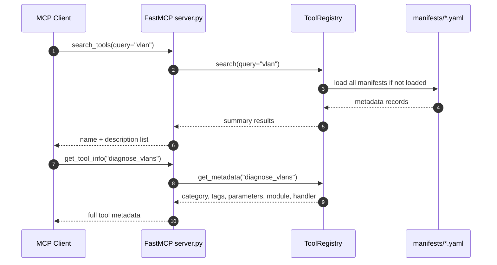
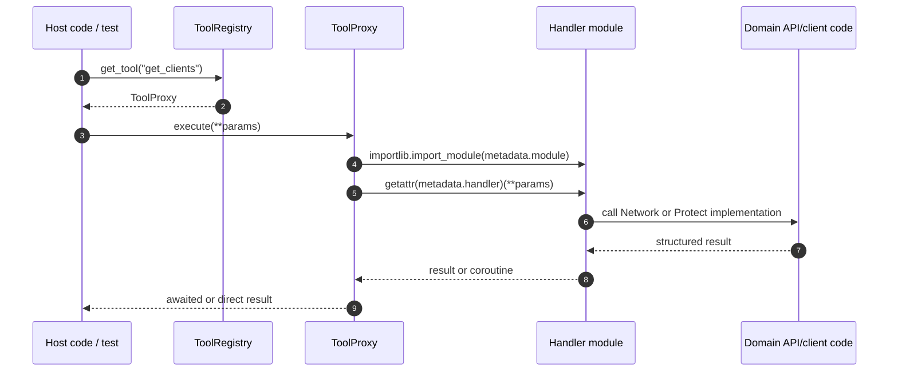

# MCP and Automation Interface Architecture

> **See also**: [C4 Architecture](../c4-architecture.md) | [MCP Server Guide](../../mcp-server/MCP_SERVER_GUIDE.md) | [MCP Standards Review](../../mcp-server/MCP_STANDARDS_REVIEW.md)

## Scope

The MCP interface lives under `src/unifi_mapper/mcp/` and exposes UniFi tooling to MCP-compatible assistants. The server (`unifi-mcp`, on the FastMCP bundled with the `mcp` SDK) exposes four public meta-tools:

- `search_tools`
- `list_categories`
- `get_tool_info`
- `execute_tool`, which runs any non-mutating catalog tool through `ToolRunner` (`mcp/runner.py`) and refuses mutating ones with `MUTATION_REFUSED`

With `--surface direct` (or `UNIFI_MCP_TOOL_SURFACE=direct`) it also lists the non-mutating, non-pipeline catalog tools directly, built by `ToolCatalog` (`mcp/catalog.py`) and run through the same `ToolRunner`. Config discovery is in `mcp/config.py`. Launch modes and client configs: [MCP Server Guide](../../mcp-server/MCP_SERVER_GUIDE.md). `ToolRegistry.get_tool(name).execute(...)` (`ToolProxy`) remains for host code and tests. The diagrams below show the registry and lazy-loading core; the runner, catalog and config modules are described in the guide and the [architecture overview](../architecture-overview.md#mcp-server-mcpserverpy).

## Component Diagram

## PlantUML Class View

## Tool Catalogue

| Manifest | Category | Registered tools | Examples |
| --- | --- | ---: | --- |
| `analysis.yaml` | analysis | 46 | `discover_stp_topology`, `audit_link_speeds`, `audit_port_profile_usage`, `check_poe_budget`, `audit_mtu_consistency`, `validate_qos` |
| `diagnostics.yaml` | diagnostics | 8 | `network_health_check`, `inspect_switch_port`, `diagnose_switch_port`, `get_switch_ports`, `diff_port_profiles` |
| `discovery.yaml` | discovery | 5 | `find_device`, `find_ip`, `find_mac`, `client_trace`, `get_client_history` |
| `observability.yaml` | observability | 2 | `get_device_events`, `get_port_counter_rates` |
| `connectivity.yaml` | connectivity | 4 | `firewall_check`, `path_analysis`, `check_inter_vlan_routing`, `traceroute` |
| `network.yaml` | network | 6 | `get_firewall_zones`, `get_firewall_policies`, `get_acl_rules`, `get_dns_policies`, `get_clients`, `get_networks` |
| `protect.yaml` | protect | 5 | `get_cameras`, `get_nvr_info`, `get_sensors`, `get_lights`, `get_doorbells` |

Total registered tools: **76** (3 mutating, never run over MCP; 11 pipeline tools, reachable only through `execute_tool`).

## Discovery Flow

## Lazy Execution Flow

## Current Implementation Notes

- Public MCP meta-tools are intentionally small and stable: discovery is cheap, and full parameter schema is fetched only when needed.
- YAML manifests are the tool contract. Keep descriptions, tags, and parameters accurate whenever handler signatures change.
- `ToolProxy.execute()` handles both synchronous and asynchronous handlers, which lets Network and Protect wrappers coexist behind the same registry.
- The server entry point is `unifi_mapper.mcp.server:main`, installed as `unifi-mcp` in `pyproject.toml`.
- Every call over MCP (`execute_tool` or a direct tool) goes through `ToolRunner`: mutation gate, signature validation, credential gate, error codes with `isError: true`, and secret masking.
