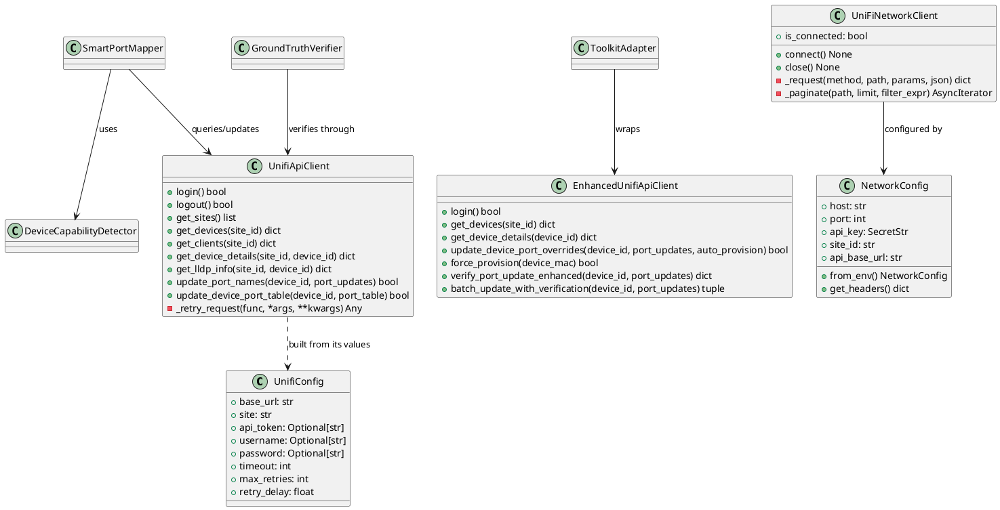
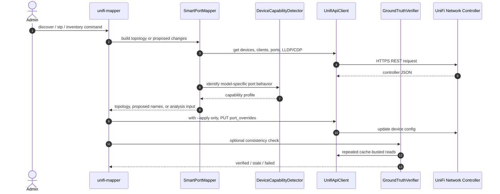

# UniFi Network Provider Architecture

> **See also**: [C4 Architecture](../c4-architecture.md) | [Architecture Overview](../architecture-overview.md) | [Codebase Map](../codemap.md)

## Scope

The UniFi Network provider covers all modules that talk to the UniFi Network controller or reason about Network controller data. It has three client paths:

- `api_client.py` and `enhanced_api_client.py`: synchronous `requests` clients, used by the original topology and port-mapping workflows, the inventory commands and the read-only port diagnostics.
- `core/utils/client.py`: the async `httpx` `UniFiClient` for the classic controller API, used by the async tools in `analysis/`, `diagnostics/`, `discovery/` and `connectivity/`. The port diagnostics are the exception: they use the synchronous clients above.
- `network/client.py`: the async `httpx` `UniFiNetworkClient` for the Integration API under `/proxy/network/integrations/v1`, used by the `network/` managers and the MCP `network` tools.

All three are intentionally present. The synchronous path preserves the mature port-naming workflow and ground-truth verification behavior; the async paths give the analysis toolkit and the newer network control modules typed clients.

## Component Diagram

```mermaid
C4Component
    title Component Diagram - UniFi Network Provider

    Container_Boundary(cli, "Entry Points") {
        Component(typer_cli, "typer_cli.py", "Typer + Rich", "Interactive unifi-mapper commands")
        Component(network_cli, "network_cli.py", "argparse", "Script-friendly network toolkit")
        Component(inventory_cli, "inventory_cli.py", "Typer", "Inventory reports and firmware upgrades")
        Component(verify_cli, "verify_cli.py", "argparse", "Verification workflows, run by unifi-mapper verify")
    }

    Container_Boundary(legacy, "Synchronous Network API Path") {
        Component(config, "config.py / UnifiConfig", "dataclass", "UNIFI_URL, site, token or username/password, timeout. Its retry settings reach no client (issue 042).")
        Component(api_client, "api_client.py / UnifiApiClient", "requests.Session", "UniFi OS and legacy controller REST client with auth negotiation and retry handling")
        Component(enhanced_client, "enhanced_api_client.py / EnhancedUnifiApiClient", "requests", "A separate client for the toolkit: port overrides, force-provision and meta.rc checks")
        Component(toolkit_adapter, "toolkit_adapters.py / ToolkitAdapter", "Python", "Sync find-device, link-quality and health tools for unifi-network-toolkit")
        Component(port_mapper, "port_mapper.py", "Python", "LLDP/CDP topology and port connection mapping")
        Component(smart_mapper, "smart_port_mapper.py", "Python", "Device-aware port naming using model capabilities")
        Component(capabilities, "device_capabilities.py", "Python", "Model-specific port/SFP/PoE/uplink capability profiles")
        Component(ground_truth, "ground_truth_verification.py", "Python", "Multi-read verification to work around controller cache behavior")
        Component(topology, "enhanced_network_topology.py", "Graphviz", "PNG, SVG and HTML topology output (mermaid and dot write a placeholder, issue 044)")
        Component(port_diag, "port_inspect.py / port_diagnostics.py / port_history.py", "Python", "Read-only port diagnostics behind ReadOnlySession")
        Component(link_settings, "analysis/link_settings.py", "Python", "The effective port profile and link settings rule")
    }

    Container_Boundary(classic_async, "Async Classic API Path") {
        Component(async_client, "core/utils/client.py / UniFiClient", "httpx.AsyncClient", "Async controller client; an MCP server process, and each CLI analysis or SSH command, shares one behind ReadOnlyAsyncTransport")
        Component(analysis, "analysis/*.py", "Python", "STP, VLAN, MTU, SFP, LAG, QoS, capacity, firmware, radio, MAC, and traffic matrix analysis")
        Component(diagnostics, "diagnostics/*.py", "Python", "Network health, performance, security, connectivity analysis and the port-diagnostics tools")
        Component(discovery, "discovery/*.py", "Python", "Find device, IP, MAC, and client trace")
        Component(connectivity, "connectivity/*.py", "Python", "Firewall checks, path analysis, traceroute, and inter-VLAN routing checks")
    }

    Container_Boundary(modern, "Async Integration API Path") {
        Component(network_config, "network/config.py / NetworkConfig", "Pydantic", "UNIFI_NETWORK_* environment config and API-key headers")
        Component(network_client, "network/client.py / UniFiNetworkClient", "httpx.AsyncClient", "Async client for sites, devices, clients, firewall, ACL, DNS, DPI, networks and traffic-matching lists")
        Component(network_modules, "network/*.py", "Python", "Managers for firewall, ACL, DNS, DPI, clients, sites, statistics, networks and traffic matching")
        Component(mcp_network, "mcp/tools/network.py", "Python", "The six MCP network tools: one client per call behind the GET-only guard")
    }

    Component(guards, "core/utils/readonly.py and redact.py", "Python", "Read-only guards, the opt-in request audit, secret stripping and masking")

    System_Ext(controller, "UniFi Network Controller", "UniFi OS / Network Application")

    Rel(typer_cli, config, "Loads")
    Rel(typer_cli, smart_mapper, "Runs discovery and update workflows")
    Rel(typer_cli, port_diag, "Runs the ports commands")
    Rel(typer_cli, analysis, "Runs the analyze, diagnose, controller, stp and radio commands")
    Rel(network_cli, port_mapper, "Runs discover")
    Rel(network_cli, toolkit_adapter, "Runs find, analyze and diagnose")
    Rel(inventory_cli, api_client, "Reads devices, sends upgrade commands")
    Rel(verify_cli, ground_truth, "Runs verification")
    Rel(smart_mapper, port_mapper, "Uses")
    Rel(smart_mapper, capabilities, "Uses")
    Rel(port_mapper, api_client, "Reads topology and ports")
    Rel(ground_truth, api_client, "Performs repeated reads")
    Rel(topology, port_mapper, "Renders discovered topology")
    Rel(toolkit_adapter, enhanced_client, "Wraps")
    Rel(api_client, controller, "REST calls", "HTTPS")
    Rel(enhanced_client, controller, "REST calls", "HTTPS")
    Rel(port_diag, api_client, "Reads through ReadOnlySession")
    Rel(port_diag, link_settings, "Resolves effective settings")
    Rel(port_diag, guards, "Strips secrets")
    Rel(analysis, async_client, "Calls")
    Rel(diagnostics, async_client, "Calls")
    Rel(discovery, async_client, "Calls")
    Rel(connectivity, async_client, "Calls")
    Rel(async_client, guards, "Guarded under MCP")
    Rel(async_client, controller, "Classic controller API", "HTTPS")
    Rel(mcp_network, network_modules, "Calls the managers")
    Rel(mcp_network, guards, "GET-only transport")
    Rel(network_modules, network_client, "Calls")
    Rel(network_client, network_config, "Configured by")
    Rel(network_client, controller, "Integration API", "HTTPS + X-API-KEY")
```

## PlantUML Class View

## Runtime Flow

## Configuration Boundary

| Path | Environment variables | Authentication model | Primary use |
| --- | --- | --- | --- |
| `UnifiConfig` | `UNIFI_URL`, `UNIFI_SITE`, `UNIFI_CONSOLE_API_TOKEN`, or username/password | API token preferred; username/password fallback | Port mapping, legacy topology, inventory, verification |
| `Credentials` (`core/utils/auth.py`) | `UNIFI_URL`, `UNIFI_SITE`, `UNIFI_CONSOLE_API_TOKEN` or username/password, with Keychain and 1Password fallbacks | API token or session login | `UniFiClient`: the analysis, diagnostics, discovery and connectivity tools |
| `NetworkConfig` | `UNIFI_NETWORK_HOST`, `UNIFI_NETWORK_API_KEY`, `UNIFI_NETWORK_SITE_ID` | UniFi Integration API key | Async Network control modules and MCP network wrappers |

## Current Implementation Notes

- `GroundTruthVerifier` is load-bearing. It exists because Network controller writes can appear successful while subsequent reads still return cached old values.
- `network_topology.py` is a compatibility re-export of `enhanced_network_topology.py`.
- STP-related automation is broad in the current manifest: discovery, optimal priorities, change plans, snapshots, drift, preflight, guard recommendations, and 10G readiness are registered under `analysis.yaml`.
- Keep new controller-specific behavior behind the relevant client/config path rather than mixing auth styles in one module.
- Read-only port diagnostics (`ports list/profile-diff/client/events/counters/diagnose` and the matching MCP tools) run on the synchronous `UnifiApiClient` behind `core/utils/readonly.py`'s `ReadOnlySession` guard. `analysis/link_settings.py` resolves each port's effective profile and link settings for them and for the profile analyses, and `core/utils/redact.py` strips secret fields from what they return. The endpoints they use:
  - `GET` legacy `stat/device`, `stat/device/{id}`, `stat/sta`, `stat/sysinfo`, `stat/user/{mac}`, `rest/portconf`, `rest/networkconf`, `rest/user` and `list/alarm`
  - `GET` v2 `clients/active`, `clients/history` and `models`
  - `POST` query bodies to legacy `stat/event` (`_start`/`_limit` paging) and v2 `system-log/{device-alert,admin-activity,update-alert,client-alert}` (`pageNumber`/`pageSize`)
  - `GET` Integration API `/v1/info`, `/v1/sites`, `/v1/sites/{id}/devices`, `.../devices/{id}` and `.../statistics/latest`, only on UniFi OS with API-key auth
- `UniFiNetworkClient` builds its requests on `/sites/{siteId}/` plus `devices`, `clients`, `networks`, `firewall/zones`, `firewall/policies`, `acl-rules`, `dns/policies` and `traffic-matching-lists`, and on `/sites` and `/dpi/...`. The six MCP tools only read zones, policies, ACL rules, DNS policies, clients and networks. Its `get_device_statistics` reads `.../devices/{id}/statistics`, which Network 10.6 doesn't serve; the reference, and the port diagnostics, use `.../statistics/latest` ([issue 035](../../issues/035-device-statistics-and-port-action-paths.md)).
- Integration API base path: Ubiquiti's published spec gives `/proxy/network/integration`, while `network/config.py` builds `/proxy/network/integrations`. A read-only check on 2026-10-02 against UniFi Network 10.6.106 got HTTP 200 from `GET /v1/info` on both bases, so the plural works there but is undocumented ([issue 003](../../issues/003-integration-api-undocumented-base-path.md)). The diagnostics try the documented path first, fall back to the plural on a 404, and record `base_path_used`.
