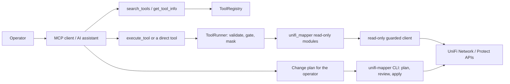

# UniFi Management MCP Server

## Overview

`unifi-mcp` is a stdio [Model Context Protocol](https://modelcontextprotocol.io/) server over
the same Python modules the `unifi-mapper` CLI uses. It registers **96 tools** in seven
categories (see [Tool categories](#tool-categories) and the [tool index](#tool-index)). Every
tool it will run is read-only against the controller. The three tools that would change it
are refused over MCP (see [Control boundary](#mcp-control-boundary)); those changes go through
the `unifi-mapper` `stp` and `radio` commands, which preview by default and write only when
told (`stp apply --plan … --no-dry-run`, `stp optimize --apply`, `radio optimize --apply`,
`radio restore --apply`, `inventory update-firmware --apply`, and every `discover` entry point
with `--apply`).
The [MCP standards review](MCP_STANDARDS_REVIEW.md) audits the server against the MCP
specification and SDK guidance, and lists the decisions still open.

## Technology Stack

- Python 3.12 (`requires-python = ">=3.12"`; 3.12 is the tested interpreter, so the launch
  commands below pin it with `--python 3.12`)
- The official MCP Python SDK, `mcp>=1.30,<1.31`, using its bundled FastMCP
  (`mcp.server.fastmcp`). The SDK is pinned to one minor because the server relies on FastMCP
  internals; see the comment in `pyproject.toml`
- pydantic 2, PyYAML 6, httpx, loguru; packaged with hatchling and launched with uv/uvx

## Project Structure

```text
src/unifi_mapper/mcp/
├── server.py      # entry point (main), meta-tools, lifespan, surfaces, resources, prompts
├── config.py      # CWD-independent config discovery, credential families, UNIFI_MCP_* settings
├── registry.py    # ToolRegistry: manifest loading and validation, search, metadata
├── catalog.py     # ToolCatalog: builds SDK tools (schemas, titles, annotations) lazily
├── runner.py      # ToolRunner: validate, gate, run, mask and package every tool call
├── manifests/     # YAML tool metadata, one file per category
└── tools/         # thin wrappers for the Network Integration API and Protect
```

## Launching

> [!WARNING]
> **Never run a bare `uvx unifi-mcp`.** `unifi-mcp` on PyPI is an unrelated third-party
> package: a bare `uvx unifi-mcp` downloads and runs it, and hands it any `UNIFI_*`
> credentials in your environment. Always launch this server with `--from <path>` or
> `--from git+https://github.com/NetDevAutomate/unifi_management_cli@<tag>`.
> `unifi-mcp --version` prints the distribution name, so you can confirm what you launched:
> `unifi-mcp (unifi-management-cli 0.2.0; mcp SDK 1.30.0)`.

| Mode | Command | Notes |
| --- | --- | --- |
| uvx, local path (recommended) | `uvx --python 3.12 --from /ABS/PATH/TO/unifi_management_cli unifi-mcp` | Builds the checkout into a cached tool environment. Config from [discovery](#configuration) |
| uvx, git | `uvx --python 3.12 --from git+https://github.com/NetDevAutomate/unifi_management_cli@v0.2.0 unifi-mcp` | Serves what is pushed and tagged on GitHub. Until `main` is pushed and `v0.2.0` is tagged, this mode serves an older release (a user action, design D7) |
| Installed tool | `uv tool install --python 3.12 /ABS/PATH/TO/unifi_management_cli`, then point the client at the absolute path of the installed `unifi-mcp` (usually `~/.local/bin/unifi-mcp`) | GUI apps start with a minimal `PATH`, so use the absolute path |
| Legacy dev | `uv --directory /ABS/PATH/TO/unifi_management_cli run unifi-mcp` with `UNIFI_CONFIG=/path/to/prod.env` in the client's `env` | Runs from the repo's `.venv` and `uv.lock` |
| Legacy wrapper | `scripts/unifi-mcp-launch.sh` | Sources `$UNIFI_MCP_ENV` (default `${XDG_CONFIG_HOME:-~/.config}/unifi_management_cli/prod.env`), exports every key, then runs the legacy dev command. Still supported, unchanged |

Only the two legacy modes read `uv.lock`. The uvx and installed-tool modes resolve from the
dependency bounds in `pyproject.toml`. The cache keys below also apply to the legacy modes'
editable install: the first launch or `uv run` after a source edit rebuilds it, which takes a
second or less and is reported on stderr, never on the stdout JSON-RPC stream.

**After changing the checkout.** uvx caches the build of a local path and rebuilds it only
when a cache key changes. `pyproject.toml` sets `[tool.uv] cache-keys` to `pyproject.toml`,
`src/**/*.py` and `src/**/*.yaml`, so the next plain launch picks up any code or manifest
edit, committed or not, and reuses the cached build otherwise:

```bash
uvx --python 3.12 --from /ABS/PATH/TO/unifi_management_cli unifi-mcp
# an installed tool doesn't rebuild on its own; reinstall it:
uv tool install --python 3.12 --reinstall /ABS/PATH/TO/unifi_management_cli
```

Restart the MCP client (or reconnect the server) so it relaunches. `uvx --refresh` and
`uvx --reinstall` don't force a rebuild of a local path (uv 0.11.8); without the cache keys
both kept serving the old build. `tests/mcp/test_packaging.py` checks the keys offline and,
with `--run-slow`, proves that an edit reaches the next launch.

### Command-line flags

| Flag | Effect |
| --- | --- |
| *(none)* | Serve MCP over stdin/stdout. stdout carries only JSON-RPC; logs and warnings go to stderr |
| `--version` | Print `unifi-mcp (unifi-management-cli <version>; mcp SDK <version>)` and exit 0 |
| `-h`, `--help` | Print usage and exit 0 |
| `--surface discovery\|direct` | Choose the [tool surface](#tool-surfaces) (case-insensitive). An invalid value exits 2 |
| `--config PATH` | Use this env file. Missing or unreadable exits 2 |
| `--check` | Print, as JSON, where config comes from, which credential families are ready (key names only, never values), the surface, how many tools each surface lists and where the MCP call log goes (`call_audit`: its path, or `off`), then exit 0 if the controller family is ready, else 1. Never contacts the controller, Keychain or 1Password |

Unknown arguments are reported on stderr and ignored. Neither `--version` nor `--help` reads
any config.

```bash
uvx --python 3.12 --from /ABS/PATH/TO/unifi_management_cli unifi-mcp --surface direct --check
```

## Configuration

The server never reads a `.env` in its working directory (under uvx the working directory is
whatever the MCP client chose). It picks **one** env file, first match wins:

1. `--config PATH` (missing → exit 2).
2. `UNIFI_CONFIG=/path/to/file.env` (a leading `~` is expanded). If that file is missing, the
   server warns on stderr, loads **no** file (it never falls through to another, which might be
   a different site) and still starts.
3. `$XDG_CONFIG_HOME/unifi_management_cli/prod.env`, then `default.env`.
4. `~/.config/unifi_management_cli/prod.env`, then `default.env`.
5. `~/.config/unifi_network_mapper/prod.env` (legacy; loaded with a deprecation warning).
6. Nothing: the server still starts. `search_tools`, `get_tool_info` and the resources work;
   tools that need credentials return `[CONFIG_MISSING]` naming the files tried.

File format: `KEY=VALUE` lines, `#` comments, surrounding quotes stripped. A malformed line is
skipped with a stderr warning that names the line number, never the value. Keep the file
private (`chmod 600`); `.env.example` in the repo lists the controller keys.

**Credential families.** Keys are loaded per family, so one client can never mix two
controllers:

| Family | Keys | Ready when |
| --- | --- | --- |
| `controller` | `UNIFI_URL`/`UNIFI_HOST`, `UNIFI_PORT`, `UNIFI_SITE`, `UNIFI_VERIFY_SSL`, `UNIFI_CONSOLE_API_TOKEN`/`UNIFI_API_TOKEN`, `UNIFI_USERNAME`, `UNIFI_PASSWORD`, `UNIFI_SSH_USERNAME`, `UNIFI_SSH_PASSWORD` | URL or host, plus a token or username and password |
| `network_api` | `UNIFI_NETWORK_*` | `UNIFI_NETWORK_HOST`, `UNIFI_NETWORK_API_KEY` and `UNIFI_NETWORK_SITE_ID` |
| `protect` | `PROTECT_*` | `PROTECT_HOST`, `PROTECT_USERNAME` and `PROTECT_PASSWORD` |

- `UNIFI_SSH_USERNAME` and `UNIFI_SSH_PASSWORD` travel with the controller family so a file
  stays one site, but no MCP tool uses them: only the CLI's `diagnose latency-matrix` and
  `diagnose bandwidth` SSH to the gateway.
- The `network_api` family needs all three keys. A file that sets only
  `UNIFI_NETWORK_API_KEY`, as the legacy `~/.config/unifi_network_mapper/prod.env` in
  [issue 037](../issues/037-launch-config-network-family-incomplete.md) does, leaves the six
  network tools at `[CONFIG_MISSING]`.
- For `protect`, use a dedicated local, view-only Protect account, not the console's admin
  login. The five Protect tools haven't been verified against a live console yet
  ([issue 034](../issues/034-protect-has-no-live-account.md)).

- A family with **any** key in the client's environment belongs to the environment and is
  never topped up from the file (a partial export stays not-ready and `--check` says so).
- An auto-discovered file (steps 3–5) is applied only if every host the client exported
  (`UNIFI_URL`/`UNIFI_HOST`, `UNIFI_NETWORK_HOST`, `PROTECT_HOST`) matches the same host in the
  file. Otherwise the file isn't applied at all, `--check` shows a `skipped_reason`, and the
  fix is to set `UNIFI_CONFIG` to the file for that site.
- An explicit file (`--config`, `UNIFI_CONFIG`) is applied per family regardless of host.
- Other keys in the file (`UNIFI_TIMEOUT`, …) are applied only where not already set.
  `UNIFI_CONFIG` and `UNIFI_MCP_*` are never read from a file.

**Keychain / 1Password fallback.** When the controller family isn't ready from the
environment or the file, the first controller tool call runs the existing
`get_credentials()` chain (macOS Keychain service `unifi-mcp`, then the 1Password CLI, with
stdin from `/dev/null` so it can never read the JSON-RPC pipe) on a background thread. The call
waits at most `UNIFI_MCP_CREDENTIAL_TIMEOUT` seconds (default 15) and then returns
`[CONFIG_MISSING]`; a late success is used by the next call, and a failed lookup is retried
after 60 s. Other requests keep being answered while it waits.

**Per-process state.** One server process logs in to the controller once: the lifespan
installs a shared client (connect timeout 10 s, request timeout 30 s) that every async tool
borrows, behind a read-only HTTP transport that refuses any request that could change the
controller. If the controller answers a borrowed request with 401 (for example an expired
password session), the shared client logs in again once and the request is retried once; a
second 401 is reported as an error. Credentials are re-resolved for that login, but the
config file is read into the process environment at start-up, so a token or password
changed in the file still needs a server restart (issue 020). The sync port-diagnostics tools (`diagnose_switch_port`, `get_switch_ports`,
`diff_port_profiles`, `get_client_history`, `get_device_events`, `get_port_counter_rates`,
`audit_link_speeds`, `audit_port_profile_usage`) keep one guarded login per call.
`inspect_switch_port` also logs in per call, through its own sync client behind the same
read-only guard. The `network_api` and `protect` tools open their own guarded client per call
(the Integration API's GET-only transport, and `ReadOnlyProtectApiClient`).

`get_clients` returns one page, `{total, returned, offset, limit, next_offset, truncated,
clients}`: `limit` 1-1000 (default 200), sorted by client ID. It reads the controller's whole
list on every call and filters it first, so `total` counts every client that matches (only
connected clients while `active_only` is true, the default; every client when it is false);
pass a page's `next_offset` as the next `offset` until it is null. A failure is `{error}`.

> [!IMPORTANT]
> **Breaking change in the 0.2.0 port: `get_clients` returns a page object, not a list.**
> Before, it returned a bare list of client objects, and `[{error}]` on failure. A caller
> that iterates the result, or reads `result[0]['error']`, must read `result['clients']`
> and `result['error']` instead, and follow `next_offset` to get more than one page
> (200 clients by default).

```json
{
  "total": 230,
  "returned": 200,
  "offset": 0,
  "limit": 200,
  "next_offset": 200,
  "truncated": true,
  "clients": [{"id": "…", "name": "Phone A", "mac_address": "02:00:00:00:02:01", "...": "…"}]
}
```

Call it again with `offset: 200` for the last 30 clients (`next_offset` is then null and
`truncated` false).

### Environment variables

| Variable | Default | Valid values | On an invalid value |
| --- | --- | --- | --- |
| `UNIFI_CONFIG` | unset | path to a readable env file | stderr warning; no file loaded; server starts |
| `UNIFI_MCP_TOOL_SURFACE` | `discovery` | `discovery`, `direct` (case-insensitive) | stderr warning; `discovery` |
| `UNIFI_MCP_TOOL_TIMEOUT` | unset (no deadline) | seconds, 5–3600 | stderr warning; no deadline |
| `UNIFI_MCP_CREDENTIAL_TIMEOUT` | 15 | seconds, 1–120 | stderr warning; 15 |
| `UNIFI_MCP_MAX_CONCURRENCY` | 4 | integer, 1–32 | stderr warning; 4 |
| `UNIFI_MCP_LOG_LEVEL` | `WARNING` | a loguru level name | stderr warning; `WARNING` |
| `UNIFI_MCP_CALL_AUDIT` | on: `$XDG_STATE_HOME/unifi_mapper/mcp-audit.jsonl` (default `~/.local/state/…`) | `on`/`true`/`1`/`default`; `off`/`false`/`0`/`none`; an absolute path (any case; `~` expanded) | a relative path or anything else: stderr warning; the call log is off |
| `UNIFI_MCP_REQUEST_AUDIT` | unset (no request lines) | `on`/`true`/`1` (request lines in the call log); `off`/`false`/`0`/`none` or `default` (none); any other value: path of a separate JSON-lines file | `on` with the call log off: stderr warning; none |
| `UNIFI_MCP_ENV` | `…/unifi_management_cli/prod.env` | path; read only by `scripts/unifi-mcp-launch.sh` | the script exits 1 |
| `XDG_CONFIG_HOME` | `~/.config` | directory | — |

### What the call log holds

The server writes one JSON line per catalog tool call (through `execute_tool` or the direct
surface) to `$XDG_STATE_HOME/unifi_mapper/mcp-audit.jsonl`, on by default
(`UNIFI_MCP_CALL_AUDIT`; issue [013](../issues/013-mcp-audit-log-and-result-cap.md)):

```json
{"t": "2026-01-01T12:00:00.000+00:00", "epoch": 1767268800.0, "kind": "call", "pid": 4242, "tool": "get_clients", "surface": "execute_tool", "arg_keys": ["active_only", "limit"], "unknown_keys": 0, "duration_ms": 182.4, "outcome": "ok"}
```

- `tool` is the registered name. A name the registry doesn't hold is client text, so it is
  written as `"<unregistered>"` with `tool_name_length`, never the name.
- `arg_keys` lists only the keys that are the tool's own parameter names (at most 64); any
  other key is counted in `unknown_keys`, never named. Argument values, results and error
  messages are never written.
- `outcome` is `ok`, the error code (`INVALID_PARAMETERS`, `MUTATION_REFUSED`,
  `TOOL_NOT_FOUND`, `CONFIG_MISSING`, `TIMEOUT`, …), or `CANCELLED` for a call the client
  cancelled (still logged, still cancelled).
- The meta-tools (`search_tools`, `get_tool_info`, `list_categories`) aren't logged.

The file and its lock, `<file>.lock` beside it (`mcp-audit.jsonl.lock` by default), are kept
`0o600` on every write, not only when they are created: one of yours with group or other
permissions is made private again, and one owned by another user, or a symbolic link in the
place of either, is never written. The default directory, `$XDG_STATE_HOME/unifi_mapper`, is
kept `0o700` the same way. The directory of a path you give in `UNIFI_MCP_CALL_AUDIT` is never
changed (one the log creates is made `0o700`): when another user owns it, or it has group or
other write permission, the log turns off with one warning and writes nothing there.

The log is capped at 16 MiB (compacted to 80%, oldest lines first) and locked per write, so
several server processes can share it. A write waits at most 5 s to take the lock. If the lock
is still held then, that write's lines (the call line and any buffered request lines) are
dropped with one warning (once per process), and the log stays on, so later calls are written
once the lock is free. The 5 s covers only that wait, so it is not a limit on a call's total
time: the append and any compaction after the lock is taken, a wait for a worker thread when
many calls run at once, and the last write of buffered request lines when the server exits
(which waits for the lock the same way) are outside it. A lock that is never released costs
every logged call up to 5 s, and after the first warning the dropped lines leave no trace.

Any other write that fails (an unwritable path, no home directory, another user's file, lock
or directory, a symbolic link, a given directory others can write to) logs one warning and
turns the log off for that process; no tool result ever changes. `unifi-mcp --check` shows the
path in `call_audit`.

### Request lines

`UNIFI_MCP_REQUEST_AUDIT=on` adds a `{"t", "epoch", "kind": "request", "method", "path"}` line
to the call log for each request the read-only guards let through, written just before the
next call line (buffered in memory, at most 1000, then one `request_overflow` line with the
count). Request lines carry no call id: with concurrent calls they belong to the time window,
not to one call. Any other value but the `off` family and `default` keeps the older form: a
path to a separate file of `{"t": <UTC time>, "method": …, "path": …}` lines. No host, query
string, headers or body is recorded either way. It's how you can show that a session sent
nothing but reads, because every tool family goes through a guard:

- `controller`: the shared client's read-only transport, or the guard on the sync
  diagnostics client (`inspect_switch_port` included). GET and HEAD (no `cmd`/`upd`
  segment), the few read-only query POSTs (`stat/event`, `list/alarm`, v2 `system-log`) and
  logout; the client's own login is sent but not recorded.
- `network_api`: the same transport with a GET-only policy (GET and HEAD, no `cmd`/`upd`
  segment), since every Integration API POST creates an object or runs an action. Nothing
  else is sent.
- `protect`: `ReadOnlyProtectApiClient`, which overrides uiprotect's `request()`: GET and
  HEAD (recorded; no `cmd`/`upd` segment), plus its session login (`POST /api/auth/login`
  or `/api/login`; sent, not recorded). A read is recorded before uiprotect's lazy login,
  so a GET whose login then fails is still recorded: reads can be over-recorded, writes
  never are.

Two uiprotect paths bypass `request()` and so aren't covered: websocket subscriptions and
the private `_get_versions_from_api`. No tool uses either.

## Tool Surfaces

| Surface | `tools/list` shows | Size (measured at this commit) |
| --- | --- | --- |
| `discovery` (default) | the four meta-tools: `search_tools`, `list_categories`, `get_tool_info`, `execute_tool` | 4 tools, about 6.4k characters |
| `direct` | the four meta-tools plus every catalog tool that is not mutating and not a pipeline tool, each with its own input schema, output schema, title and annotations | 86 tools (4 + 82), about 215k characters |

On either surface every catalog tool runs through the same `ToolRunner`, so arguments are
validated, credentials gated, results masked and errors coded identically. The 11 pipeline
tools (STP and 10G report stages whose required argument is a model produced by another tool)
are reachable only through `execute_tool`; the 3 mutating tools are never listed or run.
`--check` prints `listed_tools` for both surfaces.

Use `direct` with hosts that defer tool schemas (kiro-cli, Claude Code tool search): the
host keeps the 86 schemas out of context until needed and the model calls tools by name. Use
`discovery` with hosts that load every schema up front (Codex): the model searches, reads one
schema with `get_tool_info`, then calls `execute_tool`.

**Meta-tools.**

- `search_tools(query, category, tags, detail_level)`: find tools; `detail_level="full"` adds
  each tool's `input_schema`.
- `list_categories()`: category → tool names.
- `get_tool_info(tool_name)`: description, parameters, `input_schema`, `output_schema` and
  annotations.
- `execute_tool(tool_name, params)`: run a catalog tool (see [Errors](#errors)).

**Resources.** `unifi://catalog` (every tool's name and description, plus the categories) and
`unifi://config/status` (the resolved config: source, path, files tried and per-family
readiness, key names only).

**Prompts.** `troubleshoot_port_link(switch, port)`, a read-only investigation of a port
linking at the wrong speed, flapping or staying down; `plan_stp_change()`, which steers an STP
change to the CLI (`stp analyze` → `stp report` → `stp optimize --plan` → `stp apply --plan`,
which previews unless `--no-dry-run` is given) and names the read-only `audit_stp_priorities`
for a before-and-after check.

**Annotations.** Catalog tools carry `readOnlyHint: true` (except `snapshot_radio_config`, which
writes a local file), `destructiveHint: false`, `openWorldHint` (false for the six STP pipeline
tools that compute from their input, and for `get_wan_speedtest_history` and
`verify_config_backup`, which read a local file; none of them contacts a controller), and
`idempotentHint: false` for the sampling tools (`get_port_counter_rates`,
`get_ap_retry_rates`, `diagnose_switch_port`, `check_device_freshness`). `execute_tool` is annotated non-read-only because it can reach
`snapshot_radio_config`.

## Tool Categories

Counted from `ToolRegistry()` at this commit (96 tools):

| Category | Tools | Covers |
| --- | ---: | --- |
| analysis | 57 | IP conflicts, storms, MAC table, VLAN diagnostics and coverage, STP topology, priority audit, guard, path costs, drift, preflight and snapshots, link quality and link-speed audit, port-profile usage and validation, MTU, QoS, SFP, LAG, PoE and power budgets, uplink redundancy and transparency, client density, DHCP pools, device freshness, capacity, firmware and firmware drift, the device inventory, port-naming capabilities, Wi-Fi radio, neighbouring APs and their baseline, traffic matrix, per-VLAN traffic reports and store coverage, foreign bridges, 10G readiness, and the config-drift, link-error and roaming baseline comparisons |
| connectivity | 4 | Firewall check, path analysis, traceroute, inter-VLAN routing |
| diagnostics | 12 | Health, the all-diagnostics summary, performance, security, connectivity, single-port inspection, all-ports view, port-profile diff, port evidence bundle, WAN health, the recorded speedtest history and offline backup verification |
| discovery | 5 | Find device, IP or MAC; client trace; client history |
| network | 6 | Firewall zones and policies, ACLs, DNS policies, clients, networks (Network Integration API, `network_api` family) |
| observability | 7 | Event, alarm, system-log and admin-audit history; port counter rates and history; site-wide recent events; one device's stats, AP retry rates, raw config objects and the config-change timeline |
| protect | 5 | Cameras, NVR, sensors, lights, doorbells (`protect` family) |

Of the 96: 3 are mutating (`apply_stp_changes`, `apply_radio_optimization`,
`restore_radio_config`) and 11 are pipeline tools, leaving 82 on the direct surface.

Some tools overlap on purpose, and their descriptions say which to use. `get_device_stats`
repeats the CPU, memory, load and uptime that `find_device` reports, and one AP's share of
`get_radio_channel_report`, adding that device's per-radio and per-VAP counters.
`get_config_object` with `kind` `networkconf` returns the full legacy network object, where
`get_networks` reads the Network Integration API.

`get_vlan_traffic_report` reads a local store that only the CLI fills (`vlan-traffic sample`
over SSH, `vlan-traffic rollup` offline). `now`, `1d` and `1w` read its raw samples (kept 8
days); `1m` and `1y` read the hourly and daily rows `rollup` writes for every complete hour and
day, so they are as current as its last run. Each VLAN's `valid_sample_pct` is the share of
its samples (or rollup rows) in the period that gave a rate (a first sample with none before
it, or one after a counter reset, gives none), not the share of the period that was sampled:
`list_vlan_traffic_periods` gives each tier's earliest and latest time and its gaps. As
ported from the prototype the tool's `1w` was
always empty and `1m` and `1y` left out the newest 8 and about 61 days ([issue
069](../issues/069-vlan-reports-read-tiers-without-recent-data.md)).

## Errors

`execute_tool` returns the same JSON envelope as both the text block and `structuredContent`:

```json
{"ok": true, "result": {"...": "..."}}
{"ok": false, "error_code": "DEVICE_NOT_FOUND", "message": "...", "suggestion": "...",
 "related_tools": ["..."]}
```

Every failure also sets `isError: true` on the result, so the model and host see it as a
failed call. On the direct surface a failure is a single text block,
`[ERROR_CODE] message — suggestion`, with `isError: true`. The runner never raises.

| Code | When |
| --- | --- |
| `TOOL_NOT_FOUND` | No tool by that name |
| `MUTATION_REFUSED` | The tool changes the controller; use the CLI |
| `INVALID_PARAMETERS` | Unknown key or a type/range error; the envelope adds `parameters` and `input_schema` |
| `CONFIG_MISSING` | The tool's credential family isn't ready, or the Keychain/1Password lookup didn't finish in time; names the files tried |
| `TIMEOUT` | The call exceeded `UNIFI_MCP_TOOL_TIMEOUT` (only when set) |
| `READ_ONLY_VIOLATION` | A tool tried a write and a read-only guard refused it (a bug; nothing was written) |
| `TOOL_FAILED` | Any other exception, as `ExceptionClass: text` |
| domain codes | Raised by the tool itself, e.g. `DEVICE_NOT_FOUND`, `PROFILE_NOT_FOUND`, `CONTROLLER_UNREACHABLE`, `AUTHENTICATION_FAILED`, `CONFIG_INVALID`, `NO_DATA` |

Results and error text are masked: the value of any secret-looking `UNIFI_*`/`PROTECT_*`
variable is replaced wherever it appears, and values under secret-named keys are redacted.
Error messages are capped at 2,000 characters (`TOOL_FAILED` at 500). A `TOOL_FAILED` call
(and an unexpected error in the credential check) is also logged on stderr as one ERROR
line, the tool, the exception's type and its text masked the same way; its traceback,
masked too, only at `UNIFI_MCP_LOG_LEVEL=DEBUG`. The Network and Protect
wrappers still return `{"error": …}` inside an `ok: true` result on failure; issue 011 tracks
turning that into `TOOL_FAILED`. A write their read-only guard refuses is the exception: it is
reported as `READ_ONLY_VIOLATION`.

## Client Configuration

Every snippet points `UNIFI_CONFIG` at an env file instead of putting secrets in the client
config. Replace `/ABS/PATH/TO/unifi_management_cli` with the absolute path of your checkout and
`/Users/you` with your home directory. These are examples; the server never edits client
configs.

### kiro-cli

`~/.kiro/settings/mcp.json` (Kiro defers MCP tool schemas, so use the direct surface; `timeout`
is in milliseconds, and counter sampling can block for about 100 s):

```json
{
  "mcpServers": {
    "unifi": {
      "command": "uvx",
      "args": ["--python", "3.12", "--from", "/ABS/PATH/TO/unifi_management_cli", "unifi-mcp"],
      "env": {
        "UNIFI_CONFIG": "/Users/you/.config/unifi_management_cli/prod.env",
        "UNIFI_MCP_TOOL_SURFACE": "direct"
      },
      "timeout": 300000
    }
  }
}
```

### Claude Code

```bash
claude mcp add unifi --scope user \
  -e UNIFI_CONFIG=/Users/you/.config/unifi_management_cli/prod.env \
  -e UNIFI_MCP_TOOL_SURFACE=direct \
  -- uvx --python 3.12 --from /ABS/PATH/TO/unifi_management_cli unifi-mcp
```

or the equivalent project-scoped `.mcp.json`:

```json
{
  "mcpServers": {
    "unifi": {
      "type": "stdio",
      "command": "uvx",
      "args": ["--python", "3.12", "--from", "/ABS/PATH/TO/unifi_management_cli", "unifi-mcp"],
      "env": {
        "UNIFI_CONFIG": "/Users/you/.config/unifi_management_cli/prod.env",
        "UNIFI_MCP_TOOL_SURFACE": "direct"
      }
    }
  }
}
```

### Codex

`~/.codex/config.toml`, on the default discovery surface (Codex lists every schema up front):

```toml
[mcp_servers.unifi]
command = "uvx"
args = ["--python", "3.12", "--from", "/ABS/PATH/TO/unifi_management_cli", "unifi-mcp"]
env = { UNIFI_CONFIG = "/Users/you/.config/unifi_management_cli/prod.env" }
# Counter sampling (get_port_counter_rates, diagnose_switch_port) blocks for about 100 s.
tool_timeout_sec = 300
```

### Claude Desktop and other GUI hosts

Use the installed-tool mode (absolute path to `unifi-mcp`) or `scripts/unifi-mcp-launch.sh`
as the `command`, because GUI apps start with a minimal `PATH`.

## MCP Control Boundary

No tool that changes the controller runs over MCP. Mutating manifest entries
(`mutates: true`: `apply_stp_changes`, `apply_radio_optimization`, `restore_radio_config`) are
never listed and `execute_tool` refuses them with `MUTATION_REFUSED`; the shared async client's
transport, the sync diagnostics client's guard, the `network_api` tools' GET-only transport and
the `protect` tools' `ReadOnlyProtectApiClient` refuse any write a read-only tool might attempt
(`READ_ONLY_VIOLATION`). Any new tool that writes controller state must declare
`mutates: true`; `tests/mcp/test_execute.py` fails if an `apply_*` / `restore_*` tool ships
without it. One catalog tool writes a **local** file: `snapshot_radio_config`.



For configuration changes: generate a plan with the read-only tools, review it, apply it with
the CLI, then verify with read-only tools. Don't ask the assistant to invent live STP
priorities, VLAN changes or rollback steps.

## Development

```bash
uv sync --group dev
uv run pytest -q                                    # offline test suite
uv run pytest --run-slow tests/mcp/test_packaging.py  # isolated uvx-style resolve (network)
uv run ruff check && uv run ruff format --check
uv run pyright src/
uv run unifi-mcp --check
```

### Adding a tool

1. **Write the handler** in the module that owns the logic (for example
   `src/unifi_mapper/analysis/<topic>.py`), with type hints and a Google docstring. The
   signature is the input schema: `ToolCatalog` builds the SDK tool with
   `Tool.from_function`, so parameter names, types and defaults are what the model sees.
   Return a typed value (usually a pydantic model) so the tool gets an `outputSchema`; an
   untyped return is listed without one and must be added to `NO_OUTPUT_SCHEMA_ALLOWLIST` in
   `tests/mcp/test_manifest_parity.py`. Open the controller with
   `async with UniFiClient() as client:`: under the server it borrows the shared, read-only
   guarded connection. Raise `ToolError(message, error_code, suggestion, related_tools)` for
   expected failures; every tool a hint names must be registered
   (`tests/mcp/test_related_tools.py`).
2. **Add a manifest entry** under `tools:` in `src/unifi_mapper/mcp/manifests/<category>.yaml`.
   `MANIFEST_KEYS` in `mcp/registry.py` lists the allowed keys and their types; an unknown key
   or a wrong type fails `ToolRegistry(strict=True)`, which the tests use.

   | Key | Default | Meaning |
   | --- | --- | --- |
   | `module` | required | Import path of the handler's module |
   | `handler` | the tool name | Function name in `module` |
   | `title` | the name, title-cased | `Tool.title`; the tests require an explicit one |
   | `description` | empty | What the model reads when choosing the tool |
   | `priority`, `tags` | `P2`, none | Search ranking and search terms |
   | `parameters` | none | One entry per handler parameter; `required: true` exactly for those without a default |
   | `credentials` | `controller` | `controller`, `network_api`, `protect` or `none`; `network.yaml` entries must be `network_api`, `protect.yaml` entries `protect`, and `none` only for a module that imports no client |
   | `mutates` | `false` | `true` for anything that changes the controller: never listed, refused with `MUTATION_REFUSED`. An `apply_*` or `restore_*` tool without it fails `tests/mcp/test_execute.py` |
   | `pipeline` | `false` | `true` when a required parameter is a model another tool produces; reachable only through `execute_tool` |
   | `writes_local` | `false` | Writes a local file; drops `readOnlyHint` |
   | `idempotent` | `true` | `false` for wall-clock sampling (any `interval_seconds`, `samples` or `counter_samples` parameter) |
   | `open_world` | `true` | `false` when the tool only computes from its input |
   | `mcp` | `true` | `false` keeps it off the direct surface |
   | `aliases` | none | Deprecated parameter name → handler parameter name |
   | `cli` | none | The `unifi-mapper` command this tool is the counterpart of (`cli: analyze poe-budget`). Every entry carries `cli` or `cli_gap`, exactly one |
   | `cli_gap` | none | Why no command exists: `raw read: ...` (an agent-facing read of objects the UI shows) or `not yet built: ...` (a gap issue 078 tracks) |

3. **Run** `uv run pytest tests/mcp tests/test_surface_parity.py -q`.
   `tests/mcp/test_manifest_parity.py` checks every entry against its handler (import,
   parameters, schemas, pipeline and sampling rules, title, credential family), so a new tool
   needs no edit there. `tests/test_surface_parity.py` is the parity gate: the entry must name
   its `unifi-mapper` command or say why there is none, and a new CLI command must have a tool
   or a reason in `CLI_ONLY` (`src/unifi_mapper/mcp/parity.py`); the gate pins how many gaps
   are "not yet built", so closing or opening one is a visible edit.
4. **Update the docs**: the category counts in this guide and in the README, and the
   [tool index](#tool-index) below.

The design rationale and the decisions still open are in the
[MCP standards review](MCP_STANDARDS_REVIEW.md).

## Tool Index

All 96 registered tools by category, generated from `ToolRegistry()`. **Family** is
the credential family a tool needs (`none`: it computes from its input). **Marks**:
*mutating* tools are never listed or run over MCP; *pipeline* tools are reachable only
through `execute_tool`; *writes a local file* drops `readOnlyHint`. Every tool that is
neither mutating nor a pipeline tool is listed on the direct surface,
`snapshot_radio_config` (which writes a local file) included.

### analysis (57)

| Tool | Family | Marks | Description |
| --- | --- | --- | --- |
| `analyze_client_density` | `controller` |  | Wireless clients per access point with average signal strength. WARNING above 30 clients on one AP, CRITICAL above 50. Read-only. |
| `analyze_link_quality` | `controller` |  | Port health and error analysis for link quality assessment |
| `analyze_mac_table` | `controller` |  | MAC address table analysis and flapping detection |
| `analyze_radio_optimization` | `controller` |  | Analyze Wi-Fi radio channel reuse and transmit power settings |
| `analyze_traffic_matrix` | `controller` |  | Analyze available UniFi traffic statistics for top flows and 10G placement hints. For per-VLAN throughput history, get_vlan_traffic_report reads the local VLAN traffic store. |
| `apply_radio_optimization` | `controller` | mutating | Apply recommended radio optimisations (80MHz 5GHz, reduced 2.4GHz power, min RSSI). Auto-snapshots before applying. |
| `apply_stp_changes` | `controller` | mutating | Apply STP priority changes via API (supports dry-run mode) |
| `audit_link_speeds` | `controller` |  | Fleet-wide audit of negotiated switch-port speeds. Flags half duplex, ports forced to a speed that are down or linked at another rate, and autonegotiated ports below their Integration API maxSpeedMbps (the 10G-at-5G downgrade). Raw speed_caps is never decoded, only compared for equality between ports when the Integration API has no capability. Stale devices are excluded. Paged findings. Read-only. |
| `audit_mtu_consistency` | `controller` |  | Audit MTU and jumbo-frame consistency across inter-switch links |
| `audit_port_profile_usage` | `controller` |  | Where every port profile is applied (each port's effective profile, the override winning over the port table) and which profiles are traps. Flags profiles that force a speed, port overrides that shadow their profile's speed, autoneg or native network, ports referencing a deleted profile, duplicate and unused profiles. Paged profiles. Read-only. |
| `audit_power_budget` | `controller` |  | Audit switch INPUT power headroom - whether a switch's own power source (DC adapter or PoE-in) can run its active PHYs. Distinct from PoE output budget. Catches the failure where a compact multi-gig switch on an undersized adapter reboots as more ports go active. Only reports against published vendor figures; unlisted models yield no ceiling. |
| `audit_sfp_diagnostics` | `controller` |  | Pull SFP/SFP+ module identity and DOM diagnostics from UniFi port tables |
| `audit_stp_guard_recommendations` | `none` | pipeline | Audit Root Guard candidates and STP topology-change counters |
| `audit_stp_path_costs` | `controller` | pipeline | Audit STP path costs for IEEE long-path-cost consistency |
| `audit_stp_priorities` | `controller` |  | One-shot STP priority audit for the whole fleet, or narrowed to one switch: each switch's current, recommended and delta bridge priority and tier, a warning when two non-core switches tie at the lowest priority (the root would be decided by MAC), and the gateway under skipped (its bridge runs with STP disabled). Tiers always come from the whole fleet; narrowed to one switch, compliant and summary describe that switch and fleet_compliant and fleet_summary the fleet. Remediation names the CLI commands (stp optimize --plan, then stp apply --plan, which previews unless --no-dry-run); STP writes never run over MCP. Read-only. |
| `audit_uplink_transparency` | `controller` |  | Detect switches whose elected uplink port cannot carry tagged VLANs (for example a switch that re-homed onto an access port with tagged_vlan_mgmt=block_all), which silently severs every tagged VLAN behind it while untagged traffic keeps working |
| `audit_vlan_coverage` | `controller` |  | Check required VLAN coverage on trunk and planned uplink ports |
| `calculate_optimal_priorities` | `controller` | pipeline | Calculate optimal bridge priorities based on network hierarchy |
| `check_device_freshness` | `controller` |  | Authoritative two-sample freshness check - verifies last_seen, uptime and cumulative counters actually advance, using healthy peers as the control. SLOW: sleeps ~200s between samples because devices only inform every 75-90s. Distinguishes reboots (uptime reset) from staleness, and reports inconclusive if no peer advanced. |
| `check_dhcp_pool_utilization` | `controller` |  | DHCP pool utilisation per DHCP-enabled network - active clients against the configured range. WARNING at 80%, CRITICAL at 90% (near exhaustion). Read-only. |
| `check_poe_budget` | `controller` |  | PoE OUTPUT budget per switch - watts drawn by powered devices against the switch's PoE budget, headroom and high-draw ports (over 5 W). WARNING at 80%, CRITICAL at 90%. Distinct from audit_power_budget, which audits the switch's own input power. Read-only. |
| `check_uplink_redundancy` | `controller` |  | Count the uplink ports of every switch with their speed and state, and flag switches with a single uplink (a single point of failure) or none. Read-only. |
| `create_stp_change_plan` | `none` | pipeline | Create convergence-aware STP priority change plan with rollback bundle |
| `detect_foreign_bridges` | `controller` |  | Detect wired third-party (foreign) bridges inside the UniFi L2 domain - consumer mesh units and unmanaged switches that forward frames but do not participate in RSTP. Flags CRITICAL when one bridge touches two switch ports (an L2 loop spanning tree cannot break) or sits on a trunk profile (exports every VLAN to its fabric). |
| `detect_ip_conflicts` | `controller` |  | Find IP address conflicts between devices on the network |
| `detect_storms` | `controller` |  | Detect broadcast and multicast storms on network segments |
| `detect_stp_config_drift` | `none` | pipeline | Compare live STP topology against desired intent mapping |
| `diagnose_vlans` | `controller` |  | Comprehensive VLAN diagnostics and configuration validation |
| `diff_stp_snapshots` | `none` | pipeline | Diff two STP topology snapshots |
| `discover_stp_topology` | `controller` |  | Discover current STP topology from all switches |
| `find_lag_candidates` | `controller` |  | Find parallel healthy links that could be configured as LACP LAGs |
| `format_10g_validation_report_markdown` | `controller` | pipeline | Format 10G expansion validation report as markdown |
| `format_stp_report_markdown` | `controller` | pipeline | Format STP report as markdown with mermaid diagrams |
| `generate_stp_report` | `controller` | pipeline | Generate comprehensive STP optimization report |
| `get_capacity_report` | `controller` |  | Network capacity planning and utilization report |
| `get_firmware_report` | `controller` |  | Firmware security assessment and update recommendations |
| `get_device_inventory` | `controller` |  | Every device the controller lists, grouped as firewall (gateways), switch, ap or other, with model, firmware, address, state and the upgrade the controller offers; per type, firmware versions and models with counts. The counts cover the whole site, the devices and summaries the type asked for. Read-only. |
| `get_firmware_drift` | `controller` |  | Models whose devices run mixed firmware versions: each version's devices, the newest version any of them runs and the devices behind it, the upgrades the controller currently offers, and the kept devices that are not connected (their version is the last one reported). Read-only. |
| `get_port_naming_capabilities` | `controller` |  | Port-naming support per gateway and switch, from model and firmware: full API support, UI-only, limited, auto-resetting firmware or unsupported, with the known issues and workarounds for each flagged device, and whether automated port naming (the CLI's discover and ports refresh) is recommended for this network. Read-only. |
| `detect_config_drift` | `controller` |  | Compare device configuration against a baseline `unifi-mapper analyze config-drift --snapshot` wrote: every tracked field that changed, was removed or was added since, per device, and devices the baseline knows that are gone. Compare only, never writes a baseline. The baseline path must be absolute and end in .json. Read-only. |
| `compare_link_errors` | `controller` |  | Port error counters now against the baseline `unifi-mapper analyze link-errors --snapshot` wrote: per port the error and drop deltas and the rate per minute, ports over the threshold flagged, devices that rebooted since the baseline listed (shown, not flagged). Compare only, never writes the baseline or the counter history. Omit the path for the default under the XDG state directory. Read-only. |
| `analyze_client_roaming` | `controller` |  | Roaming and sticky clients from the history `unifi-mapper analyze roaming --snapshot` builds up (at least two snapshots): clients that roamed between APs with the APs used and their mean RSSI, and sticky clients that stay on a weak AP. Compare only, never records a snapshot. The history path must be absolute and end in .json. Read-only. |
| `scan_neighbour_aps` | `controller` |  | Neighbouring access points and interference sources from the controller's passive background scan (stat/rogueap): per neighbour the SSID, BSSID, channel, band, signal and the UniFi AP that hears it, with per-channel congestion. No scan is triggered and nothing waits; the data is what the APs reported last. Read-only. |
| `compare_neighbour_baseline` | `controller` |  | The neighbouring APs seen now against the baseline `unifi-mapper analyze neighbours --snapshot` wrote: new and disappeared neighbours, channel moves and signal changes of at least the threshold. Read live and compared in memory; never writes a baseline. The baseline path must be absolute and end in .json. Read-only. |
| `get_radio_channel_report` | `controller` |  | Generate a channel utilization report showing current state and recommended changes for all APs. For one device's radio and VAP counters, use get_device_stats. |
| `get_vlan_traffic_report` | `none` |  | Per-VLAN average and peak receive and transmit bits per second over a period, from the local store that `unifi-mapper vlan-traffic sample` fills by reading the gateway's bridge byte counters (a CLI command, run by a person; nothing here starts a sample). now, 1d and 1w read raw samples (kept 8 days), 1m hourly rollups and 1y daily rollups (whose peaks are smoothed), each up to the newest complete hour or day that `unifi-mapper vlan-traffic rollup` has rolled; methodology names the tier. Needs no credentials and sends no request; a missing store is NO_DATA. analyze_traffic_matrix reads the controller's own traffic statistics instead. Read-only. |
| `list_vlan_traffic_periods` | `none` |  | What the local VLAN traffic store holds per tier (raw, hourly, daily): earliest and latest time, row count and gaps over 5 minutes, so an idle VLAN (0 bps) can be told from a window with no samples. Needs no credentials and sends no request; a missing store is NO_DATA. Read-only. |
| `monitor_lags` | `controller` |  | LAG (Link Aggregation Group) health monitoring |
| `optimize_radio_channels` | `controller` |  | Auto-optimise Wi-Fi channel assignments based on utilization data. Returns recommendations for both 5GHz and 2.4GHz bands with before/after comparison. |
| `restore_radio_config` | `controller` | mutating | Restore radio configuration from a previously saved snapshot file. |
| `snapshot_radio_config` | `controller` | writes a local file | Snapshot current radio configuration for all APs. Use before making changes to enable rollback. |
| `snapshot_stp_topology` | `none` | pipeline | Create serializable STP topology snapshot |
| `stp_preflight_simulate_add` | `none` | pipeline | Simulate planned switch additions and STP root expectations |
| `summarise_freshness` | `controller` |  | Classify whether each device's reported telemetry is live or a stale snapshot, using state plus last_seen age. The controller returns complete plausible port tables for devices that stopped informing hours ago; call this before trusting any port state. |
| `validate_10g_expansion_readiness` | `controller` |  | Validate STP, 10G link readiness, and port errors before adding USW Flex XG switches |
| `validate_port_profiles` | `controller` |  | Validate STP Edge, BPDU Guard, and uplink safety on applied port profiles |
| `validate_qos` | `controller` |  | QoS configuration validation and policy checking |

### connectivity (4)

| Tool | Family | Marks | Description |
| --- | --- | --- | --- |
| `check_inter_vlan_routing` | `controller` |  | Check endpoint VLANs and firewall verdict for inter-VLAN routing |
| `firewall_check` | `controller` |  | Verify firewall rules and policies affecting traffic flow |
| `path_analysis` | `controller` |  | Network path analysis between two endpoints |
| `traceroute` | `controller` |  | Layer 3 path tracing to destination |

### diagnostics (12)

| Tool | Family | Marks | Description |
| --- | --- | --- | --- |
| `connectivity_analysis` | `controller` |  | Connection troubleshooting and path analysis |
| `diagnose_switch_port` | `controller` |  | Read-only evidence bundle for one switch port, for vendor tickets. Switch identity and Network application version, the raw port_table entry with negotiation fields and raw speed_caps, the full port override with both profile ids side by side, an optional diff of two port profiles, where the controller places each client, events and system log, counter samples with the recorded counter history, every port on the switch and the Integration API port capability. Includes request_audit as proof that collection never wrote to the controller. counter_samples above 1 blocks for 100 s per extra sample. |
| `diff_port_profiles` | `controller` |  | Key-by-key diff of two port profiles (rest/portconf) with identity and attr_* metadata kept separate, referenced networks resolved to names and VLANs, and every switch port that runs each profile with its live speed. Read-only. |
| `get_switch_ports` | `controller` |  | Every port on one switch with the switch identity. Per port the name, media, speed, duplex, autoneg, up, STP state, effective profile and whether an override sets it, raw speed_caps, PoE, LLDP neighbour, clients and error, CRC and link-down counters. Device model, firmware, uptime, state, system stats and thermal and power fields. Read-only. |
| `get_wan_health` | `controller` |  | WAN and internet status from stat/health (ISP, WAN IP, gateway version, latency, drops, throughput) and the result of the controller's last scheduled speedtest. Never starts a speedtest. get_wan_speedtest_history lists the recorded results. Read-only. |
| `get_wan_speedtest_history` | `none` |  | WAN speedtest results recorded by `unifi-mapper diagnose wan --record` (hourly when scheduled), newest first, from the history file under the XDG state directory. Needs no credentials and sends no request; an empty history returns a note on how to record. Read-only. |
| `inspect_switch_port` | `controller` |  | Deep inspection of a single switch port: link state, effective VLAN and port profile, the connected device (UniFi or third-party, with fingerprint model and confidence), DHCP lease vs static addressing verdict, LLDP neighbour resolved to an adopted device, error counters and PoE state |
| `network_health_check` | `controller` |  | Overall infrastructure health monitoring and assessment |
| `run_all_diagnostics` | `controller` |  | Every read-only diagnostic in one run, with a PASS, WARN or FAIL per check: the fifteen infrastructure checks `unifi-mapper diagnose all` runs (link quality, capacity, port profiles, MTU, SFP, radio, firmware, DHCP pools, PoE and power budgets, client density, uplink redundancy and VLAN transparency, foreign bridges, telemetry freshness), each naming the tool that gives its detail. A check that cannot run is a FAIL with a one-line reason; the others still run. Fifteen controller reads, so slower than one tool. Read-only. |
| `performance_analysis` | `controller` |  | Network performance analysis and bottleneck identification |
| `security_audit` | `controller` |  | Security audit: unknown, unauthorised and anomalous devices, MAC anomalies, guest and VLAN violations, and rogue APs told apart from neighbours (a rogue impersonates one of this site's SSIDs, is flagged on the wired network by the controller, or is unadopted UniFi hardware heard on the premises) |
| `verify_config_backup` | `none` |  | Check a downloaded UniFi config backup (.unf) offline: does it decrypt, extract and decompress, and how many documents does each collection hold (device, networkconf, wlanconf, setting and the rest)? The backup is not valid when a document fails to decode or bytes follow the last whole document (a truncated download). Reports structure only, never document contents: known collection names (others counted as other) and the version only when it is a version number. The path must be absolute, end in .unf and name a regular file of at most 512 MiB; the database member and the decompressed database are each capped at 1 GiB, an oversized member is refused before it is inflated, and a database of more than 64 gzip members is refused. Contacts no controller. Read-only. |

### discovery (5)

| Tool | Family | Marks | Description |
| --- | --- | --- | --- |
| `client_trace` | `controller` |  | End-to-end client path analysis through the network |
| `find_device` | `controller` |  | Search for devices by name, IP address, or MAC address. For one device's radio and VAP counters, use get_device_stats. |
| `find_ip` | `controller` |  | Locate device and port by IP address |
| `find_mac` | `controller` |  | MAC address location tracking across the network |
| `get_client_history` | `controller` |  | Where the controller places a client, across stat/sta, v2 clients/active, v2 clients/history, rest/user and stat/user, including offline records and previous ports and link rates. With switch and port, each record is checked against that port from its own location fields, independently of how it was found. Read-only. |

### network (6)

| Tool | Family | Marks | Description |
| --- | --- | --- | --- |
| `get_acl_rules` | `network_api` |  | List ACL rules and their configurations |
| `get_clients` | `network_api` |  | List connected clients with fingerprinting data, one page at a time, sorted by client ID. The controller's list is read in full and filtered first, so total counts every client that matches (only connected ones while active_only is true, the default); pass a page's next_offset as the next offset until it is null. Returns a page object, not a list. Read-only. |
| `get_dns_policies` | `network_api` |  | List DNS policies and configurations |
| `get_firewall_policies` | `network_api` |  | List firewall policies between zones |
| `get_firewall_zones` | `network_api` |  | List all firewall zones and their configurations |
| `get_networks` | `network_api` |  | List networks/VLANs and their configurations. For the full legacy network object, use get_config_object. |

### observability (7)

| Tool | Family | Marks | Description |
| --- | --- | --- | --- |
| `find_recent_config_changes` | `controller` |  | Timeline, newest first, of the WLAN, network, setting and AP-group objects created in the last since_hours, from the creation time each object's _id records. Creation only: an edit to an older object does not appear (edits are in the admin-activity system log). An empty kinds list sends no request. Read-only. |
| `get_ap_retry_rates` | `controller` |  | Every AP's per-VAP TX retry percentage over a sampling interval, from two device reads, reset-aware, with the VAPs above threshold_pct flagged. BLOCKS for interval_seconds (default 30 s, at most 240 s) plus two device reads. Read-only. |
| `get_config_object` | `controller` |  | The controller's raw legacy config objects of one kind (wlanconf, networkconf, setting or apgroup) with every secret key removed and listed by path in sanitised_paths, never by value, and each object's creation time from its _id. get_networks reads networks through the Integration API; this returns the full legacy network object. Read-only. |
| `get_device_events` | `controller` |  | Events, alarms, system log and admin audit entries that mention a device, one of its ports, or a client. Pages stat/event, reads list/alarm and pages the v2 system-log classes device-alert, admin-activity, update-alert and client-alert. Each source reports its record count, truncation and the earliest entry returned, which is the observed retention. For the whole site, use get_recent_events. Read-only. |
| `get_device_stats` | `controller` |  | One device's CPU, memory, 1-minute load, uptime and reboot time, per-radio channel utilisation and per-VAP TX counters with the cumulative retry percentage (2.4, 5 and 6 GHz). An exact name or MAC wins; an ambiguous query lists the candidates. find_device reports the same system figures and get_radio_channel_report the fleet's channel plan; this is one device's radio and VAP detail. Read-only. |
| `get_port_counter_rates` | `controller` |  | Sample one port's error, drop, CRC and link-down counters and report per-minute rates with a trust verdict that withholds rates when the device did not inform between samples. BLOCKS for (samples - 1) x interval_seconds, about 100 s by default; use samples=1 for a single snapshot. Existing baselines and the recorded counter history (baselines.history, with first_increase per counter) are compared, never written. Read-only. |
| `get_recent_events` | `controller` |  | Site-wide events, alarms and system-log entries from the last since_hours, newest first, with optional category, severity and text filters. Reads stat/event, list/alarm and the v2 system-log classes device-alert, admin-activity, update-alert and client-alert, removes every secret key and reports each source's status, record count and truncation. Admin edits are in admin-activity. For one device, port or client, use get_device_events. Read-only. |

### protect (5)

| Tool | Family | Marks | Description |
| --- | --- | --- | --- |
| `get_cameras` | `protect` |  | List all cameras and their status |
| `get_doorbells` | `protect` |  | List video doorbells and their status |
| `get_lights` | `protect` |  | List smart lights and floodlights |
| `get_nvr_info` | `protect` |  | Get NVR (Network Video Recorder) information and status |
| `get_sensors` | `protect` |  | List door/window sensors and their status |
