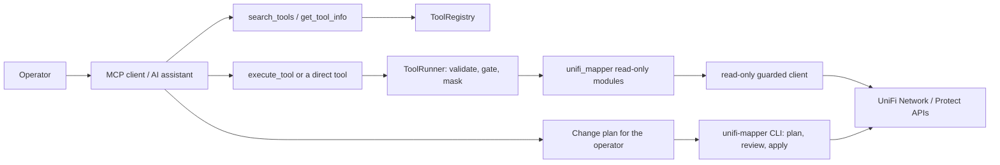

# UniFi Management MCP Server

## Overview

`unifi-mcp` is a stdio [Model Context Protocol](https://modelcontextprotocol.io/) server over
the same Python modules the `unifi-mapper` CLI uses. It registers **76 tools** in seven
categories (see [Tool categories](#tool-categories)). Every tool it will run is read-only
against the controller: tools that change the controller are refused over MCP, and changes go
through the CLI's plan → review → apply flow (see [Control boundary](#mcp-control-boundary)).
The [MCP standards review](MCP_STANDARDS_REVIEW.md) audits the server against the MCP
specification and SDK guidance, and lists the decisions still open.

## Technology Stack

- Python 3.12 (`requires-python = ">=3.12"`; 3.12 is the tested interpreter, so the launch
  commands below pin it with `--python 3.12`)
- The official MCP Python SDK, `mcp>=1.30,<1.31`, using its bundled FastMCP
  (`mcp.server.fastmcp`). The SDK is pinned to one minor because the server relies on FastMCP
  internals; see the comment in `pyproject.toml`
- pydantic 2, PyYAML 6, httpx, loguru; packaged with hatchling and launched with uv/uvx

## Project Structure

```text
src/unifi_mapper/mcp/
├── server.py      # entry point (main), meta-tools, lifespan, surfaces, resources, prompts
├── config.py      # CWD-independent config discovery, credential families, UNIFI_MCP_* settings
├── registry.py    # ToolRegistry: manifest loading and validation, search, metadata
├── catalog.py     # ToolCatalog: builds SDK tools (schemas, titles, annotations) lazily
├── runner.py      # ToolRunner: validate, gate, run, mask and package every tool call
├── manifests/     # YAML tool metadata, one file per category
└── tools/         # thin wrappers for the Network Integration API and Protect
```

## Launching

> [!WARNING]
> **Never run a bare `uvx unifi-mcp`.** `unifi-mcp` on PyPI is an unrelated third-party
> package: a bare `uvx unifi-mcp` downloads and runs it, and hands it any `UNIFI_*`
> credentials in your environment. Always launch this server with `--from <path>` or
> `--from git+https://github.com/NetDevAutomate/unifi_management_cli@<tag>`.
> `unifi-mcp --version` prints the distribution name, so you can confirm what you launched:
> `unifi-mcp (unifi-management-cli 0.2.0; mcp SDK 1.30.0)`.

| Mode | Command | Notes |
| --- | --- | --- |
| uvx, local path (recommended) | `uvx --python 3.12 --from /ABS/PATH/TO/unifi_management_cli unifi-mcp` | Builds the checkout into a cached tool environment. Config from [discovery](#configuration) |
| uvx, git | `uvx --python 3.12 --from git+https://github.com/NetDevAutomate/unifi_management_cli@v0.2.0 unifi-mcp` | Serves what is pushed and tagged on GitHub. Until `main` is pushed and `v0.2.0` is tagged, this mode serves an older release (a user action, design D7) |
| Installed tool | `uv tool install --python 3.12 /ABS/PATH/TO/unifi_management_cli`, then point the client at the absolute path of the installed `unifi-mcp` (usually `~/.local/bin/unifi-mcp`) | GUI apps start with a minimal `PATH`, so use the absolute path |
| Legacy dev | `uv --directory /ABS/PATH/TO/unifi_management_cli run unifi-mcp` with `UNIFI_CONFIG=/path/to/prod.env` in the client's `env` | Runs from the repo's `.venv` and `uv.lock` |
| Legacy wrapper | `scripts/unifi-mcp-launch.sh` | Sources `$UNIFI_MCP_ENV` (default `${XDG_CONFIG_HOME:-~/.config}/unifi_management_cli/prod.env`), exports every key, then runs the legacy dev command. Still supported, unchanged |

Only the two legacy modes read `uv.lock`. The uvx and installed-tool modes resolve from the
dependency bounds in `pyproject.toml`. The cache keys below also apply to the legacy modes'
editable install: the first launch or `uv run` after a source edit rebuilds it, which takes a
second or less and is reported on stderr, never on the stdout JSON-RPC stream.

**After changing the checkout.** uvx caches the build of a local path and rebuilds it only
when a cache key changes. `pyproject.toml` sets `[tool.uv] cache-keys` to `pyproject.toml`,
`src/**/*.py` and `src/**/*.yaml`, so the next plain launch picks up any code or manifest
edit, committed or not, and reuses the cached build otherwise:

```bash
uvx --python 3.12 --from /ABS/PATH/TO/unifi_management_cli unifi-mcp
# an installed tool doesn't rebuild on its own; reinstall it:
uv tool install --python 3.12 --reinstall /ABS/PATH/TO/unifi_management_cli
```

Restart the MCP client (or reconnect the server) so it relaunches. `uvx --refresh` and
`uvx --reinstall` don't force a rebuild of a local path (uv 0.11.8); without the cache keys
both kept serving the old build. `tests/mcp/test_packaging.py` checks the keys offline and,
with `--run-slow`, proves that an edit reaches the next launch.

### Command-line flags

| Flag | Effect |
| --- | --- |
| *(none)* | Serve MCP over stdin/stdout. stdout carries only JSON-RPC; logs and warnings go to stderr |
| `--version` | Print `unifi-mcp (unifi-management-cli <version>; mcp SDK <version>)` and exit 0 |
| `-h`, `--help` | Print usage and exit 0 |
| `--surface discovery\|direct` | Choose the [tool surface](#tool-surfaces) (case-insensitive). An invalid value exits 2 |
| `--config PATH` | Use this env file. Missing or unreadable exits 2 |
| `--check` | Print, as JSON, where config comes from, which credential families are ready (key names only, never values), the surface and how many tools each surface lists, then exit 0 if the controller family is ready, else 1. Never contacts the controller, Keychain or 1Password |

Unknown arguments are reported on stderr and ignored. Neither `--version` nor `--help` reads
any config.

```bash
uvx --python 3.12 --from /ABS/PATH/TO/unifi_management_cli unifi-mcp --surface direct --check
```

## Configuration

The server never reads a `.env` in its working directory (under uvx the working directory is
whatever the MCP client chose). It picks **one** env file, first match wins:

1. `--config PATH` (missing → exit 2).
2. `UNIFI_CONFIG=/path/to/file.env` (a leading `~` is expanded). If that file is missing, the
   server warns on stderr, loads **no** file (it never falls through to another, which might be
   a different site) and still starts.
3. `$XDG_CONFIG_HOME/unifi_management_cli/prod.env`, then `default.env`.
4. `~/.config/unifi_management_cli/prod.env`, then `default.env`.
5. `~/.config/unifi_network_mapper/prod.env` (legacy; loaded with a deprecation warning).
6. Nothing: the server still starts. `search_tools`, `get_tool_info` and the resources work;
   tools that need credentials return `[CONFIG_MISSING]` naming the files tried.

File format: `KEY=VALUE` lines, `#` comments, surrounding quotes stripped. A malformed line is
skipped with a stderr warning that names the line number, never the value. Keep the file
private (`chmod 600`); `.env.example` in the repo lists the controller keys.

**Credential families.** Keys are loaded per family, so one client can never mix two
controllers:

| Family | Keys | Ready when |
| --- | --- | --- |
| `controller` | `UNIFI_URL`/`UNIFI_HOST`, `UNIFI_PORT`, `UNIFI_SITE`, `UNIFI_VERIFY_SSL`, `UNIFI_CONSOLE_API_TOKEN`/`UNIFI_API_TOKEN`, `UNIFI_USERNAME`, `UNIFI_PASSWORD`, `UNIFI_SSH_USERNAME`, `UNIFI_SSH_PASSWORD` | URL or host, plus a token or username and password |
| `network_api` | `UNIFI_NETWORK_*` | `UNIFI_NETWORK_HOST`, `UNIFI_NETWORK_API_KEY` and `UNIFI_NETWORK_SITE_ID` |
| `protect` | `PROTECT_*` | `PROTECT_HOST`, `PROTECT_USERNAME` and `PROTECT_PASSWORD` |

- A family with **any** key in the client's environment belongs to the environment and is
  never topped up from the file (a partial export stays not-ready and `--check` says so).
- An auto-discovered file (steps 3–5) is applied only if every host the client exported
  (`UNIFI_URL`/`UNIFI_HOST`, `UNIFI_NETWORK_HOST`, `PROTECT_HOST`) matches the same host in the
  file. Otherwise the file isn't applied at all, `--check` shows a `skipped_reason`, and the
  fix is to set `UNIFI_CONFIG` to the file for that site.
- An explicit file (`--config`, `UNIFI_CONFIG`) is applied per family regardless of host.
- Other keys in the file (`UNIFI_TIMEOUT`, …) are applied only where not already set.
  `UNIFI_CONFIG` and `UNIFI_MCP_*` are never read from a file.

**Keychain / 1Password fallback.** When the controller family isn't ready from the
environment or the file, the first controller tool call runs the existing
`get_credentials()` chain (macOS Keychain service `unifi-mcp`, then the 1Password CLI, with
stdin from `/dev/null` so it can never read the JSON-RPC pipe) on a background thread. The call
waits at most `UNIFI_MCP_CREDENTIAL_TIMEOUT` seconds (default 15) and then returns
`[CONFIG_MISSING]`; a late success is used by the next call, and a failed lookup is retried
after 60 s. Other requests keep being answered while it waits.

**Per-process state.** One server process logs in to the controller once: the lifespan
installs a shared client (connect timeout 10 s, request timeout 30 s) that every async tool
borrows, behind a read-only HTTP transport that refuses any request that could change the
controller. If the controller answers a borrowed request with 401 (for example an expired
password session), the shared client logs in again once and the request is retried once; a
second 401 is reported as an error. Credentials are re-resolved for that login, but the
config file is read into the process environment at start-up, so a token or password
changed in the file still needs a server restart (issue 020). The sync port-diagnostics tools (`diagnose_switch_port`, `get_switch_ports`,
`diff_port_profiles`, `get_client_history`, `get_device_events`, `get_port_counter_rates`,
`audit_link_speeds`, `audit_port_profile_usage`) keep one guarded login per call.
`inspect_switch_port` also logs in per call, through its own sync client behind the same
read-only guard. The `network_api` and `protect` tools open their own guarded client per call
(the Integration API's GET-only transport, and `ReadOnlyProtectApiClient`).

### Environment variables

| Variable | Default | Valid values | On an invalid value |
| --- | --- | --- | --- |
| `UNIFI_CONFIG` | unset | path to a readable env file | stderr warning; no file loaded; server starts |
| `UNIFI_MCP_TOOL_SURFACE` | `discovery` | `discovery`, `direct` (case-insensitive) | stderr warning; `discovery` |
| `UNIFI_MCP_TOOL_TIMEOUT` | unset (no deadline) | seconds, 5–3600 | stderr warning; no deadline |
| `UNIFI_MCP_CREDENTIAL_TIMEOUT` | 15 | seconds, 1–120 | stderr warning; 15 |
| `UNIFI_MCP_MAX_CONCURRENCY` | 4 | integer, 1–32 | stderr warning; 4 |
| `UNIFI_MCP_LOG_LEVEL` | `WARNING` | a loguru level name | stderr warning; `WARNING` |
| `UNIFI_MCP_REQUEST_AUDIT` | unset | path of a JSON-lines file | — (opt-in) |
| `UNIFI_MCP_ENV` | `…/unifi_management_cli/prod.env` | path; read only by `scripts/unifi-mcp-launch.sh` | the script exits 1 |
| `XDG_CONFIG_HOME` | `~/.config` | directory | — |

`UNIFI_MCP_REQUEST_AUDIT=<file>` appends one line per request the read-only guards let
through: `{"t": <UTC time>, "method": …, "path": …}`. No host, query string, headers or body
is recorded. It's how you can show that a session sent nothing but reads, because every tool
family goes through a guard:

- `controller`: the shared client's read-only transport, or the guard on the sync
  diagnostics client (`inspect_switch_port` included). GET and HEAD (no `cmd`/`upd`
  segment), the few read-only query POSTs (`stat/event`, `list/alarm`, v2 `system-log`) and
  logout; the client's own login is sent but not recorded.
- `network_api`: the same transport with a GET-only policy (GET and HEAD, no `cmd`/`upd`
  segment), since every Integration API POST creates an object or runs an action. Nothing
  else is sent.
- `protect`: `ReadOnlyProtectApiClient`, which overrides uiprotect's `request()`: GET and
  HEAD (recorded; no `cmd`/`upd` segment), plus its session login (`POST /api/auth/login`
  or `/api/login`; sent, not recorded). A read is recorded before uiprotect's lazy login,
  so a GET whose login then fails is still recorded: reads can be over-recorded, writes
  never are.

Two uiprotect paths bypass `request()` and so aren't covered: websocket subscriptions and
the private `_get_versions_from_api`. No tool uses either.

## Tool Surfaces

| Surface | `tools/list` shows | Size (measured at this commit) |
| --- | --- | --- |
| `discovery` (default) | the four meta-tools: `search_tools`, `list_categories`, `get_tool_info`, `execute_tool` | 4 tools, about 6.4k characters |
| `direct` | the four meta-tools plus every catalog tool that is not mutating and not a pipeline tool, each with its own input schema, output schema, title and annotations | 66 tools (4 + 62), about 185k characters |

On either surface every catalog tool runs through the same `ToolRunner`, so arguments are
validated, credentials gated, results masked and errors coded identically. The 11 pipeline
tools (STP and 10G report stages whose required argument is a model produced by another tool)
are reachable only through `execute_tool`; the 3 mutating tools are never listed or run.
`--check` prints `listed_tools` for both surfaces.

Use `direct` with hosts that defer tool schemas (kiro-cli, Claude Code tool search): the
host keeps the 66 schemas out of context until needed and the model calls tools by name. Use
`discovery` with hosts that load every schema up front (Codex): the model searches, reads one
schema with `get_tool_info`, then calls `execute_tool`.

**Meta-tools.**

- `search_tools(query, category, tags, detail_level)`: find tools; `detail_level="full"` adds
  each tool's `input_schema`.
- `list_categories()`: category → tool names.
- `get_tool_info(tool_name)`: description, parameters, `input_schema`, `output_schema` and
  annotations.
- `execute_tool(tool_name, params)`: run a catalog tool (see [Errors](#errors)).

**Resources.** `unifi://catalog` (every tool's name and description, plus the categories) and
`unifi://config/status` (the resolved config: source, path, files tried and per-family
readiness, key names only).

**Prompts.** `troubleshoot_port_link(switch, port)`, a read-only investigation of a port
linking at the wrong speed, flapping or staying down; `plan_stp_change()`, which steers an STP
change to the CLI (`stp analyze` → `stp report` → `stp optimize --plan` → `stp apply --plan`,
which previews unless `--no-dry-run` is given).

**Annotations.** Catalog tools carry `readOnlyHint: true` (except `snapshot_radio_config`, which
writes a local file), `destructiveHint: false`, `openWorldHint` (false for the six STP pipeline
tools that compute from their input and never contact a controller), and
`idempotentHint: false` for the sampling tools (`get_port_counter_rates`,
`diagnose_switch_port`, `check_device_freshness`). `execute_tool` is annotated non-read-only because it can reach
`snapshot_radio_config`.

## Tool Categories

Counted from `ToolRegistry()` at this commit (76 tools):

| Category | Tools | Covers |
| --- | ---: | --- |
| analysis | 46 | IP conflicts, storms, MAC table, VLAN diagnostics and coverage, STP topology, guard, path costs, drift, preflight and snapshots, link quality and link-speed audit, port-profile usage and validation, MTU, QoS, SFP, LAG, PoE and power budgets, uplink redundancy and transparency, client density, DHCP pools, device freshness, capacity, firmware, Wi-Fi radio, traffic matrix, foreign bridges, 10G readiness |
| connectivity | 4 | Firewall check, path analysis, traceroute, inter-VLAN routing |
| diagnostics | 8 | Health, performance, security, connectivity, single-port inspection, all-ports view, port-profile diff, port evidence bundle |
| discovery | 5 | Find device, IP or MAC; client trace; client history |
| network | 6 | Firewall zones and policies, ACLs, DNS policies, clients, networks (Network Integration API, `network_api` family) |
| observability | 2 | Event, alarm, system-log and admin-audit history; port counter rates and history |
| protect | 5 | Cameras, NVR, sensors, lights, doorbells (`protect` family) |

Of the 76: 3 are mutating (`apply_stp_changes`, `apply_radio_optimization`,
`restore_radio_config`) and 11 are pipeline tools, leaving 62 on the direct surface.

## Errors

`execute_tool` returns the same JSON envelope as both the text block and `structuredContent`:

```json
{"ok": true, "result": {"...": "..."}}
{"ok": false, "error_code": "DEVICE_NOT_FOUND", "message": "...", "suggestion": "...",
 "related_tools": ["..."]}
```

Every failure also sets `isError: true` on the result, so the model and host see it as a
failed call. On the direct surface a failure is a single text block,
`[ERROR_CODE] message — suggestion`, with `isError: true`. The runner never raises.

| Code | When |
| --- | --- |
| `TOOL_NOT_FOUND` | No tool by that name |
| `MUTATION_REFUSED` | The tool changes the controller; use the CLI |
| `INVALID_PARAMETERS` | Unknown key or a type/range error; the envelope adds `parameters` and `input_schema` |
| `CONFIG_MISSING` | The tool's credential family isn't ready, or the Keychain/1Password lookup didn't finish in time; names the files tried |
| `TIMEOUT` | The call exceeded `UNIFI_MCP_TOOL_TIMEOUT` (only when set) |
| `READ_ONLY_VIOLATION` | A tool tried a write and a read-only guard refused it (a bug; nothing was written) |
| `TOOL_FAILED` | Any other exception, as `ExceptionClass: text` |
| domain codes | Raised by the tool itself, e.g. `DEVICE_NOT_FOUND`, `PROFILE_NOT_FOUND`, `CONTROLLER_UNREACHABLE`, `AUTHENTICATION_FAILED`, `CONFIG_INVALID`, `NO_DATA` |

Results and error text are masked: the value of any secret-looking `UNIFI_*`/`PROTECT_*`
variable is replaced wherever it appears, and values under secret-named keys are redacted.
Error messages are capped at 2,000 characters (`TOOL_FAILED` at 500). The Network and Protect
wrappers still return `{"error": …}` inside an `ok: true` result on failure; issue 011 tracks
turning that into `TOOL_FAILED`. A write their read-only guard refuses is the exception: it is
reported as `READ_ONLY_VIOLATION`.

## Client Configuration

Every snippet points `UNIFI_CONFIG` at an env file instead of putting secrets in the client
config. Replace `/ABS/PATH/TO/unifi_management_cli` with the absolute path of your checkout and
`/Users/you` with your home directory. These are examples; the server never edits client
configs.

### kiro-cli

`~/.kiro/settings/mcp.json` (Kiro defers MCP tool schemas, so use the direct surface; `timeout`
is in milliseconds, and counter sampling can block for about 100 s):

```json
{
  "mcpServers": {
    "unifi": {
      "command": "uvx",
      "args": ["--python", "3.12", "--from", "/ABS/PATH/TO/unifi_management_cli", "unifi-mcp"],
      "env": {
        "UNIFI_CONFIG": "/Users/you/.config/unifi_management_cli/prod.env",
        "UNIFI_MCP_TOOL_SURFACE": "direct"
      },
      "timeout": 300000
    }
  }
}
```

### Claude Code

```bash
claude mcp add unifi --scope user \
  -e UNIFI_CONFIG=/Users/you/.config/unifi_management_cli/prod.env \
  -e UNIFI_MCP_TOOL_SURFACE=direct \
  -- uvx --python 3.12 --from /ABS/PATH/TO/unifi_management_cli unifi-mcp
```

or the equivalent project-scoped `.mcp.json`:

```json
{
  "mcpServers": {
    "unifi": {
      "type": "stdio",
      "command": "uvx",
      "args": ["--python", "3.12", "--from", "/ABS/PATH/TO/unifi_management_cli", "unifi-mcp"],
      "env": {
        "UNIFI_CONFIG": "/Users/you/.config/unifi_management_cli/prod.env",
        "UNIFI_MCP_TOOL_SURFACE": "direct"
      }
    }
  }
}
```

### Codex

`~/.codex/config.toml`, on the default discovery surface (Codex lists every schema up front):

```toml
[mcp_servers.unifi]
command = "uvx"
args = ["--python", "3.12", "--from", "/ABS/PATH/TO/unifi_management_cli", "unifi-mcp"]
env = { UNIFI_CONFIG = "/Users/you/.config/unifi_management_cli/prod.env" }
# Counter sampling (get_port_counter_rates, diagnose_switch_port) blocks for about 100 s.
tool_timeout_sec = 300
```

### Claude Desktop and other GUI hosts

Use the installed-tool mode (absolute path to `unifi-mcp`) or `scripts/unifi-mcp-launch.sh`
as the `command`, because GUI apps start with a minimal `PATH`.

## MCP Control Boundary

No tool that changes the controller runs over MCP. Mutating manifest entries
(`mutates: true`: `apply_stp_changes`, `apply_radio_optimization`, `restore_radio_config`) are
never listed and `execute_tool` refuses them with `MUTATION_REFUSED`; the shared async client's
transport, the sync diagnostics client's guard, the `network_api` tools' GET-only transport and
the `protect` tools' `ReadOnlyProtectApiClient` refuse any write a read-only tool might attempt
(`READ_ONLY_VIOLATION`). Any new tool that writes controller state must declare
`mutates: true`; `tests/mcp/test_execute.py` fails if an `apply_*` / `restore_*` tool ships
without it. One catalog tool writes a **local** file: `snapshot_radio_config`.



For configuration changes: generate a plan with the read-only tools, review it, apply it with
the CLI, then verify with read-only tools. Don't ask the assistant to invent live STP
priorities, VLAN changes or rollback steps.

## Development

```bash
uv sync --group dev
uv run pytest -q                                    # offline test suite
uv run pytest --run-slow tests/mcp/test_packaging.py  # isolated uvx-style resolve (network)
uv run ruff check && uv run ruff format --check
uv run pyright src/
uv run unifi-mcp --check
```

### Adding a tool

1. **Write the handler** in the module that owns the logic (for example
   `src/unifi_mapper/analysis/<topic>.py`), with type hints and a Google docstring. The
   signature is the input schema: `ToolCatalog` builds the SDK tool with
   `Tool.from_function`, so parameter names, types and defaults are what the model sees.
   Return a typed value (usually a pydantic model) so the tool gets an `outputSchema`; an
   untyped return is listed without one and must be added to `NO_OUTPUT_SCHEMA_ALLOWLIST` in
   `tests/mcp/test_manifest_parity.py`. Open the controller with
   `async with UniFiClient() as client:`: under the server it borrows the shared, read-only
   guarded connection. Raise `ToolError(message, error_code, suggestion, related_tools)` for
   expected failures; every tool a hint names must be registered
   (`tests/mcp/test_related_tools.py`).
2. **Add a manifest entry** under `tools:` in `src/unifi_mapper/mcp/manifests/<category>.yaml`.
   `MANIFEST_KEYS` in `mcp/registry.py` lists the allowed keys and their types; an unknown key
   or a wrong type fails `ToolRegistry(strict=True)`, which the tests use.

   | Key | Default | Meaning |
   | --- | --- | --- |
   | `module` | required | Import path of the handler's module |
   | `handler` | the tool name | Function name in `module` |
   | `title` | the name, title-cased | `Tool.title`; the tests require an explicit one |
   | `description` | empty | What the model reads when choosing the tool |
   | `priority`, `tags` | `P2`, none | Search ranking and search terms |
   | `parameters` | none | One entry per handler parameter; `required: true` exactly for those without a default |
   | `credentials` | `controller` | `controller`, `network_api`, `protect` or `none`; `network.yaml` entries must be `network_api`, `protect.yaml` entries `protect`, and `none` only for a module that imports no client |
   | `mutates` | `false` | `true` for anything that changes the controller: never listed, refused with `MUTATION_REFUSED`. An `apply_*` or `restore_*` tool without it fails `tests/mcp/test_execute.py` |
   | `pipeline` | `false` | `true` when a required parameter is a model another tool produces; reachable only through `execute_tool` |
   | `writes_local` | `false` | Writes a local file; drops `readOnlyHint` |
   | `idempotent` | `true` | `false` for wall-clock sampling (any `interval_seconds`, `samples` or `counter_samples` parameter) |
   | `open_world` | `true` | `false` when the tool only computes from its input |
   | `mcp` | `true` | `false` keeps it off the direct surface |
   | `aliases` | none | Deprecated parameter name → handler parameter name |

3. **Run** `uv run pytest tests/mcp -q`. `tests/mcp/test_manifest_parity.py` checks every
   entry against its handler (import, parameters, schemas, pipeline and sampling rules,
   title, credential family), so a new tool needs no edit there.
4. **Update the docs**: the category counts in this guide and in the README.

The design rationale and the decisions still open are in the
[MCP standards review](MCP_STANDARDS_REVIEW.md).
