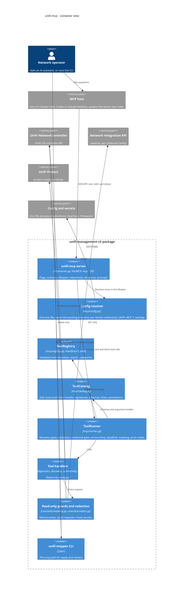

# MCP standards review

As of `cb356b0` (2026-10-04). This is the committed summary of the standards review behind the
uvx rebuild of `unifi-mcp`: what the MCP specification, the official Python SDK and the main
hosts expect, where the server stands at that commit, and how each decision the review raised
ended. Use the [MCP server guide](MCP_SERVER_GUIDE.md) to run and configure the server.

**Scope.** The stdio server in `src/unifi_mapper/mcp/` and the parts of the package it runs:
the tool handlers, the read-only guards and the redaction module. The CLI's write paths are
out of scope, because none of them runs over MCP. The standards are the MCP specification
2026-07-28, the MCP Python SDK docs, the Claude Code MCP docs, the uv tool docs and the XDG
Base Directory specification, fetched 2026-10-02 ([sources](#sources)).

## Audit

✅ meets the standard · ⚠️ partly: the open part is linked · ❌ not done.

| # | Criterion | Standard | Status at `cb356b0` |
| --- | --- | --- | --- |
| A1 | SDK version | The SDK v2 line is current; projects not yet migrated should bound `mcp<2` ([S1], [S5], [S6], [S7]) | ✅ `mcp>=1.30,<1.31` in `pyproject.toml`, locked at 1.30.0. One minor only, because the runner uses FastMCP internals; `tests/mcp/test_packaging.py` resolves the bounds in isolation (`--run-slow`). The v2 migration is [issue 008](../issues/008-mcp-sdk-v2-migration.md) |
| A2 | Protocol version | Hosts still speak 2025-11-25 and newer clients fall back to it ([S4], [S4b]) | ✅ SDK 1.30 negotiates 2024-11-05 to 2025-11-25. 2026-07-28 support comes with SDK v2 (issue 008) |
| A3 | stdio transport | Only JSON-RPC on stdout, logs on stderr, exit when stdin closes ([S3], [S14]) | ✅ stdio only. The lifespan points `sys.stdout` at stderr, so a stray `print()` can't reach the protocol stream; `tests/mcp/test_stdio_smoke.py` checks stdout purity and exit on EOF in a subprocess |
| A4 | Input schemas and validation | Every tool has a valid JSON Schema and the server validates inputs ([S2], [S9], [S20]) | ✅ Schemas come from the handler signatures (`Tool.from_function`, `mcp/catalog.py`). `ToolRunner` (`mcp/runner.py`) rejects unknown keys, then validates with the argument model, on both surfaces; `INVALID_PARAMETERS` never echoes a value |
| A5 | Structured output | A declared `outputSchema` needs conforming `structuredContent` plus a text block ([S2], [S10], [S11]) | ✅ `execute_tool` returns its envelope as text and as `structuredContent`. Direct tools carry an `outputSchema`, except two handlers with untyped returns (`snapshot_radio_config`, `optimize_radio_channels`), which are listed without one |
| A6 | Annotations | `title`, `readOnlyHint`, `destructiveHint`, `idempotentHint`, `openWorldHint` on every tool; defaults are pessimistic ([S2], [S2b], [S9], [S20]) | ✅ Every listed tool is annotated from its manifest keys (`annotations_for`, `mcp/catalog.py`). `execute_tool` is marked non-read-only because it can reach `snapshot_radio_config`, which writes a local file |
| A7 | Server identity | `instructions` to steer host tool search; `serverInfo.version` is the package's version ([S7], [S20]) | ✅ `build_instructions` names only registered tools; the version comes from `importlib.metadata` (`package_version`, `mcp/server.py`) |
| A8 | Resources and prompts | Resources are application context; prompts are user-invoked workflows ([S15], [S16]) | ✅ Resources `unifi://catalog` and `unifi://config/status`; prompts `troubleshoot_port_link` and `plan_stp_change` |
| A9 | Tool errors | Execution failures are results with `isError: true`; never return an error as a success ([S2], [S9a]) | ⚠️ Every runner failure sets `isError: true` with a coded envelope (`ERRORS_SET_IS_ERROR`, `mcp/runner.py`). The Network and Protect wrappers still return `{"error": …}` inside an `ok: true` result: [issue 011](../issues/011-network-protect-errors-as-success.md) |
| A10 | Logging | stderr only, no `print()` to stdout ([S3], [S8], [S9b]) | ⚠️ One loguru sink on stderr at `UNIFI_MCP_LOG_LEVEL` (default `WARNING`), set before anything logs; `--version` and `--help` log nothing. The SDK's stdlib logging still writes an `INFO Processing request of type …` line per request to stderr whatever that level says: [issue 020](../issues/020-mcp-protocol-follow-ups.md) |
| A11 | Lifespan | Resolve shared state once, in the lifespan ([S17]) | ⚠️ The lifespan resolves the config once and installs one shared, read-only guarded controller client that every async tool borrows. The sync port-diagnostics tools still log in on every call: [issue 021](../issues/021-sync-diagnostic-path-logs-in-per-call.md) |
| A12 | Timeouts and cancellation | Requests should time out, and cancellation should stop work promptly ([S3], [S18], [S22]) | ⚠️ The Keychain/1Password lookup runs on a background thread, bounded by `UNIFI_MCP_CREDENTIAL_TIMEOUT` (default 15 s); handlers stay async, so cancellation propagates. A per-call deadline exists but is opt-in (`UNIFI_MCP_TOOL_TIMEOUT`, unset by default): [issue 012](../issues/012-mcp-default-tool-deadline.md) |
| A13 | Progress | Report progress when the client asks for it ([S18b], [S8]) | ❌ No tool reports progress; handlers don't receive the request context. Tracked as B4 in issue 020 |
| A14 | Large results | Spec pagination covers `*/list`; tool output size is left to the host, which warns or persists large results ([S19b], [S20], [S11]) | ⚠️ The fleet-wide tools added in this work page their findings (`limit`, `offset`). No global result cap: [issue 063](../issues/063-execute-tool-result-cap.md) |
| A15 | Meta-tools vs direct tools | Progressive discovery belongs in the host; a meta-tool proxy hides per-tool schemas and annotations ([S11], [S12], [S20]) | ✅ The default `discovery` surface lists four meta-tools; the opt-in `direct` surface lists each read-only tool with its own schemas and annotations; one `ToolRunner` serves both. Whether `direct` should be the default is [issue 009](../issues/009-mcp-default-tool-surface.md) |
| A16 | Startup | Hosts spawn servers on demand, so start fast ([S21]) | ✅ `--version` and `--help` exit before reading config or building the catalog; `--check` builds the direct catalog only to count it and never starts stdio. A startup-time regression test is B12 in issue 020 |
| A17 | Config independent of the working directory | Hosts launch servers from their own directory with a near-empty environment; use XDG paths ([S21], [S23], [S7]) | ⚠️ One env file: `--config`, then `UNIFI_CONFIG`, then XDG, then `~/.config`, then the legacy path (`mcp/config.py`); a `.env` in the working directory is never read; credentials load per family. `snapshot_radio_config` still writes `reports/radio-snapshot.json` relative to the working directory: [issue 010](../issues/010-cwd-relative-state-files.md) |
| A18 | Security | Validate inputs, control access, rate-limit and sanitise outputs ([S2], [S14]) | ✅ Mutating tools are never listed and are refused (`MUTATION_REFUSED`). Every credential family goes through a read-only guard (`core/utils/readonly.py`, `ReadOnlyProtectApiClient` in `protect/client.py`), so a write attempt is `READ_ONLY_VIOLATION`. A semaphore bounds concurrency (`UNIFI_MCP_MAX_CONCURRENCY`, default 4). Results and errors are masked by key and by value (`core/utils/redact.py`). An opt-in request audit records what the guards let through (`UNIFI_MCP_REQUEST_AUDIT`). The docs warn against a bare `uvx unifi-mcp`. An audit log of MCP calls is open in issue 013 |
| A19 | Tests | Drive the server through an in-memory client session and assert on `CallToolResult` ([S9c]) | ✅ `tests/mcp/test_protocol_contract.py` runs both surfaces in memory; `tests/mcp/test_manifest_parity.py` checks every manifest entry against its handler; `tests/mcp/test_stdio_smoke.py` runs the real entry point. All offline |
| A20 | Packaging for uvx | uvx resolves the declared ranges, not `uv.lock`; `--from` takes a path or a `git+https…@ref` ([S24], [S25]) | ✅ Every dependency has a floor and a ceiling. `[tool.uv] cache-keys` rebuild a local checkout when any `src/**/*.py` or `src/**/*.yaml` file changes. The docs launch with `--from` only, because `unifi-mcp` on PyPI is an unrelated package. The git launch mode needs `main` pushed and tagged (D7) |

## Architecture at `cb356b0`

## Decisions

| ID | Decision raised by the review | Outcome at `cb356b0` |
| --- | --- | --- |
| D1 | Set `isError: true` on failed calls | Implemented (`ERRORS_SET_IS_ERROR`, `mcp/runner.py`) |
| D2 | Make `direct` the default surface | Not adopted: `discovery` stays the default and `direct` is opt-in. Open: [issue 009](../issues/009-mcp-default-tool-surface.md) |
| D3 | Write the MCP radio snapshot under the XDG state directory and return its absolute path | Not implemented: the snapshot still goes to `reports/radio-snapshot.json` in the working directory (`analysis/radio_config.py`). Open: [issue 010](../issues/010-cwd-relative-state-files.md) |
| D4 | Cap result size globally | Not implemented; the new fleet-wide tools page their findings instead. Open: [issue 063](../issues/063-execute-tool-result-cap.md) |
| D5 | Keep a JSON-lines audit log of MCP calls | Not implemented. The separate, opt-in `UNIFI_MCP_REQUEST_AUDIT` records the controller requests the read-only guards let through. Open: [issue 013](../issues/013-mcp-audit-log-and-result-cap.md) |
| D6 | Split Protect, backup and ONVIF into optional extras | Not implemented. Open: [issue 014](../issues/014-optional-dependency-extras.md) |
| D7 | Push `main` and tag `v0.2.0`, so the git launch mode serves this work | The user's action, pending: nothing is pushed and no `v0.2.0` tag exists |
| D8 | Disable the Keychain/1Password fallback under MCP | Rejected: the lookup runs on a background thread bounded by `UNIFI_MCP_CREDENTIAL_TIMEOUT`, so it can neither hang a call nor block the event loop |
| D9 | Point the user's MCP client configs at the new launch command and config path | The user's action, outside the repo: the server never edits client configs; the guide has examples |
| D10 | Raise errors from the Network and Protect wrappers instead of returning error dicts | Not implemented; a write a guard refuses is already reported as `READ_ONLY_VIOLATION`. Open: [issue 011](../issues/011-network-protect-errors-as-success.md) |
| D11 | Default per-call deadline of 300 s | Not implemented: `UNIFI_MCP_TOOL_TIMEOUT` (5 to 3600 s) is opt-in and unset by default. Open: [issue 012](../issues/012-mcp-default-tool-deadline.md) |

## Verification

- Registry: 80 tools in 7 categories; 3 mutating, 11 pipeline, 66 on the direct catalog.
- `unifi-mcp --check` (offline): `tool_count` 80; `listed_tools` 4 on `discovery`, 70 on
  `direct`. The 70 are the 66 direct catalog tools plus the 4 meta-tools.
- Offline suite at `cb356b0`: 2964 passed, 3 skipped (the three `slow`-marked packaging tests,
  two of which are also `network`-marked). With the slow tests opted in,
  `uv run pytest --run-slow tests/mcp/test_packaging.py`: 4 passed.
- Read-only live checks against a real controller, at `d6be722`: 61 of 61 passed. The request
  audit recorded 114 controller requests, all GET, and no refused write.
- Re-checked offline at `c03da2c` (2026-10-04): the registry and `--check` figures are
  unchanged, and the suite has 2996 passed, 3 skipped (the same three).
  `tests/test_docs_consistency.py` now fails when a documented MCP count stops matching the
  registry.

## Sources

[S1]: https://modelcontextprotocol.io/specification/2026-07-28/changelog
[S2]: https://modelcontextprotocol.io/specification/2026-07-28/server/tools
[S2b]: https://modelcontextprotocol.io/specification/2026-07-28/schema
[S3]: https://modelcontextprotocol.io/specification/2026-07-28/basic/transports/stdio
[S4]: https://modelcontextprotocol.io/specification/2026-07-28/basic/transports
[S4b]: https://modelcontextprotocol.io/specification/2026-07-28/basic/versioning
[S5]: https://pypi.org/project/mcp/
[S6]: https://py.sdk.modelcontextprotocol.io/v2/whats-new/
[S7]: https://py.sdk.modelcontextprotocol.io/v2/migration/
[S8]: https://py.sdk.modelcontextprotocol.io/deprecated/
[S9]: https://py.sdk.modelcontextprotocol.io/servers/tools/
[S9a]: https://py.sdk.modelcontextprotocol.io/servers/handling-errors/
[S9b]: https://py.sdk.modelcontextprotocol.io/handlers/logging/
[S9c]: https://py.sdk.modelcontextprotocol.io/get-started/testing/
[S10]: https://py.sdk.modelcontextprotocol.io/servers/structured-output/
[S11]: https://modelcontextprotocol.io/docs/2026-07-28/develop/clients/client-best-practices
[S12]: https://gofastmcp.com/servers/transforms/tool-search
[S14]: https://modelcontextprotocol.io/docs/2026-07-28/tutorials/security/security_best_practices
[S15]: https://modelcontextprotocol.io/specification/2026-07-28/server/resources
[S16]: https://modelcontextprotocol.io/specification/2026-07-28/server/prompts
[S17]: https://py.sdk.modelcontextprotocol.io/handlers/lifespan/
[S18]: https://modelcontextprotocol.io/specification/2026-07-28/basic/utilities/cancellation
[S18b]: https://modelcontextprotocol.io/specification/2026-07-28/basic/utilities/progress
[S19b]: https://modelcontextprotocol.io/specification/2026-07-28/server/utilities/pagination
[S20]: https://code.claude.com/docs/en/mcp
[S21]: https://py.sdk.modelcontextprotocol.io/get-started/real-host/
[S22]: https://anyio.readthedocs.io/en/stable/threads.html
[S23]: https://specifications.freedesktop.org/basedir-spec/latest/
[S24]: https://docs.astral.sh/uv/concepts/tools/
[S25]: https://docs.astral.sh/uv/guides/tools/

| Tag | Source |
| --- | --- |
| [S1] | MCP specification 2026-07-28, changelog |
| [S2] | MCP specification, server tools: schemas, structured output, `isError`, security |
| [S2b] | MCP schema 2026-07-28: `ToolAnnotations` and their defaults |
| [S3] | MCP specification, stdio transport |
| [S4], [S4b] | MCP specification, transports and versioning |
| [S5] | `mcp` on PyPI |
| [S6], [S7] | MCP Python SDK: what's new in v2, migration guide |
| [S8], [S9], [S9a], [S9b], [S9c], [S10] | MCP Python SDK: deprecated features, tools, errors, logging, testing, structured output |
| [S11] | MCP docs, client best practices |
| [S12] | FastMCP, tool search transform |
| [S14] | MCP docs, security best practices |
| [S15], [S16] | MCP specification, resources and prompts |
| [S17] | MCP Python SDK, lifespan |
| [S18], [S18b], [S19b] | MCP specification, cancellation, progress, pagination |
| [S20] | Claude Code docs, MCP |
| [S21] | MCP Python SDK, connecting to a real host |
| [S22] | AnyIO, working with threads |
| [S23] | XDG Base Directory specification |
| [S24], [S25] | uv, tools concept and tools guide |
