# UniFi Management CLI: Troubleshooting Guide and Operational Runbook

**Version**: 1.0
**Last Updated**: 2026-10-04
**Audience**: Network engineers and operations staff managing UniFi infrastructure via this CLI

> **See also**: [Use Cases and How-To](../guides/use-cases-and-howto.md) | [Architecture Overview](../architecture/architecture-overview.md) | [Codebase Map](../architecture/codemap.md) | [AXIS Provisioning](../guides/axis-provisioning.md)

---

## Table of Contents

### Part 1: Troubleshooting Guide
1. [Installation and Setup Issues](#1-installation-and-setup-issues)
2. [Authentication and Connection Failures](#2-authentication-and-connection-failures)
3. [SSL/TLS Certificate Issues](#3-ssltls-certificate-issues)
4. [Port Name Persistence Failures](#4-port-name-persistence-failures)
5. [API Cache Staleness](#5-api-cache-staleness)
6. [Device Compatibility Issues](#6-device-compatibility-issues)
7. [Protect Integration Issues](#7-protect-integration-issues)
8. [MCP Server Issues](#8-mcp-server-issues)
9. [Performance and Timeout Issues](#9-performance-and-timeout-issues)

### Part 2: Operational Runbook
10. [Daily Operations and Health Checks](#10-daily-operations-and-health-checks)
11. [Common Maintenance Tasks](#11-common-maintenance-tasks)
12. [Incident Response Procedures](#12-incident-response-procedures)
13. [Recovery Procedures](#13-recovery-procedures)
14. [Monitoring and Alerting Thresholds](#14-monitoring-and-alerting-thresholds)

### Part 3: Quick Reference
15. [Common Error Messages](#15-common-error-messages)
16. [Environment Variable Reference](#16-environment-variable-reference)
17. [CLI Flag Reference](#17-cli-flag-reference)
18. [API Endpoint Reference](#18-api-endpoint-reference)

---

## Part 1: Troubleshooting Guide

---

### 1. Installation and Setup Issues

#### Symptom

The CLI commands (`unifi-mapper`, `unifi-network-toolkit`, `unifi-inventory`, `unifi-mcp`) are not found after installation, or Python import errors appear on first run.

#### Diagnostic Flowchart

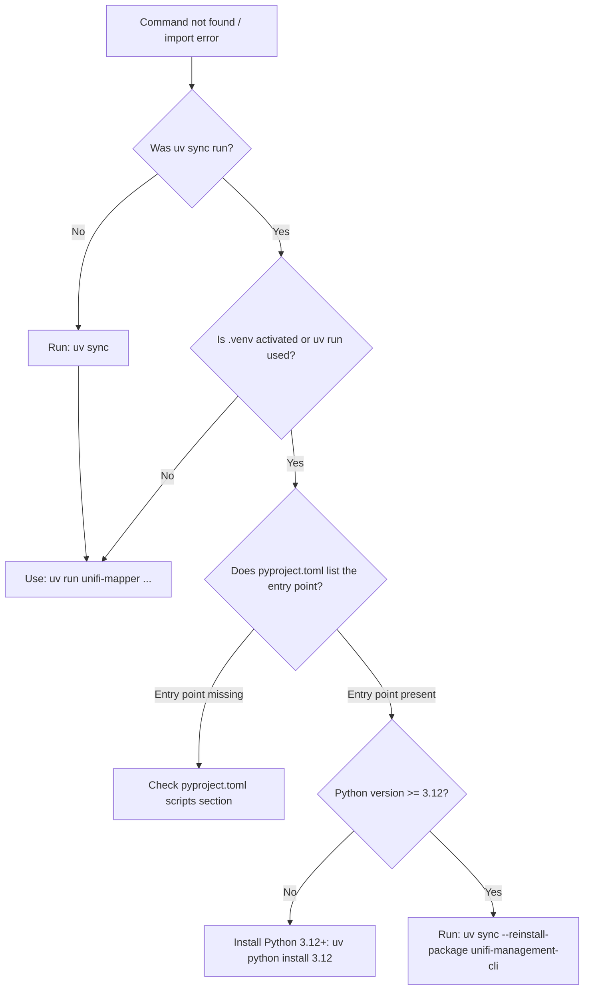

#### Root Cause

The project uses `uv` exclusively. Running `pip install` directly or forgetting the `uv run` prefix means the project's entry points and dependencies are not on the active `PATH` or `PYTHONPATH`.

#### Resolution

```bash
# Step 1: Install all dependencies
uv sync
# PNG and SVG diagrams (discover's default output) also need Graphviz's dot program
brew install graphviz          # macOS; on Debian or Ubuntu: sudo apt install graphviz

# Step 2: Run any command through uv run
uv run unifi-mapper --help
uv run unifi-network-toolkit --help

# Step 3: Or install as a uv tool for global access
uv tool install .
# Then commands are available directly:
unifi-mapper --help
```

#### Config File Not Found

**Symptom**: `Configuration file not found: /home/user/.config/unifi_management_cli/prod.env` or `UNIFI_URL environment variable required.`

The CLI reads the first of these (`cli.get_default_config_path`):

1. `--config PATH`, or `UNIFI_CONFIG=PATH` (the inventory commands take their own
   `--config` instead, [issue 043](../issues/043-inventory-ignores-the-root-config.md))
2. `prod.env`, then `default.env`, in `$XDG_CONFIG_HOME/unifi_management_cli/` when
   `XDG_CONFIG_HOME` is set to an absolute path (a relative one is ignored, as the XDG spec
   says)
3. `prod.env`, then `default.env`, in `~/.config/unifi_management_cli/`
4. the legacy `~/.config/unifi_network_mapper/prod.env` (loaded with a deprecation warning)
5. `.env` in the current directory (deprecated: loaded with a warning on stderr before any
   controller connection; removed in 0.4.0. Name it with `--config ./.env` or
   `UNIFI_CONFIG=./.env` instead)

This is the MCP server's search too (one shared function,
`core/utils/config_search.py`), minus step 5: the server never reads a `.env` in its
working directory ([issue 048](../issues/048-cli-and-mcp-config-searches-differ.md)).

**Resolution**:

```bash
mkdir -p ~/.config/unifi_management_cli
cp .env.example ~/.config/unifi_management_cli/prod.env
# Edit prod.env with actual values
chmod 600 ~/.config/unifi_management_cli/prod.env

# Or name the file explicitly (UNIFI_CONFIG=/path/to/my.env works too):
uv run unifi-mapper --config /path/to/my.env discover
```

#### Prevention

Keep a `prod.env` at the XDG standard path. Never rely on a `.env` in the working directory: the fallback is deprecated, warns on every run and is removed in 0.4.0; name such a file with `--config ./.env` or `UNIFI_CONFIG=./.env`.

#### A Root Flag Exits 2

**Symptom**: the command stops at once with exit status 2 and one of these on stderr:

```text
❌ --apply must follow the subcommand and its arguments (e.g. unifi-mapper discover --apply, unifi-mapper ports refresh --apply)
❌ --connected-devices only applies to discover (unifi-mapper discover --connected-devices)
❌ --verify-updates only applies to discover (unifi-mapper discover --verify-updates)
❌ --dry-run before a subcommand only reaches discover: read-only subcommands need no flag, and those with their own --dry-run take it after their arguments (e.g. unifi-mapper ports refresh --dry-run)
❌ choose --apply or --dry-run
```

**Cause**: the root `--dry-run`, `--connected-devices`, `--verify-updates` and `--apply`
are shortcuts for `discover`. On their own they run it (a preview unless `--apply`), and
before the `discover` subcommand the first three are passed on to it. Before any other
subcommand they are refused rather than silently ignored, and a root `--apply` is refused
before any subcommand, `discover` included, so a write is never requested by accident.

**Resolution**: put a subcommand's own flags after it: `unifi-mapper discover --apply`,
`unifi-mapper ports refresh --apply`, `unifi-mapper discover --connected-devices`.

#### `discover` or `diagram` Writes a Placeholder: Graphviz's `dot` Not Found

**Symptom**: `discover` (or `diagram`) reads the controller and exits 0, but the PNG or SVG
file holds one line of text, and the log carries:

```text
WARNING PNG diagram not drawn: Graphviz's dot program is not on PATH. Install it with: brew install graphviz (macOS) or sudo apt install graphviz (Debian/Ubuntu); or use --format html, which needs no Graphviz.
```

**Cause**: PNG (the default) and SVG diagrams are drawn by Graphviz's `dot` program. The
`graphviz` Python package that `uv sync` installs only drives it. Without Graphviz the render
is a warning and a placeholder, as it is when the package itself is missing, so `discover`
still writes its `-o` report and the dry run still exits 0. The DOT source graphviz saves
beside the diagram is removed ([issue 075](../issues/075-discover-needs-graphviz-dot-undocumented.md);
before 0.3.0 the command exited 1 with no report, leaving that source behind).

**Resolution**: install Graphviz, `brew install graphviz` (macOS) or `sudo apt install
graphviz` (Debian or Ubuntu), and run the command again, or draw an interactive diagram with
`--format html`, which needs no Graphviz. `--format dot` writes the DOT source itself, for
`dot` on another machine.

---

### 2. Authentication and Connection Failures

#### Symptom

One or more of the following:
- `Authentication failed - all methods exhausted`
- `Authentication failed: 401 Client Error`
- `Authentication failed: 403 Client Error`
- Commands return empty results with no error, only log noise

#### Diagnostic Flowchart

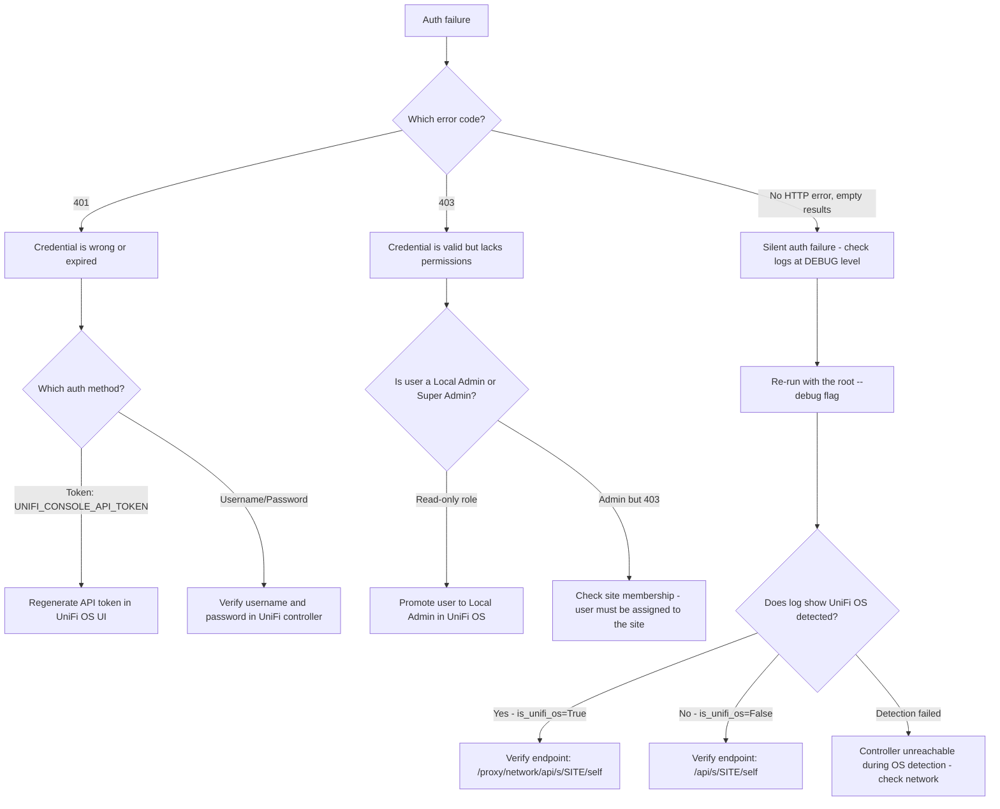

#### Authentication Method Selection

The client selects authentication method based on which environment variable is set:

```
UNIFI_CONSOLE_API_TOKEN set  -> auth_method = "token"
UNIFI_USERNAME + UNIFI_PASSWORD set -> auth_method = "username_password"
Both set -> token takes precedence
Neither set -> UniFiValidationError on login()
```

**Token authentication** tries two header formats in sequence:
1. `X-API-KEY: <token>` (preferred for UniFi OS 3.x+)
2. `Authorization: Bearer <token>` (fallback)

**Username/password authentication** uses different endpoints depending on controller type:
- UniFi OS (UDM/UDM Pro/CloudKey Gen2+): `POST /api/auth/login`
- Legacy controller (CloudKey Gen1, self-hosted): `POST /api/login`

#### UniFi OS vs Legacy Controller Detection

The client probes `GET /api/system`. A `200` response indicates UniFi OS. Any failure causes the client to assume legacy mode. If the controller is slow or behind a proxy, this probe may time out and force legacy mode incorrectly.

**Resolution for incorrect detection**:

```bash
# Test manually:
curl -k https://YOUR_CONTROLLER/api/system

# If 200: UniFi OS, endpoints are /proxy/network/api/s/SITE/...
# If 404/connection refused: Legacy, endpoints are /api/s/SITE/...
```

#### Re-authentication on 401/403

The client automatically re-authenticates on 401 or 403 responses within `get_devices()`, `get_clients()`, and `get_device_details()`. If re-authentication also fails, the method returns an empty dict/list without raising. Check logs at WARNING level for:

```
Authentication issue with devices endpoint. Attempting to re-authenticate...
```

#### Prevention

- Use API token authentication rather than username/password. Tokens survive password rotations.
- Generate API tokens under Settings > Control Plane > API Tokens in UniFi OS.
- Store tokens at `chmod 600` permissions.

#### Gateway SSH Commands Fail

`diagnose latency-matrix`, `diagnose bandwidth`, `diagnose client-connectivity`, `diagnose
ap-health --ping-clients`, `vlan-traffic sample` and the `gateway` probes (`ping`,
`traceroute`, `dns`, `http`, `flows`) run commands on the gateway over SSH. They are the only
commands that use SSH, and no MCP tool does.

**Symptom**: each exits 1 before connecting to anything, and prints this on stderr (the first
line, once per command, comes before every SSH command runs; see
[issue 038](../issues/038-ssh-host-key-verification-disabled.md)):

```text
⚠ This command runs on the gateway over SSH as the SSH user; the gateway's host key is verified against ~/.ssh/known_hosts.
❌ [CONFIG_MISSING] UNIFI_SSH_PASSWORD is not set. The gateway SSH login has its own password; UNIFI_PASSWORD (the UniFi OS login) is never sent over SSH
💡 Suggestion: Enable SSH in UniFi OS (Settings > Control Plane > Console) and set UNIFI_SSH_PASSWORD to the SSH password set there; set UNIFI_SSH_USERNAME as well if the SSH user is not root
```

Every other failure of these commands is also one line on stderr: a refused or failed
connection is `[CONTROLLER_UNREACHABLE] SSH connection to <gateway> failed: …`, a gateway
that stalls during the connect, handshake or login is `[CONTROLLER_UNREACHABLE] SSH
connection to <gateway> timed out after 30s`, and an unexpected error is `Error: …`, with
any secret-looking value in its text redacted (a traceback only with `--debug`, without
local variables). A probe whose program can't run on the gateway (missing, or not permitted
for a non-root `UNIFI_SSH_USERNAME`) is `[API_ERROR] <program> could not run on the gateway
(exit status N): <its last stderr line>`, never an empty answer such as "no flows" or 100%
loss; `diagnose client-connectivity` reports that layer as could not run, and `diagnose
ap-health --ping-clients` records it as that ping's error. The exit statuses that are a
result, not a failure: 1 from `ping` (no reply) and `nslookup` (no answer), curl's own codes
(6, 7, 28 and the like), and 1 from a `traceroute` that printed hops (some builds exit 1 when
the target was not reached; that is "Not reached").

**Resolution**:

1. Enable SSH in UniFi OS (Settings > Control Plane > Console) and set its password there.
2. Add `UNIFI_SSH_PASSWORD` to the env file, and `UNIFI_SSH_USERNAME` if the SSH user isn't
   `root`. `UNIFI_PASSWORD` is never tried over SSH: it is the UniFi OS login, so sending it
   would only leave failed root logins on the gateway.
3. If `diagnose bandwidth` refuses the target, give a plain IPv4 or IPv6 address: names
   and IPv6 zone ids (`%eth0`) are refused before anything connects. The latency matrix
   skips such targets and lists them as skipped.

The SSH session verifies the gateway's host key against `~/.ssh/known_hosts` and refuses a
missing or changed key before the password is sent:

```text
❌ [CONTROLLER_UNREACHABLE] SSH connection to root@192.0.2.1 refused: the gateway host key is not in ~/.ssh/known_hosts, or differs from the key recorded there, so the password was not sent
💡 Suggestion: Connect once with `ssh root@192.0.2.1` to record the key, after comparing the fingerprint it shows with the one in UniFi OS (Settings > Control Plane > Console) or over another trusted channel. ...
```

Run that `ssh` command once from the same user account and the SSH commands work from then
on. A key that was recorded before and has changed means the gateway was reinstalled or
replaced, or something on the path is answering in its place: confirm which before trusting
the new key. `UNIFI_SSH_KNOWN_HOSTS=off` disables the check with a warning on every run; any
other value is rejected as `CONFIG_INVALID`
([issue 038](../issues/038-ssh-host-key-verification-disabled.md)).

#### VLAN Traffic Store Errors

`vlan-traffic report`, `vlan-traffic coverage` and the MCP tools `get_vlan_traffic_report`
and `list_vlan_traffic_periods` read the local store
(`$XDG_STATE_HOME/unifi_mapper/vlan-traffic.sqlite3`, or `--db`) read-only, and report its
problems as one line; `vlan-traffic sample` reports a failed gateway script the same way:

| Message | Cause | Resolution |
| --- | --- | --- |
| `[NO_DATA] No VLAN traffic store at …` | No sample has been taken yet (a read never creates the store) | `unifi-mapper vlan-traffic sample` |
| `store needs recovery: run unifi-mapper vlan-traffic rollup` | A sample crashed mid-write and left a hot journal, which a read-only handle can't roll back | `unifi-mapper vlan-traffic rollup` (its writable open rolls the journal back) |
| `store busy: locked for more than 5 s` | A sample or a rollup holds the store | Try again in a moment |
| `store unreadable: <SQLite error name>` | The file is not a store, or is damaged | Move it aside; the next sample starts a new one |
| `cannot write the VLAN traffic store …` (`sample`, `rollup`) | The store or its directory is not writable | Fix the permissions, or name another store with `--db` |
| `the VLAN sample script could not run on the gateway (exit status N): …` (`sample`, exit 1) | The SSH user may not run `ip -4 -j addr show` or read `/sys/class/net` on the gateway | Check `UNIFI_SSH_USERNAME`; nothing was stored |
| `the VLAN sample script printed no address list` (or one that is not a JSON list) (`sample`, exit 1) | The script's output was cut short, or the gateway's `ip` does not support `-j` | Run it again; nothing was stored |
| `the VLAN sample script printed a bridge line without two integer counters: '…'` (`sample`, exit 1) | A bridge's byte counter under `/sys/class/net/<bridge>/statistics` could not be read (the SSH user may not read it, or the bridge went away during the run); the script's exit status is `ip`'s, so only the empty counter shows it | Check that `UNIFI_SSH_USERNAME` may read `/sys/class/net` on the gateway, then run it again; nothing was stored |
| `Nothing was stored: no VLAN matched a gateway interface with byte counters` (`sample`, exit 1) | No VLAN's subnet holds the address of a gateway interface, or the interfaces that matched are not `br*` bridges, whose counters are the only ones read (the line before it counts both) | Check the networks' subnets against the gateway's interfaces; nothing was stored |

---

### 3. SSL/TLS Certificate Issues

#### Symptom

```
SSL error during token authentication: [SSL: CERTIFICATE_VERIFY_FAILED]
requests.exceptions.SSLError: HTTPSConnectionPool(host='unifi.local', port=8443):
  Max retries exceeded with url: /api/s/default/self
  Caused by: SSLError(SSLCertVerificationError(...))
```

This surfaces as `UniFiConnectionError: SSL error: ...` in the exception hierarchy.

#### Diagnostic Flowchart

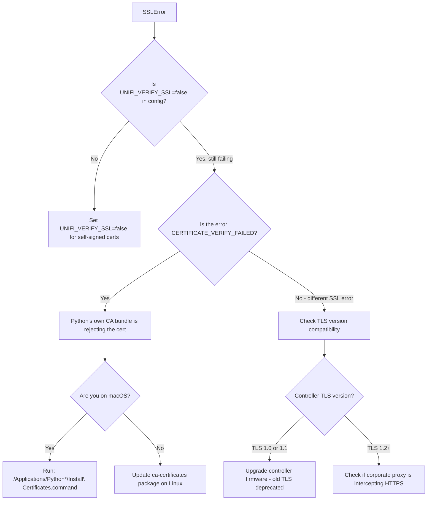

#### Root Cause

UniFi controllers ship with self-signed certificates by default. The default `UNIFI_VERIFY_SSL=false` disables certificate verification and suppresses `urllib3.exceptions.InsecureRequestWarning`. When `UNIFI_VERIFY_SSL=true`, the certificate must be signed by a CA in Python's bundle.

#### Resolution

**For self-signed/internal CA certificates (standard setup)**:

```bash
# In ~/.config/unifi_management_cli/prod.env:
UNIFI_VERIFY_SSL=false
```

**For production environments requiring verified SSL**:

```bash
# Option 1: Add your CA to the system bundle, then:
UNIFI_VERIFY_SSL=true

# Option 2: Point requests at your CA bundle:
# Not directly configurable via env; requires patching the session
# in src/unifi_mapper/api_client.py:
# self.session.verify = "/path/to/ca-bundle.pem"
```

#### Prevention

Do not set `UNIFI_VERIFY_SSL=true` unless the controller has a certificate from a trusted CA (e.g., Let's Encrypt via DDNS). The warning suppression when `verify_ssl=False` is intentional.

---

### 4. Port Name Persistence Failures

#### Symptom

Port names appear to update successfully (API returns `200`, log shows `port_overrides update successful`) but names revert to previous values or generic names (`Port 1`, `Port 2`) after a few minutes or on device reboot.

#### Diagnostic Flowchart

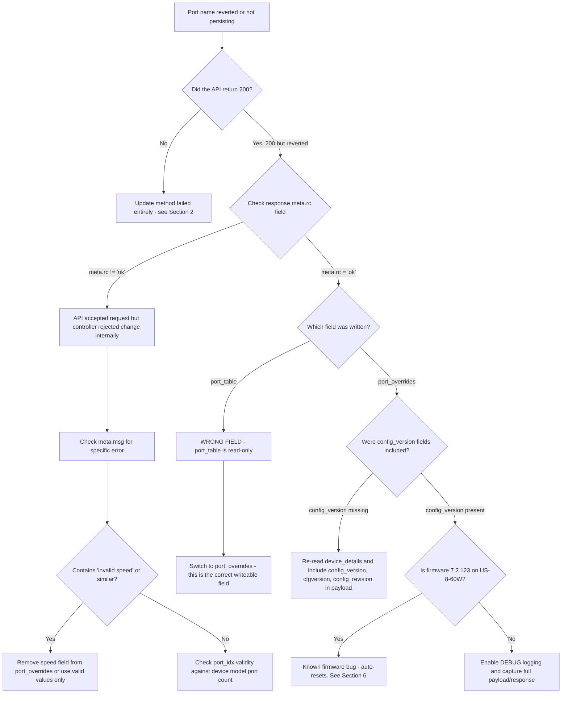

#### Root Cause: `port_table` is Read-Only

This is the most important API behaviour to understand. The UniFi API exposes two distinct fields:

| Field | Behaviour |
|-------|-----------|
| `port_table` | Read-only. Reflects current runtime state. Writing to it returns 200 but changes do not persist. |
| `port_overrides` | Writeable. Persists port configuration across reboots and device re-adoption. |

The client's `_update_port_overrides()` method is the primary update path. It reads existing `port_overrides`, merges changes, and writes back. The update payload must include device identifiers and config version fields for persistence:

```python
update_data = {
    "_id": device_details.get("_id"),
    "mac": device_details.get("mac"),
    "port_overrides": validated_overrides,
    # Critical for persistence:
    "config_version": device_details.get("config_version"),
    "cfgversion": device_details.get("cfgversion"),
    "config_revision": device_details.get("config_revision"),
}
```

Missing any of `config_version`, `cfgversion`, or `config_revision` causes the controller to silently discard the change.

#### Fallback Strategy Chain

When `_update_port_overrides()` fails, the client automatically tries:

1. `_update_device_config_with_ports()` - sends complete device config including `port_table`
2. `_update_ports_via_port_endpoint()` - tries `/rest/device/{id}/port` and `cmd/devmgr`
3. `_update_device_legacy_method()` - minimal payload with just `port_table`

**All fallbacks are less reliable than `port_overrides`.** If you are consistently reaching fallback methods, investigate why `port_overrides` is failing.

#### Valid Port Speed Values

The API rejects non-standard speed values. Valid values (from `EnhancedUnifiApiClient`):

```
10, 100, 1000, 2500, 5000, 10000, 20000, 25000, 40000, 50000, 100000
```

Zero (`0`) and any other value will be stripped from `port_overrides` before submission. If `autoneg=True` is set, the speed field is removed to allow auto-negotiation.

#### Resolution

```bash
# Step 1: Run with the root --debug flag to see the full payload (this run writes, --apply)
uv run unifi-mapper --debug --verify-updates --apply 2>&1 | grep -E "PORT OVERRIDE|API RESPONSE|config_version"

# Step 2: Check the response meta.rc - should be 'ok'
# Look for: Response meta.rc: ok

# Step 3: Preview (the default) to inspect what would be sent
uv run unifi-mapper --dry-run --verify-updates
```

#### Prevention

Always use `--verify-updates` flag when running port name updates. This triggers multi-read consistency checking (see Section 5) to confirm persistence.

---

### 5. API Cache Staleness

#### Symptom

- Port names shown as already correct before any update was applied
- Verification reports `VERIFIED` for changes that were actually not applied
- Running the tool twice gives different results for the same device state
- The ground truth report shows `inconsistent results` for a port

#### How the Cache Problem Manifests

The UniFi API serves responses from an internal cache. After writing `port_overrides`, subsequent reads may return the old value for several seconds, then the new value, then potentially the old value again if the cache layer is inconsistent. This creates false positive verification.

#### Multi-Read Consistency Checking

The `GroundTruthVerifier._multi_read_consistency_check()` method performs 5 reads with 2-second delays and cache-busting headers:

```python
self.api_client.session.headers.update({
    "Cache-Control": "no-cache, no-store, must-revalidate",
    "Pragma": "no-cache",
    "X-Requested-With": f"GroundTruthVerifier-{time.time()}",
    "X-Cache-Bust": str(int(time.time() * 1000))
})
```

A port is only marked verified when all 5 reads return the same value AND that value matches the expected name.

#### Diagnostic Flowchart

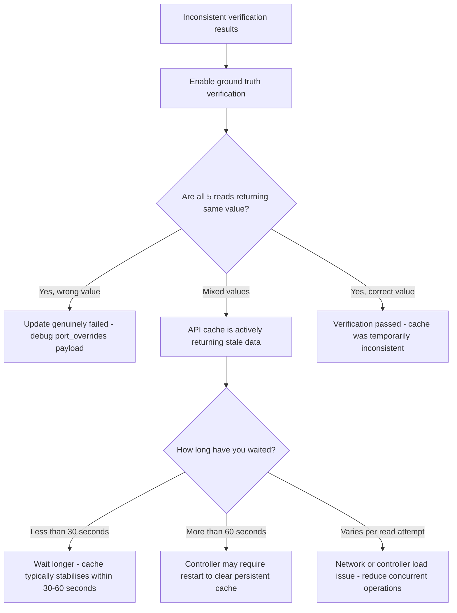

#### Resolution

```bash
# Run with full verification (triggers multi-read consistency checking)
uv run unifi-mapper --verify-updates --connected-devices --apply

# If verification is consistently failing on a specific device,
# run the advanced verification CLI:
uv run python -m unifi_mapper.verify_cli --verify-all --consistency-check
```

If the controller consistently returns stale data, a controlled restart of the UniFi Network Application (not the hardware) clears the application-level cache.

#### Prevention

Never trust a single read for verification. Always use `--verify-updates`. The LLDP-based update decision path is cache-independent: it decides what to update based on LLDP discovery data, not API-reported current state.

---

### 6. Device Compatibility Issues

#### Symptom

- Port names accepted by API but reverting within minutes
- `Skipping device: Firmware 7.2.123 automatically resets port configurations`
- `Model USW-Flex-2.5G-5 has limited port naming support`
- 2.5G speed validation failures on USW-Flex models

#### Device Compatibility Matrix

| Model Code | Display Name | Support Level | Key Issue |
|------------|-------------|---------------|-----------|
| US8P60 + fw 7.2.123 | US-8-60W | RESETS_AUTOMATICALLY | Auto-resets port profiles, device instability |
| USL8LP | USW-Lite-8-PoE | LIMITED | VLAN selection restricted, names may not persist |
| USWED35 | USW-Flex-2.5G-5 | LIMITED | Network override hidden, API may reject overrides |
| USMINI2P5G | USW-Flex-Mini-2.5G | FULL_SUPPORT | No known issues |
| Any device + fw 6.5.59 | Various | RESETS_AUTOMATICALLY | Adoption failures, SSH issues |

#### Diagnostic Flowchart

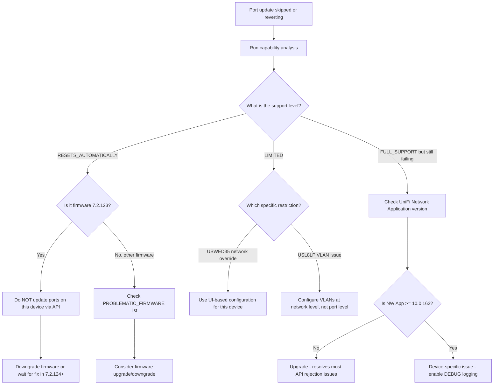

#### US-8-60W Firmware 7.2.123 Behaviour

This is the most disruptive known issue. On firmware 7.2.123:

- Port profiles automatically reset to `All` within minutes to hours of any change
- The device may enter continuous disconnection/re-adoption cycles
- Connected access points may power cycle repeatedly
- Port state transitions can cause the device to hang

The `DeviceCapabilityDetector` will set strategy to `AVOID` for this combination, and `SmartPortMapper` will log a warning and skip the device entirely.

**Resolution**:

1. Do not attempt automated port naming on US-8-60W running 7.2.123.
2. Defer the firmware upgrade; do not downgrade if the device was previously stable on an earlier version.
3. If the device is in a boot loop, factory reset and re-adopt.
4. Use the UniFi controller UI for any necessary port documentation on this device.

#### Resolution for Limited Support Devices

```bash
# Run device capability analysis to identify problem devices
uv run python -m unifi_mapper.analyze_network_capabilities

# Then target only compatible devices:
uv run unifi-mapper --dry-run 2>&1 | grep -E "Skipping|Processing|capability"
```

#### Prevention

Run the compatibility report before deploying to a new site. Upgrade the UniFi Network Application to 10.0.162 or later, which resolves most API-level rejection issues for the limited-support models.

---

### 7. Protect Integration Issues

#### Symptom

- `Failed to connect to Protect controller: ...`
- `Failed to authenticate with Protect controller: ...`
- WebSocket events not being processed
- MQTT messages not reaching Home Assistant
- AI Port cameras showing as disconnected

> [!NOTE]
> Connect with a dedicated local, view-only Protect account, not the console's admin login.
> The MCP Protect tools haven't been verified against a live console yet
> ([issue 034](../issues/034-protect-has-no-live-account.md)).

#### Connection State Machine

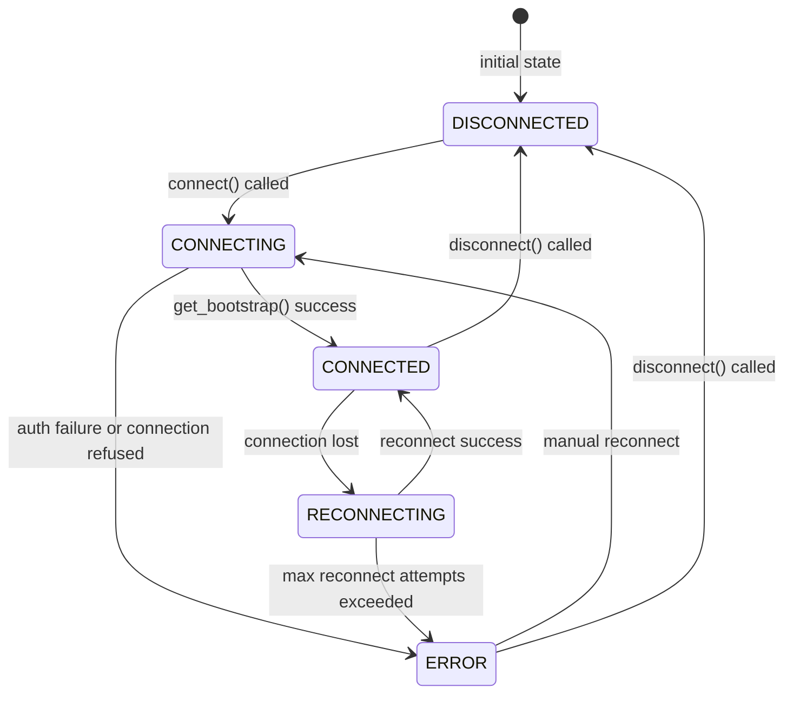

The `UniFiProtectClient.state` property exposes the current `ConnectionState` enum value. Check `client.is_connected` (only `True` when `state == CONNECTED` AND `_client is not None`) before any operation.

#### Authentication Errors

The Protect client raises `AuthenticationError` (a subclass of `ProtectClientError`) when `get_bootstrap()` fails with "unauthorized" or "authentication" in the error message. This is distinct from `UniFiAuthenticationError` in the main API client.

**Common causes**:
- `PROTECT_USERNAME` / `PROTECT_PASSWORD` belong to a Ubiquiti cloud account instead of a local user
- Multi-factor authentication is enabled on the account
- The account does not have Protect access in UniFi OS permissions

**Resolution**:

```bash
# Test Protect connectivity independently:
uv run python -c "
import asyncio
from unifi_mapper.protect import ProtectConfig, UniFiProtectClient

config = ProtectConfig(
    host='YOUR_HOST',
    username='YOUR_USER',
    password='YOUR_PASS',
    verify_ssl=False,
)
async def test():
    async with UniFiProtectClient(config) as c:
        print(f'Cameras: {len(c.cameras)}')
        print(f'AI Ports: {len(c.ai_ports)}')
asyncio.run(test())
"
```

#### WebSocket Bootstrap Refresh

If device counts are stale (cameras added to Protect but not appearing in the client), the bootstrap needs refreshing:

```python
# The client exposes a refresh() method:
await client.refresh()
```

This is a blocking async operation. In long-running processes, call `refresh()` periodically (e.g., every 5 minutes) to keep device inventory current.

#### MQTT Bridge Connectivity

**Symptom**: Home Assistant not receiving events, or device discovery messages absent.

**Diagnostic Flowchart**:

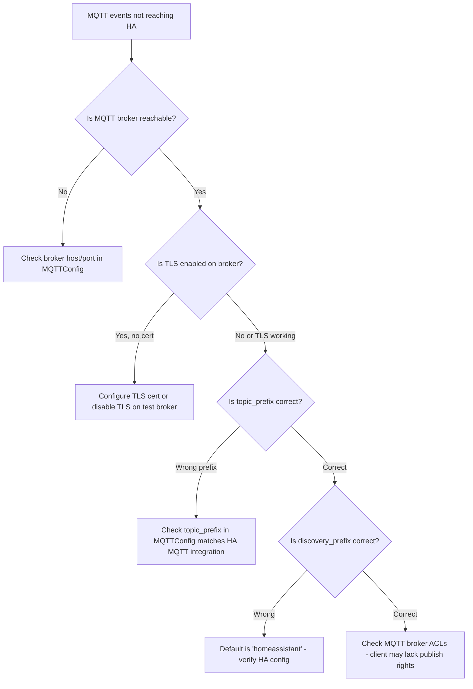

#### AI Port Pairing for Third-Party Cameras

AI Ports appear in `client.ai_ports` (from `bootstrap.aiports`). Third-party ONVIF cameras connected via AI Port appear in `client.cameras` with `is_third_party_camera=True`.

To get cameras paired with a specific AI Port:

```python
cameras = client.get_cameras_by_ai_port(ai_port_id)
```

If cameras are not pairing, verify the ONVIF camera is configured with a compatible stream URL and that the AI Port firmware is current.

#### Prevention

Run the Protect client as a persistent async service rather than a one-shot command. Short-lived connections miss WebSocket events that arrive after the bootstrap but before event subscriptions are established.

---

### 8. MCP Server Issues

#### Symptom

- The MCP client shows the `unifi` server as disconnected or lists no tools
- Tool calls return `[CONFIG_MISSING]`, `[AUTHENTICATION_FAILED]` or `[CONTROLLER_UNREACHABLE]`
- `unifi-mcp` exits immediately

#### Diagnostic Flowchart

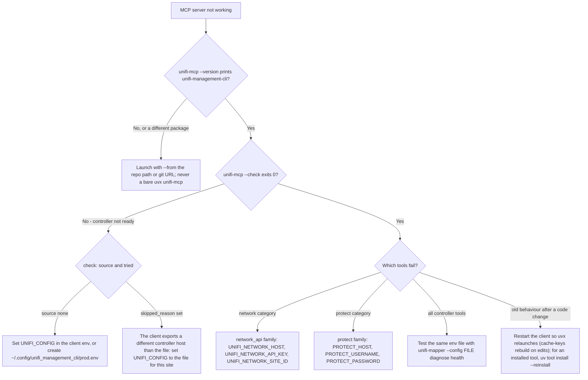

#### Client configuration

Point `UNIFI_CONFIG` at an env file instead of putting credentials in the client config:

```json
{
  "mcpServers": {
    "unifi": {
      "command": "uvx",
      "args": ["--python", "3.12", "--from", "/ABS/PATH/TO/unifi_management_cli", "unifi-mcp"],
      "env": {
        "UNIFI_CONFIG": "/Users/you/.config/unifi_management_cli/prod.env"
      }
    }
  }
}
```

GUI hosts such as Claude Desktop start with a minimal `PATH`; use the absolute path of an
installed `unifi-mcp` (`uv tool install --python 3.12 <repo>`) or `scripts/unifi-mcp-launch.sh`
as the `command`. The [MCP server guide](../mcp-server/MCP_SERVER_GUIDE.md) has the kiro-cli,
Claude Code and Codex configs.

#### Resolution

```bash
# Confirm which package runs, then where its config comes from (key names only, no values)
uvx --python 3.12 --from /ABS/PATH/TO/unifi_management_cli unifi-mcp --version
UNIFI_CONFIG=~/.config/unifi_management_cli/prod.env \
  uvx --python 3.12 --from /ABS/PATH/TO/unifi_management_cli unifi-mcp --check

# More detail on stderr while the client runs it
UNIFI_MCP_LOG_LEVEL=DEBUG  # add to the client's env block
```

The server never reads a `.env` in its working directory, so a file that works for the CLI
from the repo root is not seen by the MCP server unless `UNIFI_CONFIG` names it.

#### Prevention

Run `unifi-mcp --check` with the client's exact `env` before configuring the client, and launch
only with `--from`.

---

### 9. Performance and Timeout Issues

#### Symptom

- `Request timed out after 3 attempts: ...` (raises `UniFiTimeoutError`)
- `Connection failed after 3 attempts: ...` (raises `UniFiConnectionError`)
- Operations taking more than 30 seconds on small networks
- Verify operations hanging during multi-read consistency checks

#### Retry and Backoff Behaviour

The client implements exponential backoff for retryable errors (`UniFiRetryableError` subclasses: `UniFiConnectionError`, `UniFiTimeoutError`, `UniFiRateLimitError`). The wait before each retry is:

- Before attempt 2: `retry_delay * 2^0` (1.0s with the default delay)
- Before attempt 3: `retry_delay * 2^1` (2.0s)

There is no wait after the last attempt, so with the defaults (`max_retries=3`, `retry_delay=1.0`) a failing request spends 3 seconds backing off, plus up to three request timeouts of `UNIFI_TIMEOUT` each. `UNIFI_MAX_RETRIES` and `UNIFI_RETRY_DELAY` in the config file set the two values for every CLI client ([issue 042](../issues/042-settings-with-no-effect.md)).

`UniFiAuthenticationError` and `UniFiPermissionError` (4xx errors) are NOT retried and raise immediately.

#### Diagnostic Flowchart

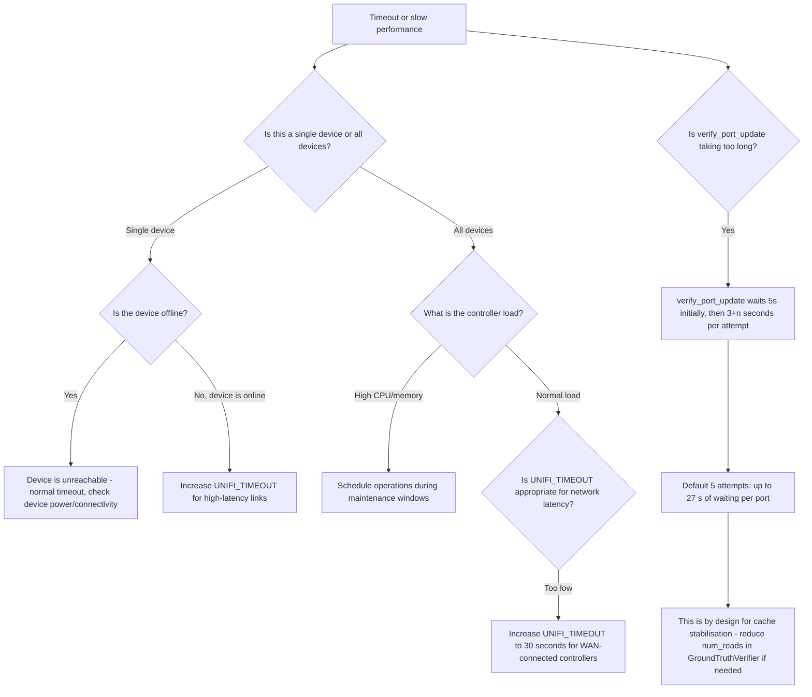

#### Tuning Parameters

Adjust this in `~/.config/unifi_management_cli/prod.env`:

```bash
# For high-latency or WAN-connected controllers (default: 10; kept within 1-300 seconds)
UNIFI_TIMEOUT=30
```

`UNIFI_MAX_RETRIES` (1-10) and `UNIFI_RETRY_DELAY` (0.1-10.0 seconds) set the attempts per
request and the first back-off for every client the CLIs build
([issue 042](../issues/042-settings-with-no-effect.md)).

#### Prevention

Test baseline latency to the controller before setting `UNIFI_TIMEOUT`. For controllers accessed over VPN or WAN, use at minimum `UNIFI_TIMEOUT=20`. The multi-read verification in `GroundTruthVerifier` intentionally adds delay; this is not a bug.

---

## Part 2: Operational Runbook

---

### 10. Daily Operations and Health Checks

#### Standard Daily Health Check Sequence

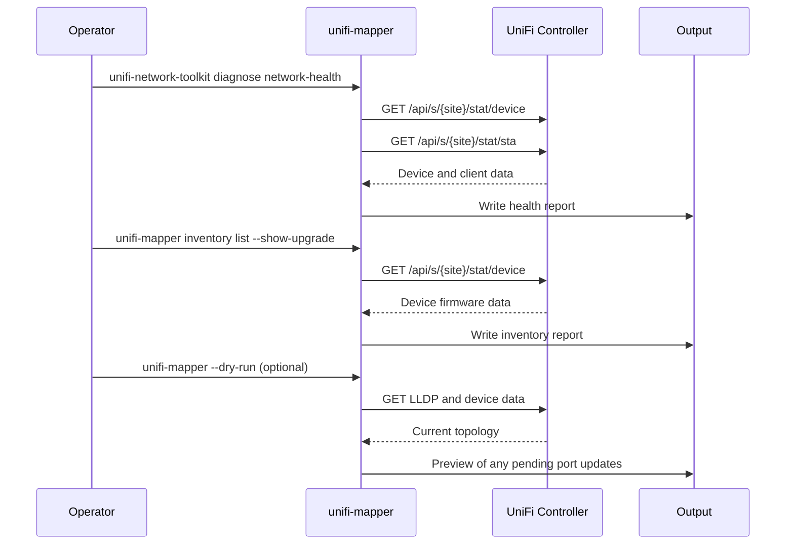

#### Daily Operations Commands

```bash
# 1. Full network health check
uv run unifi-network-toolkit diagnose network-health

# 2. Device inventory with firmware status
uv run unifi-mapper inventory list --filter switch --show-upgrade

# 3. Check for firmware updates available
uv run unifi-mapper inventory check-updates

# 4. Link quality analysis (identifies degraded interfaces)
uv run unifi-network-toolkit analyze link-quality

# 5. Dry-run port mapping to see if topology has changed
uv run unifi-mapper --dry-run --connected-devices
```

#### Interpreting Health Check Output

| Condition | What to Check |
|-----------|---------------|
| Device offline (state != "connected") | Physical connectivity, PoE power, adoption status |
| Firmware update available | Schedule update during next maintenance window |
| High error rate on interface | Check cable, SFP, or connected device |
| New devices in LLDP not in port names | Run `unifi-mapper --verify-updates --apply` to apply names |

---

### 11. Common Maintenance Tasks

#### Firmware Updates

Before updating firmware on any switch, check device compatibility:

```bash
# 1. Check current firmware versions
uv run unifi-mapper inventory list --filter switch --show-upgrade

# 2. Cross-reference against known problematic firmware versions:
#    - 7.2.123: US-8-60W auto-reset issue
#    - 6.5.59: Adoption failures on various models

# 3. After firmware update, verify port names persisted:
uv run unifi-mapper --verify-updates --connected-devices --apply
```

**Firmware update sequence**:

1. Backup current port name configuration (dry-run report)
2. Update one device at a time
3. Wait 5 minutes after device comes back online
4. Verify port names with `--verify-updates`
5. Check for any auto-resets using multi-read consistency check

#### Configuration Backup

```bash
# Generate a current topology report (port names, device connections) and an SVG diagram;
# discover previews by default, so this writes nothing to the controller
uv run unifi-mapper discover --output ~/backups/topology-$(date +%Y%m%d).md --format svg --diagram ~/backups/topology-$(date +%Y%m%d).svg

# Generate inventory snapshot (markdown)
uv run unifi-mapper inventory list --output ~/backups/inventory-$(date +%Y%m%d).md
```

#### STP Topology Management

```bash
# Analyze current STP topology
uv run unifi-mapper stp analyze

# Preview optimal priority changes and generate a reversible plan
uv run unifi-mapper stp optimize --dry-run
uv run unifi-mapper stp optimize --plan reports/stp-plan.json

# Apply after review during a maintenance window (stp apply previews unless --no-dry-run,
# then asks for confirmation unless --force)
uv run unifi-mapper stp apply --plan reports/stp-plan.json --no-dry-run

# Roll back the same bundle if post-checks fail (also previews unless --no-dry-run)
uv run unifi-mapper stp rollback reports/stp-plan.json --no-dry-run

# Validate root, path costs, Root Guard recommendations, and 10G readiness
uv run unifi-mapper stp validate-10g --planned-switches 2
uv run unifi-mapper stp guard

# Generate report for documentation
uv run unifi-mapper stp report -o stp-report-$(date +%Y%m%d).md
```

**Maintenance-window checklist**:

1. Capture baseline: `uv run unifi-mapper stp snapshot --output reports/stp-baseline.json`
2. Run preflight: `uv run unifi-mapper stp preflight --simulate-add USW-Flex-XG:2 --uplink "Edge USW Flex XG 10G"`
3. Generate plan: `uv run unifi-mapper stp optimize --plan reports/stp-plan.json`
4. Confirm the expected root in the plan is the gateway-connected core switch.
5. Apply plan: `uv run unifi-mapper stp apply --plan reports/stp-plan.json --no-dry-run`
   (without `--no-dry-run` it only previews)
6. Verify: `stp analyze`, `stp validate-10g`, `stp guard`, and `stp diff reports/stp-baseline.json`
7. Roll back if the wrong root is elected, uplinks block unexpectedly, or critical path-cost/counter findings appear.

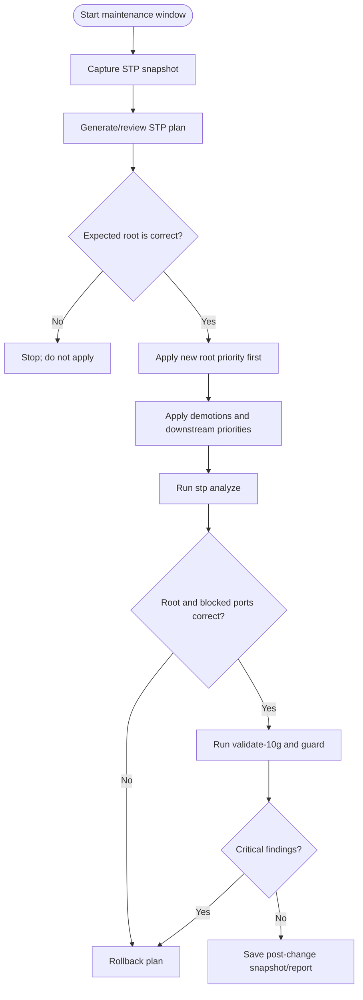

#### Port Naming Verification

```bash
uv run unifi-mapper discover \
  --connected-devices \
  --verify-updates \
  --apply \
  --output reports/port-naming-verify-$(date +%Y%m%d).md \
  --diagram reports/topology-port-naming-verify-$(date +%Y%m%d).svg \
  --format svg
```

This one writes (`--apply`); without it the same command previews.

Success means all attempted updates verify cleanly after repeated reads. If a device repeatedly fails verification, treat it as a model/firmware behaviour problem rather than assuming the CLI payload is wrong.

#### Read-Only Network Safety Audits

```bash
# Port profile safety: STP Edge and BPDU Guard
uv run unifi-mapper analyze port-profiles

# VLAN trunk coverage for planned uplinks
uv run unifi-mapper analyze vlan-coverage --required-vlans 1,10,20,30

# Inter-VLAN routing/firewall verdict between endpoints
uv run unifi-mapper diagnose inter-vlan 203.0.113.10 198.51.100.11

# SFP module diagnostics if exposed by UniFi
uv run unifi-mapper analyze sfp

# Wi-Fi radio channel/power review
uv run unifi-mapper analyze radio

# Traffic evidence for 10G placement
uv run unifi-mapper analyze traffic-matrix --top 10
```

#### Rotating API Credentials

```bash
# 1. Generate new API token in UniFi OS:
#    Settings > Control Plane > API Tokens > Create Token

# 2. Update config file
vim ~/.config/unifi_management_cli/prod.env
# Change: UNIFI_CONSOLE_API_TOKEN=new_token_here

# 3. Verify new token works (a discover preview: reads only)
uv run unifi-mapper --dry-run

# 4. The MCP server reads the same env file (the one UNIFI_CONFIG names in the client's env).
#    Check it, then restart or reconnect the client: a running server keeps the old token
#    until it restarts (issue 020)
uvx --python 3.12 --from /ABS/PATH/TO/unifi_management_cli unifi-mcp --check
```

---

### 12. Incident Response Procedures

#### Incident: Controller Unreachable

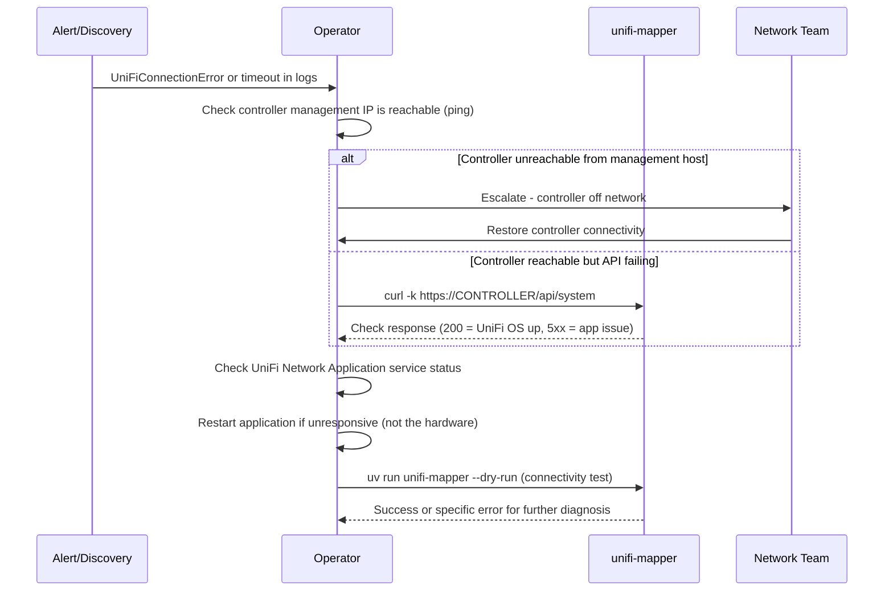

**Immediate actions**:

```bash
# Test basic connectivity
curl -k -o /dev/null -s -w "%{http_code}" https://YOUR_CONTROLLER/api/system

# Test authentication
curl -k -H "X-API-KEY: YOUR_TOKEN" https://YOUR_CONTROLLER/proxy/network/api/s/default/self

# Test with CLI (root --debug for DEBUG logs)
uv run unifi-mapper --debug --dry-run 2>&1 | head -50
```

#### Incident: Intermittent Ping After 10G or STP Change

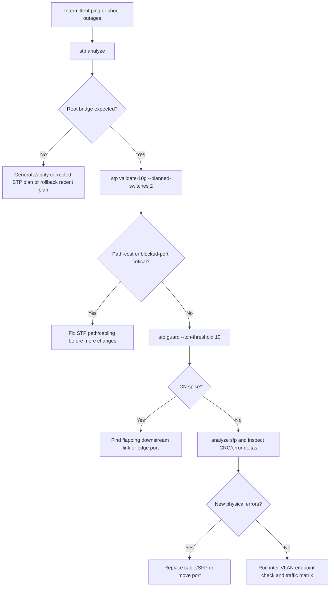

Commands:

```bash
uv run unifi-mapper stp analyze
uv run unifi-mapper stp validate-10g --planned-switches 2 --output reports/stp-10g-incident.md
uv run unifi-mapper stp guard --tcn-threshold 10
uv run unifi-mapper analyze sfp
uv run unifi-mapper diagnose inter-vlan SOURCE_ENDPOINT DESTINATION_ENDPOINT
```

Decision points:

- Wrong root bridge: fix STP priority before chasing packet loss elsewhere.
- Blocked uplink or legacy 10G path cost: treat as a topology/control-plane issue.
- TCN spike: look for a flapping access link, edge profile receiving BPDUs, or a downstream switch trying to influence root.
- New CRC/error increments: treat as cable/SFP/PHY evidence. Drops-only counters are weaker evidence and should be compared against a baseline.

#### Incident: STP Drift Against Intent

Use this when firmware upgrades, manual UI edits, or emergency changes may have altered bridge priorities.

```bash
uv run unifi-mapper stp drift --intent stp_intent.yaml
```

If drift is detected:

1. Confirm whether the drift was intentional.
2. If intentional, update `stp_intent.yaml`.
3. If unintentional, generate a fresh change plan and apply in a maintenance window.

#### Incident: Failed Or Partial STP Apply

The change-plan path stores both forward changes and rollback changes. If an apply fails midway, do not manually guess the missing state from memory.

```bash
# Check current live state
uv run unifi-mapper stp analyze

# Revert using the recorded rollback bundle (previews unless --no-dry-run)
uv run unifi-mapper stp rollback reports/stp-plan.json --no-dry-run

# Verify after rollback
uv run unifi-mapper stp analyze
uv run unifi-mapper stp diff reports/stp-baseline.json
```

If the rollback also fails, stop automated changes and use the UniFi UI/API to inspect the specific device named in the failed result. Keep the JSON plan and CLI output with the incident notes.

#### Incident: Device Goes Offline or Stops Responding

```bash
# Locate device by name or IP
uv run unifi-network-toolkit find device "DeviceName"
uv run unifi-network-toolkit find ip 192.0.2.x

# Check port connectivity to uplink device
uv run unifi-network-toolkit analyze link-quality

# Find the switch port a client MAC is on (the MCP client_trace tool gives the full
# path from the client to the uplink)
uv run unifi-network-toolkit find mac 02:00:00:00:00:01
```

#### Incident: Mass Port Name Reversion

This indicates either a firmware issue (see Section 6) or a controller-level config push that overwrote port overrides.

**Response**:

```bash
# 1. Identify affected devices: a preview (no --apply) reports the port names it would
#    write, and writes nothing to the controller
uv run unifi-mapper --verify-updates --connected-devices 2>&1 | tee reports/reversion-preview.txt

# 2. Check if firmware version changed on affected devices
uv run unifi-mapper inventory list --filter switch

# 3. If firmware 7.2.123 is detected on US-8-60W, stop and do not re-apply
#    (see Section 6 - auto-reset behaviour)

# 4. For other devices, re-apply port names
uv run unifi-mapper --verify-updates --connected-devices --apply

# 5. Confirm with ground truth verification
uv run python -m unifi_mapper.verify_cli --verify-all --consistency-check
```

#### Incident: Authentication Token Compromised

```bash
# 1. Immediately revoke compromised token in UniFi OS
#    Settings > Control Plane > API Tokens > Revoke Token

# 2. Generate new token

# 3. Update all config files: edit UNIFI_CONSOLE_API_TOKEN in the env file with an editor,
#    so the token never lands in shell history
vim ~/.config/unifi_management_cli/prod.env

# 4. The MCP server reads the same env file: restart or reconnect every MCP client that
#    runs unifi-mcp, since a running server keeps the old token (issue 020), then check
uvx --python 3.12 --from /ABS/PATH/TO/unifi_management_cli unifi-mcp --check

# 5. Verify access is restored (a discover preview: reads only)
uv run unifi-mapper --dry-run

# 6. Audit recent API activity in UniFi controller logs for
#    unauthorized operations using the old token
```

---

### 13. Recovery Procedures

#### Rolling Back Port Name Changes

There is no built-in undo command. Recovery options in order of preference:

**Option 1: Re-apply from LLDP** (recommended - accurate, automatic)

```bash
# LLDP-based naming uses actual network topology, not stored state
# Simply re-run the mapper - it will re-derive names from LLDP discovery
uv run unifi-mapper --verify-updates --connected-devices --apply
```

**Option 2: Manual UI reset**

1. Open UniFi Network Application
2. Navigate to Devices > select device > Ports tab
3. Click the port and clear the name field
4. Click Apply

**Option 3: API reset via curl**

`port_overrides` is the device's whole list: a `PUT` replaces it, so a body that carries only
one port drops every other port's overrides (names, profiles, PoE and speed settings). Read
the device's current list first (`GET .../rest/device/DEVICE_ID`, see section 18;
`unifi-mapper ports diagnose SWITCH PORT` shows this port's entry), and send every entry back
with only this port's name changed:

```bash
# Set a port back to its default name via API; PORT_OVERRIDES_WITH_THIS_NAME_RESET stands for
# the device's full port_overrides list with one name edited
curl -k -X PUT \
  -H "X-API-KEY: YOUR_TOKEN" \
  -H "Content-Type: application/json" \
  -d '{
    "_id": "DEVICE_ID",
    "mac": "DEVICE_MAC",
    "port_overrides": PORT_OVERRIDES_WITH_THIS_NAME_RESET
  }' \
  https://YOUR_CONTROLLER/proxy/network/api/s/default/rest/device/DEVICE_ID
```

#### Re-authentication After Session Expiry

The client handles re-authentication automatically on 401/403 within API calls. However, if a long-running process (such as the Protect client) loses its session, the async client must reconnect manually:

```python
# In Python code:
if not client.is_connected:
    await client.connect()

# Or use the context manager which handles lifecycle automatically:
async with UniFiProtectClient(config) as client:
    # Session managed automatically
    pass
```

For CLI tools, simply re-run the command. The `UnifiApiClient` re-authenticates as part of `get_devices()` and similar calls if `is_authenticated` is `False`.

#### Recovering from Corrupt `port_overrides`

If a device has invalid `port_overrides` (e.g., from a partial write), the device may show unexpected port configurations.

> [!CAUTION]
> **Last resort, not a troubleshooting step.** A device's `port_overrides` hold every per-port
> setting that differs from the profile: names, port profiles, PoE mode, speed and duplex,
> isolation, storm control. Clearing the list resets all of them on that switch at once, and the
> controller force-provisions the switch, so links can drop. Nothing in this toolkit does this;
> it is a raw API write you run yourself. Before it: take a controller backup (Settings > System
> > Backups, and keep the `.unf`), note the current overrides (`ports list "SWITCH" --json`), and
> make sure you can reach the switch out of band. Prefer fixing the one broken port in the UniFi
> UI (Ports > the port > Reset to profile) and leave the rest alone.

**Diagnose first (read-only):**

```bash
# Every port's settings, then one port's raw port_table entry, its port_overrides entry and
# profiles, as a JSON evidence bundle you can keep
uv run unifi-mapper ports list "SWITCH" --json > switch-overrides-before.json
uv run unifi-mapper ports diagnose "SWITCH" PORT
```

**Only if a single-port reset in the UI does not clear it**, and only with a backup taken:

```bash
# Clear ALL port_overrides on one device (reset every port to its profile defaults)
curl -k -X PUT \
  -H "X-API-KEY: YOUR_TOKEN" \
  -H "Content-Type: application/json" \
  -d '{"_id": "DEVICE_ID", "mac": "DEVICE_MAC", "port_overrides": []}' \
  https://YOUR_CONTROLLER/proxy/network/api/s/default/rest/device/DEVICE_ID

# Then preview the LLDP-derived names, and write them only once the preview looks right
uv run unifi-mapper discover --verify-updates
uv run unifi-mapper discover --verify-updates --apply
```

---

### 14. Monitoring and Alerting Thresholds

#### What to Monitor

| Metric | Normal | Warning | Critical | Action |
|--------|--------|---------|----------|--------|
| API response time | < 2s | 2-5s | > 5s | Increase `UNIFI_TIMEOUT`, check controller load |
| Auth failure rate | 0 | 1-2 per day | > 5 per day | Rotate credentials, check for token expiry |
| Port verification failures | 0 | 1-5% | > 10% | Investigate API cache, check firmware |
| Devices offline | 0 | 1-2 | > 3 | Physical check, escalate to network team |
| Controller unreachable | 0 | 1 per week | > 2 per week | Stability issue, engage Ubiquiti support |

#### Log-Based Alerting

Key log patterns to alert on:

```
# Authentication failure (check credentials immediately)
"Authentication failed - all methods exhausted"

# Persistent port change failures (configuration drift)
"Port .* name verification failed after .* attempts"

# API consistently returning stale data
"inconsistent results"

# Device capability issue requiring human intervention
"automatically resets port configurations"

# Connectivity complete failure
"Connection failed after .* attempts"
```

#### Health Check Script

```bash
#!/usr/bin/env bash
# Save as: ~/bin/unifi-health-check.sh

set -euo pipefail

LOGFILE="/var/log/unifi-health-$(date +%Y%m%d).log"

echo "=== UniFi Health Check $(date) ===" | tee -a "$LOGFILE"

# Basic connectivity
if uv run unifi-mapper --dry-run >> "$LOGFILE" 2>&1; then
    echo "OK: Controller reachable and authenticated" | tee -a "$LOGFILE"
else
    echo "CRITICAL: Controller unreachable or authentication failed" | tee -a "$LOGFILE"
    # Send alert here
fi

# Device health
uv run unifi-network-toolkit diagnose network-health >> "$LOGFILE" 2>&1

echo "=== Health check complete ===" | tee -a "$LOGFILE"
```

---

## Part 3: Quick Reference

---

### 15. Common Error Messages

| Error Message | Exception Class | Retried? | Likely Cause |
|---------------|----------------|----------|--------------|
| `Authentication failed - all methods exhausted` | `UniFiAuthenticationError` | No | Wrong credentials, expired token |
| `Authentication failed: 401 Client Error` | `UniFiAuthenticationError` | No | Invalid token or password |
| `Authentication failed: 403 Client Error` | `UniFiAuthenticationError` | No | Valid credentials but insufficient permissions |
| `API token authentication selected but no token provided` | `UniFiValidationError` | No | `UNIFI_CONSOLE_API_TOKEN` is empty |
| `Username/password authentication selected but credentials missing` | `UniFiValidationError` | No | `UNIFI_USERNAME` or `UNIFI_PASSWORD` missing |
| `Request timed out after N attempts: ...` | `UniFiTimeoutError` | Yes (N times) | Controller slow, network latency high |
| `Connection failed after N attempts: ...` | `UniFiConnectionError` | Yes (N times) | Controller unreachable, firewall blocking |
| `SSL error: [SSL: CERTIFICATE_VERIFY_FAILED]` | `UniFiConnectionError` | No | `UNIFI_VERIFY_SSL=true` but cert not trusted |
| `Client error: 400 ...` | `UniFiPermissionError` | No | Invalid request payload (check port_idx, speed) |
| `Client error: 404 ...` | `UniFiPermissionError` | No | Wrong API endpoint for controller type |
| `UNIFI_URL environment variable required` | `ValueError` | N/A | Config file not found or `UNIFI_URL` missing |
| `base_url must start with http:// or https://` | `ValueError` | N/A | `UNIFI_URL` format invalid |
| `Either api_token or username+password required` | `ValueError` | N/A | No authentication credentials configured |
| `Port N name verification failed after N attempts` | (log error) | N/A | Port update did not persist; API cache issue or firmware bug |
| `port_overrides update failed: 400 ...` | (log warning) | No | Invalid `port_overrides` payload; check speed values |
| `Failed to authenticate with Protect controller` | `AuthenticationError` | No | Protect credentials invalid or account lacks Protect access |
| `Failed to connect to Protect controller` | `ConnectionError` | No | Protect host unreachable or port blocked |
| `Not connected to Protect controller` | `ConnectionError` | No | Called `refresh()` or data access before `connect()` |

---

### 16. Environment Variable Reference

| Variable | Required | Default | Valid Values | Description |
|----------|----------|---------|--------------|-------------|
| `UNIFI_URL` | Yes | None | `https://host:port` | Controller URL. Must include `http://` or `https://` scheme. |
| `UNIFI_SITE` | No | `default` | Alphanumeric string | Site name. Strip to alphanumeric and `-_` only. |
| `UNIFI_CONSOLE_API_TOKEN` | One of these two methods | None | String | API token from UniFi OS. Takes precedence over username/password. |
| `UNIFI_USERNAME` | One of these two methods | None | String | Admin username for username/password auth. |
| `UNIFI_PASSWORD` | One of these two methods | None | String | Admin password. |
| `UNIFI_VERIFY_SSL` | No | `false` | `true` / `false` | Enable SSL certificate verification. Set `false` for self-signed certs. |
| `UNIFI_TIMEOUT` | No | `10` | `1`-`300` (seconds) | Per-request connection timeout. Clamped to 1-300. |
| `UNIFI_MAX_RETRIES` | No | `3` | `1`-`10` | Attempts per request, for every client the CLIs build ([issue 042](../issues/042-settings-with-no-effect.md)). |
| `UNIFI_RETRY_DELAY` | No | `1.0` | `0.1`-`10.0` (seconds) | First back-off; each later retry doubles it (issue 042). |
| `UNIFI_DEFAULT_FORMAT` | No | `png` | `png`, `svg`, `html`, `mermaid`, `dot` | `discover`'s diagram format when `--format` is not given (issue 042). |
| `UNIFI_OUTPUT_DIR` | No | `./reports` | Directory path (`~` expanded) | Where `discover` writes `port_mapping_report.md` when `--output` is not given (issue 042). |
| `UNIFI_DIAGRAM_DIR` | No | `./diagrams` | Directory path (`~` expanded) | Where `discover` writes `network_diagram.<format>` when `--diagram` is not given (issue 042). |
| `UNIFI_CONFIG` | No | XDG search | File path | The env file to read, like `--config` (see section 1). |
| `UNIFI_SSH_PASSWORD` | For SSH commands | None | String | Gateway SSH password for `diagnose latency-matrix`, `diagnose bandwidth`, `diagnose client-connectivity`, `diagnose ap-health --ping-clients`, `vlan-traffic sample` and the `gateway` probes (see section 2). |
| `UNIFI_SSH_USERNAME` | No | `root` | String | Gateway SSH user. |
| `UNIFI_STP_OVERRIDES` | No | `~/.config/unifi_management_cli/stp_overrides.yaml` | File path | Root-eligible and forced-access switch MACs for the STP optimiser. |
| `UNIFI_RADIO_CHANNEL_MOVES` | No | None | `NAME=FROM>TO`, comma-separated | 5 GHz channel moves for `radio optimize`: an AP whose name contains `NAME` and sits on channel `FROM` is moved to `TO`. Unset means no moves; a malformed entry exits 2. |
| `UNIFI_LOCATION_KEYWORDS` | No | None | Words, comma-separated | Extra location words for the topology report and HTML diagram, matched against device names after the built-in room words. |
| `XDG_CONFIG_HOME` | No | `~/.config` | Directory path | Overrides XDG config base directory. |
| `XDG_STATE_HOME` | No | `~/.local/state` | Absolute directory path (a relative one is ignored, as the XDG spec says) | Base of `unifi_mapper/`, where the link-error baselines, the counter and speedtest histories, the MCP call log and the VLAN traffic store live. |

The `network_api` family (`UNIFI_NETWORK_HOST`, `UNIFI_NETWORK_API_KEY` and
`UNIFI_NETWORK_SITE_ID`, all three required) and the MCP server's `UNIFI_MCP_*` settings are
listed in `.env.example` and the [MCP server guide](../mcp-server/MCP_SERVER_GUIDE.md).

**Protect-specific variables** (used by `ProtectConfig` and MCP server):

| Variable | Required for Protect | Default | Description |
|----------|---------------------|---------|-------------|
| `PROTECT_HOST` | Yes | None | IP or hostname of UniFi Protect controller |
| `PROTECT_USERNAME` | Yes | None | A dedicated local, view-only Protect user (not a Ubiquiti cloud account) |
| `PROTECT_PASSWORD` | Yes | None | That user's password |
| `PROTECT_VERIFY_SSL` | No | `false` | SSL verification for Protect connection |
| `PROTECT_CAMERA_HOSTS` | No | None (every camera) | Host prefixes, comma-separated, of the cameras the Protect monitor follows; third-party cameras are always followed. `--camera-host` overrides it. |

---

### 17. CLI Flag Reference

#### `unifi-mapper`

Root options (before any subcommand):

| Flag | Description | Default |
|------|-------------|---------|
| `--config PATH`, `-c` | Path to the `.env` config file; also read from `UNIFI_CONFIG` | XDG search (section 1) |
| `--debug` | DEBUG logging for this run | Off |
| `--dry-run` | Runs `discover` as a preview, its default anyway; exits 2 before a subcommand other than `discover` | Off |
| `--apply` | On its own, runs `discover` and writes port names; before any subcommand it exits 2 | Off |
| `--connected-devices` | Runs `discover` including non-UniFi connected devices; exits 2 before a subcommand other than `discover` | Off |
| `--verify-updates` | Runs `discover` with the smart mapper and multi-read verification; exits 2 before a subcommand other than `discover` | Off |

`discover` options (after the subcommand):

| Flag | Description | Default |
|------|-------------|---------|
| `--apply` / `--dry-run` | Write port names to the controller; `--dry-run` previews | Preview |
| `--connected-devices` | Include non-UniFi connected devices | Off |
| `--verify-updates` | Verify that port name updates persist | Off |
| `--format FORMAT` | Diagram format: `png`, `svg`, `html`, `mermaid`, `dot`. `png` and `svg` need Graphviz's `dot` program (`brew install graphviz`); `html`, `mermaid` (bare Mermaid source) and `dot` (the Graphviz source) need none | `png` |
| `--output PATH`, `-o` | Markdown report path | `./reports/port_mapping_report.md` |
| `--diagram PATH`, `-d` | Diagram path | `./diagrams/network_diagram.<format>` |

**Subcommands** (a selection; the README's Command Reference lists every one):

| Subcommand | Description |
|-----------|-------------|
| `unifi-mapper stp analyze` | Analyse current STP topology |
| `unifi-mapper stp optimize --dry-run` | Preview optimal STP bridge priorities |
| `unifi-mapper stp optimize --apply` | Apply STP optimisation |
| `unifi-mapper stp report -o FILE` | Generate STP markdown report |
| `unifi-mapper ports refresh` | Preview port labels from LLDP and wired clients (`--apply` writes) |
| `unifi-mapper inventory list` | List devices with optional filters |
| `unifi-mapper inventory check-updates` | Check for available firmware updates |
| `unifi-mapper install-completions SHELL` | Install the manual completion scripts (`bash`, `zsh` or `all`; fish: `--install-completion`) |

#### `unifi-network-toolkit`

Root options: `--config PATH` (default `~/.config/unifi_management_cli/prod.env`) and
`--debug`, before the subcommand.

| Subcommand | Description |
|-----------|-------------|
| `discover` | Topology discovery and port naming; writes port names unless `--dry-run` is given ([issue 015](../issues/015-other-discover-entry-points-write-by-default.md)) |
| `analyze link-quality` | Interface error and drop rate analysis (`--device`, `--port`) |
| `analyze capacity-planning` | Ports above a utilisation threshold (`--threshold`, default 80) |
| `analyze vlan` | VLAN diagnostics (`--vlan-id`) |
| `analyze mac` | MAC address table analysis (`--device`) |
| `diagnose network-health` | Overall infrastructure health check (`--detailed`) |
| `diagnose performance` | Bottleneck and performance analysis (`--device`) |
| `find device QUERY` | Locate a device by name, IP or MAC |
| `find ip ADDRESS` | Locate the device and port for an IP address |
| `find mac ADDRESS` | Locate a device by MAC address |
| `install-completions SHELL` | Install completions (`bash`, `zsh` or `both`) |

For an end-to-end client path, use the MCP `client_trace` tool.

---

### 18. API Endpoint Reference

The correct endpoint depends on whether the controller is UniFi OS (UDM, UDM Pro, CloudKey Gen2+) or legacy (CloudKey Gen1, self-hosted Java app).

**UniFi OS detection**: `GET /api/system` returns `200` on UniFi OS devices.

| Operation | UniFi OS Endpoint | Legacy Endpoint |
|-----------|------------------|-----------------|
| Authenticate | `POST /api/auth/login` | `POST /api/login` |
| Logout | `POST /api/auth/logout` | `POST /api/logout` |
| Get all devices | `GET /proxy/network/api/s/{site}/stat/device` | `GET /api/s/{site}/stat/device` |
| Get device by ID | `GET /proxy/network/api/s/{site}/stat/device/{id}` | `GET /api/s/{site}/stat/device/{id}` |
| Get device (writable) | `GET /proxy/network/api/s/{site}/rest/device/{id}` | `GET /api/s/{site}/rest/device/{id}` |
| Update device (port_overrides) | `PUT /proxy/network/api/s/{site}/rest/device/{id}` | `PUT /api/s/{site}/rest/device/{id}` |
| Get clients | `GET /proxy/network/api/s/{site}/stat/sta` | `GET /api/s/{site}/stat/sta` |
| Device manager commands | `POST /proxy/network/api/s/{site}/cmd/devmgr` | `POST /api/s/{site}/cmd/devmgr` |
| Verify self/token | `GET /proxy/network/api/s/{site}/self` | `GET /api/s/{site}/self` |

**Request headers**:

```
X-API-KEY: <token>           # Preferred token auth header
Authorization: Bearer <token> # Fallback token auth header
Content-Type: application/json
Accept: application/json
User-Agent: UnifiPortMapper/1.0
```

**Response envelope**: All endpoints return:

```json
{
  "meta": {
    "rc": "ok",
    "msg": ""
  },
  "data": [...]
}
```

`meta.rc` must equal `"ok"` for the operation to have succeeded. A `200` HTTP status with `meta.rc != "ok"` indicates the controller accepted the request but rejected the operation internally. The message in `meta.msg` contains the specific rejection reason.

---

*For issues not covered here, run the CLI with the root `--debug` flag (or set `UNIFI_MCP_LOG_LEVEL=DEBUG` in the MCP client's env) and review the output. The codebase comments in `api_client.py` (`_update_port_overrides`) contain inline debug logging that captures the full request payload and response for persistence issues.*
